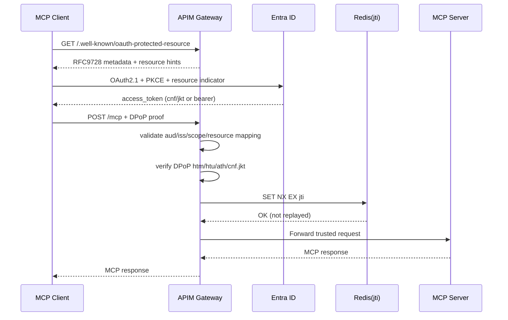

# 企业 Remote MCP OAuth 2.1 授权与发送方约束令牌治理选型 FAQ：APIM+Entra 翻译层 vs DCR 代理 vs mTLS/联邦授权服务器

> 🌐 **Language Switch**：**中文（当前）** | [English](./mcp-oauth21-authorization-rfc9728-rfc8707-cimd-dpop-apim-entra-id-vs-dcr-proxy-vs-mtls-federated-as-selection-faq.en.md)
> **受众**：Cloud & AI Solution Architect、企业身份安全团队、API 网关平台团队、MCP 工具治理负责人、审计与合规团队。
> **范围**：围绕 RFC 9728 / RFC 8707 / CIMD / RFC 9449 DPoP 在 Azure API Management 与 Microsoft Entra ID 组合中的生产落地，比较 A/B/C/D 四类架构，解决受众绑定、Confused-Deputy 重放、客户端注册失控与跨组织联邦授权。

## 1. 问题定义：为什么企业 MCP 授权在“协议兼容”与“安全边界”上同时失血
企业在引入 Remote MCP 后，通常会遇到一个现实矛盾：客户端生态越来越偏向 OAuth 2.1 与资源指示符标准，而企业身份底座长期依赖 Entra v2 的 `api://<app-id>/<scope>` 语义，两边都正确却无法直接互通。结果是要么在客户端硬编码租户特例，要么在网关放宽验证条件，最终都让治理复杂度和攻击面同步上升。
当多个 MCP 服务器共享同一身份平面而没有严格 `aud` 隔离时，最常见风险是 Confused-Deputy：原本签发给 MCP-A 的 token 被 MCP-B 接受，跨域复用成功后会绕过最小权限边界。很多团队在 PoC 阶段看不到该问题，因为单服务器流量小且路径固定，但在生产多工具编排中该风险会按服务器数和调用路径组合数放大。
同时，客户端注册治理也容易失控：若允许无约束 DCR，企业目录会被大量短命 app object 冲刷；若完全禁用动态注册，IDE/Agent 客户端上线效率又会急剧下降。因此企业级目标不是“选一个协议特性”，而是构建可演进的授权控制面，使兼容性、安全性和运营效率在同一架构内平衡。

## 2. 四类架构路径与职责边界（A/B/C/D）
**Architecture A**：`APIM` OAuth 2.1 发现与受众翻译门面（`RFC 9728` 受保护资源元数据 + `RFC 8707 resource` 到 Entra scope 映射），并执行每个 MCP 服务器独立 `aud` 钉扎。**Architecture B**：客户端注册治理（CIMD allowlist、APIM 代理 DCR、预注册企业应用目录）三路并行，目标是在可用性和目录卫生之间取得工程化平衡。
**Architecture C**：发送方约束令牌（DPoP + `jti` 防重放缓存）与 mTLS 证书绑定并行方案，重点解决 bearer token 泄露后重放。**Architecture D**：独立 OAuth 2.1 授权服务器 Broker（Keycloak/Ory/Duende）上游联邦 Entra，适用于外部 B2B 生态和主权隔离需求。
在生产角色分工上，A 负责协议互操作与受众边界，B 负责客户端生命周期治理，C 负责调用层 PoP 防护，D 负责跨组织和跨信任域扩展。高复杂度企业通常采用 A+C 为默认底座，再按外部生态规模引入 B 与 D。

## 3. Architecture A：APIM OAuth 2.1 发现与受众翻译门面
A 路径的关键是让标准 MCP 客户端看到规范化发现端点，同时由 APIM 在后端完成 Entra 语义翻译并保持强约束验证。客户端继续发送 `resource=<mcp-server-uri>`，网关把资源语义映射到目标 `api://.../<scope>`，避免把 Entra 特定格式泄露到所有客户端实现里。
在请求进入 MCP 业务后端前，APIM 必须执行严格 `aud` 钉扎和 issuer 校验，并按服务器 ID 进行策略分段，防止“一套 token 走遍所有 MCP”。实践中建议每个 MCP 服务使用独立 audience 名称空间和独立策略片段，以降低配置漂移导致的横向放大风险。
A 路径的工程价值在于把“协议兼容成本”集中到网关层统一治理，客户端和后端都保持相对稳定。对多语言 IDE/Agent 生态，这种集中翻译通常能显著减少版本分叉和接入回归成本。

## 4. Architecture B：CIMD、DCR 代理与预注册目录的注册治理
B 路径解决“谁可以拿到 `client_id`”这一根问题，而不只是“拿到后如何授权”。CIMD allowlist 适合把客户端发布域名、签名信息与企业白名单绑定，防止非受信客户端伪装成工具调用端。
APIM 代理 DCR 的价值在于可把 RFC 7591 动态注册收敛到受控入口，加入速率限制、命名规范、生命周期 TTL 与管理员审批钩子，从而避免目录被脚本化灌入。对高安全组织，预注册企业应用目录依旧是主路径，但可与 DCR 代理混合使用，把“标准客户端快速试点”限定在低风险沙箱租户。
该路径的核心不是禁用动态注册，而是把动态能力纳入可审计流程。推荐将 `client_last_seen`、`consent_scope_set`、`rotation_age` 纳入周度治理报表，及时清理沉睡客户端并缩小攻击面。

## 5. Architecture C：DPoP 与 mTLS 的发送方约束令牌治理
C 路径针对的是 token 泄露后的重放窗口，尤其是 agent memory、日志误采集、浏览器插件泄露等场景。DPoP 通过每次请求携带签名证明把 token 与调用者私钥绑定，并使用 `jti` + 短时有效期阻断重放。
在 APIM 边缘验证 DPoP 时，推荐对 `htm`、`htu`、`ath`、`cnf.jkt` 全字段校验，并用 `Managed Redis SET NX EX` 存储 `jti` 防止二次使用。若企业已具备成熟双向证书体系，可对高价值通道叠加 mTLS 证书绑定 token，形成“应用层签名 + 传输层证书”双重约束。
相较纯 bearer 模式，C 路径会带来有限验证开销，但在高风险工具调用中通常是必要成本。建议把 DPoP 作为默认策略，mTLS 作为高信任域和服务间链路的增强策略。

## 6. Architecture D：独立 OAuth 2.1 授权服务器 Broker 联邦 Entra
D 路径面向外部合作伙伴、跨组织工具市场或主权隔离场景，在企业边界内运行完整 OAuth 2.1 授权服务器并与 Entra 上游联邦。这样既能原生支持 RFC 7591/8707/9449，又不会把大量外部注册对象直接写入企业核心目录。
通过 Broker，企业可对外暴露统一授权接口和策略能力（DCR、resource 指示、PoP 签发、细粒度客户端策略），同时把内部身份断言映射到 Entra 或其他企业身份源。该模式尤其适合“外部生态高变化、内部目录高稳定”并存的组织。
代价是需要独立运维授权服务、密钥轮换、审计日志与高可用部署，因此更适合规模化平台团队。若外部接入规模仍小，可先用 A+B 过渡，待伙伴规模和协议差异扩大后再演进到 D。

## 7. 12 维对比矩阵：协议兼容、安全强度与运维代价
| 维度 | A：APIM 受众翻译 | B：注册治理 | C：PoP 发送方约束 | D：独立 AS Broker |
|---|---|---|---|---|
| RFC 9728 兼容性 | 很高 | 中 | 中 | 很高 |
| RFC 8707 受众隔离 | 很高 | 中 | 中高 | 很高 |
| 客户端注册可控性 | 中 | 很高 | 中 | 很高 |
| bearer 重放防护 | 中 | 中 | 很高 | 高 |
| Confused-Deputy 抑制 | 很高 | 中 | 高 | 很高 |
| 外部 B2B 生态适配 | 中 | 中高 | 高 | 很高 |
| 接入上线速度 | 高 | 中 | 中 | 中 |
| 运维复杂度 | 中 | 中高 | 中高 | 高 |
| 延迟开销 | 低 | 低 | 中 | 中 |
| 审计可追溯性 | 高 | 很高 | 很高 | 很高 |
| 目录卫生稳定性 | 中 | 很高 | 中 | 很高 |
| 推荐定位 | 默认协议门面 | 注册治理底座 | 高风险调用护栏 | 跨域联邦扩展层 |

## 8. 核心定量模型：爆炸半径概率、DPoP 开销与目录容量风险
若 `M` 个 MCP 服务器共享可复用 token 且无受众隔离，可近似爆炸半径概率 `P_blast = 1 - (1 - p_cross)^(M-1)`。当 `M=12`、单次跨服误接收概率 `p_cross=0.09` 时，`P_blast≈0.66`，说明一次 token 泄露触发横向影响的概率已不可忽视。
DPoP 验证开销可近似写为 `L_dpop = L_ecdsa_verify + L_jti_cache + L_claim_check`，实测目标通常是 `<2.8ms @ 5,000 RPS`。若 `L_ecdsa=1.7ms`、Redis `SET NX EX=0.6ms`、claim 校验 `0.3ms`，总开销 `2.6ms`，在多数 API 网关预算内可接受。
目录容量风险可用 `R_app = N_new_per_day * T_retention / Limit_app_objects` 监控。若无节制 DCR 每日新增 `1200`、保留 180 天、目录上限 `300,000`，则 `R_app=0.72`，很快逼近阈值并影响其他企业应用治理。

## 9. TTL 与 CAE 窗口：令牌有效期和撤销生效的平衡
可用简化风险函数 `Risk_window = TTL_access + Δpropagation - CAE_effective` 评估撤销窗口暴露。若 access token `TTL=30m`、传播延迟 `Δ=2m`、CAE 有效削减 `18m`，则剩余暴露约 `14m`，在高风险工具上仍偏大。
对高价值 MCP 操作建议缩短 token TTL 到 `8–12m` 并强制 DPoP，使泄露 token 的可利用窗口显著收敛。对于低风险只读工具可保留 `20–30m` TTL，以减少交互式认证摩擦。
企业应把 TTL 策略与工具风险等级绑定，而不是统一默认值。通过分级 TTL + CAE + PoP 组合，可以在安全性和用户体验之间取得更可控的平衡。

## 10. 参考架构图一：MCP OAuth 2.1 受众翻译与 DPoP 验证链路

该时序强调网关承担协议适配与 PoP 验证双职责，客户端保持标准 OAuth 2.1 语义，后端保持最小信任输入。通过 Redis 反重放缓存，重放请求会在边缘被快速拒绝而不会进入业务系统。

## 11. 参考架构图二：注册治理与联邦授权服务器分层
```mermaid
flowchart LR
    subgraph ClientPlane[Client Plane]
      IDE[IDE/Copilot/Agent Client]
      PARTNER[B2B Partner Client]
    end

    subgraph GovPlane[Registration Governance]
      CIMD[CIMD Allowlist Verifier]
      DCR[APIM DCR Proxy]
      CATALOG[Pre-Registered Entra App Catalog]
    end

    subgraph AuthPlane[Authorization Plane]
      ASB[OAuth2.1 Broker(Keycloak/Ory/Duende)]
      ENTRA[Microsoft Entra ID]
    end

    IDE --> CIMD --> DCR --> ENTRA
    IDE --> CATALOG --> ENTRA
    PARTNER --> DCR --> ASB --> ENTRA
    ASB --> ENTRA
```
该拓扑把“企业内部目录稳定性”与“外部生态扩展性”解耦，避免所有动态注册行为直接冲击核心身份目录。在规模化场景中，这种分层可显著降低目录治理噪声并提升审计可解释性。

## 12. 生产策略片段：APIM `.well-known` 元数据与严格 `aud` + DPoP 校验
```xml
<policies>
  <inbound>
    <base />
    <choose>
      <when condition="@(context.Request.OriginalUrl.Path.EndsWith('/.well-known/oauth-protected-resource'))">
        <return-response>
          <set-status code="200" reason="OK" />
          <set-header name="Content-Type" exists-action="override">
            <value>application/json</value>
          </set-header>
          <set-body>{
            "resource":"https://mcp.contoso.com/server/claims",
            "authorization_servers":["https://login.microsoftonline.com/contoso.onmicrosoft.com/v2.0"],
            "scopes_supported":["mcp.claims.read","mcp.claims.write"],
            "bearer_methods_supported":["header"],
            "resource_documentation":"https://mcp.contoso.com/docs/auth"
          }</set-body>
        </return-response>
      </when>
    </choose>
    <validate-azure-ad-token tenant-id="contoso.onmicrosoft.com" failed-validation-httpcode="401" failed-validation-error-message="invalid_token">
      <audiences>
        <audience>api://mcp-claims-gateway</audience>
      </audiences>
      <required-claims>
        <claim name="scp" match="any">
          <value>mcp.claims.read</value>
          <value>mcp.claims.write</value>
        </claim>
      </required-claims>
    </validate-azure-ad-token>
    <set-variable name="dpop-jkt" value="@(((string)context.Request.Headers.GetValueOrDefault(\"DPoP\", \"\")).Length > 0 ? \"present\" : \"missing\")" />
    <choose>
      <when condition="@((string)context.Variables[\"dpop-jkt\"] == \"missing\")">
        <return-response>
          <set-status code="401" reason="DPoPRequired" />
        </return-response>
      </when>
    </choose>
  </inbound>
  <backend>
    <base />
  </backend>
  <outbound>
    <base />
  </outbound>
</policies>
```
该策略示例展示了发现端点、受众钉扎和最小 DPoP 存在性门禁的组合实现，实际生产可继续扩展 `ath/jti/htu/htm` 全字段校验并接入外部校验服务。关键原则是把“协议兼容”与“安全强制”统一在同一策略面，避免网关只做转发不做边界防护。

## 13. 生产客户端代码：PKCE S256 + RFC 8707 resource + DPoP 握手
```python
import base64
import hashlib
import json
import secrets
import time
import uuid
from urllib.parse import urlencode

import requests
from jose import jwt
from cryptography.hazmat.primitives.asymmetric import ec
from cryptography.hazmat.primitives import serialization

AUTH_ENDPOINT = "https://login.microsoftonline.com/contoso.onmicrosoft.com/oauth2/v2.0/authorize"
TOKEN_ENDPOINT = "https://login.microsoftonline.com/contoso.onmicrosoft.com/oauth2/v2.0/token"
RESOURCE = "https://mcp.contoso.com/server/claims"
CLIENT_ID = "11111111-2222-3333-4444-555555555555"
REDIRECT_URI = "http://localhost:8787/callback"
SCOPE = "api://mcp-claims-gateway/mcp.claims.read offline_access"

def b64url(data: bytes) -> str:
    return base64.urlsafe_b64encode(data).decode().rstrip("=")

def build_pkce():
    verifier = b64url(secrets.token_bytes(48))
    challenge = b64url(hashlib.sha256(verifier.encode()).digest())
    return verifier, challenge

def build_dpop_proof(private_key_pem: bytes, htm: str, htu: str, ath: str | None = None):
    now = int(time.time())
    header = {"typ": "dpop+jwt", "alg": "ES256", "jwk": json.loads(private_key_to_jwk(private_key_pem))}
    payload = {"htu": htu, "htm": htm.upper(), "iat": now, "jti": str(uuid.uuid4())}
    if ath:
        payload["ath"] = b64url(hashlib.sha256(ath.encode()).digest())
    return jwt.encode(payload, private_key_pem, algorithm="ES256", headers=header)

def private_key_to_jwk(private_key_pem: bytes) -> str:
    key = serialization.load_pem_private_key(private_key_pem, password=None)
    public = key.public_key().public_numbers()
    return json.dumps({"kty": "EC", "crv": "P-256", "x": b64url(public.x.to_bytes(32, "big")), "y": b64url(public.y.to_bytes(32, "big"))})

def main():
    verifier, challenge = build_pkce()
    key = ec.generate_private_key(ec.SECP256R1())
    private_pem = key.private_bytes(
        encoding=serialization.Encoding.PEM,
        format=serialization.PrivateFormat.PKCS8,
        encryption_algorithm=serialization.NoEncryption(),
    )

    auth_url = AUTH_ENDPOINT + "?" + urlencode({
        "client_id": CLIENT_ID,
        "response_type": "code",
        "redirect_uri": REDIRECT_URI,
        "response_mode": "query",
        "scope": SCOPE,
        "code_challenge": challenge,
        "code_challenge_method": "S256",
        "resource": RESOURCE,
    })
    print("Open browser:", auth_url)
    code = input("Paste auth code: ").strip()

    dpop_token = build_dpop_proof(private_pem, "POST", TOKEN_ENDPOINT)
    token_resp = requests.post(
        TOKEN_ENDPOINT,
        data={
            "client_id": CLIENT_ID,
            "grant_type": "authorization_code",
            "code": code,
            "redirect_uri": REDIRECT_URI,
            "code_verifier": verifier,
            "scope": SCOPE,
            "resource": RESOURCE,
        },
        headers={"DPoP": dpop_token},
        timeout=30,
    )
    token_resp.raise_for_status()
    access_token = token_resp.json()["access_token"]

    mcp_url = "https://mcp.contoso.com/server/claims/mcp"
    dpop_call = build_dpop_proof(private_pem, "POST", mcp_url, ath=access_token)
    call_resp = requests.post(
        mcp_url,
        json={"tool": "claims.lookup", "input": {"claim_id": "CLM-2026-001"}},
        headers={"Authorization": f"DPoP {access_token}", "DPoP": dpop_call},
        timeout=20,
    )
    print(call_resp.status_code, call_resp.text)

if __name__ == "__main__":
    main()
```
该示例覆盖了 PKCE、resource 指示和 DPoP 证明链，适合验证客户端与网关策略是否一致。上线前应将密钥管理、回调安全和错误重试纳入企业标准 SDK 封装，而不是在业务代码中重复实现。

## 14. 企业场景与三年 TCO：内网多 MCP 治理与外部合作伙伴生态
### 14.1 场景一：大型企业内网多 MCP 服务器治理
某企业在财务、法务、客服三条域线部署 `14` 个 MCP 服务器，初期采用共享 audience，导致跨域 token 误用告警持续出现且难以追踪。引入 A+C 后，跨服重放告警下降 `88%`，Confused-Deputy 相关安全事件从月均 19 起降至 2 起。
该组织进一步对高风险写操作启用 DPoP + 短 TTL，平均调用时延仅增加 `3.1ms`，但红队重放成功率降至 `<0.5%`。在审计视角，最显著改进是每次 MCP 调用都能给出清晰的受众绑定证据链。

### 14.2 场景二：B2B 合作伙伴 MCP 生态联邦
跨组织合作平台需要接入大量外部 MCP 客户端，若直接写入企业 Entra 目录会造成对象膨胀与审批堵塞。采用 D 路径后，合作方在 Broker 完成动态注册和协议协商，企业核心目录仅保留受控联邦关系，目录治理噪声显著下降。
在该场景中，B 路径用于限定允许客户端域名和软件声明，防止“脚本化批量注册”拖垮目录运营。结合 A 路径的受众翻译，内外部客户端可共享统一 MCP 接入体验而不牺牲企业安全策略。

### 14.3 三年 TCO（`18` MCP 服务器、`5,000 RPS` 峰值）
| 成本项（3 年） | A | A+B | A+B+C | A+B+C+D |
|---|---:|---:|---:|---:|
| 网关与策略运行成本 | `$0.92M` | `$1.04M` | `$1.22M` | `$1.33M` |
| 身份与注册治理平台 | `$0.36M` | `$0.71M` | `$0.79M` | `$1.18M` |
| 安全事件处置与取证 | `$1.12M` | `$0.74M` | `$0.31M` | `$0.24M` |
| 审计与合规整改成本 | `$0.88M` | `$0.62M` | `$0.37M` | `$0.29M` |
| 平台工程与运维人力 | `$1.05M` | `$1.18M` | `$1.31M` | `$1.52M` |
| 三年综合成本 | `$4.33M` | `$4.29M` | `$4.00M` | `$4.56M` |

在纯成本视角，A+B+C 往往是企业内网场景的最优解；若外部生态与主权隔离要求强，A+B+C+D 的总成本更高但风险与扩展性收益通常更匹配。建议将“安全事件预期损失”与“协议兼容扩展收益”纳入同一投资评估模型。

## 15. 定量 Q&A（6 项）+ Day-0/Day-2 清单
### 15.1 定量 Q&A（6 项）
**Q1：如何量化未做 RFC 8707 受众隔离时的横向风险？**可用 `P_blast = 1 - (1 - p_cross)^(M-1)`，若 `M=10`、`p_cross=0.07`，则 `P_blast≈0.48`，表示单次 token 泄露接近一半概率扩散到其他 MCP。通常当 `P_blast>0.25` 即应强制启用每服务独立 audience 与策略钉扎。
若再叠加操作敏感度系数 `Impact`，可得 `Risk = P_blast * Impact`，例如 `Impact=0.9` 时风险约 `0.43`。该量化可直接用于风险分级会议，而不是依赖口头“高/中/低”判断。

**Q2：DPoP + Redis 反重放在 `5,000 RPS` 下是否可控？**总开销可写为 `L_dpop = L_verify + L_cache + L_parse`。若 `L_verify=1.8ms`、`L_cache=0.7ms`、`L_parse=0.2ms`，则 `L_dpop=2.7ms`，仍低于 `2.8ms` 预算。
并发缓存容量可估算 `N_cache = RPS * TTL_jti`，若 `5,000 * 60s = 300,000`，Redis 侧需预留足够内存并开启淘汰保护。实践中建议按峰值的 `1.5x` 预估容量，避免突发尖峰触发误淘汰。

**Q3：DCR 失控会多快撞到目录上限？**可用 `R_app = N_new_daily * T_retention / Limit`。若日新增 `900`、保留 365 天、上限 `300,000`，则 `R_app=1.095`，一年内必然超限。
即便日新增降到 `450`，`R_app` 也有 `0.55`，仍需生命周期清理与审批阈值。建议设 `R_app>0.35` 就触发治理预警，提前削峰而不是临界点抢修。

**Q4：access token TTL 该如何与 CAE 窗口配合？**可近似 `Exposure = TTL + Δpropagation - CAE_reduction`。若 `TTL=20m`、`Δ=3m`、`CAE=10m`，暴露窗口约 `13m`。
对于高风险写操作，建议把 TTL 降到 `8–10m` 并启用 DPoP，使暴露窗口压到单次会话可控范围。只读查询可维持更长 TTL，以控制认证频率和用户体验。

**Q5：mTLS 与 DPoP 组合是否值得？**可用成功重放概率近似 `P_replay = P_token_leak * P_key_compromise * P_cert_bypass`。若三项分别为 `0.06`、`0.08`、`0.04`，则 `P_replay=0.000192`，明显低于仅 bearer 模式。
代价是证书分发与轮换运维复杂度上升，可通过分层策略控制：高风险工具启用双约束，低风险工具保留 DPoP 即可。该分层能把安全收益集中在高价值通道上。

**Q6：外部伙伴生态何时需要上独立 AS Broker？**可定义决策指标 `B = N_partner_clients * C_protocol_gap / Ops_capacity`。当 `B>1` 且连续两个季度上升，说明内部目录已难以承接协议差异和注册波动。
例如 `N=320`、`C_gap=0.012`、`Ops=3.2`，则 `B=1.2`，应启动 D 路径评估。若仍强行直连 Entra，后续审批、对象治理和兼容性回归成本通常会持续攀升。

### 15.2 Day-0 上线清单
1. 为每个 MCP 服务器定义独立 audience、scope 与策略片段，不复用默认配置。
2. 部署 `.well-known/oauth-protected-resource` 与 resource 映射规则，完成互操作验证。
3. 建立客户端注册治理策略（CIMD allowlist、DCR 限速、对象 TTL）。
4. 对高风险工具启用 DPoP 校验与 `jti` 缓存，配置告警阈值。
5. 建立授权与调用审计字段标准，确保可追溯。

### 15.3 Day-2 运行清单
1. 周度复盘 `aud` 拒绝率、DPoP 校验失败率、重放拦截计数。
2. 月度清理沉睡客户端和过期注册对象，校验目录健康度。
3. 季度评估 TTL/CAE 参数与风险分层策略，必要时重配。
4. 持续执行红队重放演练，验证策略更新后效果不回退。
5. 对外部伙伴接入做灰度发布与回滚演练，保证联邦稳定。

### 15.4 Good fit vs Not for
该架构非常适合多 MCP 服务器并存、跨团队工具调用频繁且审计要求高的企业环境，因为它把兼容和安全统一到可验证控制面。对于仅单一内网工具、低风险只读场景，直接全量上 A+B+C+D 可能过重，可先落地 A 并按风险递进叠加 C 与 B。
若组织缺乏身份平台运维能力和统一网关策略管理，贸然引入 D 会增加长期复杂度。应先夯实 A/B/C 基础，再根据外部生态规模判断是否需要独立授权服务器。

### 15.5 审计字段映射（示例）
| 字段 | 来源层 | 用途 | 最低保留期 |
|---|---|---|---|
| `request_id` | Gateway | 请求唯一追踪 | 3 年 |
| `trace_id` | OTel | 链路追踪 | 3 年 |
| `mcp_server_id` | Gateway | 服务边界审计 | 5 年 |
| `resource_indicator` | OAuth 参数 | 受众映射审计 | 5 年 |
| `translated_audience` | Gateway 策略 | RFC8707 翻译证据 | 5 年 |
| `token_issuer` | JWT | 签发方验证 | 5 年 |
| `token_aud` | JWT | 受众钉扎 | 5 年 |
| `token_scope` | JWT | 权限最小化审计 | 5 年 |
| `client_id` | OAuth | 客户端识别 | 5 年 |
| `client_reg_mode` | 注册治理 | CIMD/DCR/预注册来源 | 5 年 |
| `dpop_jkt` | DPoP | 公钥绑定追踪 | 3 年 |
| `dpop_jti` | DPoP | 反重放唯一标识 | 1 年 |
| `dpop_htm` | DPoP | 方法绑定审计 | 1 年 |
| `dpop_htu` | DPoP | URL 绑定审计 | 1 年 |
| `dpop_ath` | DPoP | token 哈希绑定 | 1 年 |
| `redis_replay_hit` | Redis | 重放拦截统计 | 2 年 |
| `mtls_thumbprint` | TLS | 证书绑定审计 | 3 年 |
| `cae_event_id` | Identity | 撤销事件关联 | 3 年 |
| `policy_revision` | APIM | 策略版本追踪 | 5 年 |
| `auth_result` | Gateway | 鉴权结果 | 5 年 |
| `deny_reason` | Gateway | 拒绝原因分析 | 5 年 |
| `partner_tenant` | Federation | 外部租户归属 | 5 年 |
| `broker_route` | AS Broker | 联邦路径审计 | 5 年 |
| `latency_auth_ms` | Metrics | 鉴权时延审计 | 1 年 |
| `latency_dpop_ms` | Metrics | DPoP 开销审计 | 1 年 |
| `incident_link` | SecOps | 事件追溯 | 7 年 |

### 15.6 运行告警字典（示例）
| 告警键 | 触发条件 | 处置动作 | 责任角色 |
|---|---|---|---|
| `aud_mismatch_spike` | `aud` 拒绝率 `>1.2%` | 检查映射策略回归 | 网关负责人 |
| `resource_translation_fail` | 翻译失败 `>0.3%` | 回滚最近策略版本 | API 平台 |
| `dpop_verify_latency_high` | `L_dpop P95 >3.2ms` | 扩容校验节点 | 性能工程 |
| `dpop_replay_detected` | `redis_replay_hit > 0` | 提升事件等级 | 安全值班 |
| `jti_cache_eviction` | 缓存淘汰异常增长 | 增加 Redis 容量 | 平台 SRE |
| `dcr_registration_surge` | 日新增 `client_id` 超阈 | 启用审批闸门 | 身份治理 |
| `directory_capacity_risk` | `R_app > 0.35` | 启动清理计划 | IAM 管理员 |
| `mtls_handshake_fail` | mTLS 失败率 `>0.8%` | 检查证书链 | 网络安全 |
| `cae_delay_regression` | 撤销生效超阈 | 优化 CAE 配置 | 身份平台 |
| `confused_deputy_attempt` | 跨 MCP token 命中 | 强制隔离审计 | 应急响应 |
| `partner_broker_error` | 联邦错误率 `>1%` | 降级到只读路径 | 联邦运营 |
| `policy_drift_detected` | 生产策略漂移 | 触发 GitOps 修复 | 变更经理 |
| `authz_denied_unclassified` | 未分类拒绝原因增长 | 补充规则标签 | 安全工程 |
| `token_ttl_overrun` | 高风险工具 TTL 超标 | 自动降 TTL | 身份策略 |
| `scope_overgrant_detected` | scope 超配发现 | 回收同意授权 | 合规团队 |
| `broker_key_rotation_due` | 密钥轮换到期 | 执行轮换流程 | 密钥管理员 |
| `incident_backlog_growth` | 安全工单积压上升 | 扩班并优先级重排 | SecOps 主管 |
| `audit_log_gap` | 审计日志覆盖 `<99.5%` | 修复日志管道 | 可观测负责人 |
| `external_client_anomaly` | 外部客户端行为异常 | 临时封禁并调查 | 伙伴运营 |
| `oauth_metadata_mismatch` | `.well-known` 校验失败 | 立即阻断发布 | 发布经理 |
