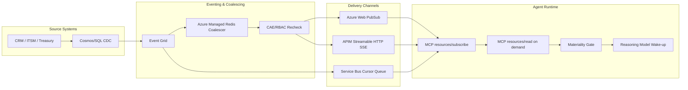
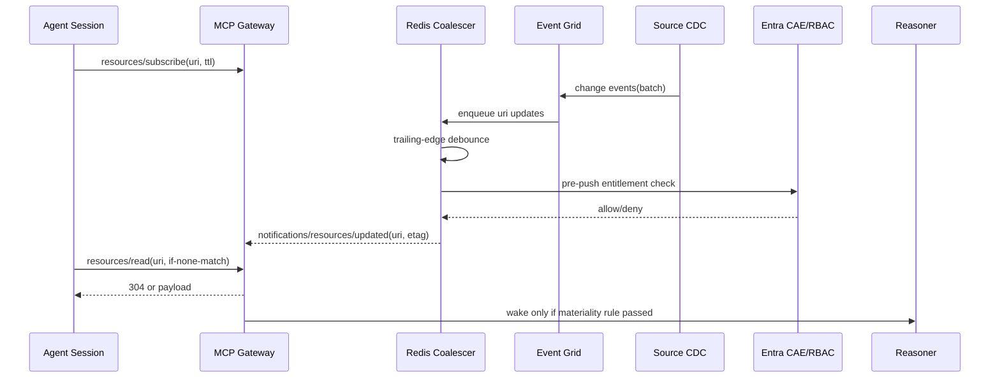

# Enterprise MCP Reactive Resource Subscription Selection FAQ: Event Grid + Redis Coalescing + Web PubSub/APIM SSE vs Service Bus Cursor vs APIM ETag Polling vs Materiality-Gated Hybrid Loop

> 🌐 **Language Switch**: [中文](./mcp-resource-subscriptions-reactive-push-coalescing-event-grid-webpubsub-apim-sse-vs-service-bus-cursor-vs-etag-polling-selection-faq.md) | **English (current)**
> **Audience**: Cloud & AI Solution Architects, integration platform leads, MCP control-plane engineers, SRE, FinOps, and enterprise security-governance teams.
> **Scope**: Production architecture for `resources/subscribe` and `notifications/resources/updated`, with explicit design trade-offs around burst coalescing, wake-up storm prevention, entitlement consistency, socket and memory sizing, and 3-year TCO.

## 1. Why naïve polling and unthrottled push both fail in production
If `5,000` concurrent sessions poll `resources/read` every `3` seconds, request pressure becomes `N/T = 5000/3 = 1,667 RPS`, which can overload shared CRM/ERP/ITSM backends even when the actual state-change ratio is tiny and business value per read is near zero.
If teams wire raw CDC records directly into `notifications/resources/updated`, a single `200`-row batch can fan out into hundreds of redundant model wake-ups per subscriber, creating Denial-of-Wallet behavior where token burn grows faster than decision quality.
A third failure mode is authorization skew: without pre-delivery CAE/RBAC revalidation, sessions may receive update notifications after entitlement revocation, producing governance incidents and audit exceptions.
Production-ready MCP reactivity therefore requires a deliberate split between change detection, notification compaction, entitlement validation, and model wake-up gating, rather than treating every mutation as immediate reasoning input.

## 2. Four architecture patterns and responsibility boundaries
**Architecture A** is a stateful coalesced push plane: `CDC -> Event Grid -> Redis trailing-edge coalescer -> Web PubSub/APIM SSE`, sending only dirty URI pointers with version metadata and deferring payload hydration to on-demand reads.
**Architecture B** is a durable cursor plane for dehydrated or sleeping agents, typically backed by Service Bus or pull-based event subscriptions with per-session watermark state and deterministic replay semantics.
**Architecture C** is a gateway-absorbed conditional polling model, where APIM handles `ETag/If-None-Match` and returns `304` for unchanged state, minimizing backend read amplification for low-churn resources.
**Architecture D** is a two-stage materiality gate that evaluates deterministic business predicates before waking the reasoning model, reducing expensive wake-ups while preserving responsiveness for truly actionable deltas.
In real enterprises these patterns are complementary, and the architecture decision is usually resource-tier specific, not a single global winner.

## 3. End-to-end reference architecture for subscriptions, coalescing, and wake-up governance

This design decouples event capture, event compaction, channel delivery, and reasoning activation, allowing each layer to scale and fail independently and preventing control-plane coupling that is difficult to tune under load.
A shared subscription registry can route each resource to A, B, or C based on freshness requirement, churn profile, and compliance sensitivity, while D provides a consistent wake-up policy envelope across channels.
Pre-delivery entitlement checks prevent stale-notification side effects and reduce avoidable round trips where agents receive update hints but fail hydration due to revoked access.
For production observability and replay determinism, persist at least `tenant_id`, `session_id`, `resource_uri`, `etag`, and `watermark` as normalized cross-plane keys.

## 4. Architecture A: coalesced dirty-pointer push with Redis trailing-edge debounce
Architecture A compresses high-frequency mutation streams into bounded windows such as `500ms–2s`, emitting one dirty-pointer notification per URI with `etag/version` instead of replaying raw event granularity to each subscriber.
This pattern is ideal when source updates are frequent but business decisions are not microsecond-sensitive, because many intermediate state transitions do not change downstream action intent and should not wake the model.
In multi-tenant deployments, URI-to-subscriber fan-out indices and TTL-based lease cleanup are mandatory to avoid zombie subscriptions and silent message-cost leakage.
If Web PubSub and APIM SSE are both enabled, deduplication by event identity is required to prevent channel-level duplicate wake-ups for the same logical state transition.

## 5. Architecture B: durable cursor subscriptions for hibernated workflows
Architecture B optimizes for lossless catch-up after disconnects, hibernation, cold starts, and long approval windows, using per-session cursor watermarks rather than always-on socket dependency.
This approach is strong for enterprises with pronounced day-night utilization cycles, where keeping thousands of idle SSE connections open is wasteful and operationally brittle.
Durable Functions or LangGraph dispatchers can consolidate replayed updates into compact state deltas before reactivation, avoiding wake-up storms during recovery bursts.
The trade-off is additional orchestration state management and slightly higher median freshness, which is acceptable when continuity and replay correctness are prioritized over sub-second fan-out.

## 6. Architecture C: APIM ETag conditional polling with 304 absorption
Architecture C uses HTTP cache validators to terminate unchanged reads at the gateway edge, returning `304 Not Modified` without hitting origin APIs for the majority of low-value refresh traffic.
For serverless MCP backends, this can dramatically reduce cold starts, origin database contention, and cloud egress, especially for resources that change infrequently but are queried frequently.
Adaptive jittered backoff avoids synchronized polling phases and smooths backend demand under scale events or regional failovers.
C does not replace push semantics for critical streams, but it provides a low-complexity control-plane option where stateful pub/sub infrastructure would be operationally disproportionate.

## 7. Architecture D: materiality-gated two-stage reactive loop
Architecture D first accepts coalesced dirty URI events and then applies deterministic edge predicates such as `status_changed`, `delta_pct >= 2%`, or `sla_remaining_min <= 15` before waking an LLM path.
By inserting a cheap, explainable decision stage ahead of model inference, enterprises can reduce wake-up volume by `85–95%` while preserving coverage for meaningful events.
D is particularly valuable for regulated domains because each wake or suppress decision can be justified through explicit predicate traces rather than opaque post-hoc interpretation.
Policy versioning and change-control discipline are mandatory, since gate drift can introduce hidden false negatives or costly false positives at scale.

## 8. Twelve-dimension comparison matrix
| Dimension | A: Coalesced push plane | B: Durable cursor plane | C: ETag conditional polling | D: Materiality-gated hybrid |
|---|---|---|---|---|
| Real-time responsiveness | Very high | Medium | Medium to low | High |
| Disconnect recovery consistency | Medium | Very high | Medium | High |
| Origin read-pressure control | High | High | Very high | Very high |
| LLM wake-up suppression | Medium | Medium | Medium | Very high |
| Implementation complexity | Medium | Medium to high | Low to medium | High |
| Operational burden | Medium | Medium | Low | High |
| Connection footprint | Medium to high | Low | Low | Medium |
| Cost predictability | Medium | High | High | Very high |
| Revocation consistency | High | High | Medium | High |
| Multi-tenant scaling flexibility | High | High | Medium | High |
| Audit explainability | Medium | High | Medium | Very high |
| Recommended adoption phase | High-freshness domains | Long-running workflows | Low-churn resources | Mature governance stage |

## 9. Quantitative sizing and storm-prevention formulas
Polling load is modeled as `R_poll = N_sessions / T_poll`; with `N=5000` and `T=3s`, this is `1667 RPS`, and if change ratio is `1%`, around `99%` of reads produce no new decision value.
Coalesced push fan-out can be approximated as `R_push = λ_mut * K_sub / C_coalesce`, where `λ_mut` is mutation batches per second, `K_sub` average subscriber count, and `C_coalesce` compaction factor.
SSE memory sizing can be estimated with `Mem_conn = N_conn * m_per_conn`; for `50,000` connections and `24KB` per connection, baseline memory is near `1.2GB` before buffers and runtime overhead.
Socket and SNAT planning can use `Socket_need = N_conn * f_burst`, where `f_burst` is a reconnect burst factor such as `1.3` to survive regional jitter and rolling upgrades.
Wake-up token cost can be expressed as `Cost_wake = wakeups_per_hour * prompt_tokens/1000 * price_per_1k`, and this is the core KPI to compare D-enabled and non-D reactive strategies.
Subscription orphan dynamics can be tracked via an exponential-decay approximation such as `Orphan(t) = S_total * e^(-t/TTL)` to balance cleanup aggressiveness against lease-renew churn.
A practical operating scorecard should include `coalesce_ratio`, `304_hit_ratio`, `wakeups_saved_pct`, and `acl_reject_before_push` to tie platform behavior directly to cost and risk controls.

## 10. Subscription, coalescing, entitlement, and hydration sequence

This sequence enforces a strict separation between awareness and reasoning, so systems can remain responsive to change signals without treating every signal as expensive model work.
Placing entitlement checks before delivery prevents noisy “notified then denied” behavior and improves both user trust and compliance auditability.
Stable ETag semantics are required across replicas and regions, or `304` optimization can become incorrect and hide genuine changes.
For incident forensics and replay determinism, persist both `event_id` and `coalesce_batch_id` through delivery and wake-up telemetry.

## 11. Production Python sample: Redis Lua coalescer, ACL-verified notifier, materiality gate
```python
from __future__ import annotations

import json
import time
from dataclasses import dataclass
from typing import Dict, Iterable, Tuple

import redis


COALESCE_LUA = """
local key = KEYS[1]
local ttl = tonumber(ARGV[1])
local payload = ARGV[2]
redis.call('SET', key, payload, 'EX', ttl)
return 1
"""


@dataclass
class UpdateEvent:
    tenant_id: str
    session_id: str
    uri: str
    etag: str
    version: int
    status_changed: bool
    delta_pct: float
    sla_remaining_min: int


def materiality_pass(evt: UpdateEvent) -> bool:
    if evt.status_changed:
        return True
    if evt.delta_pct >= 2.0:
        return True
    return evt.sla_remaining_min <= 15


def entitlement_ok(tenant_id: str, session_id: str, uri: str) -> bool:
    # Replace with CAE-aware entitlement cache + authoritative lookup
    return bool(tenant_id and session_id and uri.startswith("mcp://"))


def emit_dirty_pointer(r: redis.Redis, evt: UpdateEvent, ttl_seconds: int = 30) -> None:
    key = f"mcp:dirty:{evt.tenant_id}:{evt.session_id}:{evt.uri}"
    payload = json.dumps({"uri": evt.uri, "etag": evt.etag, "version": evt.version, "ts": int(time.time())})
    r.eval(COALESCE_LUA, 1, key, ttl_seconds, payload)


def process_batch(r: redis.Redis, updates: Iterable[UpdateEvent]) -> Tuple[int, int]:
    notified, gated = 0, 0
    for evt in updates:
        if not entitlement_ok(evt.tenant_id, evt.session_id, evt.uri):
            continue
        emit_dirty_pointer(r, evt)
        notified += 1
        if materiality_pass(evt):
            gated += 1
    return notified, gated
```
This sample encodes the three critical controls in the correct order: compact first, validate entitlement second, and gate wake-up third, so the platform preserves awareness while limiting waste and risk.
In production, entitlement checks should be CAE-aware and short-cache validated to honor revocations quickly without introducing remote-auth bottlenecks on every event.
The `notified/gated` metrics should be exported to observability pipelines and tied to FinOps reports, enabling direct correlation between gate policy and token spend.
In multi-region active-active topologies, idempotency keys and event dedup windows are required to prevent duplicate wake-ups across replicated pipelines.

## 12. Production XML/Bicep sample: APIM conditional cache, SSE policy posture, Event Grid to Web PubSub wiring
```xml
<policies>
  <inbound>
    <base />
    <set-variable name="ifNoneMatch" value="@(context.Request.Headers.GetValueOrDefault(\"If-None-Match\",\"\"))" />
    <cache-lookup-value key="@(\"etag:\" + context.Request.OriginalUrl.Path)" variable-name="cachedEtag" />
    <choose>
      <when condition="@((string)context.Variables[\"ifNoneMatch\"] == (string)context.Variables.GetValueOrDefault(\"cachedEtag\",\"\"))">
        <return-response>
          <set-status code="304" reason="Not Modified" />
        </return-response>
      </when>
    </choose>
  </inbound>
  <outbound>
    <base />
    <set-header name="Cache-Control" exists-action="override">
      <value>private, max-age=3</value>
    </set-header>
    <cache-store-value key="@(\"etag:\" + context.Request.OriginalUrl.Path)" value="@(context.Response.Headers.GetValueOrDefault(\"ETag\",\"\"))" duration="30" />
  </outbound>
</policies>
```
```bicep
resource webPubSub 'Microsoft.SignalRService/WebPubSub@2024-03-01' = {
  name: 'mcp-reactive-wps'
  location: resourceGroup().location
  sku: {
    name: 'Standard_S1'
    capacity: 3
  }
}

resource topic 'Microsoft.EventGrid/topics@2022-06-15' = {
  name: 'mcp-resource-updates'
  location: resourceGroup().location
  sku: { name: 'Standard' }
}

resource sub 'Microsoft.EventGrid/topics/eventSubscriptions@2022-06-15' = {
  name: 'to-coalescer'
  parent: topic
  properties: {
    destination: {
      endpointType: 'WebHook'
      properties: {
        endpointUrl: 'https://coalescer.internal/events'
      }
    }
    filter: {
      includedEventTypes: [
        'Microsoft.Resources.ResourceWriteSuccess'
      ]
    }
  }
}
```
These samples illustrate a hybrid operating model where unchanged reads are absorbed at the gateway while high-value changes can still be distributed through reactive channels.
Cache TTL should be tuned by resource volatility, because aggressive caching on fast-changing entities can create stale-state blind spots.
Web PubSub sizing must consider connection concurrency and message throughput jointly, not as independent constraints.
Event Grid paths should include retry and dead-letter handling so transient endpoint failures do not become silent data-loss windows.

## 13. Enterprise scenarios and three-year TCO
### Scenario A: Global incident command war-room with 4,000 live telemetry and ITSM resources
This scenario needs high situational freshness during major incidents but cannot afford indiscriminate model wake-ups from every metric micro-change, so A plus D is typically the strongest operational fit.
B complements this setup by preserving continuity across shift handovers and temporary disconnects, ensuring that returning sessions can reconcile state deterministically rather than restarting context heuristically.

### Scenario B: Institutional wealth and treasury intraday alert and rebalance copilot
This environment combines dense intraday changes with strict entitlement boundaries, making pre-push authorization checks and predicate-based wake-up controls essential to avoid overreaction to low-materiality fluctuations.
Outside market peaks, C can carry low-urgency views with lower operational overhead while preserving consistency through ETag-driven conditional reads.

### Three-year TCO table (example, USD)
| Item | A: Coalesced push | B: Durable cursor | C: ETag polling | D: Materiality hybrid |
|---|---:|---:|---:|---:|
| Year-0 build cost | 380,000 | 340,000 | 210,000 | 460,000 |
| Year-1 run cost | 260,000 | 230,000 | 170,000 | 280,000 |
| Year-2 run cost | 250,000 | 225,000 | 168,000 | 270,000 |
| Year-3 run cost | 245,000 | 220,000 | 165,000 | 265,000 |
| 3-year total cost | 1,135,000 | 1,015,000 | 713,000 | 1,275,000 |
| 3-year productivity value estimate | 2,420,000 | 2,100,000 | 1,260,000 | 3,150,000 |
| 3-year net value | 1,285,000 | 1,085,000 | 547,000 | 1,875,000 |
| Best-fit lifecycle stage | High-freshness core domains | Long-running async domains | Low-churn domains | Mature governance domains |

## 14. Day-0 and Day-2 operational checklists
### 14.1 Day-0 production readiness checklist
1. Lock the subscription contract with required fields: `uri`, `etag`, `version`, `ttl`, and `watermark`.
2. Enforce pre-delivery CAE/RBAC checks and block direct bypass delivery paths.
3. Configure coalescer windows with safe defaults (for example `1s`) and idempotent event keys.
4. Define initial materiality thresholds and review them with business owners and operations leads.
5. Instrument `coalesce_ratio`, `304_hit_ratio`, `wakeups_saved_pct`, and `orphan_subscriptions` before go-live.
6. Run disconnect/reconnect and cross-region recovery drills with documented rollback actions.

### 14.2 Day-2 operating checklist
1. Review gate-hit distributions weekly to detect threshold drift and domain-specific false-positive or false-negative patterns.
2. Validate CAE revocation propagation latency monthly to ensure pre-push rejection remains within target bounds.
3. Tune subscription TTL and renewal cadence to lower zombie-subscription rates without overloading lease paths.
4. Rebalance resource routing across A/B/C based on observed freshness requirements and cost profiles.
5. Refresh TCO and cost-per-wake metrics quarterly and feed outcomes into architecture change governance.

## 15. Quantitative Q&A, fit boundaries, and operating dictionaries
### 15.1 Worked quantitative Q&A (6)
**Q1: How large is the polling storm at common enterprise scale?** With `N=5000` sessions and `T=3s`, baseline polling pressure is `1667 RPS`, and with only `1%` true change rate, about `99%` of requests are low-value repeats.
**Q2: How does coalescing reduce fan-out pressure?** If `λ_mut=120/s`, `K_sub=40`, and `C_coalesce=8`, effective push volume drops from `4,800 msg/s` to around `600 msg/s` before delivery-channel optimization.
**Q3: How does materiality gating translate to token savings?** If ungated wake-ups are `12,000/h` at `1,200` prompt tokens each and gating cuts wake-ups by `90%`, savings are roughly `12,960,000` tokens per hour.
**Q4: Why is SSE memory often underestimated?** At `50,000` active connections and `24KB` per connection, baseline footprint is near `1.2GB`, and practical planning should include at least `1.5x` headroom for buffers and control overhead.
**Q5: When should Architecture B be preferred over Architecture A?** Whenever reconnect continuity and replay determinism are mandatory across hibernation windows, durable cursor semantics provide safer behavior than pure always-on fan-out.
**Q6: When is Architecture C sufficient without full reactive fan-out infrastructure?** For low-churn resources with minute-level freshness tolerance, ETag plus `304` can deliver major backend relief with much lower implementation and operating complexity.

### 15.2 Good fit vs Not for
This architecture family is a strong fit for large multi-tenant enterprises that require both responsiveness and strict governance, because it separates event awareness from expensive reasoning while preserving auditability.
It is not an ideal fit for very small, low-change workloads where the overhead of multi-plane reactive infrastructure can exceed practical benefit.

### 15.3 Audit field dictionary (example)
| Field | Source plane | Governance purpose | Minimum retention |
|---|---|---|---|
| `tenant_id` | Gateway | Multi-tenant boundary proof | 5 years |
| `session_id` | Runtime | Session traceability | 2 years |
| `resource_uri` | MCP | Subscription object identity | 3 years |
| `etag` | Resource API | Conditional-read consistency | 2 years |
| `version` | CDC | Mutation ordering | 3 years |
| `coalesce_batch_id` | Coalescer | Compaction explainability | 2 years |
| `materiality_rule_id` | Gate | Wake/suppress rationale | 3 years |
| `wake_decision` | Gate | Cost and quality audit trail | 3 years |
| `acl_check_result` | Auth | Entitlement evidence | 5 years |
| `cae_token_age_ms` | Auth | Revocation propagation health | 2 years |
| `delivery_channel` | Transport | Channel governance | 2 years |
| `cursor_watermark` | Durable | Replay position proof | 3 years |
| `sse_conn_id` | Realtime | Connection diagnostics | 1 year |
| `retry_count` | Eventing | Delivery resilience analysis | 2 years |
| `304_hit` | APIM | Cache effectiveness | 1 year |
| `origin_read_ms` | Backend | Origin pressure visibility | 1 year |
| `wake_tokens` | LLMOps | Token cost attribution | 3 years |
| `cost_center` | FinOps | Chargeback mapping | 5 years |
| `incident_id` | Ops | Incident linkage | 5 years |
| `policy_version` | Governance | Change-trace evidence | 5 years |

### 15.4 Runtime alert dictionary (example)
| Alert key | Trigger condition | Immediate action | Owning team |
|---|---|---|---|
| `poll_rps_spike` | Polling rate exceeds threshold | Enable stronger jitter backoff | API Platform |
| `coalesce_ratio_drop` | Compaction ratio drops unexpectedly | Re-evaluate debounce windows | MCP Platform |
| `wake_storm_detected` | Wake-ups spike sharply | Raise gate strictness temporarily | LLMOps |
| `acl_prepush_fail` | Entitlement pre-check failures increase | Validate identity sync and CAE propagation | Security |
| `cursor_lag_high` | Watermark lag exceeds SLO | Scale replay consumers | Workflow |
| `sse_conn_exhaustion` | Connection capacity near limit | Scale PubSub/APIM units | SRE |
| `304_hit_regress` | 304 hit ratio degrades | Validate ETag behavior and cache keys | Gateway |
| `orphan_subscriptions_high` | Zombie subscriptions exceed target | Trigger forced lease cleanup | Platform |
| `event_replay_gap` | Replay discontinuity detected | Run compensating replay | Eventing |
| `token_cost_regress` | Cost per hour rises above guardrail | Tighten wake budget policy | FinOps |
| `cae_delay_breach` | Revocation latency breaches limit | Switch to conservative delivery mode | Security |
| `materiality_false_negative` | Critical events not waking model | Temporarily relax thresholds | Domain Ops |
| `materiality_false_positive` | Excess low-value wake-ups | Tighten predicate set | LLMOps |
| `apim_cache_miss_spike` | Cache misses surge | Revisit cache key and TTL policy | Gateway |
| `cross_region_order_skew` | Cross-region ordering drift | Enable sequence correction path | Platform |

### 15.5 Evolution path from single-channel control to hybrid reactive governance
A practical path is to begin with C to quickly reduce redundant origin reads, then introduce A for high-value high-churn entities, and finally add D once governance telemetry and policy operations are mature.
Organizations already running durable orchestration stacks can introduce B in parallel to guarantee replay correctness for sleeping or deferred sessions without keeping idle long-lived sockets open.
Each evolution step should be gated by replay-based regression evidence and explicit rollback plans, especially when adjusting materiality predicates that directly affect wake-up volume and business responsiveness.
The target state is not “real-time push for everything,” but resource-tiered channel selection that optimizes freshness, cost, and audit confidence simultaneously.
