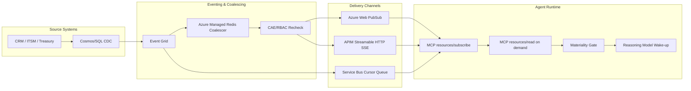
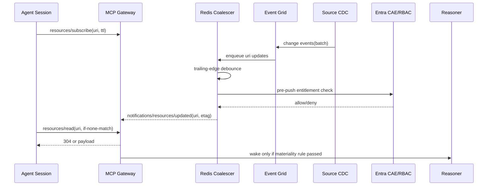

# 企业 MCP 资源订阅与反应式更新选型 FAQ：Event Grid + Redis 合并 + Web PubSub/APIM SSE vs Service Bus Cursor vs APIM ETag 轮询 vs 物质性门控混合环

> 🌐 **Language Switch**: **中文（当前）** | [English](./mcp-resource-subscriptions-reactive-push-coalescing-event-grid-webpubsub-apim-sse-vs-service-bus-cursor-vs-etag-polling-selection-faq.en.md)
> **适用对象**：Cloud & AI Solution Architect、企业集成平台主管、MCP 平台团队、SRE、FinOps 与安全治理团队。
> **讨论范围**：围绕 `resources/subscribe` 与 `notifications/resources/updated` 的企业级反应式通知平面，覆盖风暴抑制、权限一致性、连接容量、令牌成本、跨会话恢复与三年 TCO。

## 1. 为什么朴素轮询与无节制推送都会在生产中失败
当 `5,000` 个会话每 `3s` 轮询一次 `resources/read` 时，请求速率是 `N/T = 5000/3 = 1,667 RPS`，在 CRM/ERP/ITSM 这类共享系统上会形成持续读压，即便真实变化比例只有个位数，也会造成连接池与缓存层抖动。
反过来，如果把 CDC 明细逐条直接映射为 `notifications/resources/updated`，一次 `200` 行批处理可能变成每个订阅者 `200` 次唤醒，导致“证据没变、模型反复推理”的 Denial-of-Wallet 风险，云账单和响应延迟同时恶化。
更隐蔽的问题是权限时序，若推送链路不做 CAE/RBAC 复核，用户会在权限撤销后仍收到“脏 URI”更新提示，形成合规漏洞并削弱审计可信度。
因此生产设计必须把“变更事件数量”与“模型唤醒次数”分离，通过合并窗口、物质性判定与会话水位游标构建可控更新环。

## 2. 四类架构路径与责任边界
**Architecture A** 是状态化推送平面，链路为 `CDC -> Event Grid -> Redis 合并器 -> Web PubSub/APIM SSE`，通知只发 `uri + etag/version`，读取延迟到需要时再 `resources/read`。
**Architecture B** 是耐久游标平面，使用 Service Bus Topic 或 Event Grid Namespace Pull 维护每会话 watermark，适配休眠、断线、跨小时流程与“醒后追平”场景。
**Architecture C** 是网关吸收式条件轮询，利用 APIM `ETag/If-None-Match` 与响应缓存，把大量“未变化读取”收敛为网关侧 `304` 快速响应，降低后端 API 压力。
**Architecture D** 是物质性门控双阶段环路，先推脏指针，再用确定性规则判断是否值得唤醒模型，把高频小变动拦截在规则层而非推理层。
在企业落地中，这四类路径并非互斥，通常是按资源热度和流程特征分层组合，目标是成本可预测、恢复可验证、权限可审计。

## 3. 端到端参考架构：反应式订阅、合并与唤醒门控

该拓扑把“事件捕获、事件合并、事件投递、模型唤醒”分为独立控制面，避免任何单一层同时承担流量与语义决策而难以调优。
A/B/C 三种通道可由同一订阅注册表驱动，平台按资源标签决定走实时推送、游标补偿或条件轮询，从而在稳定性与成本之间做可解释切换。
安全方面应在投递前执行 CAE/RBAC 复核，不把权限正确性外包给消费侧，以避免“消息已送达但后续 read 被拒”的灰区行为。
建议在订阅元数据中固定 `tenant_id`、`session_id`、`resource_uri`、`etag`、`watermark` 五元组，确保调试、追责与重放口径一致。

## 4. Architecture A：Redis 尾缘合并 + 脏 URI 推送平面
A 的核心是把高频明细变更压缩为短窗口内的“最后有效状态”，例如 `500ms–2s` trailing-edge 合并后仅推一次 `uri + version`，从而把变更风暴降成可控订阅通知。
该模式尤其适合“变更高频但决策节奏低于秒级”的业务对象，如工单状态、市场风险阈值、告警计数器等，因为连续微变动并不都值得触发一次模型推理。
在多租户场景中，A 需要维护 URI 到订阅者集合的索引并支持 TTL 回收，防止会话异常退出后保留僵尸订阅导致无效广播与成本外泄。
若采用 Web PubSub 与 APIM SSE 双通道，应在同一事件 ID 上做去重，避免同会话双重投递触发重复唤醒。

## 5. Architecture B：Service Bus 持久游标与休眠恢复
B 强调“丢了连接也不丢状态”，通过每会话水位游标记录最后消费位置，适配 scale-to-zero、审批等待、夜间静默与跨时区异步流程。
相比长连推送，B 在会话不活跃时不占用持续 socket 和内存，更适合“白天峰值、夜间低活跃”且恢复一致性要求高的企业流程。
Durable Functions 或 LangGraph 可作为唤醒调度层，将游标后的变更批量整合为阶段性输入，避免恢复时出现上千条逐条重播。
B 的代价是端到端实时性略低，因此建议按资源等级分层使用：关键告警走 A，追平一致性走 B，低频查询走 C。

## 6. Architecture C：APIM ETag 条件轮询与 304 吸收
C 利用 HTTP 条件请求语义把“无变化读取”在网关层终止，客户端携带 `If-None-Match`，APIM 命中缓存时直接返回 `304 Not Modified`，后端系统无需重复执行重查询。
在函数型无状态 MCP 后端中，C 能显著减少冷启动与数据库连接成本，尤其适合低变更对象或对实时推送运维投入不足的团队。
若叠加抖动回退（jittered backoff），可在高峰时自动拉长轮询间隔，避免客户端同相同步引发脉冲流量。
该模式并不替代推送，而是把“无需状态基础设施也能控成本”的路径标准化，便于中小团队快速达成生产可用。

## 7. Architecture D：物质性门控双阶段反应环
D 先接收合并后的脏指针，再执行确定性谓词，如 `status_changed`、`delta_pct >= 2%`、`sla_remaining_min <= 15`，只有命中业务重要变更才唤醒模型。
这种“规则先行、推理后置”结构能把大部分噪声更新挡在廉价计算层，实测常见可将模型唤醒量压降 `85–95%`，并显著降低无效推理的尾延迟。
D 还便于审计，因为每次“为何唤醒/为何抑制”都可由规则命中记录解释，而不是仅依赖模型输出后验判断。
在金融与运维场景中，建议将门控策略版本化并纳入变更审批，防止策略漂移带来隐性漏报或过报。

## 8. 12 维度对比矩阵
| 维度 | A：合并推送 | B：耐久游标 | C：ETag 轮询 | D：门控混合 |
|---|---|---|---|---|
| 实时性 | 很高 | 中 | 中到低 | 高 |
| 断线恢复一致性 | 中 | 很高 | 中 | 高 |
| 后端读压控制 | 高 | 高 | 很高 | 很高 |
| 模型唤醒抑制 | 中 | 中 | 中 | 很高 |
| 实施复杂度 | 中 | 中到高 | 低到中 | 高 |
| 运维复杂度 | 中 | 中 | 低 | 高 |
| 连接资源占用 | 中到高 | 低 | 低 | 中 |
| 成本可预测性 | 中 | 高 | 高 | 很高 |
| 权限撤销一致性 | 高 | 高 | 中 | 高 |
| 多租户扩展弹性 | 高 | 高 | 中 | 高 |
| 审计可解释性 | 中 | 高 | 中 | 很高 |
| 推荐落地阶段 | 高实时域 | 长流程域 | 低变更域 | 成熟治理域 |

## 9. 定量模型：风暴预防、连接容量与令牌成本
轮询读压模型可写为 `R_poll = N_sessions / T_poll`，当 `N=5000`、`T=3s` 时 `R_poll=1667 RPS`，若变化率仅 `1%`，则约 `99%` 请求属于重复读取。
合并推送可近似为 `R_push = λ_mut * K_sub / C_coalesce`，其中 `λ_mut` 是每秒变更批次数、`K_sub` 是平均订阅者数、`C_coalesce` 为合并压缩系数，`C_coalesce` 越高说明抑制效果越好。
SSE 连接内存估算可写为 `Mem_conn = N_conn * m_per_conn`，若 `N_conn=50000`、`m_per_conn=24KB`，则仅连接状态约 `1.2GB`，需预留头部和缓冲空间。
SNAT 与 socket 规划可用 `Socket_need = N_conn * f_burst`，例如 `f_burst=1.3` 作为高峰冗余因子，以避免瞬时重连导致端口耗尽。
模型唤醒成本可表达为 `Cost_wake = wakeups_per_hour * prompt_tokens/1000 * price_per_1k`，对比门控前后的 `wakeups_per_hour` 是 FinOps 的核心杠杆。
订阅回收可建模 `Orphan = S_total * e^(-t/TTL)` 的经验衰减，缩短 TTL 能降低僵尸订阅但会增加续租开销，需在可靠性与成本间平衡。
建议将 `wakeups_saved_pct`、`304_hit_ratio`、`coalesce_ratio`、`acl_reject_before_push` 四项设为日常 KPI，以便将技术优化直接映射为成本与风险指标。

## 10. 时序图：订阅、合并、权限复核与按需读取

该时序将“消息到达”与“模型推理”显式分离，使系统可以在不丢变更感知能力的情况下压缩推理开销。
权限复核放在推送前有助于减少无效通知，也避免客户端收到通知后才发现无权限读取造成体验和审计噪声。
`304` 返回路径需要与缓存策略统一设计，确保 ETag 来源稳定且跨副本一致，否则会出现错误命中。
建议为每个通知写入 `event_id` 与 `coalesce_batch_id`，便于排查“为何这次只触发一次唤醒”之类问题。

## 11. 生产代码示例：Redis Lua 合并器 + ACL 验证通知 + 物质性门控
```python
from __future__ import annotations

import json
import time
from dataclasses import dataclass
from typing import Dict, Iterable, Tuple

import redis


COALESCE_LUA = """
local key = KEYS[1]
local ttl = tonumber(ARGV[1])
local payload = ARGV[2]
redis.call('SET', key, payload, 'EX', ttl)
return 1
"""


@dataclass
class UpdateEvent:
    tenant_id: str
    session_id: str
    uri: str
    etag: str
    version: int
    status_changed: bool
    delta_pct: float
    sla_remaining_min: int


def materiality_pass(evt: UpdateEvent) -> bool:
    if evt.status_changed:
        return True
    if evt.delta_pct >= 2.0:
        return True
    return evt.sla_remaining_min <= 15


def entitlement_ok(tenant_id: str, session_id: str, uri: str) -> bool:
    # placeholder for Entra CAE + RBAC lookup
    return bool(tenant_id and session_id and uri.startswith("mcp://"))


def emit_dirty_pointer(r: redis.Redis, evt: UpdateEvent, ttl_seconds: int = 30) -> None:
    key = f"mcp:dirty:{evt.tenant_id}:{evt.session_id}:{evt.uri}"
    payload = json.dumps({"uri": evt.uri, "etag": evt.etag, "version": evt.version, "ts": int(time.time())})
    r.eval(COALESCE_LUA, 1, key, ttl_seconds, payload)


def process_batch(r: redis.Redis, updates: Iterable[UpdateEvent]) -> Tuple[int, int]:
    notified, gated = 0, 0
    for evt in updates:
        if not entitlement_ok(evt.tenant_id, evt.session_id, evt.uri):
            continue
        emit_dirty_pointer(r, evt)
        notified += 1
        if materiality_pass(evt):
            gated += 1
    return notified, gated
```
此示例体现三层控制：先合并脏指针、再做权限复核、最后做物质性门控，确保“有变化不漏、无价值不唤醒、无权限不推送”。
在生产环境中可把 `entitlement_ok` 替换为缓存化授权判定并配置短 TTL，既能跟上 CAE 撤权，又不会把每次通知都变成昂贵远程鉴权。
建议将 `process_batch` 的 `notified/gated` 输出写入指标系统，形成门控前后的可观测证据链。
若采用多区域部署，需要为 `event_id` 引入幂等键避免重复广播与双重唤醒。

## 12. 生产配置示例：APIM ETag + SSE 与 Event Grid/Web PubSub 绑定
```xml
<policies>
  <inbound>
    <base />
    <set-variable name="ifNoneMatch" value="@(context.Request.Headers.GetValueOrDefault(\"If-None-Match\",\"\"))" />
    <cache-lookup-value key="@(\"etag:\" + context.Request.OriginalUrl.Path)" variable-name="cachedEtag" />
    <choose>
      <when condition="@((string)context.Variables[\"ifNoneMatch\"] == (string)context.Variables.GetValueOrDefault(\"cachedEtag\",\"\"))">
        <return-response>
          <set-status code="304" reason="Not Modified" />
        </return-response>
      </when>
    </choose>
  </inbound>
  <outbound>
    <base />
    <set-header name="Cache-Control" exists-action="override">
      <value>private, max-age=3</value>
    </set-header>
    <cache-store-value key="@(\"etag:\" + context.Request.OriginalUrl.Path)" value="@(context.Response.Headers.GetValueOrDefault(\"ETag\",\"\"))" duration="30" />
  </outbound>
</policies>
```
```bicep
resource webPubSub 'Microsoft.SignalRService/WebPubSub@2024-03-01' = {
  name: 'mcp-reactive-wps'
  location: resourceGroup().location
  sku: {
    name: 'Standard_S1'
    capacity: 3
  }
}

resource topic 'Microsoft.EventGrid/topics@2022-06-15' = {
  name: 'mcp-resource-updates'
  location: resourceGroup().location
  sku: { name: 'Standard' }
}

resource sub 'Microsoft.EventGrid/topics/eventSubscriptions@2022-06-15' = {
  name: 'to-coalescer'
  parent: topic
  properties: {
    destination: {
      endpointType: 'WebHook'
      properties: {
        endpointUrl: 'https://coalescer.internal/events'
      }
    }
    filter: {
      includedEventTypes: [
        'Microsoft.Resources.ResourceWriteSuccess'
      ]
    }
  }
}
```
配置重点是把“304 吸收路径”和“推送路径”都纳入统一治理，让不同资源热度可走不同通道而不破坏客户端契约。
APIM 缓存策略需结合资源一致性要求设置短 TTL，避免高频变更对象误用长缓存造成陈旧读取。
Web PubSub 容量应按并发连接与消息速率双维规划，不应仅按连接数估算。
Event Grid 到合并器建议启用重试与死信，防止短时故障导致静默丢事件。

## 13. 企业场景与三年 TCO 对比
### 场景 A：全球故障战情室（4,000 资源实时监控）
该场景关注低延迟与高一致性并重，告警与工单状态高频变化，但真正需要模型介入的事件占比有限，适合采用 A+D 组合把通知量与推理量解耦。
在跨地域指挥中，B 作为会话恢复与追平保障，确保班次切换或网络抖动后仍能无缝接续上下文。

### 场景 B：机构财富与资金管理盘中预警 Copilot
该场景在交易时段变化密集且有严格权限边界，需在推送前做授权复核并在门控层引入阈值规则，避免小幅波动触发大规模推理。
盘后或午间低活跃时段可退化为 C 路径，以较低运维负担维持状态感知能力。

### 三年 TCO（示例，单位 USD）
| 项目 | A：合并推送 | B：耐久游标 | C：ETag 轮询 | D：门控混合 |
|---|---:|---:|---:|---:|
| Year-0 建设成本 | 380,000 | 340,000 | 210,000 | 460,000 |
| Year-1 运维成本 | 260,000 | 230,000 | 170,000 | 280,000 |
| Year-2 运维成本 | 250,000 | 225,000 | 168,000 | 270,000 |
| Year-3 运维成本 | 245,000 | 220,000 | 165,000 | 265,000 |
| 三年总成本 | 1,135,000 | 1,015,000 | 713,000 | 1,275,000 |
| 三年效率收益估算 | 2,420,000 | 2,100,000 | 1,260,000 | 3,150,000 |
| 三年净收益 | 1,285,000 | 1,085,000 | 547,000 | 1,875,000 |
| 最佳应用阶段 | 高实时核心域 | 长流程恢复域 | 低变更成本域 | 成熟治理域 |

## 14. Day-0 / Day-2 清单
### 14.1 Day-0 上线清单
1. 固化订阅契约：`uri`、`etag`、`version`、`ttl`、`watermark` 字段必填并加签。
2. 建立 CAE/RBAC 复核前置策略，禁止未复核通知直接下发。
3. 为合并器配置窗口参数（默认 `1s`）和幂等去重键。
4. 定义门控规则初始阈值并完成业务评审。
5. 落地告警项：`coalesce_ratio`、`304_hit_ratio`、`wakeups_saved_pct`、`orphan_subscriptions`。
6. 完成断线恢复演练与跨区故障演练。

### 14.2 Day-2 运维清单
1. 周度复盘门控命中分布，识别“过严漏报/过松过报”阈值漂移。
2. 月度核验 CAE 撤权生效时延，确保推送前拒绝比例稳定。
3. 持续优化订阅 TTL 与续租节奏，压降僵尸订阅比例。
4. 对比 A/B/C 通道路由命中率，动态调整资源分层策略。
5. 季度更新 TCO 与单位唤醒成本，形成架构优化闭环。

## 15. 六个定量问答、适配边界与运行字典
### 15.1 定量问答（6）
**Q1：轮询风暴规模如何快速估算？** 若 `N=5000`、`T=3s`，则 `R=1667 RPS`；若资源变化率仅 `1%`，意味着 `99%` 请求没有新增价值。
**Q2：合并窗口为什么能显著降本？** 当 `λ_mut=120/s`、`K_sub=40`、`C_coalesce=8`，推送负载可从 `4,800 msg/s` 降到约 `600 msg/s`。
**Q3：门控节省如何折算为令牌成本？** 若门控前 `wakeups=12,000/h`、每次 `1,200` token，门控后降 `90%`，则每小时减少约 `12,960,000` token。
**Q4：SSE 内存为何常被低估？** `50,000` 连接按 `24KB` 估算约 `1.2GB`，再叠加缓冲和连接管理开销，容量规划需留足 `1.5x` 裕度。
**Q5：何时应优先 B 而非 A？** 当会话经常休眠且需要“醒后无丢失追平”，游标耐久比长连实时更关键。
**Q6：何时 C 足够而不必建设推送平面？** 当对象低变更、响应可缓存、实时性要求分钟级时，ETag+304 方案往往以更低复杂度满足需求。

### 15.2 Good fit vs Not for
该架构族适合多租户、大订阅规模、权限敏感且成本治理明确的企业平台，因为它把“事件感知”和“模型唤醒”拆分成可独立优化的两层。
对于小规模、低并发、低变更应用，直接采用 C 或轻量 A 即可，过早引入完整 D 可能造成运维负担超过收益。

### 15.3 审计字段字典（示例）
| 字段 | 来源层 | 用途 | 保留期 |
|---|---|---|---|
| `tenant_id` | Gateway | 多租户边界 | 5 年 |
| `session_id` | Runtime | 会话追踪 | 2 年 |
| `resource_uri` | MCP | 订阅对象识别 | 3 年 |
| `etag` | Resource API | 条件读取一致性 | 2 年 |
| `version` | CDC | 变更顺序追踪 | 3 年 |
| `coalesce_batch_id` | Coalescer | 合并解释 | 2 年 |
| `materiality_rule_id` | Gate | 门控决策解释 | 3 年 |
| `wake_decision` | Gate | 唤醒审计 | 3 年 |
| `acl_check_result` | Auth | 权限验证 | 5 年 |
| `cae_token_age_ms` | Auth | 撤权时效 | 2 年 |
| `delivery_channel` | Transport | 通道治理 | 2 年 |
| `cursor_watermark` | Durable | 恢复位置 | 3 年 |
| `sse_conn_id` | Realtime | 连接诊断 | 1 年 |
| `retry_count` | Eventing | 失败重试分析 | 2 年 |
| `304_hit` | APIM | 缓存收益统计 | 1 年 |
| `origin_read_ms` | Backend | 后端压力洞察 | 1 年 |
| `wake_tokens` | LLM | 成本归因 | 3 年 |
| `cost_center` | FinOps | 分摊计费 | 5 年 |
| `incident_id` | Ops | 故障关联 | 5 年 |
| `policy_version` | Governance | 策略追溯 | 5 年 |

### 15.4 运行告警字典（示例）
| 告警键 | 触发条件 | 立即动作 | 责任团队 |
|---|---|---|---|
| `poll_rps_spike` | 轮询速率超阈 | 启用抖动回退 | API 团队 |
| `coalesce_ratio_drop` | 合并率下降 | 检查窗口参数 | 平台团队 |
| `wake_storm_detected` | 唤醒量激增 | 提高门控阈值 | LLMOps |
| `acl_prepush_fail` | 推送前鉴权失败升高 | 核验权限同步 | 安全团队 |
| `cursor_lag_high` | 游标滞后升高 | 扩容消费者 | 工作流团队 |
| `sse_conn_exhaustion` | 连接容量逼近上限 | 扩容 PubSub/APIM | SRE |
| `304_hit_regress` | 304 命中下降 | 排查 ETag 一致性 | 网关团队 |
| `orphan_subscriptions_high` | 僵尸订阅超阈 | 启动强制回收 | 平台团队 |
| `event_replay_gap` | 重放断档 | 触发补偿回放 | 事件团队 |
| `token_cost_regress` | 单小时令牌成本上升 | 下调唤醒预算 | FinOps |
| `cae_delay_breach` | 撤权生效超时 | 切换保守策略 | 安全团队 |
| `materiality_false_negative` | 关键事件漏唤醒 | 紧急放宽阈值 | 业务团队 |
| `materiality_false_positive` | 过多无效唤醒 | 收紧规则条件 | LLMOps |
| `apim_cache_miss_spike` | 缓存命中恶化 | 复查缓存键策略 | 网关团队 |
| `cross_region_order_skew` | 跨区顺序漂移 | 启用顺序修正 | 平台团队 |

### 15.5 从单通道到混合环的演进建议
建议先落地 C 快速抑制重复读取，再在高价值对象上引入 A 合并推送，待审计与成本体系成熟后叠加 D 门控，以最小风险换取最大收益。
若企业已有强异步编排基础，可并行引入 B 保障休眠恢复，从而让日间高实时和夜间低活跃都保持稳定体验。
每次演进应配套回归指标与回滚策略，尤其在门控阈值调整时必须先做离线重放验证，避免直接在线试错。
最终目标不是“全部资源都实时推送”，而是按业务价值把每一份变更路由到最合适、最经济、最可审计的处理路径。

### 15.6 治理深化补充：组织机制、变更纪律与成本可验证闭环
在大型企业中，反应式订阅体系并不是单一平台团队可以长期独立维护的能力，必须建立由业务域负责人、平台团队、安全团队与财务治理团队共同参与的周例会机制，把事件密度、误唤醒率、权限拒绝率和单位唤醒成本同时纳入评审。
如果仅追求技术指标而忽略业务结果，系统会很快出现“通知处理很快但决策质量未提升”的伪优化，因此建议每个资源域都维护一份“可行动变化定义”文档，并把物质性规则与业务 KPI 做显式映射。
在变更管理上，合并窗口、门控阈值和权限缓存 TTL 都应被视为受控配置项，任何调整都要绑定变更单、回归证据与回滚策略，避免在生产高峰期做不可追溯的临时调参。
建议将“策略发布”拆分为模拟回放、灰度租户、全量推广三个阶段，并在每个阶段记录 `wakeups_saved_pct`、`false_negative_rate`、`false_positive_rate`，确保门控不是单纯压低成本而牺牲关键事件覆盖。
对跨区域部署，应把会话主归属区域写入订阅元数据，并在跨区路由时优先同区处理，再把必要状态摘要异步复制到备区，避免双区同时唤醒同一会话造成并发语义冲突。
在多云混合场景中，推荐将“事件标准化”与“业务判定”分层，前者只做字段归一和幂等去重，后者在企业控制面执行，从而防止外部系统字段漂移直接影响门控规则稳定性。
对于监管审计要求较高的行业，应保留每次唤醒决策的证据链哈希，并允许审计系统在不访问原始业务数据的前提下复验“为何唤醒、为何抑制”，提升治理透明度并降低取证成本。
当平台进入规模化阶段，建议把无效唤醒预算纳入 SLO 体系，例如定义“每千次通知最多允许 `X` 次无效模型唤醒”，并把超标事件视为平台可用性问题而非纯成本问题。
在权限治理上，建议将 CAE 撤权验证与订阅续租放在同一守护流程中执行，这样可以在最短路径内清理过期会话并停止推送，避免出现权限已撤销但订阅仍活跃的灰色窗口。
对于异常恢复，系统需要区分“消息丢失补偿”和“重复消息抑制”两个方向，前者靠游标回放补齐，后者靠事件幂等键去重，二者不可互相替代，否则恢复后容易出现重复推理。
建议为关键业务资源配置“硬门控 + 软门控”双层规则，硬门控用于绝不遗漏的安全或合规事件，软门控用于成本优化型事件，通过双层结构避免过度追求节流导致关键事件漏报。
在战情场景中，班次切换通常伴随订阅大规模重建，平台应预热连接池并分批恢复订阅，防止交接时刻出现瞬时连接洪峰拖垮网关和推送通道。
对于资金与交易类场景，应将时间窗口与市场时段绑定，在高波动时段自动收紧合并窗口和放宽门控条件，在低波动时段反向调整，实现业务语境驱动的弹性治理。
为保证长期可维护性，建议将规则表达格式标准化，例如统一使用声明式谓词与版本号，不把业务逻辑硬编码在多个服务中，从而避免多团队并行改动导致策略分叉。
在容量治理上，SSE 长连接、消息吞吐和模型并发三条曲线必须联合评估，不能只优化其中一条，否则常见结果是网关稳定了但模型层出现新的排队尾延迟。
建议建立“事件到决策”全链路追踪 ID，并贯穿 CDC、事件总线、合并器、推送通道、读取网关与推理服务，确保任何一次异常都能在分钟级定位到具体瓶颈节点。
对外部系统频繁批量更新的场景，应在源头约束更新粒度并提供批次上下文，帮助合并器更准确地识别同批次噪声变化，避免把技术上独立的多条变更误判为业务上独立事件。
在 FinOps 层面，应把“每个业务域的每千次有效唤醒成本”作为核心度量，而不是只看平台总令牌费用，因为总量成本无法揭示哪些域的门控策略长期失效。
建议将 304 命中率与门控命中率联动分析，如果 304 很高但门控命中也很高，说明读取层压降成功但推理层仍有过度唤醒，需要进一步优化物质性判定阈值。
在安全事件处置流程中，平台应支持“一键切换保守模式”，即临时关闭低优先级推理唤醒并提升鉴权严格度，确保应急期间资源优先用于关键事件处理。
对跨团队协作，建议将每次策略调整的收益与代价写入统一决策日志，包括节省的令牌、增加的延迟、误报和漏报变化，便于季度评审时客观比较不同优化方案。
随着业务扩张，平台通常会出现“少数热点资源占据大部分通知量”的帕累托分布，应针对热点资源定制更细粒度门控与缓存策略，而不是对全部资源统一施策。
若组织已经建设统一数据目录，建议把资源 URI 与数据资产目录做映射，让策略引擎能够感知数据等级和合规标签，从而实现按数据敏感级别自动选择推送和唤醒策略。
最终成熟态应体现为三点：通知流量可预测、模型唤醒可解释、权限边界可证明，只有三者同时成立，反应式 MCP 订阅体系才能在企业生产环境长期稳定演进。
将该体系纳入年度平台路线图时，建议明确“效率目标、可靠性目标、合规目标”三条并行里程碑，避免只以功能上线为成功标准而忽略运营质量和治理成熟度。
