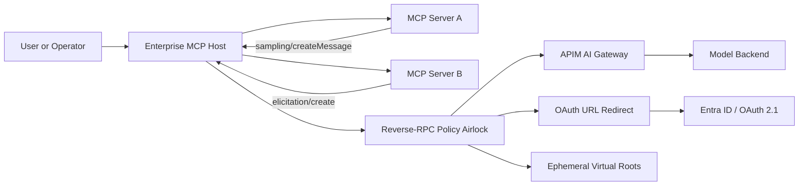
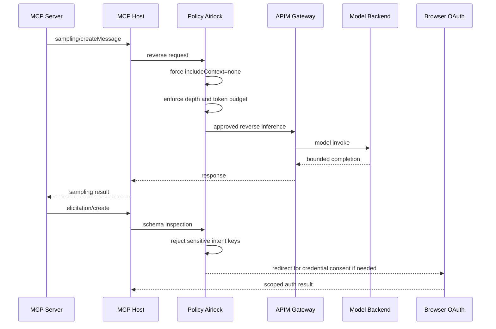
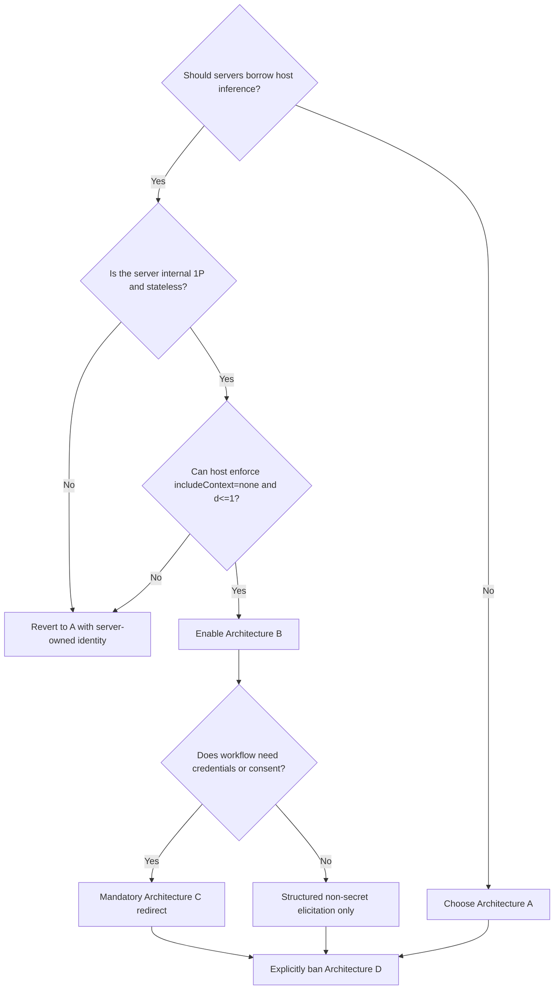

# Enterprise MCP Reverse-RPC Governance Selection FAQ: BYO-Model Zero-Sampling vs Host-Airlock Bounded Sampling vs OAuth URL Redirect vs Pass-Through Anti-Pattern
> **Primary audience**: Cloud & AI Solution Architects, platform governance owners, security architects, and MCP Host maintainers.
> **Decision scope**: server-initiated `sampling/createMessage`, phishing-safe `elicitation/create`, and scoped `roots/list` boundary control in production enterprise environments.
> **Executive recommendation**: default to Architecture A, allow Architecture B only with hard airlock controls, always pair interactive flows with Architecture C, and explicitly ban Architecture D.

## 1. Executive summary
As MCP adoption matures, the bottleneck shifts from protocol compatibility to governance correctness.
Most teams can connect tools within days.
Very few teams can explain, in audit language, who paid for reverse inference and why that was allowed.
When a server can ask the host to generate text, the trust boundary flips direction.
When that reverse call carries broad context, data minimization collapses silently.
When the same server can request freeform user input, phishing opportunities become embedded in trusted client chrome.
When roots are over-broad, ordinary file reads become privilege amplification.
Therefore, production MCP is not just tool orchestration.
It is a reverse-permission architecture problem spanning cost governance, security isolation, and compliance evidence.
Architecture A disables host sampling and forces every server to use its own model identity and quota domain.
Architecture B keeps sampling available but only through a host policy airlock with mandatory context stripping and bounded depth.
Architecture C confines elicitation to non-sensitive structured clarification and redirects credential collection to browser-isolated OAuth flows.
Architecture D allows pass-through reverse RPC and effectively delegates enterprise security posture to unknown server behavior.
At scale, D produces cost parasitism, cross-server leakage risk, and hard-to-prove compliance gaps.
This guide provides concrete formulas, architecture trade-offs, implementation snippets, and TCO guidance across three enterprise tiers.

## 2. Why reverse RPC is the real MCP production boundary
Forward tool calls are usually easier to reason about.
A user asks the host to run a tool.
A tool returns bounded output.
Reverse RPC changes this dynamic.
Now the server asks the host to spend model budget.
This means financial responsibility and security exposure are no longer aligned by default.
Without explicit governance, one server can consume another team’s budget envelope indirectly.
Without strict context minimization, reverse requests can become data exfiltration side channels.
Without depth limits, recursive sampling can create token amplification that appears as noisy but legitimate traffic.
Without schema policy, elicitation can look like a harmless confirmation dialog while collecting credentials.
Without scoped roots, a single approved tool can explore irrelevant host directories and source artifacts.
In other words, the protocol remains valid while the architecture becomes unsafe.
That is why governance controls must be protocol-native and deterministic, not advisory UI guidelines.
The design goal is not to ban functionality.
The design goal is to preserve utility while reducing blast radius and preserving explainability.

## 3. Four architecture candidates
Architecture A: Zero-sampling host profile; server-owned model execution through managed identity and APIM policy boundary.
Architecture B: Host-airlock brokered sampling with hard override `includeContext: "none"`, strict depth limit, and model-tier ceiling.
Architecture C: AST/scheme-sanitized elicitation, sensitive-intent rejection, OAuth URL redirect for credentials, and ephemeral virtual roots.
Architecture D: Auto-approved pass-through sampling and freeform elicitation with broad context propagation.
A optimizes accountability and isolation first.
B optimizes controlled convenience for internal lightweight servers.
C optimizes human-input safety and filesystem boundary integrity.
D optimizes initial developer speed while externalizing long-term operational risk.

## 4. Architecture A in detail: server-owned inference, zero host sampling
In Architecture A, the host does not expose `capabilities.sampling` to MCP servers.
Servers that need LLM synthesis call model backends directly using their own workload identity.
A typical path is `Server MI -> APIM AI Gateway -> model backend`.
This creates deterministic chargeback by server identity, subscription, and product domain.
The host no longer acts as a hidden inference wallet.
Cross-server context leakage risk is reduced because no reverse generation channel exists at the host layer.
Audit teams gain a clean evidence chain from caller identity to quota policy to billed tokens.
Operationally, A trades simplicity at the host for explicit ownership at server onboarding time.
That trade is usually favorable in medium and large enterprises with formal FinOps controls.
In regulated sectors, A aligns with separation-of-duties expectations by design, not by convention.

## 5. Architecture B in detail: bounded sampling through policy airlock
Architecture B is valid only when every boundary is machine-enforced.
The airlock must rewrite reverse sampling requests to `includeContext: "none"` regardless of server input.
Depth must be capped, typically `d <= 1`, to prevent recursive fan-out explosions.
Per-server and per-tool token/rate budgets must be enforced before model invocation.
Model selection must be constrained to approved tiers, typically SLM-first for reverse requests.
Every reverse call must emit lineage metadata for downstream cost and incident analysis.
When these controls are complete, B can support internal stateless tools without distributing model credentials broadly.
When any control is optional, B drifts toward D.
The critical insight is that B is a governance product, not merely a routing feature.

## 6. Architecture C in detail: anti-phishing elicitation + OAuth redirect + scoped roots
Architecture C addresses the human interaction surface where social engineering risks concentrate.
The host accepts only structured, non-sensitive elicitation intents.
Allowed fields include bounded enums, booleans, numeric ranges, and clearly non-secret strings.
Schemas containing sensitive patterns such as `password`, `api_key`, `pat`, `otp`, or identity numbers are rejected.
If the workflow requires authentication, the host redirects to browser-isolated OAuth consent instead of collecting secrets in form text.
This split creates two explicit trust lanes: business clarification and identity consent.
For filesystem exposure, C enforces ephemeral virtual roots per task.
Servers see only assigned project paths with explicit TTL, never broad home-directory mounts.
This approach reduces accidental overexposure and improves post-incident scoping.

## 7. Architecture D anti-pattern: why pass-through fails in production
Architecture D often appears as the fastest onboarding path.
It is also the fastest path to unbounded uncertainty.
Allowing `includeContext: "allServers"` introduces cross-server transcript mixing risk.
Allowing freeform elicitation allows persuasive credential harvest prompts in trusted UI shells.
Allowing unrestricted roots broadens file-access attack surface without explicit intent.
The resulting incidents are difficult to classify because each individual call remains protocol-compliant.
Teams discover the problem through budget spikes, unexplained leakage concerns, or compliance exceptions.
By then, forensics is expensive and politically difficult because accountability boundaries were never encoded.
D should be formally denied in architecture standards and control catalogs.

## 8. Quantitative risk and cost model
Recursive sampling amplification can be modeled as:
`A_tokens = Σ(i=0..d) b^i * T_i`
Where `b` is branching factor and `T_i` is average token usage at depth `i`.
With `b=3`, `d=2`, and `T_i≈1800`, effective token volume reaches `1800*(1+3+9)=23,400`.
That is before retries, latency timeout compensation, or defensive re-prompts.
Token parasitism cost delta can be estimated as:
`C_parasitism = (A_tokens - T_baseline) * P_token`.
Elicitation rejection precision is tracked by:
`Precision_reject = TP / (TP + FP)`.
Sensitive prompt miss rate is tracked by:
`Miss_rate = FN / (TP + FN)`.
Airlock latency overhead is:
`Δ_latency = L_policy + L_schema + L_logging`.
Target state is not zero latency overhead.
Target state is bounded overhead with materially reduced compromise probability and fully attributable spend.

## 9. Twelve-dimension architecture comparison
| Dimension | Architecture A | Architecture B | Architecture C | Architecture D |
|---|---|---|---|---|
| Budget accountability | Highest | High | High | Low |
| Context leakage resistance | Highest | High | High | Lowest |
| Phishing resistance | Medium | Medium | Highest | Lowest |
| Operational onboarding speed | Medium | High | Medium | Highest |
| Governance complexity | Medium | High | Medium-High | Low (deceptive) |
| Audit explainability | High | High | High | Low |
| Recursive amplification control | Strong | Strong | Strong | None |
| Roots boundary control | Medium | Medium | Strong | Weak |
| Multi-tenant consistency | High | Medium-High | High | Low |
| Compliance fit | Highest | Medium-High | Highest | Unacceptable |
| Recommended usage | Broad default | Narrow controlled scope | Mandatory supplement | Prohibited |
| Net decision | Preferred baseline | Conditional | Always pair for input/auth | Deny |

## 10. Reverse-RPC trust-boundary topology


## 11. End-to-end sequence for sampling, elicitation, and redirect


## 12. Architecture selection decision tree


### Q1. Why should sampling be disabled by default in enterprise hosts
Default-on sampling hides cost transfer between trust domains.
It also weakens explainability when incidents happen.
A secure default should minimize privilege and spend surface first.
Selective enablement can then be justified with evidence.
This default mirrors least-privilege patterns used in identity and network design.
Operational convenience is preserved through explicit exceptions, not implicit exposure.

### Q2. What breaks first when Architecture B is under-specified
The first failure is usually context scope drift.
Teams enforce rate limits but forget context hard overrides.
The second failure is recursive depth drift under urgent feature requests.
The third failure is incomplete lineage records that prevent reliable attribution.
Each of these failures is preventable with policy-as-code and mandatory gates.
B succeeds only when controls are treated as product requirements.

### Q3. How does Architecture C reduce phishing success probability
C removes subjective judgement from secret collection pathways.
Sensitive intent is rejected by deterministic schema policy.
Credential and consent steps are moved to browser security boundaries.
This prevents “look-alike trusted form” attacks inside chat or IDE surfaces.
The result is lower social-engineering effectiveness and clearer audit evidence.
Precision and miss-rate telemetry continuously improves policy quality.

### Q4. Why are virtual roots non-negotiable for production MCP
Roots define the maximum filesystem visibility for server tools.
Broad roots convert small tool privileges into broad discovery power.
Ephemeral virtual roots constrain blast radius by task and time.
They also support deterministic cleanup and better post-incident scoping.
In multi-tenant systems, scoped roots are part of tenant-isolation proof, not optional hygiene.
Without root minimization, other controls can be bypassed indirectly through file access.

### Q5. How to map reverse-RPC governance to enterprise TCO
Governance cost includes policy execution, telemetry storage, review workflows, and false-positive handling.
Non-governance cost includes token waste, incident response, legal review, and remediation programs.
A realistic TCO model must include both direct cloud spend and expected incident loss.
When modeled across quarters, stronger governance often lowers total cost despite higher baseline controls.
This is especially visible in multi-vendor MCP marketplaces with heterogeneous server quality.
Cost predictability is a business capability, not just an accounting output.

### Q6. Five-step rollout and Good fit vs Not for
Step one: classify servers by trust, ownership, and compliance tier.
Step two: set host default to A and document exception policy for B.
Step three: deploy C schema guards and OAuth redirect as mandatory controls.
Step four: implement virtual roots with TTL and per-task entitlement.
Step five: run monthly lineage-cost reviews and policy regression tests.
Good fit: organizations operating multiple MCP servers with strict cost and audit constraints.
Not for: ad-hoc prototype environments without production accountability requirements.

## 13. Implementation snippets
```python
import re
from typing import Any, Dict

SENSITIVE = [
    r"password", r"passwd", r"api[_-]?key", r"secret", r"token",
    r"otp", r"one[- ]time", r"ssn", r"pat", r"private[_-]?key"
]

def enforce_reverse_sampling(req: Dict[str, Any], depth: int, max_depth: int = 1, max_tokens: int = 1200) -> Dict[str, Any]:
    r = dict(req)
    r["includeContext"] = "none"
    if depth > max_depth:
        raise ValueError("reverse sampling depth exceeded")
    current = int(r.get("maxTokens", 0) or 0)
    if current <= 0 or current > max_tokens:
        r["maxTokens"] = max_tokens
    return r

def validate_elicitation_schema(schema: Dict[str, Any]) -> None:
    blob = str(schema).lower()
    for p in SENSITIVE:
        if re.search(p, blob):
            raise PermissionError("sensitive elicitation intent is not allowed")

def classify_input_lane(schema: Dict[str, Any]) -> str:
    text = str(schema).lower()
    keywords = ["login", "authorize", "credential", "consent", "signin"]
    return "oauth_redirect" if any(k in text for k in keywords) else "safe_form"
```

```xml
<policies>
  <inbound>
    <base />
    <set-variable name="isReverseRpc" value="@(context.Request.Headers.GetValueOrDefault(&quot;x-mcp-reverse-rpc&quot;,&quot;false&quot;))" />
    <choose>
      <when condition="@(context.Variables[&quot;isReverseRpc&quot;].ToString() == &quot;true&quot;)">
        <quota-by-key calls="120" renewal-period="60" counter-key="@(context.Subscription.Id + &quot;|mcp-reverse&quot;)" />
        <set-header name="x-airlock-context" exists-action="override">
          <value>none</value>
        </set-header>
        <choose>
          <when condition="@(context.Request.Headers.GetValueOrDefault(&quot;x-model-tier&quot;,&quot;slm&quot;) != &quot;slm&quot;)">
            <return-response>
              <set-status code="403" reason="reverse sampling model tier denied" />
            </return-response>
          </when>
        </choose>
      </when>
    </choose>
  </inbound>
  <backend><base /></backend>
  <outbound><base /></outbound>
  <on-error><base /></on-error>
</policies>
```

```yaml
mcpHostGovernance:
  capabilities:
    sampling: conditional
    elicitation: restricted
    roots: scoped_virtual
  sampling:
    defaultMode: disabled
    includeContextOverride: none
    maxDepth: 1
    maxTokensPerRequest: 1200
    rpmPerServer: 60
    modelTierAllowlist:
      - slm
  elicitation:
    allowedFieldTypes:
      - enum
      - boolean
      - integer
      - number
      - string_non_secret
    deniedKeywords:
      - password
      - api_key
      - otp
      - ssn
      - pat
    oauthRedirect: required_for_credentials
  roots:
    mode: ephemeral_mount
    ttlMinutes: 45
    allowHomeDirectory: false
  telemetry:
    emitLineage: true
    attributes:
      - reverse_rpc.server_id
      - reverse_rpc.tool_name
      - reverse_rpc.model_tier
      - reverse_rpc.max_tokens
      - reverse_rpc.include_context
```

## 14. Three-tier enterprise TCO and suitability
| Tier | Typical estate | Recommended stack | Primary cost drivers | Primary risk reduction |
|---|---|---|---|---|
| Tier-1 | Internal 1P tooling | A + selective B | APIM quota + basic policy ops | Budget clarity and bounded recursion |
| Tier-2 | Multi-vendor ISV MCP marketplace | A + B + C | Airlock governance operations | Leakage control and phishing resistance |
| Tier-3 | Regulated banking/healthcare enclave | A + C (zero-sampling posture) | Compliance evidence and strict IAM controls | Minimum blast radius and strongest auditability |

## 15. Operational rollout checklist (Day-0 / Day-2)
Validate the secure default posture first: sampling capability disabled, exception registry present, and immutable `includeContext=none` enforcement for all approved reverse requests.
Validate bounded execution controls next: depth guard before backend invocation, per-server/per-tool token plus RPM quotas, and model-tier allowlists with explicit deny codes.
Validate human-input and file-boundary protections: sensitive elicitation rejection, OAuth browser redirect for consent paths, ephemeral virtual roots with TTL, and isolation probes for cross-server context leakage.
Validate operational sustainment: lineage-to-cost correlation, emergency kill-switch runbooks, adversarial regression tests, monthly policy tuning review, and evidence package completeness for compliance audits.

## 16. Extended design notes for enterprise architects
Reverse RPC should be treated as delegated reasoning authority crossing trust domains, not as a generic API shape.
If authority delegation is not bounded by budget, context, and identity controls, the result is effectively unmanaged privilege escalation.
Mature architectures encode constraints at admission time through host policy, gateway policy, and telemetry closure, rather than relying on retrospective investigation.
At scale, best-effort conventions fail under vendor churn, operational pressure, and audit scrutiny; deterministic defaults remain stable.
Strict defaults with explicit exception pathways improve release confidence by reducing hidden coupling between product teams and platform controls.
This is the practical mechanism that converts MCP flexibility into enterprise-grade reliability, accountability, and defensible governance evidence.

## 17. Conclusion
MCP can be a force multiplier for enterprise agent platforms only when reverse permissions are explicitly engineered.
Architecture A provides the clearest accountability and should be the baseline posture.
Architecture B is useful but only under strict, non-optional airlock enforcement.
Architecture C is mandatory anywhere user interaction might cross into identity or secret collection.
Architecture D should be treated as a prohibited pattern in production standards.
When reverse-RPC boundaries are codified in policy, observed in telemetry, and tied to cost ownership, MCP adoption scales safely and predictably.
