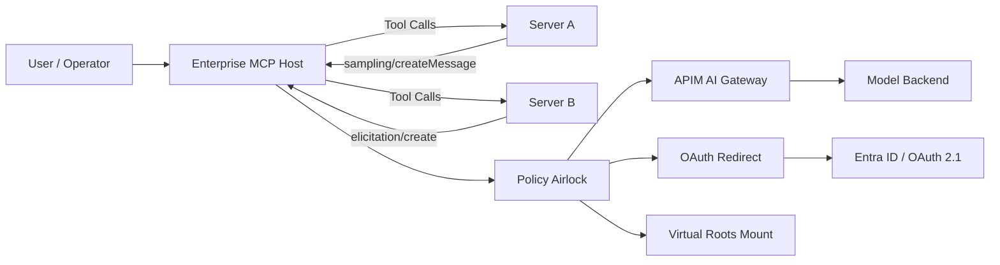
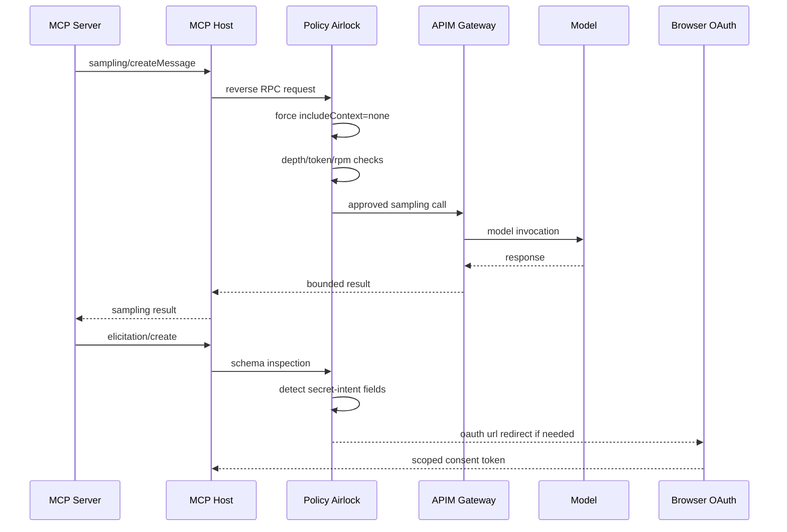
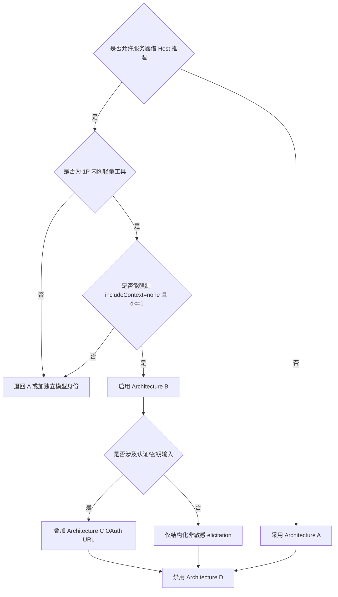

# 企业 MCP Reverse-RPC 治理选型 FAQ：BYO-Model 零采样 vs Host Airlock 受控采样 vs OAuth URL 重定向 vs 透传反模式
> **角色定位**：Cloud & AI Solution Architect、平台治理负责人、安全架构师、MCP Host 维护团队。
> **聚焦问题**：如何治理 MCP 服务器反向发起的 `sampling/createMessage`、`elicitation/create`、`roots/list`，同时守住成本、隐私与可审计边界。
> **一句话结论**：默认 A；受控内网短链可选 B；凡涉及凭据与敏感输入必须 C；D 直接列入禁用清单。

## 1. 执行摘要
MCP 把工具调用标准化后，企业开始从“能连上”进入“能安全运营”阶段。
真正的难点不在请求转发，而在反向 RPC 的治理。
当服务器可以向 Host 请求推理时，成本归属、上下文泄露与模型越权会同时发生。
当服务器可以直接弹出表单时，钓鱼面会借助可信 UI 外衣显著提升成功率。
当服务器请求 roots 过宽时，本地工作区边界会被静默扩大。
因此，MCP 生产化不是协议接入工程，而是“反向权限系统设计”。
Architecture A 通过禁用 Host sampling，把推理预算收敛到服务器自有成本中心。
Architecture B 保留受控 sampling，但必须硬性 `includeContext: "none"` 与深度上限。
Architecture C 规定表单只问业务澄清，不问秘密，秘密走 OAuth URL 流程。
Architecture D 的透传做法在审计、隔离、FinOps 三条线上都不可接受。
本文给出四架构分层对比、公式化风险模型、策略代码与三档 TCO。
结论可直接落地到 APIM、Host 拦截器、Azure Monitor 与 Entra 授权流程。

## 2. 为什么 MCP Reverse-RPC 会成为企业风险放大器
多数团队早期只关注“工具调用成功率”，忽略了“谁在消耗谁的模型预算”。
一旦允许服务器反向 sampling，请求就从“服务器执行工具”变成“服务器借 Host 脑力”。
如果 Host 保留全上下文，服务器可间接读取本不属于它的会话片段。
如果多个服务器并存，`allServers` 模式会让跨域数据旁路成为现实。
在高并发场景中，递归 sampling 还会触发令牌放大。
例如分支因子 `b=3`、深度 `d=2`，预算会被拉到 `1 + 3 + 9 = 13` 倍调用面。
这类事件通常不先表现为安全告警，而是先表现为 PTU 异常消耗。
另一方面，`elicitation/create` 若允许自由文本请求秘密，UI 信任链会被反向利用。
用户看到的是“企业熟悉的 Copilot 外壳”，但内容可能来自不可信服务器。
若没有 schema 约束，`password`、`pat`、`otp` 一类字段会自然渗透到流程。
同样危险的还有 roots 暴露。
过宽 roots 会把开发者本地目录、缓存目录、历史构建目录一起暴露。
攻击者并不需要系统权限提升，只需合法调用 `resources/read` 就可扩大信息面。
因此，Reverse-RPC 治理必须同时处理四件事。
第一件是上下文最小化。
第二件是预算与深度最小化。
第三件是输入类型最小化。
第四件是文件系统可见面最小化。

## 3. 四种候选架构
Architecture A：禁用 Host sampling，服务器自有身份调用模型。
Architecture B：Host Airlock 代理采样，强制 `includeContext: "none"`。
Architecture C：Elicitation 结构化反钓鱼 + OAuth URL 重定向 + 虚拟 roots。
Architecture D：sampling 与 elicitation 透传，含 `allServers` 上下文。
A 追求最强隔离与最清晰账单归属。
B 追求轻量接入与凭据不下发的折中。
C 追求人机交互安全边界清晰化。
D 追求短期接入速度，但把长期风险转嫁给平台方。

## 4. Architecture A：Zero-Sampling Server-Owned Sub-Agent
A 的核心是 Host 不向服务器提供 `capabilities.sampling`。
服务器若要推理，只能用自己的 Managed Identity 调用 APIM 后端模型。
这样做把责任边界固定为“谁发起推理，谁承担预算与审计义务”。
对 FinOps 而言，账单按服务器维度天然可分摊。
对安全而言，Host 会话上下文不会被反向读取。
对可运维性而言，不需要维护跨服务器上下文红线策略。
A 的代价是每个服务器要有独立模型接入路径。
如果组织已有统一 APIM AI Gateway，这个代价通常可接受。
在监管行业，A 还能满足“工具平台与推理平台分责”的审计诉求。

## 5. Architecture B：Host Airlock 受控 sampling
B 的目标是让内部轻量服务器无需直接持有模型凭据。
但 B 必须以硬护栏成立，否则会退化成 D。
第一条硬护栏：`includeContext` 统一覆写为 `none`。
第二条硬护栏：递归深度上限 `d <= 1`。
第三条硬护栏：每工具 `maxTokens` 与 `rpm` 双配额。
第四条硬护栏：模型等级白名单与成本上限。
第五条硬护栏：反向 RPC 调用链必须写入可追溯日志。
当这些护栏全部存在时，B 可在安全与效率之间取得可控平衡。
若任意一条缺失，B 很快会演变为跨团队争议焦点。

## 6. Architecture C：结构化 elicitation + OAuth URL + 虚拟 roots
C 关注的是“用户交互输入面”的安全。
策略是把可问问题限定为非敏感业务澄清。
例如枚举、整数、布尔、非秘密字符串。
一旦字段命中秘密词典，如 `password`、`api_key`、`token`、`otp`，立即拒绝。
当服务器确实需要授权，应重定向到浏览器隔离的 OAuth 2.1 或 Entra 登录页。
这把“认证凭据输入”与“业务参数输入”分离成两条信任链。
roots 方面，C 采用任务级虚拟挂载。
服务器仅看到显式分配的项目子目录，而非用户主目录。
这样就算服务器被入侵，也只能在窄边界内活动。
C 的价值在于把社工风险前移到协议层控制。

## 7. Architecture D：透传反模式
D 常见口号是“先跑起来再治理”。
真实后果通常是“先扩散再止血”。
`includeContext: "allServers"` 会把多服务器输出拼接成新的泄露面。
自由文本 elicitation 会把凭据采集伪装成正常问询。
roots 全盘暴露会让无关文件进入检索候选。
最终表现为三类故障并发。
第一类是 Token Parasitism。
第二类是跨域上下文污染。
第三类是凭据钓鱼事件。
D 在企业环境中不可作为过渡方案使用。

## 8. 关键公式与量化模型
递归采样放大：
`A_tokens = Σ(i=0..d) b^i * T_i`
其中 `b` 为每层分支数量，`T_i` 为第 i 层平均 token。
若 `b=4, d=2, T_i≈2k`，则 token 近似 `2k*(1+4+16)=42k`。
Token Parasitism 额外消耗可写为：
`C_parasitism = (A_tokens - T_baseline) * P_token`。
Elicitation 拦截精度：
`Precision_reject = TP / (TP + FP)`。
Elicitation 漏拦率：
`Miss_rate = FN / (TP + FN)`。
Airlock 时延开销：
`Δ_latency = L_policy + L_schema + L_logging`。
企业目标不是把 `Δ_latency` 变为零，而是把 `Miss_rate` 降到监管可接受范围。

## 9. 12 维横向对比矩阵
| 维度 | Architecture A | Architecture B | Architecture C | Architecture D |
|---|---|---|---|---|
| 预算归属清晰度 | 最高 | 中高 | 高 | 低 |
| 上下文泄露风险 | 最低 | 低 | 低 | 最高 |
| 凭据钓鱼暴露 | 低 | 中 | 最低 | 最高 |
| 接入速度 | 中 | 高 | 中 | 最高 |
| 平台治理复杂度 | 中 | 高 | 中高 | 低（表面） |
| 审计可解释性 | 高 | 高 | 高 | 低 |
| 递归放大控制 | 强 | 中强 | 强 | 无 |
| roots 边界可控 | 中 | 中 | 强 | 弱 |
| 多租户隔离一致性 | 高 | 中高 | 高 | 低 |
| 合规可接受度 | 最高 | 中高 | 最高 | 不可接受 |
| 推荐适用面 | 广 | 受控内部 | 敏感交互 | 无 |
| 总体建议 | 默认 | 条件启用 | 必选补层 | 禁用 |

## 10. 反向 RPC 信任边界拓扑


## 11. Airlock 时序：sampling + elicitation + OAuth redirect


## 12. 方案选择决策树


### Q1. 为什么企业不应默认开启 sampling 能力
默认开启 sampling 看似提高服务器智能度。
但它会把成本责任从服务器悄悄转移给 Host 平台。
平台侧很快出现“谁在烧预算”不可解释问题。
更严重的是上下文泄露边界被模糊化。
因此默认值应是关闭，而非开启后再补丁治理。
当组织没有成熟审计链时，关闭 sampling 是风险最小策略。

### Q2. B 模式最容易被忽略的失败点是什么
最常见失败点是“只限流，不限上下文”。
限流只能控制总量，不能控制泄露半径。
第二个失败点是允许多层递归。
递归深度一旦放开，预算模型会失真。
第三个失败点是日志只记结果，不记调用链。
没有 lineage，事后追责与修复都会失去抓手。

### Q3. C 模式如何防止表单钓鱼
防钓鱼不应依赖“人工识别可疑文案”。
应在协议层把可输入类型限制为可验证 schema。
凡涉及秘密输入，统一导向 OAuth URL。
这把风险从“文案判断”转成“流程判断”。
当流程受控时，社会工程学成功率会显著下降。
实践中还应保留拒绝样本用于规则回归测试。

### Q4. roots/list 为什么必须做虚拟化
roots 是文件可见面的根。
根一旦给宽，后续每个读取都在扩大暴露面。
虚拟 roots 能把授权从“目录级习惯”变成“任务级契约”。
它还支持到期自动回收，减少历史残留权限。
对多租户环境，虚拟 roots 也是隔离证明的一部分。
没有 roots 最小化，其他策略都会被文件读取旁路削弱。

### Q5. 如何把 Reverse-RPC 治理映射到 TCO
治理成本不只来自网关策略执行。
它也来自审计、告警、误拦截复核与规则维护。
若不用治理，短期成本看似低。
但事故后会以应急、人力与合规罚责形式回流。
因此 TCO 模型要把“未治理事故期望损失”显式纳入。
成熟企业通常在第二个季度就能看见治理投资回报。

### Q6. 五步落地指南与 Good fit / Not for
第一步，按服务器分类：1P 内部、3P 供应商、高监管域。
第二步，默认关闭 sampling，仅对白名单评估 B。
第三步，上线 C：schema 反钓鱼与 OAuth URL 分流。
第四步，实施虚拟 roots 与会话级到期回收。
第五步，建立 lineage 看板与月度预算复盘。
Good fit：多服务器并存、预算敏感、需审计可追踪的组织。
Not for：把 MCP 当“实验脚本通道”且无生产责任边界的团队。

## 13. 生产策略实现片段
```python
import re
from typing import Any, Dict

SENSITIVE_PATTERNS = [
    r"password", r"passwd", r"api[_-]?key", r"secret", r"token",
    r"otp", r"one[- ]time", r"ssn", r"private[_-]?key", r"pat"
]

def enforce_sampling_policy(payload: Dict[str, Any], depth: int, max_depth: int = 1, max_tokens: int = 1200) -> Dict[str, Any]:
    req = dict(payload)
    req["includeContext"] = "none"
    if depth > max_depth:
        raise ValueError("sampling depth exceeded")
    mt = int(req.get("maxTokens", 0) or 0)
    if mt <= 0 or mt > max_tokens:
        req["maxTokens"] = max_tokens
    return req

def reject_sensitive_elicitation(schema: Dict[str, Any]) -> None:
    text = str(schema).lower()
    for p in SENSITIVE_PATTERNS:
        if re.search(p, text):
            raise PermissionError("elicitation schema contains sensitive intent")

def route_to_oauth_if_needed(schema: Dict[str, Any]) -> str:
    txt = str(schema).lower()
    return "oauth_url" if any(x in txt for x in ["login", "consent", "authorize", "credential"]) else "form_mode"
```

```xml
<policies>
  <inbound>
    <base />
    <set-variable name="mcpReverseRpc" value="@(context.Request.Headers.GetValueOrDefault(&quot;x-mcp-reverse-rpc&quot;,&quot;false&quot;))" />
    <choose>
      <when condition="@(context.Variables[&quot;mcpReverseRpc&quot;].ToString() == &quot;true&quot;)">
        <quota-by-key calls="120" renewal-period="60" counter-key="@(context.Subscription.Id + &quot;|reverse-rpc&quot;)" />
        <set-header name="x-airlock-context-mode" exists-action="override">
          <value>none</value>
        </set-header>
        <choose>
          <when condition="@(context.Request.Headers.GetValueOrDefault(&quot;x-model-tier&quot;,&quot;slm&quot;) != &quot;slm&quot;)">
            <return-response>
              <set-status code="403" reason="Model tier not allowed for reverse RPC" />
            </return-response>
          </when>
        </choose>
      </when>
    </choose>
  </inbound>
  <backend><base /></backend>
  <outbound><base /></outbound>
  <on-error><base /></on-error>
</policies>
```

```yaml
mcpHostPolicy:
  capabilities:
    sampling: conditional
    elicitation: restricted
    roots: virtual_only
  sampling:
    default: disabled
    includeContextOverride: none
    maxDepth: 1
    maxTokensPerCall: 1200
    rpmPerServer: 60
    allowedModelTiers:
      - slm
  elicitation:
    allowFieldTypes:
      - enum
      - boolean
      - integer
      - number
      - string_non_secret
    denyKeywords:
      - password
      - api_key
      - otp
      - ssn
      - pat
    oauthRedirectEnabled: true
  roots:
    mode: ephemeral_virtual_mount
    ttlMinutes: 45
    allowHostHomeDirectory: false
  observability:
    emitLineageToAzureMonitor: true
    traceAttributes:
      - reverse_rpc.server_id
      - reverse_rpc.tool_name
      - reverse_rpc.model_tier
      - reverse_rpc.token_budget
```

## 14. 三档企业 TCO 与适用边界
| 档位 | 典型组织 | 推荐架构 | 成本主驱动 | 关键收益 |
|---|---|---|---|---|
| Tier-1 | Internal 1P Tooling | A + 部分 B | APIM 配额与轻审计 | 快速治理起步、预算可见 |
| Tier-2 | Multi-Vendor ISV MCP Marketplace | A + B + C | Airlock 策略与审计运营 | 抑制跨供应商泄露与预算劫持 |
| Tier-3 | Banking/Healthcare Zero-Sampling Enclave | A + C | 严格合规审计与身份闭环 | 最低泄露面与最强可追责 |

## 15. 上线检查清单（Day-0/Day-2）
上线前应验证 sampling 默认关闭且 B 白名单服务器数量受控。
上线前应验证 `includeContext` 被强制覆写。
上线前应验证 `d<=1` 与 token 上限生效。
上线前应验证敏感关键词拒绝精度。
上线前应验证 OAuth URL 跳转成功率。
上线前应验证虚拟 roots 可按任务回收。
上线前应验证 lineage 可关联到成本报表。
上线后应按周复盘误拦截与漏拦截样本。
上线后应按月复盘 reverse RPC 的预算偏差。
上线后应对新增服务器执行准入评审。
上线后应把失败案例转成策略回归测试。

## 16. 结论
MCP 的价值在于标准化工具互操作。
MCP 的风险也在于标准化后扩散更快。
企业要做的是先定义反向权限边界，再谈规模化连接。
A 提供最清晰责任边界与成本归属。
B 只应在强护栏成立时启用。
C 让用户输入与认证输入彻底分流，是生产必需。
D 虽然接入快，但会把安全、合规与预算问题一次性引爆。
对于大型集团实践，还应把反向采样、表单拒绝、OAuth 重定向、虚拟 roots 生命周期、审计证据保留期限与成本分摊规则统一写入同一平台控制基线，并通过季度攻防演练与跨团队复盘持续校准，确保策略在组织扩张、供应商变更与监管检查压力下仍保持可执行与可解释。
同时建议将每次策略变更绑定回归测试编号、风险评级、审批人与回滚条件，保证在发生跨区域故障或供应商组件升级时能够以分钟级恢复到已验证策略版本并维持审计链连续完整。
把 Reverse-RPC 治理前置，企业才能把 MCP 从“可演示能力”升级为“可持续生产能力”。
