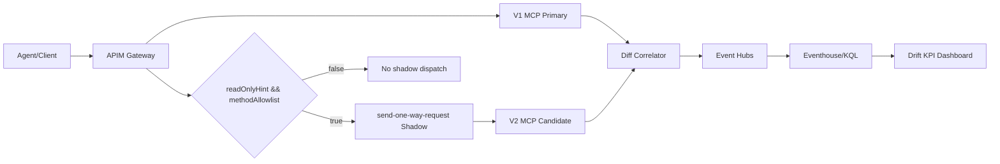
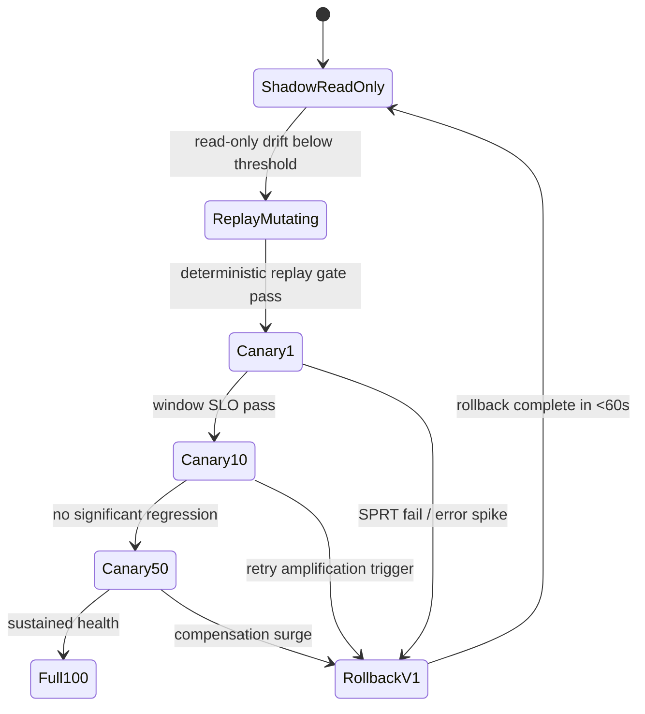

# Enterprise MCP Server Release Engineering Selection FAQ: Read-Only Shadow Mirroring vs Deterministic Replay Sandbox vs Cohort Ring Canary

> Domain: AI Gateway governance, MCP tool release engineering, cross-organization A2A federation reliability.
> Core decision: How to upgrade MCP adapters (`v1 -> v2`) without breaking autonomous trajectories or creating duplicate side-effecting writes.

## 1. Executive summary

MCP release failures are often measured by latency and error rate only, but the highest-impact incidents are silent data corruption events:

- duplicate refunds,
- duplicate support tickets,
- inventory divergence,
- double-booked financial entries,
- workflow split-brain caused by mid-session version hopping.

A safe enterprise pattern separates verification by risk domain:

- **Route A** for read-only live shadow analysis under strict APIM policy gates.
- **Route B** for mutating-tool deterministic replay in an isolated cassette sandbox.
- **Route C** for session-pinned progressive tenant-ring canary with fast rollback.
- **Route D** treated as prohibited anti-pattern behavior.

Recommended control objective:

1. Preserve zero side effects during read-path compatibility validation.
2. Prove mutating workflow safety before production write traffic exposure.
3. Enforce session stickiness and statistical rollback criteria during rollout.
4. Emit complete evidence artifacts for architecture review and compliance audit.

## 2. Business and risk context

### 2.1 Typical enterprise MCP workloads

- Omnichannel order-state and refund operations in retail ecosystems.
- Banking core-ledger and treasury transfer adapters.
- ERP procurement, inventory reservation, and reconciliation tools.
- SaaS ITSM and CRM adapters with mixed read/write procedures.

### 2.2 Why this class of release is hard

- JSON-RPC envelopes may appear homogeneous while methods carry very different side-effect semantics.
- Agent workflows are multi-turn and correlation-sensitive.
- Tool-level idempotency guarantees vary across downstream systems.
- API response schema drift can pass smoke tests and still break long trajectories.

### 2.3 Design objective

Build a release pipeline that is:

- deterministic for mutating paths,
- representative for read-only real traffic,
- statistically defensible for canary promotion/rollback decisions,
- and auditable across policy, routing, and outcome dimensions.

## 3. Route definitions

### Route A: APIM policy-gated read-only live shadow mirroring + async diff engine

- Mirror only requests that are both `readOnlyHint=true` and method-allowlisted.
- Strip mutation credentials from mirrored requests.
- Use out-of-band one-way shadow dispatch to avoid user-path latency inflation.
- Persist `(v1, v2, latency_delta, schema_diff, semantic_diff)` for analysis in Event Hubs/Eventhouse.

### Route B: Deterministic cassette record-and-replay sandbox for mutating tools

- Capture sealed gold request/response cassettes with state invariants.
- Replay in isolated Microcks/WireMock or equivalent sandbox on ACA/AKS.
- Compare full multi-turn trajectories against outcome oracles before promotion.
- Use Foundry Evaluation gates for objective pass/fail evidence.

### Route C: Progressive cohort/tenant-ring canary with session-pinned weighted routing

- Drive rollout steps `1% -> 10% -> 50% -> 100%`.
- Pin entire `Mcp-Session-Id` to one revision to avoid split-brain within a workflow.
- Continuously score `isError` drift, retry amplification, compensation triggers.
- Auto-drain to v1 when rollback criteria are met (`<60s` target).

### Route D: Anti-pattern baseline

- Shadow all JSON-RPC POSTs including mutating operations.
- Route requests round-robin between v1 and v2 in the same session.
- Replace `latest` endpoint in place without shadow/replay/canary evidence.

## 4. Twelve-dimension head-to-head matrix

| Dimension | Route A Read-Only Shadow | Route B Replay Sandbox | Route C Session-Pinned Canary | Route D Anti-Pattern |
|---|---|---|---|---|
| Side-effect safety | High | Very high | Medium-high | Very low |
| Live traffic realism | Very high | Medium | High | Uncontrolled |
| Mutating path confidence | Low | Very high | Medium-high | Low |
| Rollout control quality | Medium | Medium | Very high | Low |
| Policy auditability | High | High | High | Low |
| Latency impact on user path | Near-zero | None (offline) | Low-medium | Unpredictable |
| Regression detection depth | High | Very high | High | Low |
| Session consistency guarantee | Medium | High | Very high | Low |
| Engineering complexity | Medium | Medium-high | Medium | Superficially low |
| Cost predictability | Medium | Medium | Medium | Poor long-term |
| Regulatory suitability | Good | Excellent | Excellent | Poor |
| Incident blast-radius control | High | High | Very high | Low |

## 5. Architecture diagram A: shadow mirror and diff analytics path



## 6. Architecture diagram B: progressive shadow-to-canary state machine



## 7. Q1: How to prove side-effect risk is bounded in read-only shadow mode?

Let:

- `R_mut`: fraction of mutating methods in incoming traffic.
- `C_allow`: coverage of read-only allowlist over eligible methods.
- `P_false_ro`: probability of incorrect read-only labeling.

Risk upper bound:

\[
Risk_{side\_effect} \le R_{mut} \cdot (1 - C_{allow}) + P_{false\_ro}
\]

Engineering controls:

1. Require explicit read-only hint plus method allowlist match.
2. Strip or replace mutation credentials in mirrored context.
3. Maintain deny-by-default for unknown methods.
4. Trigger policy alert on method classification misses.

## 8. Q2: Why asynchronous shadowing instead of synchronous dual-call?

Synchronous dual-call adds:

\[
\Delta TTFT_{sync} \approx latency(v2)
\]

At scale, this raises p95/p99 and can trigger queueing cascades.

Asynchronous one-way shadowing keeps:

\[
\Delta TTFT_{async} \approx 0 \text{ ms (gateway copy overhead only)}
\]

Therefore:

- production user path remains stable,
- shadow depth can increase without customer-facing latency tax.

## 9. Q3: Canary sample sizing for minimum detectable `isError` regression

Approximate two-proportion sizing:

\[
n \approx \frac{2 \cdot p(1-p)\cdot(Z_{1-\alpha/2}+Z_{1-\beta})^2}{\Delta p^2}
\]

Example:

- baseline `p = 0.02`,
- detect `\Delta p = 0.005`,
- `\alpha = 0.05`, `\beta = 0.2`.

Result:

- required observations per stage are typically in the high thousands.
- low-volume windows need aggregation or longer hold periods before promotion.

## 10. Q4: Why session pinning is non-negotiable for MCP rollout integrity?

Without session pinning:

- step N can call v1 and step N+1 can call v2,
- tool parameter contracts can drift mid-workflow,
- compensation logic can execute against mismatched state.

Pinning requirement:

- bind `Mcp-Session-Id` and workflow correlation ID to one revision for entire session lifecycle.
- never allow weighted router to split within active session boundaries.

## 11. Q5: Deterministic replay strategy for mutating tools

Replay of mutating workflows requires:

- sealed cassette request/response fixtures,
- pre-state and post-state invariant checks,
- idempotency key behavior validation,
- compensation path assertions.

Typical mutating methods:

- `create_purchase_order`,
- `issue_refund`,
- `update_ledger`,
- `close_case_and_notify`.

Promotion gate:

- replay pass rate threshold,
- no critical invariant violations,
- bounded retry and compensation metrics.

## 12. Q6: Automated rollback criteria and decisioning logic

Primary indicators:

- `isError` delta above threshold.
- retry amplification above baseline band.
- compensation trigger surge.
- p99 latency inflation exceeding SLO budget.

Derived metrics:

\[
A_{retry} = \frac{retries_{total}}{requests_{total}}
\]

\[
C_{comp} = \frac{compensations}{mutating\_calls}
\]

Rollback rule:

- if any hard threshold trips across rolling windows, drain canary and route back to v1 immediately.

## 13. Production policy and evaluator snippets

### Snippet A: APIM shadow-gate policy (read-only only)

```xml
<policies>
  <inbound>
    <base />
    <set-variable name="readOnlyHint" value="@(context.Request.Headers.GetValueOrDefault(\"x-mcp-readonly\",\"false\"))" />
    <set-variable name="method" value="@(context.Request.Body.As<JObject>(preserveContent:true)[\"method\"]?.ToString())" />
    <choose>
      <when condition="@((string)context.Variables[\"readOnlyHint\"] == \"true\" && ((string)context.Variables[\"method\"]).StartsWith(\"tools/read_\"))">
        <send-one-way-request mode="new" timeout="5">
          <set-url>https://mcp-v2-shadow.internal/mcp</set-url>
          <set-method>POST</set-method>
          <set-header name="Authorization" exists-action="delete" />
          <set-header name="x-shadow-correlation-id" exists-action="override">
            <value>@(context.RequestId)</value>
          </set-header>
          <set-body>@(context.Request.Body.As<string>(preserveContent:true))</set-body>
        </send-one-way-request>
      </when>
    </choose>
  </inbound>
  <backend><base /></backend>
  <outbound><base /></outbound>
</policies>
```

### Snippet B: rollback evaluator (sliding window)

```python
from dataclasses import dataclass

@dataclass
class Metrics:
    requests: int
    errors: int
    retry_amp: float
    comp_rate: float
    p99_delta_ms: float

def rollback_decision(m: Metrics, baseline_err: float) -> bool:
    if m.requests < 2500:
        return False
    err_rate = m.errors / m.requests
    if err_rate > baseline_err + 0.005:
        return True
    if m.retry_amp > 0.22:
        return True
    if m.comp_rate > 0.015:
        return True
    if m.p99_delta_ms > 120:
        return True
    return False
```

### Snippet C: shadow diff event envelope

```json
{
  "correlationId": "mcp-2d90-77a",
  "sessionId": "mcp-session-44120",
  "method": "tools/read_order_status",
  "v1LatencyMs": 122,
  "v2LatencyMs": 139,
  "latencyDeltaMs": 17,
  "jsonSchemaDiff": [
    "$.order.shipment.eta type: string -> object"
  ],
  "semanticDriftScore": 0.07,
  "timestampUtc": "2026-11-26T02:24:12Z"
}
```

## 14. Enterprise scenarios (2+)

### Scenario 1: global retail omnichannel order/refund MCP gateway

- Monthly MCP volume: `~50M` calls.
- Read-heavy status tools plus high-risk refund mutations.
- Pattern: Route A for read diffing, Route B for refund trajectory replay, Route C for staged rollout.
- Outcome: no duplicate refund side effects during adapter migration windows.

### Scenario 2: regulated banking core-ledger and treasury MCP adapter

- High-risk mutating operations with strict reconciliation controls.
- Route B enforces deterministic ledger invariants before exposure.
- Route C enables session-pinned canary with `<60s` rollback objective.
- Outcome: schema drift caught pre-production, preventing production reconciliation incidents.

### Scenario 3: cross-org SaaS ERP connector evolution

- Multiple enterprise tenants with heterogeneous workflow contracts.
- Route A drift analytics revealed pagination/field contract regressions.
- Route C halted rollout at 10% ring after retry amplification trigger.
- Controlled rollback avoided broad tenant-visible disruption.

## 15. Three-tier 3-year TCO and implementation checklist

### 15.1 Three-tier TCO model (USD, 3-year horizon)

| Monthly MCP calls | Route A Shadow | Route B Replay | Route C Canary | Combined A+B+C |
|---|---:|---:|---:|---:|
| 5M | 1,120,000 | 1,450,000 | 980,000 | 3,210,000 |
| 50M | 3,860,000 | 4,420,000 | 2,940,000 | 9,780,000 |
| 500M | 22,400,000 | 19,600,000 | 14,900,000 | 52,700,000 |

Interpretation:

- At small scale, replay fixed costs dominate.
- At very large scale, shadow analytics and storage become dominant spend categories.
- Combined strategy remains economically justified when avoiding high-impact side-effect incidents.

### 15.2 Day-0 / Day-1 / Day-2 checklist

**Day-0:**

- classify MCP methods into read-only/mutating taxonomies,
- define allowlist/denylist and policy ownership,
- define drift metrics, SLO thresholds, and rollback contracts.

**Day-1:**

- activate Route A read-only shadow pipeline and diff dashboard,
- create Route B cassette suites for all high-risk mutating methods,
- start Route C at 1% with session pinning and auto-rollback wiring.

**Day-2:**

- extend to multi-region and tenant-ring operating model,
- integrate statistical promotion gates into release approvals,
- operationalize 72-hour post-rollout stability review playbook.

### 15.3 Good fit vs Not for

**Good fit:**

- enterprises requiring safe adapter evolution under high call volume,
- regulated organizations needing deterministic evidence and rollback certainty.

**Not for:**

- teams without method-level side-effect classification discipline,
- environments lacking baseline observability and release automation foundations.

### 15.4 Final recommendation

- Use **Route A** as default read-path compatibility lens,
- use **Route B** as mandatory mutating-path promotion gate,
- use **Route C** as controlled rollout and rollback plane,
- explicitly ban **Route D** in architecture review standards.

Additional recommendation: institutionalize a mandatory 72-hour post-cutover forensic review, so each release improves policy precision and reduces uncertainty for the next migration wave.

### 15.5 Operational governance addendum

To make MCP upgrades a repeatable platform capability rather than an ad-hoc project activity, institutionalize the following controls:

- **Method taxonomy registry**: require explicit read-only vs mutating classification updates for every release candidate.
- **Shadow eligibility coverage KPI**: track percentage of production traffic that is safely shadowable under policy constraints.
- **Replay asset freshness KPI**: track cassette recency, business-rule coverage, and invariant assertion pass trend.
- **Ring promotion standardization**: enforce the same statistical and SLO gates across all rollout rings to avoid subjective gate drift.
- **Rollback drill policy**: run monthly `<60s` rollback exercises to validate policy, credentials, and automation paths.
- **Evidence package template**: persist shadow diff reports, replay outcomes, promotion decisions, rollback events, and forensic summary.

Recommended dashboard fields:

- `shadow_diff_rate_p95`
- `semantic_drift_score_p95`
- `canary_error_delta`
- `retry_amp_ratio`
- `compensation_burst_index`
- `session_pin_break_count`

Cross-team operating model:

- Platform engineering owns gateway policy, diff pipeline, and rollback automation.
- Domain teams own high-risk method assertions and acceptance thresholds.
- Security/compliance owns audit sampling, least-privilege validation, and federated-access review.

With these controls in place, MCP release engineering gains measurable predictability while preserving data integrity and customer trust under high-frequency adapter evolution.

Additional field guidance:

- maintain consumer-driven contract suites for federated A2A consumers,
- enforce semantic unit checks on monetary and ledger-critical fields,
- cap automated compensation loops with explicit escalation breakpoints.
