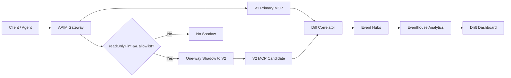
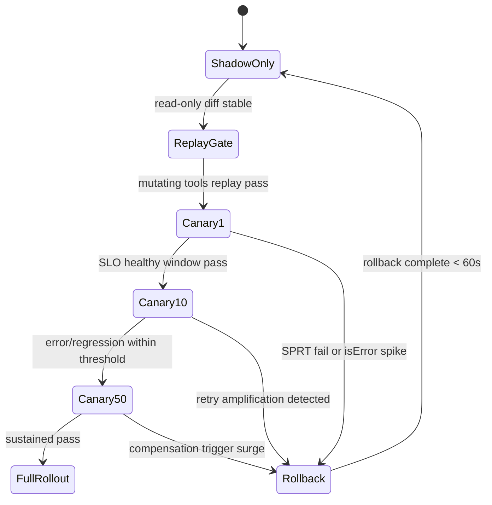

# 企业 MCP Server 发布工程选型 FAQ：只读影子流量 vs 录制回放沙箱 vs 分层金丝雀环

> 领域：AI Gateway、MCP 工具治理、跨组织 A2A 协作发布工程。
> 问题：在 `v1 -> v2` 升级中，如何避免自治 Agent 轨迹断裂与副作用重复写入。

## 1. 执行摘要

企业 MCP Server 升级失败并不只体现在可用性下降，更危险的是“无声数据破坏”：

- 重复退款。
- 重复工单。
- 库存与账务双写。
- 中途会话切版本导致流程分裂。

本指南比较四条路线：

- Route A：APIM 只读影子镜像 + Event Hubs 异步差异引擎。
- Route B：有状态变更工具录制回放沙箱 + 轨迹门禁。
- Route C：会话粘性分层金丝雀 + 自动回滚。
- Route D：全量盲影子、会话不粘、就地覆盖 latest 反模式。

总体建议：

1. 生产读流量验证优先 Route A。
2. 变更写工具验证必须 Route B。
3. 上线切流必须 Route C。
4. Route D 应写入架构审查否决清单。

## 2. 业务背景与风险边界

典型场景：

- 零售全渠道订单、退款、发货状态工具。
- 银行业核心总账、资金划拨、头寸调度工具。
- ERP 采购、库存、财务对账工具。

核心风险：

- MCP JSON-RPC 请求含可变更动作，影子执行会产生真实副作用。
- 不同工具方法的幂等能力不一致，不能统一复制。
- Agent 多轮流程对会话一致性极其敏感。

目标：

- 零副作用验证。
- 可量化回归识别。
- 快速自动回滚。
- 完整审计证据链。

## 3. 路线定义

### Route A：APIM 只读影子镜像 + 异步 Diff

- 仅在 `readOnlyHint=true` 且命中 allowlist 时复制请求。
- 复制采用 `send-one-way-request` 异步不阻塞主链路。
- 对 `(v1_resp, v2_resp, latency_delta, schema_diff)` 做结构与语义对比。
- 差异结果进入 Event Hubs/Eventhouse 做聚合分析。

### Route B：录制回放沙箱（有状态变更工具）

- 录制金样本请求/响应与状态断言。
- 在 `Microcks/WireMock` 或自建沙箱中重放。
- 对 `create_purchase_order`、`issue_refund`、`update_ledger` 等高风险工具做轨迹级对比。
- 以 Foundry Evaluation 结果作为推广门禁。

### Route C：分层金丝雀会话粘性切流

- 基于 App Configuration 特性旗标与 APIM 权重路由。
- 全会话 `Mcp-Session-Id` 固定到同一版本。
- 渐进比例 `1% -> 10% -> 50% -> 100%`。
- 持续评估 `isError`、重试放大、补偿触发率并自动回退。

### Route D：反模式

- 盲目影子所有请求（含写操作）。
- 会话级别不粘性，单工作流跨版本跳跃。
- 直接覆盖 latest 端点，不做回放差异验证。

## 4. 12 维比较矩阵

| 维度 | Route A 只读影子 | Route B 录制回放 | Route C 分层金丝雀 | Route D 反模式 |
|---|---|---|---|---|
| 副作用安全性 | 高 | 很高 | 中高 | 极低 |
| 真实流量代表性 | 很高 | 中 | 高 | 不可控 |
| 写路径覆盖 | 低 | 很高 | 中高 | 混乱 |
| 工程复杂度 | 中 | 中高 | 中 | 低（短期） |
| 回归检测精度 | 高 | 很高 | 高 | 低 |
| 会话一致性保障 | 中 | 高 | 很高 | 低 |
| 自动回滚能力 | 中 | 中 | 很高 | 弱 |
| 合规审计可解释性 | 高 | 很高 | 高 | 低 |
| 上线速度 | 中 | 中 | 高 | 表面高 |
| 运行成本 | 中 | 中高 | 中 | 隐性高 |
| 故障隔离能力 | 高 | 高 | 很高 | 低 |
| 监管行业适配 | 良 | 优 | 优 | 差 |

## 5. 架构图一：影子到差异分析链路



## 6. 架构图二：影子->金丝雀状态机



## 7. Q1：只读影子如何证明“零副作用风险”？

定义：

- `R_mut`：可变更方法调用比例。
- `C_allow`：allowlist 对只读方法覆盖率。
- `P_false_ro`：错误标记为只读的概率。

副作用风险上界：

\[
Risk_{side\_effect} \le R_{mut} \times (1 - C_{allow}) + P_{false\_ro}
\]

工程要求：

- 仅当 `readOnlyHint=true` 且命中 allowlist 才镜像。
- 影子请求剥离 mutation credential。
- 对候选响应只做离线比较，不回写主流程。

## 8. Q2：异步影子为何优于同步双调用？

若同步双调用：

- 增量时延约 `ΔTTFT_sync ≈ latency(v2)`。
- 主链路 P99 明显抬升，可能引发级联超时。

若异步单向镜像：

- `ΔTTFT_async ≈ 0ms`（仅网关本地复制开销）。
- 用户面体验基本不受影响。

结论：

- 实时业务必须采用异步影子。
- 同步双调用仅可在离线压力测试使用。

## 9. Q3：金丝雀样本量如何估算最小可检测回归？

目标：检测 `isError` 回归 `Δp`。
简化近似：

\[
n \approx \frac{2 \cdot p(1-p)\cdot(Z_{1-\alpha/2}+Z_{1-\beta})^2}{\Delta p^2}
\]

示例：

- 基线 `p=0.02`。
- 希望检测 `Δp=0.005`。
- `\alpha=0.05, \beta=0.2`。

得到 `n` 约为万级请求量。
因此 1% 环需按流量峰谷分层抽样，避免偏差。

## 10. Q4：会话粘性为何是硬约束？

若会话内跨版本：

- 上下文字段解释可能不一致。
- v1 返回结构被 v2 工具链误解。
- 补偿逻辑失配，导致重复动作。

策略：

- `Mcp-Session-Id` 绑定版本。
- 工作流关联 ID 全程一致。
- 在会话结束前禁止跨版本漂移。

## 11. Q5：录制回放沙箱如何覆盖状态依赖工具？

仅录请求/响应不够，还需：

- 初始状态快照。
- 每步后置断言。
- 幂等键与顺序约束。

示例断言：

- 创建采购单后库存预留变化。
- 发起退款后账务余额变化。
- 更新总账后借贷平衡保持恒等。

## 12. Q6：如何度量重试放大与补偿风暴？

定义：

\[
A_{retry}=\frac{retries\_total}{requests\_total}
\]

\[
C_{comp}=\frac{compensations}{mutating\_calls}
\]

当 Canary 版本出现：

- `A_retry` 持续高于基线阈值。
- `C_comp` 突增。

应立即触发自动回滚并回到影子阶段排查。

## 13. 生产配置与代码示例

### 示例 A：APIM 影子门禁策略（只读）

```xml
<policies>
  <inbound>
    <base />
    <set-variable name="isReadOnly" value="@(context.Request.Headers.GetValueOrDefault(\"x-mcp-readonly\",\"false\"))" />
    <set-variable name="toolName" value="@(context.Request.Body.As<JObject>(preserveContent:true)[\"method\"]?.ToString())" />
    <choose>
      <when condition="@((string)context.Variables[\"isReadOnly\"] == \"true\" && ((string)context.Variables[\"toolName\"]).StartsWith(\"tools/read_\"))">
        <send-one-way-request mode="new" timeout="5">
          <set-url>https://mcp-v2-shadow.internal/mcp</set-url>
          <set-method>POST</set-method>
          <set-header name="Authorization" exists-action="delete" />
          <set-header name="x-shadow-correlation-id" exists-action="override">
            <value>@(context.RequestId)</value>
          </set-header>
          <set-body>@(context.Request.Body.As<string>(preserveContent:true))</set-body>
        </send-one-way-request>
      </when>
    </choose>
  </inbound>
  <backend><base /></backend>
  <outbound><base /></outbound>
</policies>
```

### 示例 B：自动回滚评估器（滑窗 + SPRT 简化）

```python
from dataclasses import dataclass

@dataclass
class WindowStats:
    req: int
    err: int
    retry_amp: float
    comp_rate: float

def should_rollback(stats: WindowStats, baseline_err: float) -> bool:
    if stats.req < 2000:
        return False
    err_rate = stats.err / stats.req
    if err_rate > baseline_err + 0.005:
        return True
    if stats.retry_amp > 0.22:
        return True
    if stats.comp_rate > 0.015:
        return True
    return False
```

### 示例 C：结构差异记录模型

```json
{
  "correlationId": "3f4d-92aa",
  "sessionId": "mcp-session-8842",
  "tool": "tools/read_order_status",
  "v1LatencyMs": 118,
  "v2LatencyMs": 134,
  "latencyDeltaMs": 16,
  "schemaDiff": ["$.items[0].fulfillmentEta type changed string->object"],
  "semanticDiffScore": 0.08,
  "timestampUtc": "2026-11-26T02:22:11Z"
}
```

## 14. 企业场景（2+）

### 场景 1：全球零售全渠道订单/退款 MCP 网关

- 月调用规模：`50M`。
- 读请求占比高，但退款工具为高风险写路径。
- 采用 Route A 做读影子，Route B 校验退款轨迹，Route C 渐进切流。
- 成果：升级窗口内无重复退款事故，P99 抖动受控。

### 场景 2：监管银行核心总账/资金调度 MCP 适配器

- 变更工具必须零重复记账。
- 采用 Route B 建立确定性账务断言回放。
- 采用 Route C 会话粘性金丝雀并启用 `<60s` 自动回退。
- 成果：新版本在预生产捕获字段语义漂移，避免生产事故。

### 场景 3：跨组织 SaaS ERP 连接器升级

- 多租户客户对升级窗口容忍度低。
- 通过 Route A 差异看板识别分页回归。
- 在 Route C 的 10% 环发现重试放大后自动回退。
- 实现低风险迭代与可解释交付。

## 15. 三档三年 TCO 与落地清单

### 15.1 三档规模 TCO（USD，三年）

| 档位（月 MCP 调用） | Route A 只读影子 | Route B 回放沙箱 | Route C 金丝雀切流 | 组合方案 A+B+C |
|---|---:|---:|---:|---:|
| 5M | 1,120,000 | 1,450,000 | 980,000 | 3,210,000 |
| 50M | 3,860,000 | 4,420,000 | 2,940,000 | 9,780,000 |
| 500M | 22,400,000 | 19,600,000 | 14,900,000 | 52,700,000 |

注释：

- 低流量时，回放沙箱固定成本占比高。
- 超大流量时，影子数据管道成本增长最快。
- 组合方案通常优于单一路线，因为能按风险面分层投入。

### 15.2 Day-0 / Day-1 / Day-2

Day-0：

- 建立 readOnly allowlist 与 mutating tool 清单。
- 定义差异评分标准与 SLO 回退阈值。
- 建立会话粘性路由键规范。

Day-1：

- 上线 Route A 只读影子并接入 Eventhouse 看板。
- 为高风险写工具构建 Route B 金样本回放。
- 在 1% 环启动 Route C，并接通自动回退开关。

Day-2：

- 扩展至多区域、多租户分层策略。
- 引入统计检验自动化与变更审批联动。
- 将升级证据链标准化为审计工单模板。

### 15.3 Good fit vs Not for

Good fit：

- 需要在真实流量下验证兼容性且不能承担副作用风险的企业。
- 监管敏感场景，要求可追溯可回退。

Not for：

- 无法维护方法级只读/写分类的团队。
- 不具备基本发布工程与观测能力的环境。

### 15.4 最终建议

- 读路径采用 Route A，写路径采用 Route B，上线采用 Route C。
- 将 Route D 标记为禁止模式。
- 每次升级至少完成“影子差异 + 回放轨迹 + 金丝雀回退演练”三项门禁。

补充建议：将“升级后 72 小时稳定性复盘”纳入标准流程，持续降低下一轮发布不确定性。

### 15.5 运营治理补充（建议纳入企业发布规范）

为了让 MCP 升级从“项目动作”进化为“平台能力”，建议把以下机制标准化：

- **方法分类登记制度**：每次发布前必须更新 read/mutate 分类清单，分类变更要走审查工单。
- **影子覆盖率指标**：统计可影子只读方法占比、未分类方法占比、误分类修复时长。
- **回放资产新鲜度指标**：金样本距今时长、最近业务规则变更覆盖度、断言失效率。
- **金丝雀晋级门槛一致化**：每个环必须满足同一组 SLO 与统计门槛，避免人为放宽。
- **回滚演练制度**：每月强制演练一次 `<60s` 自动回退，验证策略与权限链仍然有效。
- **证据归档模板**：统一保存差异报告、回放报告、晋级决策、回滚记录、最终复盘。

推荐看板字段：

- `shadow_diff_rate_p95`：只读影子结构差异 P95。
- `semantic_drift_score_p95`：语义差异分数 P95。
- `canary_error_delta`：当前环相对基线错误率差。
- `retry_amp_ratio`：重试放大系数。
- `compensation_burst_index`：补偿触发突增指数。
- `session_pin_break_count`：会话粘性破坏次数。

组织协同建议：

- 平台团队负责网关策略、差异引擎、回滚自动化。
- 业务域团队负责断言定义、高风险方法清单、验收阈值。
- 安全与合规团队负责审计抽查、凭据最小化、跨组织访问审查。

当这些机制形成闭环后，MCP 发布将具备“可度量、可预测、可回退、可审计”的工程特性，能够支持高频迭代而不牺牲数据一致性与客户信任。

附加实践建议：

- 对跨组织 A2A 联邦调用建立“合同测试仓库”，每次升级自动运行消费者驱动契约校验。
- 对关键字段（金额、币种、订单状态、账务分录）建立语义白名单与单位一致性校验器。
- 对补偿动作设置“预算上限与人工升级闸门”，防止异常版本触发无限补偿循环。
- 对高峰窗口升级采用“冻结时间 + 灰度窗口”双重策略，确保问题可在低冲击时段回退。
- 对全球多区域部署，要求回退策略与配置在主备区域保持一致，避免“主区可回退、备区不可回退”的治理断层。

通过以上机制，企业可把 MCP 升级风险从“黑盒试错”转为“白盒度量”，显著提升版本演进的确定性。
建议再补充一个“发布周报”机制：固定披露本周影子覆盖率、回放通过率、金丝雀晋级次数、自动回滚触发次数、误报率与漏报率，并将异常样本沉淀到下一轮回放资产池。这样可以把经验从单次项目沉淀为组织级长期能力。
同时建议将“关键工具方法回放覆盖率”设为硬门槛（例如不低于 95%），并按业务风险分层设定不同最低标准，确保高风险方法在每次升级中都被重复验证而非抽样跳过。
若覆盖率不达标，应自动阻断晋级并回退到补齐回放资产阶段，避免“带缺陷证据集”进入生产切流决策。
建议在季度审计中抽检升级案例，验证门禁执行是否与制度设计一致。
并持续复盘指标口径，保持跨团队可比性。
形成年度治理基线。
