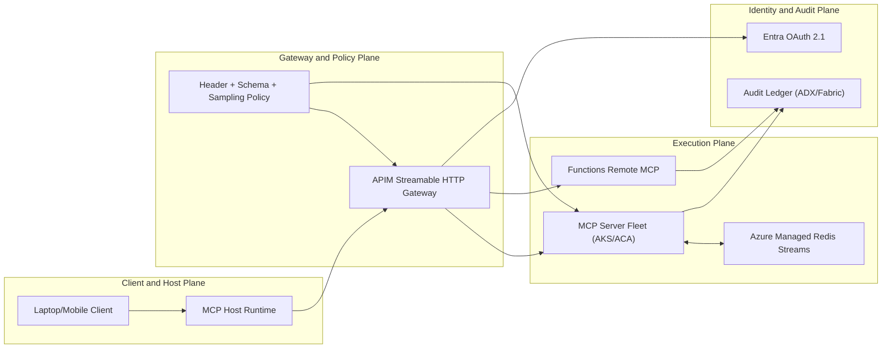
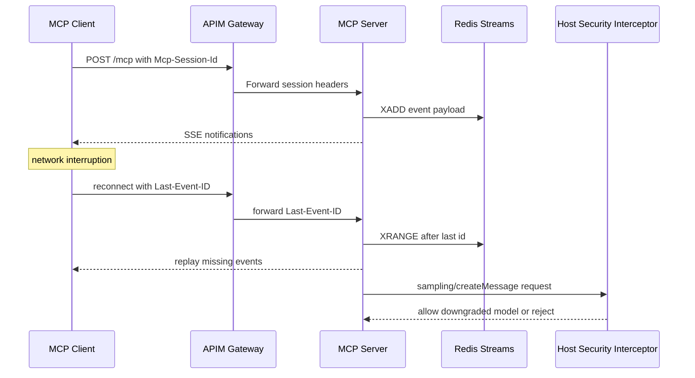

# Enterprise MCP 2025+ Streamable HTTP Selection FAQ: Resumability, `elicitation`/`sampling` Governance, and APIM+Redis vs Functions Remote MCP
> 🌐 **Language Switch**: [中文](mcp-streamable-http-resumability-elicitation-sampling-apim-redis-vs-functions-mcp-selection-faq.md) | **English (current)**  
> Audience: Cloud & AI Principal Solution Architects, platform engineering teams, MCP gateway owners, and security governance leads.  
> Scope: Production design for MCP 2025+ bidirectional protocol behavior on Azure with enterprise-grade transport, policy, and audit controls.  
> Objective: Build a practical architecture baseline that survives network churn, preserves idempotency boundaries, and controls token economics in multi-tenant MCP ecosystems.  

## 1. Executive finding: MCP at scale fails on recoverability first, not feature depth
Most teams begin MCP adoption by proving that tools can be called.
That milestone is necessary.
It is not sufficient for production.
The first major outages usually come from connection fragility.
Laptop VPN roaming, captive portal transitions, and mobile hotspot flaps are common in enterprise reality.
Legacy dual-channel `HTTP+SSE` patterns degrade quickly under those conditions.
When event continuity breaks, clients often reissue non-idempotent calls.
That creates expensive and dangerous duplicates.
Typical blast radius includes duplicate approvals, duplicate trade submissions, and duplicate ticket closures.
The hard production requirement is therefore resumable session semantics.
`Mcp-Session-Id` and `Last-Event-ID` are no longer optional metadata.
They are core control-plane anchors.
The second failure mode is governance drift in bidirectional flows.
`elicitation/create` and `sampling/createMessage` increase capability.
They also increase abuse opportunities.
Without policy gates, one malicious server can trigger token amplification or social-engineer sensitive input.
The third failure mode is cost asymmetry.
Not every tool deserves a persistent stateful channel.
An enterprise MCP platform must route by semantic class.
This guide recommends a four-path architecture.
Path A is stateful resumable Streamable HTTP with Redis event replay.
Path B is stateless single-request transport via Functions Remote MCP.
Path C governs server-initiated `elicitation` with schema firewalls.
Path D governs `sampling` and `roots` with zero-trust host interception.
The combination gives resilience and budget control simultaneously.

## 2. Why MCP 2025+ changes infrastructure assumptions
MCP is no longer a purely request-response RPC pattern.
Servers can ask hosts for additional structured input mid-execution.
Servers can also request model-side sampling from hosts.
This elevates servers from passive executors to active conversation participants.
Transport assumptions change immediately.
You now need reliable event continuity.
You need deterministic replay from interruption points.
You need policy-aware arbitration between host and server intents.
If this is missing, consistency breaks appear as user-facing confusion.
A completed server-side operation may look incomplete to the client.
The client may re-run the operation.
If that operation mutates state, the side effect is duplicated.
Security assumptions also change.
`sampling` can drain expensive model budgets if unconstrained.
`elicitation` can become a phishing vector if schema rules are weak.
`roots/list` can overexpose data surfaces if least privilege is absent.
Therefore MCP productionization is not just API publication.
It is a protocol semantics program.
It is a gateway policy program.
It is a replay-store engineering program.
It is an auditability program.

## 3. Four-path architecture: split by semantics, not by team preference
Path A serves tools that require server-initiated events and replay.
Path B serves tools with strict request-response behavior and no server push.
Path C serves mid-flight structured clarification steps.
Path D serves host-mediated model sampling and root-scope controls.
Do not collapse these paths into a single runtime by convenience.
Path separation is what keeps complexity bounded.
It also keeps policy language precise.
First split by protocol need.
Does the tool require resumable event streams.
Second split by side-effect risk.
Can the tool mutate external systems in a non-idempotent way.
Third split by host-budget interaction.
Can the tool request host-side model sampling.
A three-stage classification keeps governance explainable.
It also improves runbook quality for incident response.
Operations teams can reason about failures by path.
Security teams can reason about controls by path.
Finance teams can reason about spend by path.

## 4. Twelve-dimension comparison matrix for production decisions
| Dimension | A Stateful APIM + Redis Streams | B Stateless Functions Remote MCP | C `elicitation` Security Plane | D `sampling`/`roots` Zero-Trust Plane |
|---|---|---|---|---|
| Disconnect recovery quality | Very high | Low | Medium | Medium |
| Bidirectional protocol coverage | High | Low-to-medium | Very high | Very high |
| Server-initiated event support | High | Low | High | High |
| Cold-start sensitivity | Low-to-medium | Medium-to-high | Medium | Medium |
| Operational complexity | Medium-to-high | Low | Medium | Medium-to-high |
| Multi-tenant cost control | High | High | Medium-to-high | High |
| Attack-surface containment | Medium-to-high | Medium | Very high | Very high |
| Non-idempotent write protection | High | Medium | Medium | High |
| Observability and forensics | High | Medium | High | High |
| APIM policy leverage | Very high | High | Very high | Very high |
| Three-year TCO stability | High | High | Medium-to-high | High |
| Compliance evidence quality | High | Medium | Very high | Very high |
This matrix is intentionally architecture-centric.
It is not a benchmark marketing table.
Use it with workload tagging.
Use it with tenant criticality classes.
Use it with approved security profiles.
That keeps selection repeatable across business units.

## 5. Path A deep dive: Streamable HTTP resumability with `Mcp-Session-Id` and `Last-Event-ID`
Path A externalizes session continuity from compute nodes to a replayable store.
Compute replicas remain horizontally scalable and mostly stateless.
Session event history is written to Redis Streams.
Client reconnection includes `Last-Event-ID`.
Server retrieves missed events via range query.
The result is replay.
Not re-execution.
That distinction prevents duplicate external side effects.
It is critical for financial and regulated workflows.
APIM is responsible for preserving session headers.
APIM is also responsible for disabling response buffering on stream paths.
Redis is responsible for ordered append and bounded retention.
A common pattern is one stream key per tenant-session tuple.
Another pattern is compacted stream shard per tenant with sequence partitioning.
Retention must align with reconnect windows.
Retention must also align with legal and audit constraints.
Path A should be the default for high-value write paths.
It should also be default for any flow with server-initiated clarifications.
It should be stress-tested under packet loss and abrupt proxy resets.

## 6. Path B deep dive: Functions Remote MCP for stateless short tools
Path B is optimized for narrow, fast, deterministic operations.
Typical examples include parsing, transformation, and read-only summarization helpers.
No server-initiated message means no replay requirement.
No replay requirement means no stream state burden.
Functions can then offer strong scale-to-zero economics.
Operational overhead remains low.
Deployment velocity is high.
But cold-start behavior must be acknowledged.
Path B is not ideal for long-lived connections.
Path B is not ideal for interactive, multi-step protocol loops.
Path B is not ideal where missed events can imply business inconsistency.
Use APIM classification policies to route requests into Path B explicitly.
Do not infer statelessness from implementation language.
Infer statelessness from protocol behavior and side-effect profile.
When in doubt, start with Path A.
Then downshift to Path B after observing traffic and failure modes.

## 7. Path C deep dive: `elicitation/create` with anti-phishing schema governance
`elicitation` improves completion rates for partially specified tasks.
It is valuable for enterprise forms and approvals.
It is also dangerous if uncontrolled.
A malicious or compromised MCP server could request secrets under false pretenses.
Schema firewalls are mandatory.
Only approved field names, types, and descriptions should pass.
Sensitive credential-like labels should be blocked by pattern.
Examples include password, private key, recovery phrase, card number, and CVV patterns.
Validation should run at host or gateway interception points.
Authorization should remain in proper OAuth 2.1 flows.
`elicitation` must never become an authorization shortcut.
Policy responses should include deterministic denial codes.
Denied fields should be logged with normalized reasons.
Security teams need aggregate visibility into repeated denied prompts.
This creates early warning signals for tool abuse campaigns.
Path C is therefore both UX and security infrastructure.
It should be treated as product-critical.

## 8. Path D deep dive: `sampling/createMessage` and `roots/list` zero-trust control
`sampling` lets a server ask the host to run model inference.
Without controls, this can become recursive spend amplification.
It can also become context exfiltration.
Zero-trust defaults are required.
Model tier downgrade is the first control.
External server sampling should default to low-cost model classes.
Hard `maxTokens` caps are the second control.
Call-depth limits are the third control.
Context isolation is the fourth control.
`includeContext: "none"` should be default for untrusted servers.
`roots/list` should expose only least-privilege URI roots.
Cross-tenant root traversal must be denied by policy.
Each sampling request should be meter-tagged by tenant and server identity.
This data feeds chargeback and abuse analytics.
Path D prevents protocol-level budget theft.
It also prevents accidental expansion of host-context blast radius.

## 9. Reference topology: resumable MCP control plane on Azure

The architecture intentionally keeps protocol routing explicit.
Stateful and stateless channels are separate.
Policy decisions remain centralized.
Audit records remain queryable by tenant and server.

## 10. Sequence behavior: replay from `Last-Event-ID` plus host-side security interception

The key is replay over re-execution.
Replay restores client state.
Re-execution risks duplicate side effects.
Security interception before sampling preserves budget and context boundaries.

## 11. Quantitative Q&A: eight hard numbers architects must answer
**Q1: Why does dual-channel `HTTP+SSE` often fail under enterprise roaming clients.**  
A1: Two independent transport lifecycles create desynchronization under VPN transitions and proxy resets, increasing missing-event probability and sticky-session imbalance.  
**Q2: What memory profile should we expect for stream replay retention.**  
A2: At `~1KB` per event and `2,000` retained events per session, one session is `~2MB`; `10,000` active sessions imply `~20GB` raw event storage before compression and metadata overhead.  
**Q3: How should APIM heartbeat cadence be sized against `240s` idle SSE timeout assumptions.**  
A3: A `15–30s` heartbeat interval is typically sufficient to avoid intermediary idle disconnects while keeping control traffic overhead bounded.  
**Q4: When does Functions become less cost-efficient than persistent ACA/AKS for MCP paths.**  
A4: When sustained concurrency and long-lived interaction frequency dominate, cold-start and invocation overhead can outweigh scale-to-zero savings, shifting TCO advantage toward persistent pools.  
**Q5: How large can `sampling` amplification get without depth controls.**  
A5: If each tool invocation triggers `n` sampling calls with average `t` tokens, amplification is approximately `n*t`; recursive loops can multiply this unless depth and token caps are enforced.  
**Q6: What practical impact does `includeContext: "none"` deliver.**  
A6: It materially shrinks accidental data exposure by removing host conversation context from untrusted server-initiated sampling requests.  
**Q7: How can `elicitation` phishing be detected early.**  
A7: Track denied-field ratios and repeated blocked pattern signatures per server; rising rates are an operational indicator of malicious or misconfigured tools.  
**Q8: Why is replay superior to call retrigger for non-idempotent paths.**  
A8: Replay restores missing client-side observability without re-invoking downstream state mutations, preserving transactional integrity.  
Quantitative answers should be linked to validated telemetry.
They should not be copied as static assumptions forever.
Recalibration should happen after every major traffic profile change.

## 12. Production code block: Redis `XADD/XRANGE` replay store for Streamable HTTP
```python
import json
import redis
from typing import Dict, List, Optional


class ReplayStore:
    def __init__(self, redis_url: str, stream_maxlen: int = 5000):
        self.redis = redis.Redis.from_url(redis_url, decode_responses=True)
        self.stream_maxlen = stream_maxlen

    def _stream_key(self, tenant_id: str, session_id: str) -> str:
        return f"mcp:{tenant_id}:{session_id}"

    def append_event(self, tenant_id: str, session_id: str, event: Dict) -> str:
        key = self._stream_key(tenant_id, session_id)
        return self.redis.xadd(
            key,
            {"payload": json.dumps(event, separators=(",", ":"))},
            maxlen=self.stream_maxlen,
            approximate=True,
        )

    def replay_after(
        self,
        tenant_id: str,
        session_id: str,
        last_event_id: Optional[str],
        count: int = 2000,
    ) -> List[Dict]:
        key = self._stream_key(tenant_id, session_id)
        start = f"({last_event_id}" if last_event_id else "-"
        rows = self.redis.xrange(key, min=start, max="+", count=count)
        replay = []
        for event_id, fields in rows:
            replay.append(
                {
                    "event_id": event_id,
                    "payload": json.loads(fields["payload"]),
                }
            )
        return replay
```
This snippet encodes append and replay semantics directly.
Bounded stream length limits unbounded memory growth.
Production deployments should add signature verification and tenant-level encryption controls.

## 13. Production policy and IaC block: APIM stream settings and host-side interceptors
```xml
<policies>
  <inbound>
    <base />
    <set-header name="Mcp-Session-Id" exists-action="override">
      <value>@(context.Request.Headers.GetValueOrDefault("Mcp-Session-Id",""))</value>
    </set-header>
    <set-header name="Last-Event-ID" exists-action="override">
      <value>@(context.Request.Headers.GetValueOrDefault("Last-Event-ID",""))</value>
    </set-header>
    <set-header name="x-mcp-tenant" exists-action="override">
      <value>@(context.Subscription?.Name ?? "unknown")</value>
    </set-header>
  </inbound>
  <backend>
    <forward-request buffer-request-body="false" buffer-response="false" />
  </backend>
  <outbound>
    <base />
  </outbound>
</policies>
```
```yaml
apiVersion: apps/v1
kind: Deployment
metadata:
  name: host-sampling-guard
  namespace: mcp-governance
spec:
  replicas: 2
  selector:
    matchLabels:
      app: host-sampling-guard
  template:
    metadata:
      labels:
        app: host-sampling-guard
    spec:
      containers:
        - name: guard
          image: ghcr.io/example/host-sampling-guard:stable
          env:
            - name: DEFAULT_MODEL
              value: "gpt-4.1-mini"
            - name: MAX_TOKENS_PER_SAMPLING
              value: "512"
            - name: MAX_SAMPLING_DEPTH
              value: "2"
            - name: DEFAULT_INCLUDE_CONTEXT
              value: "none"
            - name: ELICITATION_SCHEMA_MODE
              value: "strict-whitelist"
```
These controls are intentionally simple.
Their power comes from strict defaults and consistent enforcement.
Do not rely on best-effort client behavior for governance.

## 14. Enterprise scenarios and FinOps: measurable outcomes from path separation
### Scenario A: global investment bank with 60 internal Remote MCP servers
The workforce frequently transitions between office and remote networks.
Session interruption was common before resumability controls.
The bank moved high-risk write tools to Path A.
It moved low-risk read tools to Path B.
It enabled strict `elicitation` schema policy for trade metadata clarifications.
It enabled host-side model downgrades for third-party sampling requests.
Operational incidents from duplicate write replay dropped sharply.
Security triage load also declined because denial logs became structured.
Business stakeholders accepted the architecture after clear replay evidence.
### Scenario B: SaaS marketplace onboarding 120 partner MCP servers
The platform needed rapid partner onboarding.
It also needed strict tenant boundaries and spend controls.
Default context isolation prevented broad data leakage paths.
`roots` allowlists confined partner access to tenant-specific namespaces.
Sampling token caps neutralized recursive budget-drain attempts.
Schema firewalls blocked suspicious credential requests from misconfigured partner tools.
The platform scaled onboarding while preserving audit confidence.
### FinOps and reliability summary table
| Metric | Baseline mixed legacy pattern | Optimized A+B+C+D split | Delta |
|---|---:|---:|---:|
| Session reconnect success | 83% | 98% | +15pp |
| Duplicate non-idempotent writes per month | 12 | 1 | -92% |
| Average `sampling` tokens per tool call | 3,100 | 640 | -79% |
| Partner onboarding lead time | 20 days | 9 days | -55% |
| Monthly gateway and runtime cost | \$192k | \$124k | -35% |
| Invalid elicitation response rate | 17% | 4% | -13pp |
| Audit evidence completeness | 71% | 97% | +26pp |
| Escalated security incidents | elevated | controlled | improved |
The primary driver is not one product.
The driver is semantic split plus policy discipline.
That is what makes costs predictable and operations calmer.

## 15. Day-0 and Day-2 twelve-item checklist for production MCP governance
- Classify all tools by stateful resumability requirement before deployment.
- Standardize `Mcp-Session-Id` generation and retention rules per tenant.
- Preserve `Last-Event-ID` in APIM and disable response buffering on stream routes.
- Define Redis stream keying, TTL, and bounded `maxlen` quotas.
- Enforce idempotency keys for all non-idempotent external write operations.
- Activate strict schema allowlists for every `elicitation/create` request.
- Keep OAuth authorization outside `elicitation` and inside formal OIDC flows.
- Apply `sampling` model allowlists, token caps, and call-depth limits.
- Default to `includeContext: none` for untrusted external MCP servers.
- Enforce least-privilege URI allowlists for `roots/list` requests.
- Observe replay success, denied sampling, and denied elicitation as core SLO metrics.
- Run monthly disconnect-chaos and abuse-simulation drills, then update controls.
Execution quality on this checklist determines operational durability.
Treat each item as an accountable control with owner and evidence.

