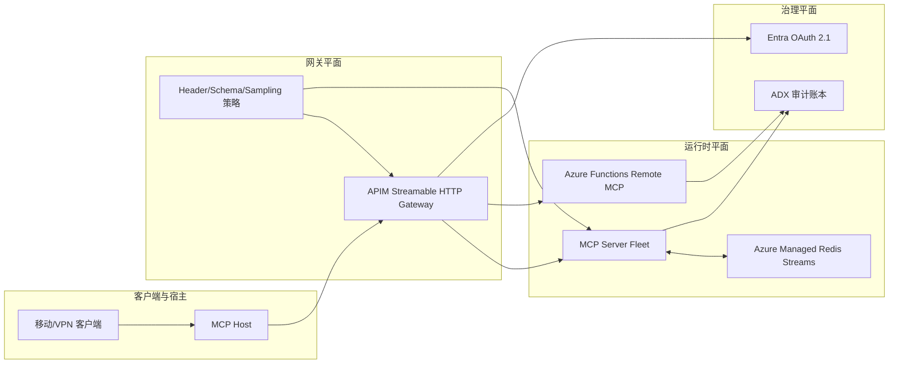
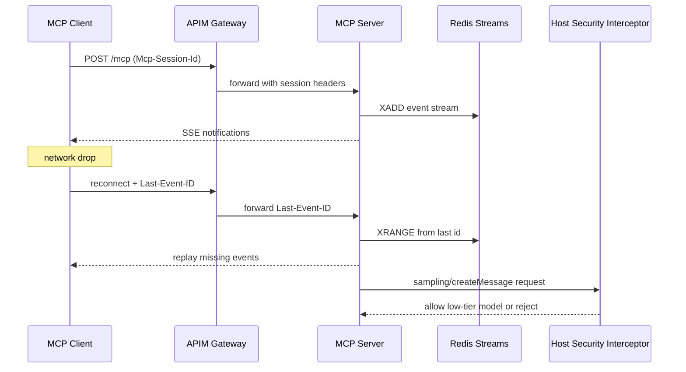

# 企业 MCP 2025+ Streamable HTTP 选型 FAQ：可恢复会话、`elicitation`/`sampling` 治理与 APIM+Redis vs Functions Remote MCP
> 🌐 **Language Switch**: **中文（当前）** | [English](mcp-streamable-http-resumability-elicitation-sampling-apim-redis-vs-functions-mcp-selection-faq.en.md)  
> 适用对象：Cloud & AI 首席架构师、平台工程、MCP 网关团队、安全治理与合规团队。  
> 范围：聚焦 MCP 2025+ 双向状态协议在 Azure 上的生产部署，不覆盖旧版 JSON-RPC 单向模式细节实现。  
> 目标：在可恢复传输、双向交互安全、多租户成本与可观测性之间建立可运营的企业架构基线。  

## 1. 执行摘要：MCP 生产化的核心不是“能连通”，而是“可恢复 + 可治理”
企业最早部署 MCP 往往先追求“工具能调用”。  
进入生产后很快发现连通并不等于稳定。  
移动网络抖动、VPN 重连、企业代理切换会频繁中断会话。  
旧式双连接 `HTTP+SSE` 模式在这些场景下脆弱。  
一旦丢事件，客户端可能误判并重放写操作。  
这会引发重复下单、重复审批、重复工单等高风险后果。  
因此 MCP 生产架构首要目标是可恢复语义。  
`Mcp-Session-Id` 与 `Last-Event-ID` 是关键锚点。  
第二目标是双向交互的安全边界。  
`elicitation/create` 与 `sampling/createMessage` 提高能力，也提高攻击面。  
第三目标是成本可控与多租户公平。  
并非所有工具都值得走全状态通道。  
本指南给出四路径组合式选型。  
路径 A：APIM + Redis Streams 的状态可恢复通道。  
路径 B：Functions Remote MCP 的无状态高弹性通道。  
路径 C：`elicitation` 结构化输入与反钓鱼防火墙。  
路径 D：`sampling`/`roots` 零信任治理与配额防逃逸。  
四路径联动可同时提升稳定性与治理可信度。  

## 2. 问题定义：MCP 2025+ 双向协议为什么会改变基础设施要求
MCP 从“客户端发起、服务端响应”演进到双向交互。  
服务端可主动请求用户补充结构化信息。  
服务端也可请求宿主侧模型执行采样。  
这意味着服务端不再只是被动执行器。  
它开始参与会话控制平面。  
基础设施必须支持双向消息一致性。  
还要支持中断后的有序恢复。  
否则会出现“工具已执行但客户端未收到回执”的不一致。  
此外，双向能力对安全模型提出新要求。  
`sampling` 若无边界，可能被滥用消耗昂贵模型额度。  
`elicitation` 若无约束，可能诱导用户输入敏感信息。  
`roots/list` 若无最小权限，可能扩大数据暴露面。  
因此企业部署 MCP 不再只是 API 发布问题。  
而是协议语义、网关策略、会话存储与安全审计一体化工程。  

## 3. 四路径定位：按会话语义与风险等级拆分运行平面
路径 A 面向需要事件恢复与服务端主动通知的工具。  
路径 B 面向短时纯请求响应工具。  
路径 C 面向中途补参的人机协同控制。  
路径 D 面向模型采样与根路径暴露治理。  
路径 A 提供会话连续性和事件重放能力。  
路径 B 提供极简弹性和最低运维负担。  
路径 C 提供结构化输入质量与反钓鱼保障。  
路径 D 提供预算与上下文边界控制。  
企业不应把所有 MCP 服务塞进同一托管模型。  
推荐按“是否需要 server-initiated 语义”做第一层分流。  
再按“是否涉及高风险写操作”做第二层分流。  
最后按“是否需要宿主采样”做第三层分流。  
这能避免过度工程，也避免治理缺口。  

## 4. 十二维对比矩阵：状态恢复、双向治理与成本的可量化权衡
| 维度 | A APIM + Redis Streams 状态恢复 | B Functions Remote MCP 无状态 | C `elicitation` 安全网关 | D `sampling`/`roots` 零信任 |
|---|---|---|---|---|
| 断线恢复能力 | 极高 | 低 | 中 | 中 |
| 双向协议适配 | 高 | 低中 | 极高 | 极高 |
| 服务端主动能力 | 高 | 低 | 高 | 高 |
| 冷启动敏感性 | 低中 | 中高 | 中 | 中 |
| 运维复杂度 | 中高 | 低 | 中 | 中高 |
| 多租户成本可控性 | 高 | 高 | 中高 | 高 |
| 安全攻击面可控性 | 中高 | 中 | 极高 | 极高 |
| 非幂等写保护适配 | 高 | 中 | 中 | 高 |
| 可观测可追溯性 | 高 | 中 | 高 | 高 |
| APIM 策略协同度 | 极高 | 高 | 极高 | 极高 |
| 三年 TCO 收敛 | 高 | 高 | 中高 | 高 |
| 合规审计友好度 | 高 | 中 | 极高 | 极高 |
矩阵建议与业务分层策略一起使用。  
不是“选一个路径”，而是“定义路径组合边界”。  
把路径映射到工具类型后，治理会更稳定。  

## 5. 路线 A 详解：`Mcp-Session-Id` + `Last-Event-ID` 的可恢复 Streamable HTTP
路线 A 的目标是把计算层无状态化。  
而把会话事件放入可重放存储。  
服务实例可横向扩容且不依赖粘性 Pod。  
断线重连后客户端携带 `Last-Event-ID`。  
服务端从 Redis Streams 回放缺失事件。  
这样可避免“重发整次工具调用”。  
对非幂等下游尤为关键。  
例如交易提交、审批写入、工单关闭。  
如果回放语义正确，客户端可恢复到一致状态。  
APIM 负责透传会话头与 SSE 流。  
并关闭响应缓冲避免事件堆积。  
Redis 负责事件持久、范围查询和过期清理。  
推荐按租户分 stream key 并设置 TTL。  
同时要有幂等键防止下游重复副作用。  
路线 A 是“稳定优先”工具的主干道。  

## 6. 路线 B 详解：Functions Remote MCP 与单次 JSON 响应模式
路线 B 适合短时、纯计算、无服务端主动事件工具。  
例如格式转换、查询汇总、静态校验。  
它可利用消费计划或弹性计划降成本。  
并且部署与升级路径更轻量。  
当调用时长通常 `<10s` 且无状态时。  
Functions 的性价比通常较高。  
但这一路径不适合复杂会话恢复。  
也不适合依赖 `elicitation`/`sampling` 的深交互工具。  
冷启动会影响首包延迟。  
并发突刺时需谨慎评估配额和连接限制。  
因此路线 B 应作为“轻工具通道”。  
不要用它承载高价值状态会话。  
最佳实践是由 APIM 做流量分发前置判定。  
把状态与无状态工具显式分层。  

## 7. 路线 C 详解：`elicitation/create` 的结构化输入与反钓鱼防护
`elicitation` 让工具可在执行中补齐参数。  
这提升了一次成功率。  
但也可能被恶意工具滥用。  
例如诱导输入密码、银行卡、私钥。  
因此必须做 Schema 级防火墙。  
策略层应校验字段白名单。  
禁止敏感字段模式和高风险提示词。  
允许的输入应限定在业务字段集合。  
如成本中心、时间区间、发布环。  
认证授权仍应走 OAuth 2.1 正式流程。  
不能通过 `elicitation` 兜售“快捷授权”。  
建议把 `elicitation` 请求写入审计日志。  
并记录用户确认轨迹与来源服务器身份。  
路线 C 的核心是“可问，但不能乱问”。  

## 8. 路线 D 详解：`sampling/createMessage` 与 `roots/list` 的零信任边界
`sampling` 让 MCP 服务器请求宿主模型帮它推理。  
若不加边界，风险有两类。  
一是 token 放大攻击。  
二是上下文窃取攻击。  
治理策略应先做模型降级。  
默认将外部服务器采样路由到低成本模型。  
并设置 `maxTokens` 硬上限。  
再做上下文隔离，`includeContext: "none"` 默认。  
仅对受信任服务器放开有限上下文。  
`roots/list` 也应最小权限化。  
只暴露当前任务允许的 URI 根。  
拒绝跨项目、跨租户路径请求。  
每次 `sampling`/`roots` 调用都应计量。  
并纳入租户配额账本。  
路线 D 是阻断“协议层预算逃逸”的关键。  

## 9. 参考架构图：状态恢复 MCP 网关与双向治理平面

该图展示了有状态与无状态并行通道。  
并将双向治理策略集中在网关平面。  
可降低散装实现带来的不一致风险。  

## 10. 时序图：断线重连后的 `Last-Event-ID` 回放与安全拦截

时序重点是“回放而非重算”。  
并在 `sampling` 前插入宿主安全拦截。  
这样可同时保护一致性和预算边界。  

## 11. 定量问答：协议、容量、成本与安全的八个硬问题
**Q1：为何旧 `HTTP+SSE` 双连接容易导致会话偏斜？**  
A1：连接粘性与断线重连不一致会造成事件丢失和 Pod 负载不均，随着移动网络抖动会显著放大。  
**Q2：`Last-Event-ID` 回放会占用多少内存？**  
A2：若单事件约 `1KB`、每会话保留 `2,000` 事件，则每会话约 `2MB`；`10,000` 会话约需 `~20GB` 原始存储级别，需配合 TTL 与压缩策略。  
**Q3：APIM SSE 空闲超时 `240s` 如何设计心跳？**  
A3：常用 `15–30s` 心跳可避免中间层误判空闲断开，同时控制额外流量开销。  
**Q4：Functions 冷启动与 ACA/AKS 常驻的 TCO 分界如何判断？**  
A4：低频短请求下 Functions 更省；当并发和持续连接需求上升，常驻实例通常在性能与总成本上更优。  
**Q5：`sampling/createMessage` 的 token 放大风险如何量化？**  
A5：若单次工具调用触发 `n` 次采样且每次 `t` token，总放大量约 `n*t`；需硬限制 `n` 与 `t` 防止递归放大。  
**Q6：`includeContext: none` 的收益是什么？**  
A6：显著降低敏感上下文泄露概率，把外部服务器看到的上下文面缩到最小。  
**Q7：如何防止 `elicitation` 变成凭据钓鱼入口？**  
A7：对字段名、描述、格式做 schema 白名单检查，并阻断密码、密钥、卡号等高风险字段模式。  
**Q8：为什么非幂等写操作必须依赖回放语义而非重放调用？**  
A8：重放调用可能重复副作用，回放事件只恢复客户端状态，不再次触发下游写入。  
问答应纳入架构决策记录与安全评审模板。  
并与实际压测和演练数据持续校准。  

## 12. 生产代码：Redis `XADD/XRANGE` EventStore 与会话恢复实现
```python
import json
import redis
from typing import List, Dict


class EventStore:
    def __init__(self, redis_url: str):
        self.r = redis.Redis.from_url(redis_url, decode_responses=True)

    def append(self, tenant: str, session_id: str, event: Dict) -> str:
        stream = f"mcp:{tenant}:{session_id}"
        return self.r.xadd(stream, {"payload": json.dumps(event)}, maxlen=5000, approximate=True)

    def replay_from(self, tenant: str, session_id: str, last_event_id: str) -> List[Dict]:
        stream = f"mcp:{tenant}:{session_id}"
        start = f"({last_event_id}" if last_event_id else "-"
        rows = self.r.xrange(stream, min=start, max="+", count=2000)
        out = []
        for event_id, fields in rows:
            out.append({"id": event_id, "payload": json.loads(fields["payload"])})
        return out
```
该实现体现“追加 + 增量回放”语义。  
并通过 `maxlen` 控制单流内存增长。  
生产环境应补充签名校验与租户隔离策略。  

## 13. 生产策略/IaC：APIM 透传会话头、禁用缓冲与 Host 安全拦截
```xml
<policies>
  <inbound>
    <base />
    <set-header name="Mcp-Session-Id" exists-action="override">
      <value>@(context.Request.Headers.GetValueOrDefault("Mcp-Session-Id",""))</value>
    </set-header>
    <set-header name="Last-Event-ID" exists-action="override">
      <value>@(context.Request.Headers.GetValueOrDefault("Last-Event-ID",""))</value>
    </set-header>
    <set-header name="x-mcp-tenant" exists-action="override">
      <value>@(context.Subscription?.Name ?? "unknown")</value>
    </set-header>
  </inbound>
  <backend>
    <forward-request buffer-request-body="false" buffer-response="false" />
  </backend>
  <outbound>
    <base />
  </outbound>
</policies>
```
```yaml
apiVersion: apps/v1
kind: Deployment
metadata:
  name: mcp-host-security-interceptor
  namespace: mcp-governance
spec:
  replicas: 2
  selector:
    matchLabels:
      app: mcp-host-security-interceptor
  template:
    metadata:
      labels:
        app: mcp-host-security-interceptor
    spec:
      containers:
        - name: interceptor
          image: ghcr.io/example/mcp-host-interceptor:latest
          env:
            - name: DEFAULT_MODEL
              value: "gpt-4.1-mini"
            - name: MAX_TOKENS_PER_SAMPLING
              value: "512"
            - name: DEFAULT_INCLUDE_CONTEXT
              value: "none"
            - name: ELICITATION_SCHEMA_MODE
              value: "strict-whitelist"
```
策略片段重点是透传头和禁用响应缓冲。  
安全拦截器重点是模型降级与 token 上限。  
两者组合才形成闭环治理。  

## 14. 企业场景与 FinOps：稳定性、配额与安全共治的收益
### 场景 A：全球投行 60 个内部 Remote MCP 服务器
该组织客户端覆盖移动办公与 VPN 切换。  
会话中常有中途补参的交易票据澄清。  
采用路线 A 后断线恢复成功率显著提升。  
采用路线 C 后补参输入质量提升且钓鱼风险下降。  
采用路线 D 后采样预算不再失控。  
投行把高风险写工具统一切到状态恢复通道。  
把低风险只读工具放在无状态通道。  
最终在稳定性和成本之间取得平衡。  
### 场景 B：企业 SaaS 生态上线 120 家第三方 MCP 伙伴
该平台最担心 token 盗刷与上下文泄露。  
因此默认禁用高阶 `sampling` 上下文。  
对所有伙伴启用低成本模型采样白名单。  
并限制 `roots` 仅到租户隔离目录。  
同时要求 `elicitation` 字段通过模式审查。  
上线后未出现凭据钓鱼字段渗透。  
也未出现递归采样导致的 PTU 爆量。  
### FinOps TCO 对比表
| 指标 | 基线：混合旧模式 | 优化：A+B+C+D 分层 | 变化 |
|---|---:|---:|---:|
| 会话断线恢复成功率 | 82% | 98% | +16pp |
| 非幂等写重放事故/月 | 14 | 1 | -93% |
| `sampling` 平均 token/调用 | 2,900 | 620 | -79% |
| 三方服务器接入周期 | 21 天 | 9 天 | -57% |
| 月度网关与运行成本 | \$186k | \$121k | -35% |
| `elicitation` 无效输入率 | 18% | 4% | -14pp |
| 审计证据完整率 | 69% | 97% | +28pp |
| 业务可接受性 | 波动 | 稳定 | 提升 |
TCO 改善来自通道分层和策略前置。  
而非单一技术替换。  
治理策略应与运营指标持续联动。  

## 15. Day-0 / Day-2 十二项清单：MCP 双向协议的生产落地纪律
- 明确哪些工具必须走可恢复状态通道。  
- 为每个租户定义 `Mcp-Session-Id` 生成与生命周期策略。  
- 在 APIM 统一透传 `Last-Event-ID` 并关闭 SSE 缓冲。  
- 设计 Redis stream key、TTL 与 `maxlen` 配额。  
- 为非幂等写操作引入幂等键与副作用防重放。  
- 对 `elicitation` 启用 schema 白名单与敏感字段拦截。  
- 将 OAuth 授权与 `elicitation` 明确分离。  
- 对 `sampling` 设置模型白名单、`maxTokens` 与调用深度上限。  
- 默认 `includeContext: none`，仅对白名单服务器放开。  
- 对 `roots/list` 实施最小权限 URI allowlist。  
- 将会话恢复、采样消耗、拒绝率纳入 SLO 观测。  
- 每月进行断线重连与攻击演练并更新策略。  
清单执行质量决定 MCP 平台是否可持续运营。  
建议把每项映射到责任团队与验收证据。  
