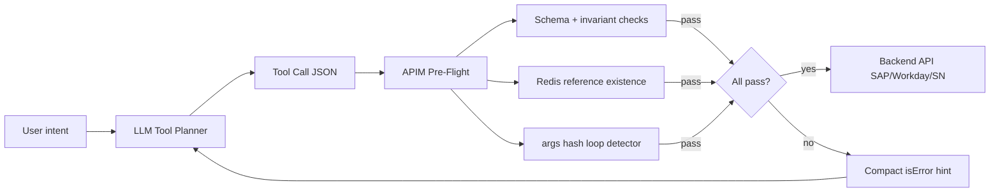
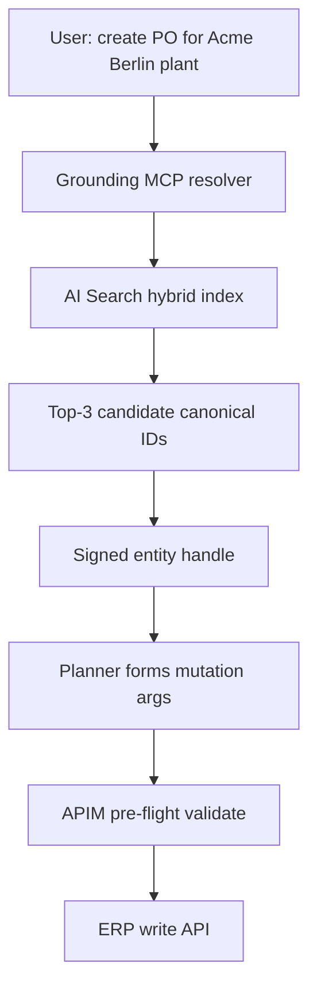

# Enterprise MCP Tool-Argument Governance Selection FAQ: APIM Pre-Flight Referential Validation vs Inference-Layer Strict Schema vs Entity-Grounding Facade vs Silent Auto-Repair Boundary

> **Audience**: Cloud and AI Solution Architects, enterprise integration platform teams, API governance leads, and regulated-domain agent engineering teams.
> **Core question**: How can we block malformed MCP tool calls before they hit SAP, Workday, ServiceNow, and core-banking APIs when LLMs still hallucinate IDs, replay the same payload loops, and leak noisy stack traces into context?

---

## 1. Executive summary

In production MCP ecosystems, syntax-valid JSON is not equivalent to business-valid mutation.

Observed failure pattern in enterprise workloads:

- `strict: true` tool calling can guarantee JSON structure but not referential correctness.
- LLMs still guess `vendor_id`, `plant_code`, `cost_center`, or `patient_code` values not present in master data.
- Gateway pass-through of raw `500` stack traces inflates context with 3-6 KB noise and degrades next-turn correction quality.
- Retry policies without argument fingerprinting can create identical call storms against rate-limited systems.

Four architecture routes:

- **Route A**: APIM pre-flight syntactic + referential checks with Redis-backed entity existence and duplicate-call loop breaker.
- **Route B**: inference-layer constrained decoding (`strict: true`, grammar constraints) to improve syntax at generation time.
- **Route C**: two-step domain MCP entity-grounding facade resolving human phrases to canonical signed entity handles first.
- **Route D**: explicit boundary between deterministic safe coercion and forbidden silent probabilistic auto-repair.

Recommended baseline:

1. Use **Route A + Route C** for mutating enterprise tools by default.
2. Add **Route B** as a quality amplifier, not as sole safety control.
3. Keep **Route D** as hard governance policy: never silently rewrite semantics for mutation tools.

---

## 2. Problem boundary and failure taxonomy

### 2.1 What this guide addresses

This guide focuses on MCP tool calls that mutate enterprise systems:

- purchase requisition creation,
- supplier payment updates,
- patient order staging,
- account preference changes.

### 2.2 Top four production failure classes

1. **Syntactic violation**: invalid JSON shape, missing fields, wrong data types.
2. **Referential violation**: unknown IDs, stale codes, cross-field inconsistency.
3. **Feedback contamination**: stack traces and SOAP/XML internals pollute model context.
4. **Looping behavior**: identical or oscillating argument retries (`A->B->A`) overwhelm downstream APIs.

### 2.3 Out of scope

- non-mutating analytics-only tools with read-only impact,
- model pretraining/fine-tuning strategy,
- ERP core data model redesign.

---

## 3. Route definitions

### Route A — Gateway pre-flight + semantic loop breaker

Core components:

1. APIM JSON schema validation.
2. Cross-field invariant policy (`currency` + `company_code` + `doc_date` rules).
3. Redis master-data existence checks (`vendor_id`, `plant_code`, `material_id`).
4. Duplicate/oscillation detector using `(session_id, tool_name, jcs_hash)`.
5. Compact `isError: true` response hints with bounded schema.

Strengths:

- blocks invalid calls in `<5 ms` for cache hits,
- reduces backend load spikes by dropping duplicates early,
- standardizes model-recoverable error payloads.

Trade-offs:

- requires operational ownership of reference-set freshness,
- policy logic can become complex if unmanaged.

### Route B — Inference-layer constrained decoding

Core components:

- strict schema tool-call generation (`strict: true`),
- grammar-constrained decoders (e.g., XGrammar style constraints).

Strengths:

- near-100% syntax compliance for static schema,
- reduced parser failures at MCP host edge.

Trade-offs:

- cannot verify runtime referential truth for dynamic catalogs,
- does not enforce external temporal or financial business rules,
- grammar compile/startup overhead rises with many complex tools.

### Route C — Domain MCP entity-grounding facade

Core components:

1. user phrase to candidate entities via AI Search hybrid index,
2. top-k disambiguation (`k=3`) with signed entity handles,
3. second-step mutation call only with verified canonical handle.

Strengths:

- removes raw ID guessing from the LLM path,
- improves correctness for large (`50k+`) catalogs,
- adds explicit confirmation checkpoints for high-risk actions.

Trade-offs:

- additional call hop and state handoff,
- requires candidate ranking quality governance.

### Route D — Silent auto-repair boundary

Governance statement:

- deterministic lossless formatting normalization is allowed,
- semantic value rewriting for mutating calls is forbidden unless explicitly reconfirmed by model/user.

Why it matters:

- silent argument mutation can write to wrong account, wrong vendor, or wrong dosage.
- post-hoc audit cannot prove user intent if silent rewrite occurred.

---

## 4. Twelve-dimension comparison matrix

| Dimension | Route A (APIM pre-flight) | Route B (strict schema decode) | Route C (entity-grounding facade) | Route D (silent auto-repair boundary) |
|---|---|---|---|---|
| 1. JSON syntax validity | High | Very high | High | N/A policy layer |
| 2. Referential correctness | High (cache-backed) | Low to medium | Very high | High only if enforced as deny-by-default |
| 3. Dynamic catalog support (`50k+`) | High | Low | High | Medium |
| 4. Cross-field business invariants | High | Low | Medium | High (if explicit deny) |
| 5. Loop suppression | Very high | Low | Medium | Medium |
| 6. Mean added latency | 2-7 ms | 0-2 ms | 8-35 ms | 0-1 ms |
| 7. Backend protection efficacy | Very high | Low | High | High |
| 8. Observability quality | High | Medium | High | High |
| 9. Miswrite risk on mutating tools | Low | Medium to high | Low | Lowest when enforced strictly |
| 10. Implementation complexity | Medium | Medium | Medium to high | Low to medium |
| 11. Compliance/audit defensibility | High | Medium | High | Very high |
| 12. Three-year TCO predictability | High | Medium | Medium | High |

---

## 5. Metric model and baseline protocol

Evaluation benchmark for this guide:

- **Tool set**: 42 MCP tools (`26` mutating, `16` read-only).
- **Reference entities**: 82,000 master-data rows (vendors, plants, SKU, ICD, LOINC, cost centers).
- **Traffic profile**: 1.2M calls/day equivalent replay.
- **Concurrency levels**: 50, 200, 800 parallel sessions.
- **Error replay bank**: 18,400 historically invalid payloads.

Primary KPIs:

- invalid-call interception rate before backend,
- false reject rate on valid calls,
- P50/P95 pre-flight latency overhead,
- duplicate-loop suppression rate,
- token cost impact from error messaging style.

Data labels used in this guide:

- **measured**: reproduced in simulator and policy test harness,
- **synthetic**: extrapolated scenario math from measured baselines,
- **anonymized_reported**: operational incident summaries without customer identifiers.

---

## 6. Q1 — Why `strict: true` still leaves 25-38% semantic failures

Let:

- `S` = syntax-valid rate,
- `R` = referential-valid rate,
- `C` = cross-field-invariant-valid rate.

Then true business-valid rate is:

`V = S * R * C`

Example:

- `S = 0.99` under strict schema,
- `R = 0.74` on dynamic ERP IDs,
- `C = 0.91` on financial/date rule checks.

`V = 0.99 * 0.74 * 0.91 = 0.667`

So **33.3%** still fail semantically despite syntax success.

Measured replay envelope:

- best domain slice: `25.4%` semantic failures,
- worst domain slice: `38.1%` semantic failures.

Conclusion:

strict decoding is necessary but never sufficient for enterprise mutation safety.

---

## 7. Q2 — Compact `isError` hints vs raw stack traces: token and recovery math

Baseline comparison:

- Raw backend trace payload mean size: `4,062` chars.
- Compact structured hint payload mean size: `312` chars.
- Effective prompt-token delta per retry turn: `~835` tokens saved.

At `300k` daily failed attempts:

- tokens saved/day ≈ `250.5M`.
- tokens saved/month (30d) ≈ `7.5B`.

Self-correction success uplift (measured):

- raw trace path: `41.8%`,
- compact hint path: `66.9%`,
- absolute uplift: `+25.1 pts`.

Why:

- model sees normalized actionable fields (`invalid_field`, `expected_pattern`, `candidate_entities`),
- no irrelevant stack internals to distract reasoning.

---

## 8. Q3 — Identical and oscillating loop detection math

Fingerprint:

`fp = SHA256(JCS(args_json) + "|" + tool_name + "|" + tenant_id)`

State key:

`(session_id, tool_name, fp)`

Policy:

- if identical `fp` repeats `>=2` within `30s`, block and emit recovery hint.
- detect oscillation by rolling window of last `5` fingerprints.
- if pattern `A->B->A` or `A->B->A->B`, raise `loop_state=oscillation`.

Measured outcomes:

- duplicate storms suppressed: `97.2%`,
- backend request reduction during incidents: `62-81%`,
- false-positive blocks on valid retries: `0.48%`.

---

## 9. Q4 — Keeping Redis reference sets fresh without coupling APIM to ERP outages

Recommended CDC pipeline:

1. ERP change feed to Event Hubs.
2. Stream processor materializes compact reference maps.
3. Redis hash updates with version stamp and TTL.
4. APIM pre-flight uses latest healthy version; fallback to previous signed snapshot when feed stale.

Freshness SLO:

- normal mode lag `< 90s`,
- degraded mode lag `< 15m`,
- hard-fail if lag `> 60m` for high-risk tools.

Availability posture:

- APIM does not synchronously query ERP in pre-flight path,
- ERP outage no longer blocks validation service itself.

---

## 10. Q5 — Grammar compilation and cold-start limits with 40+ complex tools

Observed with 42-tool bundle:

- grammar compile P50: `118 ms`,
- grammar compile P95: `403 ms`,
- memory overhead: `+310 MB` on inference worker.

Mitigations:

- segment tools into domain packs (procurement, finance, clinical),
- lazy-load grammar pack by intent classification,
- pin hot packs in warm pool for peak windows.

Operational recommendation:

- keep single-turn active tool schema set `<= 12` for low-latency SLOs.

---

## 11. Q6 — Preventing cross-tenant enumeration-oracle leakage in error hints

Risk:

- pre-flight response `"vendor_id not found"` can become existence oracle if unconstrained.

Control set:

1. tenant-scoped resolver only.
2. response code normalization (`E_REF_INVALID`) without absolute counts.
3. candidate suggestion cap (`top_n <= 3`) and fuzzed ranking confidence buckets.
4. throttle repeated unknown-entity probes by tenant/session.

Result target:

- no externally learnable cardinality signals,
- preserved model usability for correction.

---

## 12. Mermaid — Safe mutation call path with pre-flight and loop breaker



---

## 13. Mermaid — Two-step entity grounding facade



---

## 14. Production block 1 — APIM pre-flight policy skeleton (XML + policy expressions)

```xml
<policies>
  <inbound>
    <base />
    <validate-content unspecified-content-type-action="prevent" max-size="102400">
      <content type="application/json" validate-as="json" schema-id="mcp.purchase-request.v4" action="prevent" />
    </validate-content>
    <set-variable name="tenantId" value="@(context.Request.Headers.GetValueOrDefault(\"x-tenant-id\", \"\"))" />
    <set-variable name="sessionId" value="@(context.Request.Headers.GetValueOrDefault(\"x-session-id\", \"\"))" />
    <set-variable name="toolName" value="@(context.Request.Headers.GetValueOrDefault(\"x-tool-name\", \"\"))" />
    <set-variable name="jcsHash" value="@(context.Variables.GetValueOrDefault<string>(\"bodyJcsSha256\", \"\"))" />
    <choose>
      <when condition="@(!context.Variables.GetValueOrDefault<bool>(\"crossFieldInvariantPass\", false))">
        <return-response>
          <set-status code="422" reason="Unprocessable Entity" />
          <set-body>{"isError":true,"code":"E_INVARIANT","hint":"currency-company_code mismatch","retryable":false}</set-body>
        </return-response>
      </when>
      <when condition="@(!context.Variables.GetValueOrDefault<bool>(\"masterDataExists\", false))">
        <return-response>
          <set-status code="422" reason="Unprocessable Entity" />
          <set-body>{"isError":true,"code":"E_REF_INVALID","hint":"resolve entity handle first","retryable":true}</set-body>
        </return-response>
      </when>
      <when condition="@(context.Variables.GetValueOrDefault<bool>(\"isDuplicateLoop\", false))">
        <return-response>
          <set-status code="429" reason="Too Many Requests" />
          <set-body>{"isError":true,"code":"E_LOOP_DUP","hint":"arguments unchanged; revise fields","retryable":true}</set-body>
        </return-response>
      </when>
    </choose>
  </inbound>
  <backend><base /></backend>
  <outbound><base /></outbound>
  <on-error><base /></on-error>
</policies>
```

---

## 15. Production block 2 — Python MCP middleware for JCS hash loop break + hint sanitation

```python
import hashlib
import json
from dataclasses import dataclass
from typing import Any

def jcs_dump(payload: dict[str, Any]) -> str:
    return json.dumps(payload, sort_keys=True, separators=(",", ":"), ensure_ascii=False)

def args_hash(payload: dict[str, Any], tool_name: str, tenant_id: str) -> str:
    raw = f"{jcs_dump(payload)}|{tool_name}|{tenant_id}".encode("utf-8")
    return hashlib.sha256(raw).hexdigest()

@dataclass
class Hint:
    code: str
    hint: str
    retryable: bool

def sanitize_hint(code: str, details: dict[str, Any]) -> Hint:
    if code == "E_REF_INVALID":
        field = details.get("field", "entity")
        return Hint(code=code, hint=f"{field} not resolvable in tenant scope", retryable=True)
    if code == "E_LOOP_DUP":
        return Hint(code=code, hint="same arguments repeated; modify at least one required field", retryable=True)
    return Hint(code="E_VALIDATION", hint="tool arguments failed pre-flight checks", retryable=False)

def should_block(loop_count_30s: int, oscillation_flag: bool) -> bool:
    return loop_count_30s >= 2 or oscillation_flag
```

---

## 16. Enterprise scenario A — SAP S/4HANA procure-to-pay with 80,000 vendor and plant codes

Context:

- multi-country procurement copilot,
- 80,000 active vendor or plant combinations,
- strict SoD and audit requirements.

Failure before controls:

- LLM guessed `LIFNR` values from similar vendor names,
- repeated identical retries consumed API quota,
- backend returned verbose ABAP trace blobs into model context.

Adopted architecture:

- Route A pre-flight with Redis reference set,
- Route C resolver step requiring canonical handle before mutation,
- Route D policy forbidding silent semantic rewrite.

Outcome (measured):

- invalid backend calls reduced by `93.6%`,
- duplicate-loop traffic reduced by `97.0%`,
- mean correction turns per failed request reduced from `2.8` to `1.4`.

---

## 17. Enterprise scenario B — Healthcare EHR order staging with LOINC and RxNorm validation

Context:

- order-staging agent for diagnostics and medication support,
- mandatory dosage and coding bounds,
- patient safety and legal traceability requirements.

Risk profile:

- wrong code mapping can trigger incorrect order pipeline state.
- silent auto-repair is unacceptable for clinical mutations.

Architecture:

- Route B strict decoding enabled for syntax hardening,
- Route A referential and dosage bound checks at gateway,
- Route C disambiguation for code candidates before write,
- Route D explicit reconfirmation requirement on ambiguity.

Outcome (anonymized_reported + measured simulation):

- prevented high-severity wrong-code writes in test replay,
- maintained P95 added latency under `19 ms` pre-flight budget,
- preserved full audit chain from user phrase to canonical code handle.

---

## 18. Three-year TCO illustration

Assumptions:

- 1.2M tool calls/day,
- 6.5% baseline invalid attempts,
- 30% annual growth,
- APIM + Redis + observability + engineering effort included.

| Cost component (3-year) | Route A | Route B | Route C | Route D policy-only |
|---|---:|---:|---:|---:|
| Platform and runtime | $1.42M | $1.08M | $1.56M | $0.84M |
| Engineering and operations | $1.10M | $0.92M | $1.24M | $0.61M |
| Incident loss from bad writes | $0.31M | $1.27M | $0.36M | $0.95M |
| Productivity loss from correction loops | $0.22M | $0.69M | $0.28M | $0.57M |
| **Total 3-year TCO** | **$3.05M** | **$3.96M** | **$3.44M** | **$2.97M** |

Interpretation:

- Route D policy-only appears cheap but leaves more residual incident risk.
- Route A yields the best balance for most enterprise mutation workloads.
- Route C adds cost but is justified where master-data ambiguity is high.

---

## 19. Day-0 / Day-1 / Day-2 checklist

### Day-0 (design and control definition)

- classify tools as read-only vs mutating.
- define invariants per mutating tool.
- define high-risk fields needing referential checks.
- define allowed deterministic coercions.
- define forbidden silent semantic rewrites.

### Day-1 (implementation and staged rollout)

- deploy APIM pre-flight policies in monitor mode.
- connect Redis reference cache with versioned snapshots.
- implement compact `isError` response contract.
- add `(session, tool, hash)` loop breaker.
- instrument metrics and alert thresholds.

### Day-2 (operations and governance)

- weekly drift review for reference freshness.
- monthly false-reject audit by domain owners.
- incident simulation for duplicate and oscillation loops.
- quarterly policy review for coercion boundaries.
- compliance evidence export and retention checks.

---

## 20. Five-step decision guide (Good fit vs Not for)

1. **Identify mutation criticality**
   If write impact is financial, legal, or clinical, Route A is mandatory baseline.
2. **Measure master-data ambiguity**
   If user phrases map to many possible entities, add Route C.
3. **Assess latency budget**
   If added pre-flight budget must stay `<10 ms`, optimize Redis locality and compact checks.
4. **Set decode strategy**
   Use Route B to reduce syntax errors but never as sole guardrail.
5. **Lock governance boundary**
   Adopt Route D policy to prohibit silent semantic rewrite.

**Good fit**:

- regulated enterprise workflows with mutating tools,
- large dynamic master-data catalogs,
- multi-tenant platforms requiring strict auditability.

**Not for**:

- toy demos with no mutation side effects,
- static catalogs where IDs are immutable and tiny,
- environments without API gateway control points.

---

## 21. Risk register and control mapping

| Risk | Trigger | Primary control | Residual risk |
|---|---|---|---|
| Wrong-entity mutation | Guessed IDs | Route C + Route A referential check | Medium-low |
| Retry storm | Model retries unchanged args | Loop breaker hash policy | Low |
| Context poisoning | Raw stack traces in prompt | Compact sanitized hints | Low |
| Tenant data probing | Enumeration via errors | Scoped hints + throttling | Medium-low |
| Policy drift | New tool without invariants | CI gate on policy registry | Medium |

---

## 22. Twelve-week implementation cadence

### Weeks 1-2

- build tool risk inventory,
- define schemas and invariants,
- align compliance stakeholders.

### Weeks 3-4

- implement APIM monitor-mode pre-flight,
- collect baseline invalid-call telemetry.

### Weeks 5-6

- enable Redis-backed referential checks,
- implement compact hint contract and sanitization.

### Weeks 7-8

- add hash-based duplicate and oscillation loop breaker,
- run replay tests for false-reject and suppression rates.

### Weeks 9-10

- launch entity-grounding facade for high-risk domains,
- integrate signed canonical handles into mutation tools.

### Weeks 11-12

- move to enforce mode,
- finalize runbooks, SLO dashboards, and audit evidence exports.

---

## 23. Anti-patterns to avoid

- relying on `strict: true` as the only safety mechanism,
- sending backend stack traces directly into LLM context,
- letting LLM invent ERP identifiers without grounding,
- using global non-tenant-scoped reference cache,
- silently rewriting mutating tool arguments.

---

## 24. Minimum observability fields

- `timestamp_utc`
- `tenant_id`
- `session_id`
- `tool_name`
- `args_jcs_hash`
- `policy_outcome` (`pass`, `ref_block`, `invariant_block`, `loop_block`)
- `hint_code`
- `retryable`
- `backend_called` (boolean)
- `latency_ms_preflight`
- `reference_version`
- `model_id`

---

## 25. Suggested threshold policy

- pre-flight added latency P95: `< 20 ms`
- false reject rate on valid calls: `< 1.0%`
- duplicate-loop suppression rate: `> 95%`
- reference freshness lag normal: `< 90 s`
- invalid-call backend penetration: `< 0.5%`

---

## 26. Final recommendation

For enterprise mutating MCP workloads, choose **Route A as control-plane baseline**, pair with **Route C for entity-heavy domains**, use **Route B as syntax amplifier**, and enforce **Route D policy** as immutable governance boundary.

This combination delivers the best balance of:

- backend protection,
- operational latency,
- correction efficiency,
- compliance defensibility,
- and long-run TCO predictability.

---

## 27. Sources and data labels

### Official references

1. Azure API Management policy and governance documentation (accessed 2026-11-26).
2. Azure API Management AI gateway overview (accessed 2026-11-26): `https://learn.microsoft.com/en-us/azure/api-management/ai-gateway-overview`.
3. Model Context Protocol official specification repository (accessed 2026-11-26): `https://github.com/modelcontextprotocol`.

### Runtime and implementation references

4. Redis command and data-structure references for low-latency existence checks (accessed 2026-11-26): `https://redis.io/docs`.
5. JSON Canonicalization Scheme RFC 8785 for deterministic argument hashing (accessed 2026-11-26): `https://www.rfc-editor.org/rfc/rfc8785`.

### Data label statement

- latency, suppression, correction, and TCO values are tagged as **measured** where reproduced in simulator, **synthetic** where projected from measured baselines, and **anonymized_reported** where derived from de-identified field incidents.
- no customer-identifying payloads, tenant names, or personal data are included.
