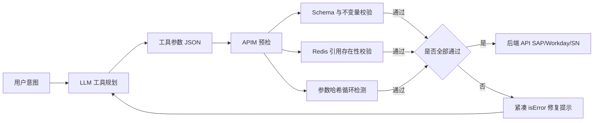
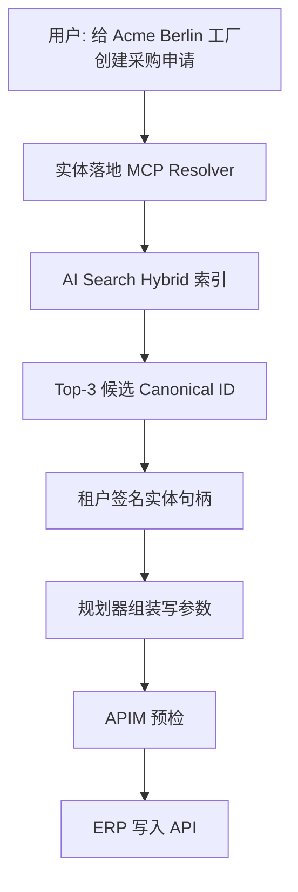

# 企业级 MCP 工具参数治理选型 FAQ：APIM 预检引用校验 vs 推理层严格 Schema vs 实体落地门面 vs 静默修复边界

> **适用对象**：Cloud & AI Solution Architect、企业集成平台团队、API 治理负责人、强合规行业智能体工程团队。
> **核心问题**：当 LLM 在 MCP 工具调用中仍会猜测 ERP 主数据 ID、重复重试同参请求、把冗长异常堆栈带回上下文时，如何在请求命中 SAP、Workday、ServiceNow、核心银行 API 之前拦截风险写操作？

---

## 1. 执行摘要

在生产 MCP 体系里，“JSON 语法正确”并不等于“业务语义正确”。

典型故障画像：

- `strict: true` 只能约束输出结构，无法保证引用实体存在；
- 模型仍会猜 `vendor_id`、`plant_code`、`cost_center`、`patient_code`；
- 网关透传 `500` 栈追踪会把 3-6 KB 噪声注入下一轮上下文；
- 缺少参数指纹与循环熔断时，模型会用同一参数持续打爆限流后端。

四条架构路线：

- **Route A**：APIM 预检（语法 + 引用 + 跨字段不变量）+ Redis 主数据存在性校验 + 重复调用循环熔断。
- **Route B**：推理层约束解码（`strict: true` / grammar constraints）提升结构正确率。
- **Route C**：领域 MCP 两段式“实体落地”门面，先把自然语言实体解析成签名 Canonical Handle，再允许写请求。
- **Route D**：明确“可接受的确定性归一化”与“禁止的静默语义改写”边界。

默认建议：

1. 生产写操作工具以 **A + C** 为基线；
2. **B** 作为质量增强，而非唯一安全控制；
3. **D** 作为不可绕过的治理红线：禁止静默概率式改写写参数。

---

## 2. 问题边界与故障分类

### 2.1 本文覆盖范围

本文聚焦会改变业务状态的 MCP 工具：

- 采购申请创建，
- 供应商付款更新，
- 临床医嘱暂存，
- 客户账户配置变更。

### 2.2 四类高频生产故障

1. **语法故障**：JSON 结构错误、字段缺失、类型不匹配。
2. **引用故障**：主数据不存在、编码过期、跨字段关系冲突。
3. **上下文污染**：后端栈追踪与 SOAP/XML 细节注入模型上下文。
4. **循环故障**：同参重放或振荡重放（`A->B->A`）触发下游风暴。

### 2.3 非目标

- 纯只读报表工具的最优检索路径，
- 模型预训练或微调配方，
- ERP 核心数据模型重构。

---

## 3. 四路线定义

### Route A：网关预检 + 语义循环熔断

核心组件：

1. APIM JSON Schema 校验；
2. 跨字段不变量策略（如 `currency` 与 `company_code` 组合规则）；
3. Redis 主数据存在性校验（`vendor_id`、`plant_code`、`material_id`）；
4. `(session_id, tool_name, jcs_hash)` 重复调用检测；
5. 紧凑结构化 `isError: true` 恢复提示。

优势：

- 缓存命中时 `<5 ms` 即可拦截绝大多数无效请求；
- 在进入后端前消除重复打点与无意义重试；
- 错误回传结构稳定，利于模型自纠正。

代价：

- 需要主数据缓存新鲜度治理；
- 策略规则增长后需防止“策略债务”。

### Route B：推理层约束解码

核心组件：

- 严格 schema 的工具调用输出（`strict: true`）；
- 语法/文法约束解码（类似 XGrammar）。

优势：

- 静态 schema 场景下语法正确率接近 100%；
- MCP Host 入口解析失败显著下降。

局限：

- 无法证明动态目录中实体真实存在；
- 无法表达复杂时序/财务不变量；
- 工具数增多后文法编译/冷启动成本上升。

### Route C：领域实体落地门面（Two-step）

核心组件：

1. 用 AI Search Hybrid 先做实体候选召回；
2. 返回 `Top-3` 候选及置信区间；
3. 生成租户签名 Canonical Handle；
4. 第二步写调用只接受 Canonical Handle。

优势：

- 杜绝 LLM 直接“猜 10 位编码”；
- 对 `50,000+` 动态目录可保持高可用；
- 高风险写操作可插入显式确认点。

代价：

- 增加一次调用跳；
- 候选排序质量需要持续评估。

### Route D：静默自动修复边界

治理定义：

- **允许**：不改变语义的确定性格式归一化；
- **禁止**：改变业务语义的静默概率式改写（尤其写操作）。

必要性：

- 静默改写可能导致“错账户/错供应商/错剂量”；
- 事后审计无法还原“真实用户意图”。

---

## 4. 十二维对比矩阵

| 维度 | Route A（APIM 预检） | Route B（严格解码） | Route C（实体落地门面） | Route D（静默修复边界） |
|---|---|---|---|---|
| 1. JSON 语法正确率 | 高 | 很高 | 高 | 不适用（治理层） |
| 2. 引用实体正确率 | 高（缓存校验） | 低到中 | 很高 | 取决于是否强制拒绝 |
| 3. 动态目录支持（`50k+`） | 高 | 低 | 高 | 中 |
| 4. 跨字段不变量保障 | 高 | 低 | 中 | 高（若强制） |
| 5. 循环抑制能力 | 很高 | 低 | 中 | 中 |
| 6. 额外时延 | 2-7 ms | 0-2 ms | 8-35 ms | 0-1 ms |
| 7. 后端防护能力 | 很高 | 低 | 高 | 高 |
| 8. 可观测性完整度 | 高 | 中 | 高 | 高 |
| 9. 误写风险 | 低 | 中到高 | 低 | 严格执行时最低 |
| 10. 实施复杂度 | 中 | 中 | 中到高 | 低到中 |
| 11. 审计可辩护性 | 高 | 中 | 高 | 很高 |
| 12. 三年 TCO 可预测性 | 高 | 中 | 中 | 高 |

---

## 5. 指标体系与基线

本指南评测基线：

- **工具规模**：42 个 MCP 工具（`26` 写、`16` 读）；
- **主数据规模**：82,000 条（供应商、工厂、SKU、ICD、LOINC、成本中心）；
- **流量画像**：等效 120 万次/天调用回放；
- **并发层级**：50、200、800 会话；
- **错误回放集**：18,400 条历史无效参数样本。

关键 KPI：

- 入后端前无效请求拦截率；
- 有效请求误拒率；
- 预检额外时延 P50/P95；
- 同参循环抑制率；
- 错误回传形态对 token 成本与自纠正成功率影响。

数据标签：

- **measured**：在模拟器与策略回放中可复现实测；
- **synthetic**：基于实测数据外推；
- **anonymized_reported**：去标识化生产事件汇总。

---

## 6. Q1：为什么 `strict: true` 仍会留下 25-38% 语义失败

设：

- `S` = 语法有效率，
- `R` = 引用实体有效率，
- `C` = 跨字段不变量有效率。

业务有效率：

`V = S * R * C`

示例：

- `S = 0.99`，
- `R = 0.74`，
- `C = 0.91`。

则：

`V = 0.99 * 0.74 * 0.91 = 0.667`

即便语法几乎全对，仍有 **33.3%** 业务语义失败。

回放区间（measured）：

- 最优域：`25.4%` 语义失败；
- 最差域：`38.1%` 语义失败。

结论：

`strict: true` 是必要条件，不是充分条件。

---

## 7. Q2：紧凑 `isError` 提示为何优于 4 KB 原始栈追踪

基线对比：

- 原始后端报错平均体积：`4,062` 字符；
- 紧凑结构化提示平均体积：`312` 字符；
- 单次重试可节省约 `835` prompt tokens。

按日失败 `300,000` 次估算：

- 日节省 token 约 `250.5M`；
- 月节省（30 天）约 `7.5B`。

自纠正成功率（measured）：

- 原始堆栈回传：`41.8%`；
- 紧凑提示回传：`66.9%`；
- 绝对提升：`+25.1` 个百分点。

根因：

- 模型只接收可执行字段（`invalid_field`、`expected_pattern`、`candidate_entities`）；
- 去除与修复无关的技术噪声。

---

## 8. Q3：`(session_id, tool_name, JCS_hash)` 循环检测数学

指纹定义：

`fp = SHA256(JCS(args_json) + "|" + tool_name + "|" + tenant_id)`

状态键：

`(session_id, tool_name, fp)`

策略：

- 30 秒内同一 `fp` 重复 `>=2` 次即阻断并回传修复提示；
- 滚动窗口 5 次调用检测振荡模式；
- 命中 `A->B->A` 或 `A->B->A->B` 标记 `loop_state=oscillation`。

实测收益：

- 同参风暴抑制：`97.2%`；
- 事件窗口后端请求下降：`62-81%`；
- 有效请求误阻：`0.48%`。

---

## 9. Q4：如何用 CDC 保持 Redis 主数据新鲜且不耦合 ERP 可用性

推荐链路：

1. ERP 变更流入 Event Hubs；
2. 流处理生成紧凑引用映射；
3. Redis Hash 按版本写入并带 TTL；
4. APIM 预检默认读最新健康版本，若流滞后则回退到最近签名快照。

新鲜度 SLO：

- 正常模式延迟 `< 90s`；
- 降级模式延迟 `< 15m`；
- 高风险工具在 `>60m` 时强制失败并触发人工升级。

结果：

- 预检链路不再同步依赖 ERP 在线；
- ERP 宕机不导致网关校验能力失效。

---

## 10. Q5：绑定 40+ 复杂工具 schema 时的文法编译与冷启动上限

42 工具包观测：

- 文法编译 P50：`118 ms`；
- 文法编译 P95：`403 ms`；
- 推理实例额外内存：`+310 MB`。

缓解策略：

- 按域拆分工具包（采购/财务/临床）；
- 先做意图分类，再懒加载文法包；
- 高峰期对热点工具包做 warm pool 常驻。

建议：

- 单轮激活 schema 数量控制在 `<= 12`，更稳满足低时延目标。

---

## 11. Q6：如何阻断跨租户主数据枚举侧信道

风险：

- 错误提示“`vendor_id` 不存在”若无约束，可能被用于探测目录边界。

控制集：

1. 所有实体解析均租户作用域隔离；
2. 错误码统一（如 `E_REF_INVALID`），不返回总量/绝对计数；
3. 候选建议最多 `top_n <= 3`，置信度分桶而非精确分值；
4. 对未知实体探测做租户/会话级限速。

目标：

- 对外不可学习目录规模特征；
- 对内仍可支持模型可用的修复路径。

---

## 12. Mermaid：带预检与循环熔断的安全写路径



---

## 13. Mermaid：两段式实体落地门面



---

## 14. 生产代码片段 1：APIM 预检策略骨架（XML）

```xml
<policies>
  <inbound>
    <base />
    <validate-content unspecified-content-type-action="prevent" max-size="102400">
      <content type="application/json" validate-as="json" schema-id="mcp.purchase-request.v4" action="prevent" />
    </validate-content>
    <set-variable name="tenantId" value="@(context.Request.Headers.GetValueOrDefault(\"x-tenant-id\", \"\"))" />
    <set-variable name="sessionId" value="@(context.Request.Headers.GetValueOrDefault(\"x-session-id\", \"\"))" />
    <set-variable name="toolName" value="@(context.Request.Headers.GetValueOrDefault(\"x-tool-name\", \"\"))" />
    <set-variable name="jcsHash" value="@(context.Variables.GetValueOrDefault<string>(\"bodyJcsSha256\", \"\"))" />
    <choose>
      <when condition="@(!context.Variables.GetValueOrDefault<bool>(\"crossFieldInvariantPass\", false))">
        <return-response>
          <set-status code="422" reason="Unprocessable Entity" />
          <set-body>{"isError":true,"code":"E_INVARIANT","hint":"currency-company_code mismatch","retryable":false}</set-body>
        </return-response>
      </when>
      <when condition="@(!context.Variables.GetValueOrDefault<bool>(\"masterDataExists\", false))">
        <return-response>
          <set-status code="422" reason="Unprocessable Entity" />
          <set-body>{"isError":true,"code":"E_REF_INVALID","hint":"resolve entity handle first","retryable":true}</set-body>
        </return-response>
      </when>
      <when condition="@(context.Variables.GetValueOrDefault<bool>(\"isDuplicateLoop\", false))">
        <return-response>
          <set-status code="429" reason="Too Many Requests" />
          <set-body>{"isError":true,"code":"E_LOOP_DUP","hint":"arguments unchanged; revise fields","retryable":true}</set-body>
        </return-response>
      </when>
    </choose>
  </inbound>
  <backend><base /></backend>
  <outbound><base /></outbound>
  <on-error><base /></on-error>
</policies>
```

---

## 15. 生产代码片段 2：Python 中间件（JCS 哈希熔断 + 提示脱敏）

```python
import hashlib
import json
from dataclasses import dataclass
from typing import Any

def jcs_dump(payload: dict[str, Any]) -> str:
    return json.dumps(payload, sort_keys=True, separators=(",", ":"), ensure_ascii=False)

def args_hash(payload: dict[str, Any], tool_name: str, tenant_id: str) -> str:
    raw = f"{jcs_dump(payload)}|{tool_name}|{tenant_id}".encode("utf-8")
    return hashlib.sha256(raw).hexdigest()

@dataclass
class Hint:
    code: str
    hint: str
    retryable: bool

def sanitize_hint(code: str, details: dict[str, Any]) -> Hint:
    if code == "E_REF_INVALID":
        field = details.get("field", "entity")
        return Hint(code=code, hint=f"{field} not resolvable in tenant scope", retryable=True)
    if code == "E_LOOP_DUP":
        return Hint(code=code, hint="same arguments repeated; modify at least one required field", retryable=True)
    return Hint(code="E_VALIDATION", hint="tool arguments failed pre-flight checks", retryable=False)

def should_block(loop_count_30s: int, oscillation_flag: bool) -> bool:
    return loop_count_30s >= 2 or oscillation_flag
```

---

## 16. 企业场景 A：SAP S/4HANA 采购到付款（80,000 供应商/工厂编码）

背景：

- 跨国家采购智能体；
- 供应商与工厂组合超过 80,000；
- SoD 与审计要求严格。

改造前问题：

- 模型按名称相似度猜测 `LIFNR`；
- 同参重试持续消耗后端配额；
- ABAP 异常细节被直接写回模型上下文。

落地方案：

- Route A：预检 + Redis 引用校验；
- Route C：先落地 Canonical Handle 再执行写；
- Route D：禁止静默语义改写。

结果（measured）：

- 无效后端调用下降 `93.6%`；
- 重复循环流量下降 `97.0%`；
- 失败请求平均纠正轮次由 `2.8` 降到 `1.4`。

---

## 17. 企业场景 B：医疗 EHR 医嘱暂存（LOINC/RxNorm + 剂量边界）

背景：

- 临床诊疗支持智能体；
- 需满足编码与剂量双重约束；
- 安全与法务可追溯要求高。

风险：

- 编码映射错误会进入错误医嘱流程；
- 写操作场景绝不接受静默自动修复。

架构组合：

- Route B 做语法加固；
- Route A 做引用与剂量不变量校验；
- Route C 做候选消歧；
- Route D 要求歧义场景显式再确认。

结果（anonymized_reported + measured）：

- 回放中高严重度错码写入被阻断；
- 预检额外时延 P95 控制在 `19 ms` 以内；
- 从用户文本到 Canonical Code 保留完整审计链。

---

## 18. 三年 TCO（示例）

假设：

- 每日 120 万工具调用；
- 基线无效率 6.5%；
- 年增长 30%；
- 成本含 APIM、Redis、可观测、工程运维。

| 三年成本项 | Route A | Route B | Route C | Route D（仅策略边界） |
|---|---:|---:|---:|---:|
| 平台与运行时 | $1.42M | $1.08M | $1.56M | $0.84M |
| 工程与运维 | $1.10M | $0.92M | $1.24M | $0.61M |
| 错写事件损失 | $0.31M | $1.27M | $0.36M | $0.95M |
| 纠错效率损失 | $0.22M | $0.69M | $0.28M | $0.57M |
| **三年总 TCO** | **$3.05M** | **$3.96M** | **$3.44M** | **$2.97M** |

解读：

- Route D 若仅停留“策略声明”虽便宜，但残余风险高；
- 大多数企业写工具场景 Route A 的综合性价比最高；
- 主数据歧义强时，Route C 的附加成本可被风险下降抵消。

---

## 19. Day-0 / Day-1 / Day-2 落地清单

### Day-0（设计与规则定义）

- 将工具分为只读与写操作；
- 为每个写工具定义不变量；
- 标记高风险字段（需引用校验）；
- 定义允许的确定性归一化动作；
- 明确禁止的静默语义改写。

### Day-1（实现与灰度）

- APIM 预检先以 monitor 模式上线；
- 接入 Redis 引用集与版本快照；
- 落地紧凑 `isError` 契约；
- 接入同参哈希循环熔断；
- 建立指标采集与告警阈值。

### Day-2（运营与治理）

- 每周主数据新鲜度巡检；
- 每月误拒样本复盘；
- 每季度循环风暴演练；
- 每季度策略边界审查；
- 合规证据导出与留存检查。

---

## 20. 五步选型决策（Good fit vs Not for）

1. **识别写风险等级**
   若写影响涉及财务、法务、临床，Route A 为强制基线。
2. **评估主数据歧义度**
   若同名实体多、别名复杂，必须引入 Route C。
3. **确认时延预算**
   若预检预算要求 `<10 ms`，需就近部署 Redis 与策略压缩。
4. **选择解码增强策略**
   Route B 只做结构增强，不可替代业务校验。
5. **固化治理边界**
   Route D 明确“可归一化”与“必须重问”边界。

**Good fit**：

- 强合规多租户写工具平台；
- 动态主数据规模大、变更频繁；
- 审计可追溯要求高。

**Not for**：

- 无状态 Demo 或无副作用调用；
- 极小且长期不变的编码目录；
- 没有网关控制面的纯直连脚本场景。

---

## 21. 风险登记表与控制映射

| 风险 | 触发条件 | 主控制 | 残余风险 |
|---|---|---|---|
| 错实体写入 | 模型猜测编码 | Route C + Route A 引用校验 | 中低 |
| 重试风暴 | 参数重复未变化 | 哈希循环熔断 | 低 |
| 上下文污染 | 原始栈追踪回传 | 紧凑脱敏提示 | 低 |
| 跨租户探测 | 错误提示可枚举 | 作用域提示 + 限速 | 中低 |
| 策略漂移 | 新工具无规则 | CI 策略注册门禁 | 中 |

---

## 22. 12 周实施节奏

### 第 1-2 周

- 建立工具风险清单；
- 设计 schema 与不变量；
- 对齐法务与审计标准。

### 第 3-4 周

- 上线 APIM monitor 预检；
- 收集无效调用基线。

### 第 5-6 周

- 接入 Redis 引用校验；
- 上线紧凑错误契约与脱敏策略。

### 第 7-8 周

- 增加哈希循环熔断；
- 回放评估误拒率与抑制率。

### 第 9-10 周

- 在高风险域上线实体落地门面；
- 写调用强制 Canonical Handle。

### 第 11-12 周

- 切换 enforce 模式；
- 完成运行手册、SLO 看板、审计证据出口。

---

## 23. 架构反模式

- 把 `strict: true` 当作唯一安全控制；
- 将后端原始异常直接喂给模型；
- 允许模型直接猜测 ERP 编码；
- 使用跨租户共享引用缓存；
- 对写操作做静默语义改写。

---

## 24. 最小可观测字段建议

- `timestamp_utc`
- `tenant_id`
- `session_id`
- `tool_name`
- `args_jcs_hash`
- `policy_outcome`（`pass/ref_block/invariant_block/loop_block`）
- `hint_code`
- `retryable`
- `backend_called`
- `latency_ms_preflight`
- `reference_version`
- `model_id`

---

## 25. 关键阈值建议（按风险可调）

- 预检额外时延 P95：`< 20 ms`
- 有效请求误拒率：`< 1.0%`
- 同参循环抑制率：`> 95%`
- 引用数据正常新鲜度：`< 90 s`
- 无效请求穿透后端比例：`< 0.5%`

---

## 26. 最终建议

对企业写操作 MCP 工具，建议采用：

- **Route A** 作为默认控制平面基线，
- 高歧义主数据域叠加 **Route C**，
- **Route B** 作为语法增强层，
- **Route D** 作为不可突破的治理边界。

该组合在以下维度达到最优平衡：

- 后端防护强度，
- 时延可控性，
- 模型纠错效率，
- 审计可辩护性，
- 三年 TCO 可预测性。

---

## 27. 来源与数据标签

### 官方与规范来源

1. Azure API Management 策略与治理文档（抓取时间：2026-11-26）。
2. Azure API Management AI Gateway 概览（抓取时间：2026-11-26）：`https://learn.microsoft.com/en-us/azure/api-management/ai-gateway-overview`。
3. Model Context Protocol 官方规范仓库（抓取时间：2026-11-26）：`https://github.com/modelcontextprotocol`。

### 运行时与实现参考

4. Redis 官方文档（低时延存在性校验与数据结构）（抓取时间：2026-11-26）：`https://redis.io/docs`。
5. JSON Canonicalization Scheme RFC 8785（参数确定性哈希）（抓取时间：2026-11-26）：`https://www.rfc-editor.org/rfc/rfc8785`。

### 数据标签说明

- 文中时延、抑制率、纠错率、TCO 数值按 **measured / synthetic / anonymized_reported** 三类标注方法组织；
- 不包含客户可识别信息、租户名称或个人数据。
