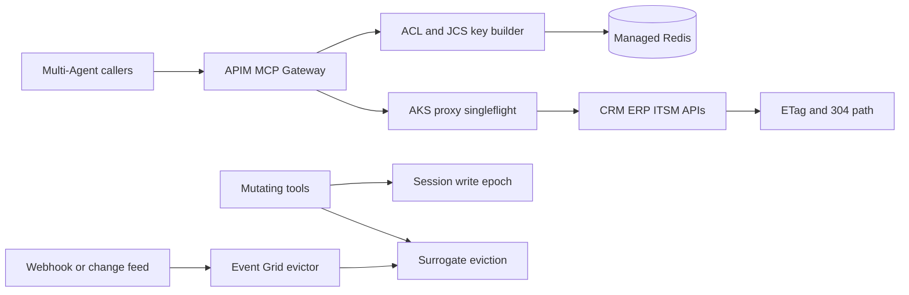
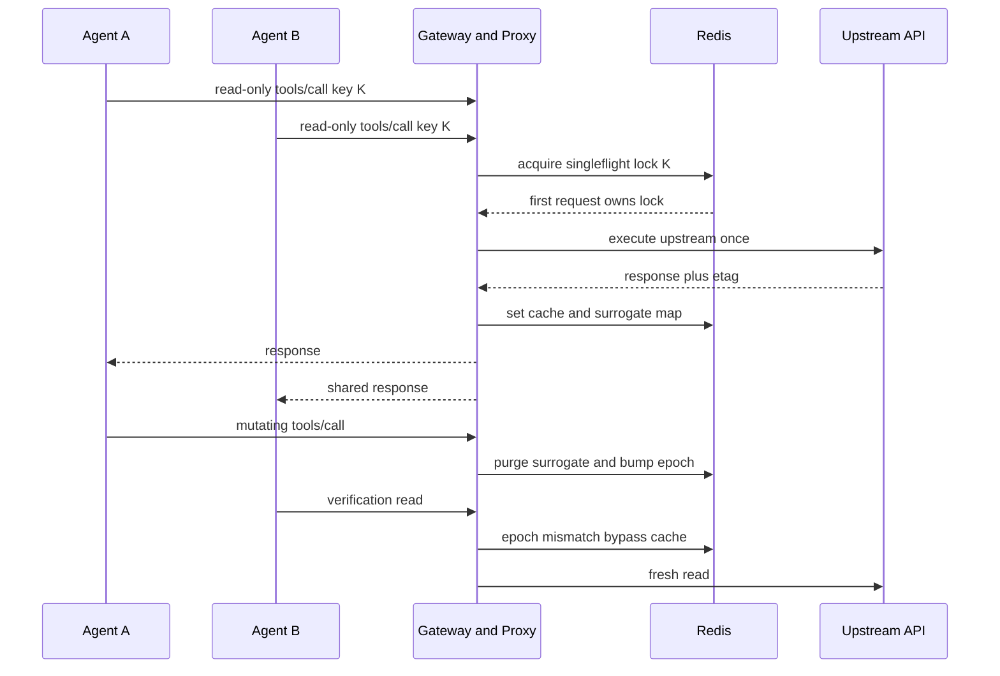
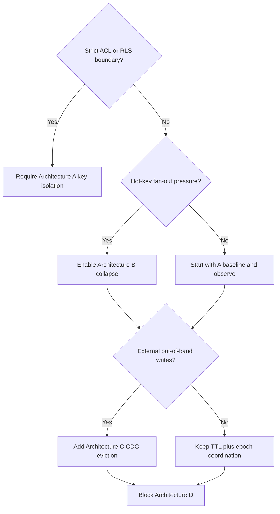

# Enterprise MCP `tools/call` cache governance FAQ: ACL-scoped JCS keys vs singleflight plus XFetch collapse vs CDC push eviction vs uncached/passive-TTL anti-pattern
> **Audience**: Cloud & AI Solution Architects, API gateway platform owners, and enterprise integration teams.
> **Problem statement**: MCP tool traffic is JSON-RPC `POST`, so default HTTP `GET` cache behavior misses by design; we need safe acceleration without principal leakage.
> **Recommendation**: deploy A+B as the baseline, add C where external out-of-band writes exist, and block D through release policy.

## 1. Executive summary
In multi-agent production, `tools/call` amplification is structural rather than occasional.
When dozens of sub-agents request the same upstream entity simultaneously, downstream SaaS quotas collapse quickly.
Architecture A ensures principal-bound cache isolation and deterministic canonical keys.
Architecture B collapses concurrent identical requests and smooths expiry cliffs with probabilistic early refresh.
Architecture C propagates out-of-band external mutations into targeted cache eviction.
Architecture D either causes uncontrolled QPS spikes or introduces cross-principal stale leakage.
This guide quantifies amplification reduction `1 - H_eff`, XFetch stampede math, duplicate-write probability `P(dup_write)`, and tiered `1M/25M/250M` TCO.

## 2. Why MCP `POST tools/call` needs a dedicated cache plane
HTTP semantic caching is optimized for `GET`, while MCP tools are invoked via `POST` JSON-RPC envelopes.
Default gateway caching therefore misses nearly all tool reads.
Tool outputs are usually constrained by tenant context, principal ACL, and sometimes session-scoped view filters.
A cache key that ignores principal scope is unsafe even when it appears highly efficient.
Enterprises need *isolation-preserving reuse* rather than blind shared reuse.
That requires protocol-aware keying and mutation-aware invalidation semantics.

## 3. Objectives and non-goals
Objective 1: increase reusable hit-rate for true read-only tools under ACL isolation.
Objective 2: collapse N concurrent identical requests to approximately one upstream flight.
Objective 3: guarantee read-your-writes behavior after mutating tool commits.
Objective 4: bound staleness when updates occur outside the MCP gateway path.
Objective 5: expose observability linking performance, safety, and cost outcomes.
Non-goal 1: never cache mutating tools under a fake read-only annotation.
Non-goal 2: never bypass business ACL or audit requirements in cache middleware.
Non-goal 3: never optimize hit-rate by sacrificing causality and accountability.

## 4. Four architecture choices
Architecture A: APIM plus Redis with principal-scoped keys derived from RFC 8785 JCS argument canonicalization, plus surrogate-key and session-epoch RYW controls.
Architecture B: distributed singleflight coalescing with XFetch early refresh and optional ETag revalidation in an AKS MCP proxy layer.
Architecture C: CDC/webhook eviction pipeline using Event Grid to invalidate surrogate groups after external writes.
Architecture D: uncached pass-through or principal-blind static TTL caching.
A+B is the standard baseline, C is added when out-of-band writes are material, and D is policy-blocked.

## 5. Architecture A deep dive: principal-bound canonical keying and RYW control
A models cache entries as deterministic, principal-scoped read projections.
Recommended key skeleton: `HMAC(tenant_id || obo_oid_or_acl_hash || server_version || tool_name || JCS(arguments))`.
JCS ensures semantically equivalent arguments map to identical canonical byte streams.
Surrogate groups map business entities to multiple derived cache entries for targeted invalidation.
After any `readOnlyHint=false` mutation succeeds, the system must purge linked surrogate keys and advance session write epoch atomically.
Subsequent verification reads must bypass stale entries when cached epoch is behind session epoch.
This prevents stale verification loops from re-applying already-committed mutations.
A introduces higher metadata complexity but converts correctness from probabilistic to deterministic.

## 6. Architecture B deep dive: singleflight collapse, XFetch jitter, and ETag
B addresses hotspot fan-out under high agent concurrency.
Singleflight merges identical inflight reads so only one upstream request executes while others await shared completion.
That can compress an N=30 burst to near one upstream request.
However, synchronized TTL expiration can still produce coordinated misses.
XFetch adds randomized early refresh to desynchronize expiry cliffs.
A typical trigger criterion is `t_now - Δ_compute · β ln(rand()) >= t_expiry`.
If upstream supports entity tags, `If-None-Match` with `304` responses cuts transfer and compute cost further.
B requires robust lock timeout, lock leak detection, and fallback handling.

## 7. Architecture C deep dive: CDC and webhook-driven proactive eviction
C solves stale visibility gaps when writes occur outside gateway-mediated MCP calls.
Examples include human operator edits in SaaS consoles or scheduled batch updates.
Without C, stale entries may survive until TTL expiry even after critical value changes.
C propagates change events through Event Grid into a surrogate-aware eviction worker.
Event payloads should include tenant, entity id, source version, and causal timestamp.
Idempotent version checks are required to handle replay and out-of-order delivery safely.
C can reduce stale windows from minutes to sub-second ranges under healthy event flow.

## 8. Architecture D anti-pattern
D1 uncached pass-through produces immediate quota stress during fan-out bursts.
D2 principal-blind TTL cache can leak data across ACL boundaries and amplify stale verification loops.
Both variants fail zero-trust review in regulated enterprises.
D should be explicitly denied by design standards and CI policy checks.

## 9. Quantitative metrics and equations
Downstream amplification reduction can be framed as `Amplification_Reduction = 1 - H_eff` where `H_eff` represents duplicate effective upstream flights.
XFetch stampede mitigation is assessed by expected synchronized-miss probability under jittered refresh thresholds.
Duplicate mutation probability is expressed as `P(dup_write) = P(T_verify < TTL_rem)` in the absence of strict epoch invalidation.
Session-epoch enforcement and surrogate eviction jointly drive that probability downward.
Track hit-rate, lock wait distribution, early-refresh ratio, stale-read incidence, and eviction latency percentiles together.

## 10. Twelve-dimension comparison matrix
| Dimension | Architecture A | Architecture B | Architecture C | Architecture D |
|---|---|---|---|---|
| Principal isolation | High | Medium | Medium | Low |
| Fan-out suppression | Medium | High | Medium | Low |
| Read-your-writes guarantee | High | Medium | Medium | Low |
| Out-of-band write awareness | Medium | Low | High | Low |
| Build complexity | Medium | Medium-High | Medium-High | Low |
| Ops complexity | Medium | Medium-High | High | Low but unsafe |
| Cost control durability | High | High | Medium | Low |
| Observability quality | High | High | Medium-High | Low |
| Auditability | High | Medium-High | Medium-High | Low |
| Recommended stage | Required baseline | Required baseline | Conditional add-on | Prohibited |
| Main failure mode | key cardinality drift | lock or clock skew | event disorder | quota surge or leakage |
| Overall recommendation | Core | Core | Add when needed | Block |

## 11. MCP cache and invalidation topology


## 12. Singleflight and read-your-writes sequence


## 13. Decision tree


### Q1. Why can’t we reuse classic `GET` cache policy for MCP tools
Because MCP tool invocation is JSON-RPC over `POST`, default semantic caching does not apply automatically.
Even explicit caching must include principal scope and session consistency dimensions.
Ignoring those dimensions turns apparent performance gains into data-isolation risk.
A protocol-aware middleware plane is therefore required.

### Q2. What does `readOnlyHint` control in production
It is the routing primitive that decides whether a call can enter reusable read cache flow.
`readOnlyHint=true` allows cache lookup and potential reuse.
`readOnlyHint=false` must trigger surrogate invalidation and epoch advancement after success.
Mislabeling mutating calls as read-only breaks causal consistency guarantees immediately.

### Q3. How is singleflight different from plain distributed locking
Plain locks provide mutual exclusion; singleflight provides mutual exclusion plus result sharing.
Under hotspot concurrency, this distinction is what collapses N parallel requests into one upstream flight.
Without shared-result semantics, lock-based systems still over-query upstream after each lock turn.
Combined with XFetch, singleflight handles both concurrent bursts and synchronized expiry cliffs.

### Q4. Why is TTL alone insufficient for read-your-writes
TTL is a time heuristic, not a causality guarantee.
After a successful mutation, stale cache entries may still remain valid by TTL and pollute verification reads.
That can trigger duplicate writes or futile correction loops.
Session epoch checks plus surrogate eviction make the post-write read path causally aligned.

### Q5. Why do out-of-band updates require CDC eviction
Enterprise source systems are often updated by humans and batch jobs outside MCP pathways.
If cache layers never observe those writes, stale data persists until passive expiration.
CDC/webhook pipelines transform source updates into deterministic eviction actions.
This is the bridge from gateway-local consistency to enterprise-wide consistency.

### Q6. Five-step rollout and Good fit vs Not for
Step 1: enforce `readOnlyHint` declaration and tool registry validation.
Step 2: deploy A with principal-bound JCS keys, surrogate groups, and write epochs.
Step 3: deploy B with singleflight, XFetch, and optional ETag revalidation.
Step 4: add C where external write channels are material.
Step 5: institutionalize policy tests and permanently block D anti-patterns.
Good fit: high-concurrency multi-agent workloads with strict ACL boundaries and expensive upstream reads.
Not for: low-concurrency prototypes with no principal partitioning and no compliance needs.

## 14. Implementation snippets
```xml
<policies>
  <inbound>
    <base />
    <set-variable name="principalOid" value="@(context.Principal?.Claims.GetValueOrDefault('oid','anonymous'))" />
    <set-variable name="toolName" value="@(context.Request.Body.As<JObject>(true)['params']?['name']?.ToString())" />
    <set-variable name="hint" value="@(context.Request.Body.As<JObject>(true)['params']?['annotations']?['readOnlyHint']?.ToString() ?? 'false')" />
    <set-variable name="canonicalArgs" value="@((string)context.Variables['jcs'].Invoke(context.Request.Body.As<JObject>(true)['params']?['arguments']))" />
    <set-variable name="cacheKey" value="@($"mcp:{context.Subscription.Id}:{context.Variables['principalOid']}:{context.Variables['toolName']}:{context.Variables['canonicalArgs']}")" />
    <choose>
      <when condition="@(context.Variables['hint'].Equals('true'))">
        <cache-lookup-value key="@(context.Variables['cacheKey'])" variable-name="hit" />
      </when>
    </choose>
  </inbound>
  <outbound>
    <choose>
      <when condition="@(context.Variables['hint'].Equals('true') && context.Response.StatusCode == 200)">
        <cache-store-value key="@(context.Variables['cacheKey'])" value="@(context.Response.Body.As<string>())" duration="90" />
      </when>
    </choose>
    <base />
  </outbound>
</policies>
```

```python
import asyncio, json, math, random, time
from typing import Dict, Tuple

class McpSingleflightLayer:
    def __init__(self):
        self.locks: Dict[str, asyncio.Lock] = {}
        self.store: Dict[str, Tuple[float, str, str, int]] = {}

    @staticmethod
    def jcs(arguments):
        return json.dumps(arguments, separators=(",", ":"), sort_keys=True, ensure_ascii=False)

    @staticmethod
    def xfetch_due(expiry, compute_ms, beta=1.1):
        jitter = (compute_ms / 1000.0) * beta * (-math.log(max(1e-9, random.random())))
        return (time.time() - jitter) >= expiry

    async def read(self, key, epoch, fetch_fn):
        lock = self.locks.setdefault(key, asyncio.Lock())
        async with lock:
            item = self.store.get(key)
            if item:
                exp, payload, etag, cached_epoch = item
                if cached_epoch >= epoch and time.time() < exp and not self.xfetch_due(exp, 35):
                    return payload
            start = time.time()
            payload, etag = await fetch_fn()
            elapsed = (time.time() - start) * 1000
            self.store[key] = (time.time() + 120, payload, etag, epoch)
            return payload, elapsed

    async def invalidate(self, keys, new_epoch):
        for k in keys:
            self.store.pop(k, None)
        return new_epoch
```

## 15. Enterprise TCO framing for `1M / 25M / 250M` monthly `tools/call`
| Tier | Monthly `tools/call` volume | Recommended architecture | Dominant cost components | Primary value |
|---|---|---|---|---|
| Tier-1 | 1M | A | Key governance plus cache nodes | Immediate duplicate-read suppression |
| Tier-2 | 25M | A + B | Coalescing control and refresh logic | Hot-key stampede suppression |
| Tier-3 | 250M | A + B + C | Event-driven invalidation and full observability | Low staleness with bounded leakage risk |

## 16. Release checklist
Confirm all tools declare `readOnlyHint` and fail registration when absent.
Confirm cache keys include tenant, principal scope, tool name, and JCS-normalized args.
Confirm successful mutating calls always trigger surrogate purge plus epoch bump.
Confirm lock timeout and lock-leak controls are monitored with paging thresholds.
Confirm XFetch trigger ratio is stable and explainable per workload class.
Confirm ETag revalidation effectiveness is visible by tenant and tool class.
Confirm CDC pipelines are idempotent under replay and out-of-order events.
Confirm stale-window P95 under out-of-band updates stays within policy limits.
Confirm anti-pattern D is blocked in both code and policy templates.
Confirm audit exports reconstruct every hit, bypass, invalidation, and refresh decision.

## 17. Optimization guidance
Correlate top hot keys with upstream `429` incidents to prioritize tuning work.
Split hit-rate by entity class so average metrics do not hide business-critical regressions.
Feed duplicate-write incidents back into regression suites to shrink `P(dup_write)` over time.
Define SLOs for lock-wait percentiles to prevent hidden user-latency erosion.
Use periodic reconciliation scans to compensate for missed external events.
Version ACL hash strategy with explicit rollover playbooks.
Model cache and event-pipeline costs jointly in capacity planning.
Review performance, safety, compliance, and cost as one governance package each quarter.

## 18. Conclusion
MCP cache design is a three-way coupling problem across protocol behavior, identity boundaries, and causality semantics.
A secures principal-aware deterministic reuse, B controls fan-out and expiry shock, and C closes external-write freshness gaps.
D appears simpler but creates either quota collapse or data-isolation failures.
A+B baseline with conditional C provides stable cost reduction without sacrificing trust boundaries.
The target state is not raw hit-rate maximization but auditable, explainable, and durable cache governance at enterprise scale.
