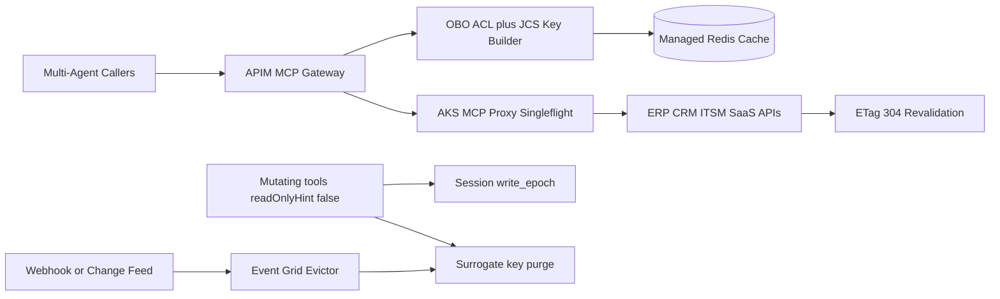
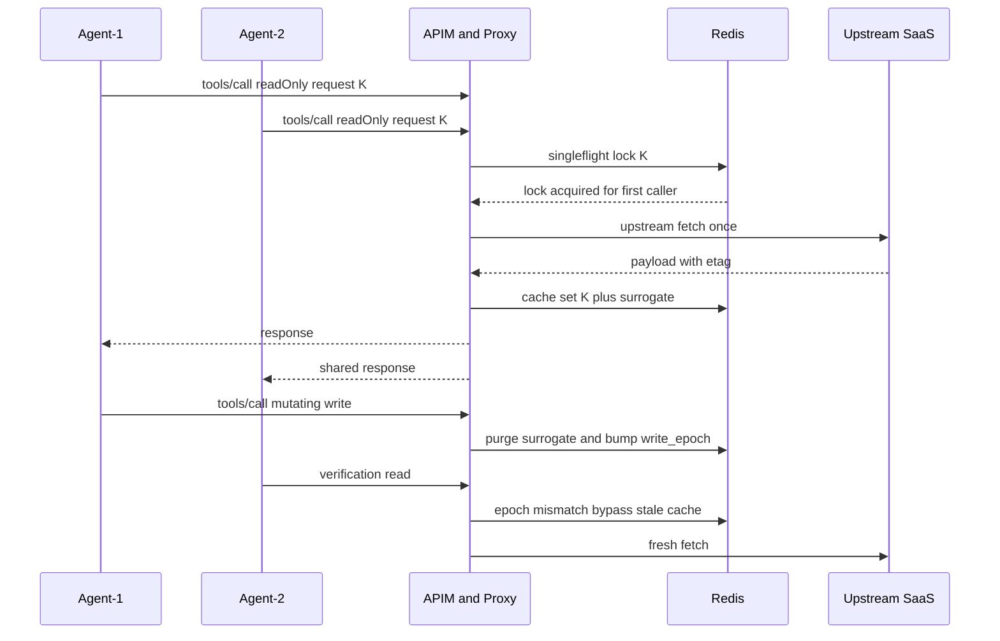
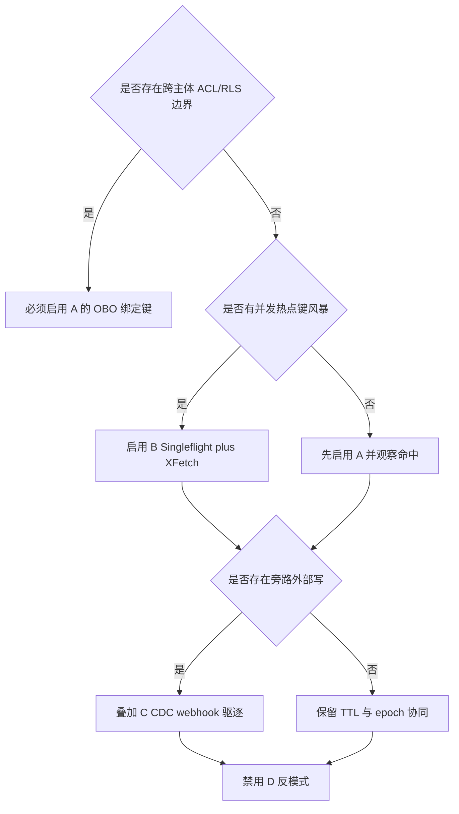

# 企业 MCP `tools/call` 读缓存与失效治理选型 FAQ：`OBO-ACL + JCS` 键隔离 vs `Singleflight + XFetch` 抗击穿 vs `CDC/Webhook` 近实时驱逐 vs 反模式直通/盲 TTL
> **适用对象**：Cloud & AI Solution Architect、平台网关团队、企业集成与数据治理团队。
> **问题定义**：MCP 工具调用是 JSON-RPC `POST`，传统 `GET` 缓存默认失效，如何在不泄露 OBO 权限边界的前提下降本增稳。
> **建议结论**：默认 A+B，外部系统存在旁路写时叠加 C，D 作为生产禁用路径写入发布门禁。

## 1. 执行摘要
多智能体并发时代，`tools/call` 放大不是偶发峰值，而是结构性放大。
当 30 个子代理同时查询相同工单、库存或价格主数据时，下游 SaaS 极易触发 `HTTP 429`。
A 用 OBO 主体约束键隔离，解决跨用户数据串读与 RLS 泄露风险。
B 用 Singleflight 与 XFetch 抑制热点雪崩，解决并发同键的放大冲击。
C 用 CDC/Webhook 将外部变更推送到缓存驱逐面，缩短跨系统陈旧窗口。
D 要么不缓存导致流量爆炸，要么主体盲缓存导致越权读与重复写循环。
本文提供 `1 - H_eff` 放大抑制指标、`XFetch` 提前刷新概率、`P(dup_write)` 重复写概率，以及 `1M/25M/250M` 月调用 TCO 框架。

## 2. 为什么 MCP `POST tools/call` 需要专门缓存体系
HTTP 语义缓存天生偏向 `GET`，而 MCP 工具协议是 `POST` JSON-RPC。
如果只靠网关默认缓存，命中率几乎为零，平台成本随并发线性上升。
更关键的是，工具返回通常受主体权限、租户边界与会话上下文共同影响。
因此缓存键不能只看 `tool_name + arguments`，必须引入 OBO 主体维度。
一旦忽略主体，缓存命中越高，越权风险越大。
企业真正需要的是“权限隔离命中”，而不是“无脑共享命中”。

## 3. 目标与非目标
目标一：在主体隔离前提下提高 `readOnly` 工具的复用命中率。
目标二：将并发同键 `N` 次上游调用压缩到接近 1 次。
目标三：保证同会话写后读（Read-Your-Writes）一致性，不再读到旧值。
目标四：外部旁路写发生后，缓存陈旧窗口可预测且可审计。
目标五：将缓存收益、风险与成本纳入统一运营看板。
非目标一：不把含副作用工具伪装成可缓存读调用。
非目标二：不在缓存层绕过业务 ACL 与审计链路。
非目标三：不以牺牲可追责性换取短期吞吐数字。

## 4. 四种候选架构总览
Architecture A：`APIM + Managed Redis`，以 `OBO oid / acl_hash + RFC 8785 JCS(arguments)` 生成隔离键，并维护 `surrogate-key + write_epoch`。
Architecture B：`AKS MCP Proxy` 实现分布式 Singleflight、XFetch 提前刷新与 ETag 再验证。
Architecture C：外部系统变更通过 `Event Grid` 驱动 Surrogate Evictor，主动驱逐关联键。
Architecture D：不缓存直通或主体盲 TTL 缓存，前者放大量化，后者泄露权限。
生产推荐是 A+B 作为主路径，存在第三方旁路写时加 C，D 仅作为反面教材写入政策。

## 5. Architecture A 深入：OBO 绑定键与会话写后读一致性
A 的核心是把可缓存读调用建模为“主体作用域内的确定性查询”。
建议键模型：`HMAC(tenant_id || obo_oid_or_acl_hash || server_version || tool_name || JCS(arguments))`。
`JCS` 保证参数语义等价时哈希稳定，避免 key 抖动。
`surrogate-key` 把同一业务实体关联到多个缓存条目，便于定向失效。
当 `readOnlyHint=false` 的写工具成功提交后，系统应原子执行两件事：驱逐关联 surrogate；推进 `session_write_epoch`。
后续验证读请求若发现 epoch 过期，必须绕过旧缓存重新取数。
这保证了代理不会因旧值反复执行同一 mutation。
A 的成本是键管理复杂度上升，但收益是权限安全与一致性确定化。

## 6. Architecture B 深入：Singleflight、XFetch 与 ETag 再验证
B 关注热点键高并发时的瞬时放大。
Singleflight 将同键并发请求合并成一次上游飞行，其余请求等待结果共享。
这能把 `N=30` 的并发冲击压缩为近似 `1` 次下游调用。
但仅靠 Singleflight 仍可能在 TTL 边界出现齐刷刷过期。
XFetch 通过随机化提前刷新窗口打散请求峰，减少同步击穿概率。
公式常写为：`t_now - Δ_compute · β ln(rand()) >= t_expiry` 触发提前刷新。
若上游支持 ETag，可用 `If-None-Match` 获得 `304`，进一步降低载荷成本。
B 对时钟偏差、锁超时和锁泄露敏感，需完善观测与降级。

## 7. Architecture C 深入：CDC/Webhook 主动驱逐
C 解决的是“缓存层不知道外部写已经发生”的信息滞后问题。
例如客服在 SaaS 控制台手工改了 `incident_severity`，MCP 网关并未直接观察到该写。
若没有 C，缓存可能在 TTL 结束前持续返回过时值。
C 通过 `Change Feed / Debezium / SaaS Webhook -> Event Grid -> Redis Evictor` 推送失效事件。
推荐事件负载包含：实体键、租户、变更版本、来源系统、因果时间戳。
驱逐逻辑应按 surrogate 维度执行，避免全局粗暴清空。
C 的收益是将陈旧窗口从分钟级降到亚秒级；代价是事件管道建设与运维复杂度。

## 8. Architecture D 反模式
D1 不缓存直通路径在多代理并发下几乎必然触发配额拥塞。
D2 主体盲固定 TTL 虽看似高命中，但会造成跨主体越权读取。
更糟的是，越权旧值可诱发代理重复执行写入，形成自激循环。
D 在合规审计中通常无法通过最小权限与可追责检查。
因此 D 应在架构评审阶段被明确否决。

## 9. 关键公式与量化指标
下游放大抑制可写为：`Amplification_Reduction = 1 - H_eff`，其中 `H_eff` 表示同键重复上游飞行占比。
XFetch 防击穿可通过提前刷新触发概率近似估计，核心在随机扰动打散同一过期边界。
写后读重复写概率可写：`P(dup_write) = P(T_verify < TTL_rem)`。
当 `session_write_epoch` 被强制校验时，`P(dup_write)` 可显著下降。
推荐同时跟踪：命中率、共享等待时延、锁冲突率、提前刷新触发率、驱逐时延分位数。

## 10. 12 维选型矩阵
| 维度 | Architecture A | Architecture B | Architecture C | Architecture D |
|---|---|---|---|---|
| 主体隔离安全 | 高 | 中 | 中 | 低 |
| 并发放大抑制 | 中 | 高 | 中 | 低 |
| 写后读一致性 | 高 | 中 | 中 | 低 |
| 外部旁路写收敛 | 中 | 低 | 高 | 低 |
| 实施复杂度 | 中 | 中高 | 中高 | 低 |
| 运维复杂度 | 中 | 中高 | 高 | 低但高风险 |
| 成本可控性 | 高 | 高 | 中 | 低 |
| 失败可观测性 | 高 | 高 | 中高 | 低 |
| 审计友好度 | 高 | 中高 | 中高 | 低 |
| 推荐阶段 | 默认必选 | 默认必选 | 条件启用 | 禁用 |
| 主要风险 | 键爆炸治理 | 锁与时钟漂移 | 事件乱序 | 越权与风暴 |
| 总体建议 | A+B 核心 | A+B 核心 | 有旁路写再加 | 禁止上线 |

## 11. `tools/call` 缓存与失效拓扑


## 12. Singleflight 与 RYW 失效时序


## 13. 决策树


### Q1. 为什么 `tools/call` 不能直接套用传统 `GET` 缓存策略
因为 MCP 工具调用是 JSON-RPC `POST`，默认不会被 HTTP 语义缓存自动命中。
即使技术上强行缓存，也必须纳入主体权限、参数规范化与会话一致性维度。
忽略这些维度会出现“命中越高，风险越大”的反直觉结果。
因此要构建面向工具协议的专用缓存中间层，而非沿用静态网页缓存思路。

### Q2. `readOnlyHint` 在生产缓存策略中的真实作用是什么
它不是装饰性标签，而是缓存分流与一致性策略的核心信号。
`readOnlyHint=true` 才允许进入可复用读缓存路径。
`readOnlyHint=false` 必须触发 surrogate 驱逐与会话 epoch 推进。
把写调用误标记为读调用会直接破坏 RYW 保证并扩大数据风险。

### Q3. Singleflight 与普通分布式锁有什么本质差别
普通锁强调互斥，Singleflight强调“结果共享”。
在高并发同键场景，Singleflight 能把等待请求复用首个飞行结果。
这比“每个请求都拿锁后各自请求上游”更能抑制风暴。
配合 XFetch 提前刷新，才能同时覆盖“同键并发”和“TTL 齐到期”两类风险。

### Q4. 为什么只做 TTL 不足以保证写后读一致
TTL 是时间近似，不是因果一致性机制。
写操作完成后，只靠 TTL 可能在剩余窗口内继续读到旧值。
这会驱动代理重复下发同一写命令，形成循环重试。
通过 `write_epoch` 与 surrogate 精准驱逐，才能把因果一致性落地到会话级。

### Q5. 外部系统旁路写为什么必须接入 CDC 驱逐
现实系统中，人和批处理任务常绕过 MCP 网关直接修改主数据。
若缓存层感知不到这些写入，陈旧值会持续污染代理决策。
CDC/Webhook 能把变更事件转成定向驱逐动作，缩短陈旧窗口。
这一步是“网关内一致”走向“企业级一致”的关键补丁。

### Q6. 五步落地与 Good fit / Not for
第一步：定义 `readOnlyHint` 契约并强制工具注册校验。
第二步：上线 A 的 OBO+JCS 键、surrogate、write_epoch 数据结构。
第三步：上线 B 的 Singleflight、XFetch 与 ETag 再验证流水线。
第四步：若存在旁路写，接入 C 的 CDC/Webhook 定向驱逐。
第五步：建立审计与压测门禁，明确禁止 D 反模式上线。
Good fit：多代理并发、强 ACL、频繁读取主数据的企业工具网关。
Not for：无权限分层、低并发、一次性实验性质的临时工具调用链路。

## 14. 生产实现片段
```xml
<policies>
  <inbound>
    <base />
    <set-variable name="oboOid" value="@(context.Principal?.Claims.GetValueOrDefault('oid','anonymous'))" />
    <set-variable name="toolName" value="@(context.Request.Body.As<JObject>(true)['params']?['name']?.ToString())" />
    <set-variable name="readOnlyHint" value="@(context.Request.Body.As<JObject>(true)['params']?['annotations']?['readOnlyHint']?.ToString() ?? 'false')" />
    <set-variable name="jcsArgs" value="@((string)context.Variables['canonicalizer'].Invoke(context.Request.Body.As<JObject>(true)['params']?['arguments']))" />
    <set-variable name="cacheKey" value="@($"mcp:{context.Subscription.Id}:{context.Variables['oboOid']}:{context.Variables['toolName']}:{context.Variables['jcsArgs']}")" />
    <choose>
      <when condition="@(context.Variables['readOnlyHint'].Equals('true'))">
        <cache-lookup-value key="@(context.Variables['cacheKey'])" variable-name="mcpHit" />
      </when>
    </choose>
  </inbound>
  <outbound>
    <choose>
      <when condition="@(context.Variables['readOnlyHint'].Equals('true') && context.Response.StatusCode == 200)">
        <cache-store-value key="@(context.Variables['cacheKey'])" value="@(context.Response.Body.As<string>())" duration="120" />
      </when>
    </choose>
    <base />
  </outbound>
</policies>
```

```python
import asyncio, json, math, random, time
from typing import Dict, Tuple

class SingleflightCache:
    def __init__(self):
        self._locks: Dict[str, asyncio.Lock] = {}
        self._data: Dict[str, Tuple[float, str, str, int]] = {}

    def _jcs(self, obj):
        return json.dumps(obj, separators=(",", ":"), sort_keys=True, ensure_ascii=False)

    def _xfetch_due(self, expiry_ts: float, compute_ms: float, beta: float = 1.2) -> bool:
        now = time.time()
        jitter = (compute_ms / 1000.0) * beta * (-math.log(max(1e-9, random.random())))
        return (now - jitter) >= expiry_ts

    async def get_or_fill(self, key: str, session_epoch: int, fetch_fn):
        lock = self._locks.setdefault(key, asyncio.Lock())
        async with lock:
            item = self._data.get(key)
            if item:
                expiry, payload, etag, cached_epoch = item
                if cached_epoch >= session_epoch and time.time() < expiry and not self._xfetch_due(expiry, 40):
                    return payload
            start = time.time()
            payload, etag = await fetch_fn()
            ttl = 120
            compute_ms = (time.time() - start) * 1000
            self._data[key] = (time.time() + ttl, payload, etag, session_epoch)
            return payload

    async def invalidate_surrogate(self, keys, new_epoch: int):
        for k in keys:
            self._data.pop(k, None)
        return new_epoch
```

## 15. `1M / 25M / 250M` 月调用 TCO 框架
| 档位 | 月 `tools/call` 量级 | 推荐组合 | 主要成本项 | 主要收益 |
|---|---|---|---|---|
| Tier-1 | 1M | A | 键管理与缓存节点 | 立刻降低重复读调用 |
| Tier-2 | 25M | A + B | 锁协同与提前刷新 | 显著抑制热点风暴 |
| Tier-3 | 250M | A + B + C | 事件驱逐与全链观测 | 保持低陈旧与低越权风险 |

## 16. 上线核查清单
应确认所有工具都声明 `readOnlyHint` 且注册审查不可绕过。
应确认缓存键含租户、主体、工具名与 JCS 参数哈希。
应确认写工具成功后必触发 surrogate 驱逐与 epoch 推进。
应确认 Singleflight 锁超时、重入和泄露都有监控与兜底。
应确认 XFetch 触发率在可解释区间且不引发过度刷新。
应确认 ETag 再验证命中率可视化并可按租户拆分。
应确认 CDC 事件乱序时仍能按版本号实现幂等驱逐。
应确认旁路写高峰下陈旧窗口 P95 保持在目标阈值内。
应确认 D 反模式路径在代码与策略配置均被禁用。
应确认审计导出可还原每次命中、驱逐与绕过决策链。

## 17. 运营优化建议
建议将热点键 TopN 与上游 429 告警做同屏展示，缩短定位路径。
建议按业务实体类型拆分命中率，避免均值掩盖关键域退化。
建议把写后读失败案例回灌到回归集，持续压缩 `P(dup_write)`。
建议对 lock wait 分位数设 SLO，避免共享等待侵蚀用户体验。
建议对 CDC 丢事件风险设置补偿扫描，保证驱逐最终一致收敛。
建议将 ACL 变更事件与缓存键版本绑定，防止权限变更后旧值复用。
建议在容量规划中将缓存节点与事件通道成本一体建模。
建议季度复盘时统一审阅性能、安全、合规与成本四维指标。

## 18. 结论
企业 MCP 缓存问题本质是“协议特性 + 权限边界 + 一致性语义”的三元耦合问题。
A 解决主体安全与键确定性，B 解决并发风暴与过期击穿，C 解决外部写感知迟滞。
D 看似简单，但会把系统推向配额崩溃或越权泄露两种高风险极端。
以 A+B 为默认、按需叠加 C，才能在大规模 `tools/call` 负载下实现稳态降本与可信治理。
最终目标不是单点命中率，而是可解释、可审计、可持续的企业级缓存控制面。
在治理实践中，应围绕“租户隔离命中”建立量化阈值、值班手册与故障回放剧本，确保问题处理具有可重复验证结果，落点：租户隔离命中。
在治理实践中，应围绕“主体撤权回收”建立量化阈值、值班手册与故障回放剧本，确保问题处理具有可重复验证结果，落点：主体撤权回收。
在治理实践中，应围绕“实体版本漂移”建立量化阈值、值班手册与故障回放剧本，确保问题处理具有可重复验证结果，落点：实体版本漂移。
在治理实践中，应围绕“跨区时钟偏差”建立量化阈值、值班手册与故障回放剧本，确保问题处理具有可重复验证结果，落点：跨区时钟偏差。
在治理实践中，应围绕“锁饥饿防护”建立量化阈值、值班手册与故障回放剧本，确保问题处理具有可重复验证结果，落点：锁饥饿防护。
在治理实践中，应围绕“批量刷新节流”建立量化阈值、值班手册与故障回放剧本，确保问题处理具有可重复验证结果，落点：批量刷新节流。
在治理实践中，应围绕“驱逐幂等重放”建立量化阈值、值班手册与故障回放剧本，确保问题处理具有可重复验证结果，落点：驱逐幂等重放。
在治理实践中，应围绕“写后验证超时”建立量化阈值、值班手册与故障回放剧本，确保问题处理具有可重复验证结果，落点：写后验证超时。
在治理实践中，应围绕“上游 304 利用”建立量化阈值、值班手册与故障回放剧本，确保问题处理具有可重复验证结果，落点：上游 304 利用。
在治理实践中，应围绕“配额熔断回退”建立量化阈值、值班手册与故障回放剧本，确保问题处理具有可重复验证结果，落点：配额熔断回退。
在治理实践中，应围绕“事件乱序修正”建立量化阈值、值班手册与故障回放剧本，确保问题处理具有可重复验证结果，落点：事件乱序修正。
在治理实践中，应围绕“热点键聚类”建立量化阈值、值班手册与故障回放剧本，确保问题处理具有可重复验证结果，落点：热点键聚类。
在治理实践中，应围绕“参数规范漂移”建立量化阈值、值班手册与故障回放剧本，确保问题处理具有可重复验证结果，落点：参数规范漂移。
在治理实践中，应围绕“ACL 哈希轮换”建立量化阈值、值班手册与故障回放剧本，确保问题处理具有可重复验证结果，落点：ACL 哈希轮换。
在治理实践中，应围绕“缓存旁路审计”建立量化阈值、值班手册与故障回放剧本，确保问题处理具有可重复验证结果，落点：缓存旁路审计。
在治理实践中，应围绕“会话 epoch 泄漏”建立量化阈值、值班手册与故障回放剧本，确保问题处理具有可重复验证结果，落点：会话 epoch 泄漏。
在治理实践中，应围绕“反序列化开销”建立量化阈值、值班手册与故障回放剧本，确保问题处理具有可重复验证结果，落点：反序列化开销。
在治理实践中，应围绕“异常重试噪声”建立量化阈值、值班手册与故障回放剧本，确保问题处理具有可重复验证结果，落点：异常重试噪声。
在治理实践中，应围绕“下游窗口限流”建立量化阈值、值班手册与故障回放剧本，确保问题处理具有可重复验证结果，落点：下游窗口限流。
在治理实践中，应围绕“追踪 ID 串联”建立量化阈值、值班手册与故障回放剧本，确保问题处理具有可重复验证结果，落点：追踪 ID 串联。
在治理实践中，应围绕“工具注册漂移”建立量化阈值、值班手册与故障回放剧本，确保问题处理具有可重复验证结果，落点：工具注册漂移。
在治理实践中，应围绕“失效广播延迟”建立量化阈值、值班手册与故障回放剧本，确保问题处理具有可重复验证结果，落点：失效广播延迟。
在治理实践中，应围绕“跨云 API 波动”建立量化阈值、值班手册与故障回放剧本，确保问题处理具有可重复验证结果，落点：跨云 API 波动。
在治理实践中，应围绕“多租户公平性”建立量化阈值、值班手册与故障回放剧本，确保问题处理具有可重复验证结果，落点：多租户公平性。
在治理实践中，应围绕“异常工单映射”建立量化阈值、值班手册与故障回放剧本，确保问题处理具有可重复验证结果，落点：异常工单映射。
建议将跨租户缓存穿透事件纳入月度专项复盘，并形成授权边界核验闭环，结论标签：tenant-boundary-closure。
建议将工具参数 canonicalization 变更纳入变更评审模板，避免哈希漂移造成命中回退，结论标签：canonicalization-drift-guard。
建议把 Singleflight 锁争用热力图接入值班大屏，缩短并发拥塞定位时间，结论标签：singleflight-contention-heatmap。
建议在写后读验证路径增加故障注入演练，检验 epoch 绕过逻辑稳健性，结论标签：ryw-fault-injection.
建议把 surrogate 分组规模作为容量门槛，超过阈值自动拆分，结论标签：surrogate-cardinality-cap。
建议对 XFetch 触发分布做分租户审视，防止某类租户长期过度提前刷新，结论标签：xfetch-fairness-watch。
建议将 ETag 再验证命中与下游计费账单关联，验证真实降本效果，结论标签：etag-cost-attribution。
建议在 CDC 管道引入乱序重排窗口监测，确保驱逐逻辑对事件顺序不敏感，结论标签：cdc-order-robustness。
建议把缓存旁路审计日志与 SIEM 规则联动，提升越权迹象检测速度，结论标签：bypass-audit-linkage。
建议将会话级 write_epoch 泄漏异常做独立告警，防止跨会话污染，结论标签：epoch-leakage-sentinel。
建议将热点实体的 TTL 策略改为按风险分层配置，避免一刀切，结论标签：risk-tier-ttl-policy。
建议将重复写事件按业务后果分级，优先治理高损失链路，结论标签：duplicate-write-severity-map。
建议把缓存节点扩容策略与上游配额窗口联动，避免单侧扩容无效，结论标签：capacity-quota-coupling。
建议对代理工具注册清单执行每日漂移核对，减少策略漏挂风险，结论标签：registry-drift-reconcile。
建议在跨区域容灾演练中覆盖缓存失效广播延迟指标，结论标签：geo-eviction-latency-drill。
建议将异常重试退避参数固化到治理基线，避免临时改动引发雪崩，结论标签：retry-backoff-baseline。
建议把缓存命中收益按业务域拆账，提升治理投入产出可解释性，结论标签：domain-finops-ledger。
建议将强一致链路与高吞吐链路在策略上分轨治理，结论标签：consistency-throughput-separation。
建议把每次策略回滚原因写入知识库并结构化标签化，结论标签：rollback-cause-taxonomy。
建议持续以“权限安全、因果一致、成本透明”三准则审阅缓存控制面，结论标签：triad-governance-principle。
