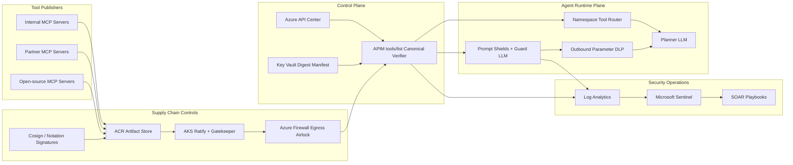
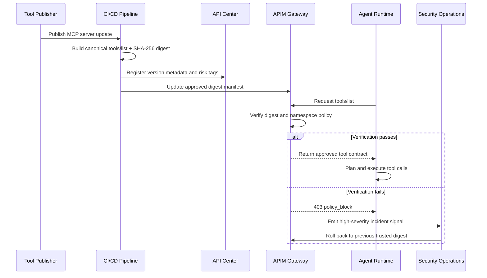

# Enterprise MCP Supply-Chain Defense FAQ: Tool Poisoning, Rug-Pulls, and Cross-Server Shadowing (APIM Hash Pinning vs Prompt Shields vs ACA/AKS Air-Locked Hosting)

> Audience: Cloud & AI Solution Architects, platform security leads, MCP governance owners, and enterprise CISO architecture teams.  
> Scope: multi-server MCP ecosystems, third-party tool onboarding, cross-organization A2A workflows, and developer self-service tool publishing.  
> Question: how to stop **control-plane attacks embedded in tool definitions** instead of only filtering end-user prompts.  
> Outcome: production-grade defense layers, quantitative decision matrix, 3-year TCO, implementation sequence, and measurable operating thresholds.  

## 1. Why this became a top-tier production risk for enterprise agent platforms

When enterprises move from “single model + a few internal tools” to “federated MCP server mesh with hundreds or thousands of tools,”  
the dominant attack surface shifts from user text to metadata control channels.  

In real deployments,  
agent runtimes repeatedly fetch `tools/list`,  
planning models treat `name`, `description`, and `inputSchema` as high-priority instructions,  
and then generate privileged downstream calls based on those fields.  

That architectural reality creates a critical asymmetry:  
an attacker can compromise behavior **without touching user input**  
simply by altering trusted tool metadata.  

Across red-team programs, three high-impact classes repeatedly appear:  

- **Tool Poisoning**: hidden instructions inside `description` fields that steer exfiltration or privilege escalation.  
- **Rug-Pull Mutation**: safe schema at day 0, malicious or risky schema drift after approval at day 14 or later.  
- **Cross-Server Shadowing**: look-alike tool names that hijack intent from trusted internal tools.  

These are control-plane integrity failures,  
not just content filtering failures.  
Therefore the solution must include cryptographic attestation and deterministic policy enforcement.  

## 2. Boundary with adjacent topics: not the same as RAG prompt injection or catalog sprawl

This topic intersects prior guidance but is materially different in failure mode and mitigation.

It is not equivalent to indirect RAG prompt injection:  
RAG attacks influence grounding content,  
while MCP poisoning influences **planner control metadata** and often receives higher instruction priority.  

It is not equivalent to API catalog governance:  
catalog governance controls discoverability and ownership,  
but does not guarantee immutability of runtime tool contracts after publication.  

The essential goal here is to elevate tool definitions from “best effort documentation”  
to “verifiable security artifacts” with strong runtime checks.  

## 3. Attack-chain decomposition: five hops from tools/list to business impact

A representative compromise path can be modeled in five hops:

1. Attacker compromises or impersonates an MCP server.  
2. Server returns weaponized `tools/list` payload (description, schema, optional fields, aliases).  
3. Runtime lacks hash pinning or namespace policy and forwards payload to planner LLM.  
4. LLM interprets malicious metadata as authoritative tool contract.  
5. Downstream systems execute harmful calls (exfiltration, unauthorized writes, funds movement, or policy bypass).  

The lowest-friction high-impact choke point is hop 3.  
If canonical JSON digest verification and namespace enforcement are applied there,  
the blast radius is dramatically reduced before model reasoning starts.  

Shadowing exploits a different branch:  
trusted internal tool `srv_fin__create_wire_transfer`  
is mimicked by external `create_wire_transfer` or `fin_create_wire_transfer`,  
and non-deterministic tool ranking causes selection drift unless prefix policy is strict.  

## 4. Option A architecture: APIM + API Center canonical manifest hash pinning (recommended baseline)

Option A treats tool contracts as governed release artifacts with deterministic runtime verification.

Core services:

- Azure API Center as catalog source-of-truth for tool identity and version lineage.  
- Azure API Management as centralized `tools/list` policy enforcement point.  
- Key Vault for trusted digest manifests and rotation governance.  
- Log Analytics + Sentinel for forensic-grade telemetry and incident correlation.  

Mandatory controls:

- Canonical JSON normalization before SHA-256 digest generation.  
- Runtime comparison of response digest vs approved digest manifest.  
- Immediate block and alert on mismatch.  
- Enforced namespace prefixes such as `srv_hr__*`, `srv_erp__*`, `srv_payments__*`.  

Why this works at scale:  
it secures the control plane without requiring every product team to rewrite all MCP servers at once,  
making it a pragmatic platform baseline in large federated organizations.  

## 5. Option B architecture: internal zero-trust MCP hosting with signed images and admission enforcement

Option B hardens upstream supply chain and execution environment in addition to runtime metadata checks.

Core services:

- Azure Container Registry (ACR) for signed image storage and retention.  
- Sigstore Cosign or Notation for provenance signatures and signer identity controls.  
- AKS Ratify + Gatekeeper for policy-based admission rejection.  
- Azure Firewall Premium + UDR + DNS proxy for outbound airlock and egress control.  

Primary guarantees:

- Unsigned image cannot run.  
- Wrong signer cannot run.  
- Unapproved destination cannot be reached from third-party MCP workloads.  

This path is stronger for regulated boundaries,  
but it increases platform engineering burden and change-management overhead.  

## 6. Option C architecture: runtime Prompt Shields and guard-model inspection only (insufficient alone)

Runtime classifiers and guard models are useful but incomplete if used as the sole control.

Known blind spots:

- Semantic obfuscation and low-entropy instruction smuggling can evade classifiers.  
- Structural schema mutation is not reliably detectable by text-only methods.  
- Slow-roll rug-pulls can appear benign in local snapshots but fail over time windows.  

Therefore Option C should be treated as a secondary or tertiary line,  
never as the only production control for high-value MCP ecosystems.  

## 7. Twelve-dimension decision matrix (A vs B vs C)

| Dimension | Option A: APIM Hash Pinning | Option B: Signed Supply Chain + Admission + Airlock | Option C: Prompt Shields Only |
|---|---|---|---|
| Control-plane integrity | High | High | Medium |
| Rug-pull resistance | High | High | Low to Medium |
| Shadowing resistance | High | Medium | Low |
| Rollout speed | Fast | Medium to Slow | Fast |
| Platform complexity | Medium | High | Low |
| Cross-team consistency | High | Medium | Low |
| Auditability | High | High | Medium |
| Latency overhead | Low (3–12 ms P95) | Low (2–8 ms P95) | Medium (15–45 ms P95) |
| False-positive profile | Low to Medium | Low | Medium to High |
| Regulatory fit | Strong | Very strong | Weak alone |
| 3-year TCO | Medium | High | Low to Medium (risk externalized) |
| Strategic role | Baseline default | High-sensitivity reinforcement | Supplemental guardrail |

Interpretation:

- If tool count exceeds 300 and includes third-party providers, Option A is baseline, not optional.  
- If business-critical write paths involve money movement or regulated records, Option B should be layered for those namespaces.  
- Option C remains valuable for runtime anomaly scoring and human review triage, but not as primary integrity control.  

## 8. Reference architecture map: layered controls from publisher to runtime



## 9. Sequence of trust: publish, verify, execute, detect, and rollback



## 10. Production policy example: APIM canonical digest verification + namespace enforcement

The snippet below demonstrates two deterministic controls:

1. canonical response digest verification against a trusted manifest;  
2. strict namespace-prefix validation for every advertised tool.

```xml
<policies>
  <inbound>
    <base />
    <set-variable name="trustedDigest" value="@((string)context.Variables.GetValueOrDefault("manifestDigest","sha256:8bc4..."))" />
  </inbound>
  <backend>
    <base />
  </backend>
  <outbound>
    <base />
    <set-body template="none">@{
      var body = context.Response.Body.As<string>(preserveContent: true);
      var token = Newtonsoft.Json.Linq.JToken.Parse(body);
      var canonical = token.ToString(Newtonsoft.Json.Formatting.None);
      using var sha = System.Security.Cryptography.SHA256.Create();
      var bytes = System.Text.Encoding.UTF8.GetBytes(canonical);
      var digest = "sha256:" + BitConverter.ToString(sha.ComputeHash(bytes)).Replace("-", "").ToLowerInvariant();

      if (!digest.Equals((string)context.Variables["trustedDigest"], StringComparison.OrdinalIgnoreCase))
      {
        context.Response.StatusCode = 403;
        context.Response.Headers.SetValue("x-mcp-policy", "digest_mismatch");
        return "{\"error\":\"tools_list_digest_mismatch\"}";
      }

      var tools = token["tools"] as Newtonsoft.Json.Linq.JArray;
      foreach (var t in tools)
      {
        var n = (string)t["name"];
        if (n == null || !n.StartsWith("srv_", StringComparison.Ordinal))
        {
          context.Response.StatusCode = 403;
          context.Response.Headers.SetValue("x-mcp-policy", "namespace_violation");
          return "{\"error\":\"tool_namespace_violation\"}";
        }
      }
      return body;
    }</set-body>
  </outbound>
  <on-error>
    <base />
    <log-to-eventhub logger-id="soc-audit">@("mcp_policy_block:" + context.LastError?.Message)</log-to-eventhub>
  </on-error>
</policies>
```

Operational note:
digest updates must be tied to release approvals,  
with dual-control workflow and immutable audit records.

## 11. Production policy example: AKS Ratify + Cosign/Notation admission constraints

This sample constraint ensures only trusted signed images can run in MCP namespaces.

```yaml
apiVersion: constraints.gatekeeper.sh/v1beta1
kind: K8sRequiredImageSignatures
metadata:
  name: mcp-signed-images-only
spec:
  match:
    kinds:
      - apiGroups: [""]
        kinds: ["Pod"]
    namespaces: ["mcp-prod", "mcp-shared", "mcp-thirdparty"]
  parameters:
    verify:
      - provider: ratify
        artifacts:
          - repo: "contoso.azurecr.io/mcp/*"
        authorities:
          - keyless:
              identities:
                - issuer: "https://token.actions.githubusercontent.com"
                  subjectRegExp: "^repo:contoso/.+:ref:refs/heads/main$"
          - notation:
              trustPolicy: "mcp-prod-policy"
```

Recommended complementary controls:

- Outbound deny-by-default rules for third-party MCP workloads.  
- Mandatory FQDN allow-list with DNS proxy logs retained for forensics.  
- Segregated subscriptions and VNets for untrusted tool providers.  

## 12. Capacity sizing and 3-year TCO model

Baseline assumptions (representative enterprise profile):

- Total tools: 1,200 (700 internal, 500 third-party).  
- Daily tool invocations: 42 million.  
- Peak concurrent agent sessions: 8,500.  
- High-sensitivity write operations: 11% of total tool calls.  
- Compliance target: immutable audit and incident reconstruction under 30 minutes.  

### 12.1 Option A monthly cost (USD)

- APIM Premium v2 (three units, dual-region): $18.4k  
- API Center governance automation: $2.1k  
- Log Analytics + Sentinel incremental ingestion: $4.2k  
- Platform engineering operations allocation (2.5 FTE equivalent): $11.8k  
- **Total: $36.5k/month; 3-year run-rate: $1.31M**  

### 12.2 Option B monthly cost (USD)

- AKS dual-region managed clusters: $22.7k  
- ACR Premium retention and signature artifacts: $2.9k  
- Ratify/Gatekeeper policy operations and break-fix labor: $16.4k  
- Azure Firewall Premium + egress audit path: $9.6k  
- **Total: $51.6k/month; 3-year run-rate: $1.86M**  

### 12.3 Option C monthly cost (USD)

- Prompt Shields and guard-model inference: $14.2k  
- Security operations triage and manual review: $8.9k  
- False-positive handling overhead: $5.4k  
- **Total: $28.5k/month; 3-year run-rate: $1.03M**  

### 12.4 Residual risk monetization

When expected incident loss is included:

- Option A annual residual risk estimate: $0.22M  
- Option B annual residual risk estimate: $0.15M  
- Option C annual residual risk estimate: $0.94M  

Three-year “cost + residual risk” aggregate:

- Option A: $1.97M  
- Option B: $2.31M  
- Option C: $3.85M  

Conclusion:
Option C looks cheaper on infrastructure,
but becomes most expensive when incident expectation is priced in.

## 13. Scenario A: global software enterprise with 4,500 developers and MCP-integrated coding agents

Context:

- IDE assistants, CI agents, and release orchestration all use MCP tools.  
- Ecosystem pushes 180+ tool updates per week.  
- Multiple partner teams publish tool servers with inconsistent conventions.  

Applied architecture:

- API Center staging ring for all new tool versions.  
- CI canonicalization and digest publication to Key Vault.  
- APIM hard-block for digest mismatch and namespace violations.  
- Additional DLP policy on write-capable tools.  

Measured 12-week outcomes:

- Suspicious schema change blocks: 99.2% detection-and-stop rate.  
- Shadowing mis-selection events: 17/week down to 1/week.  
- Tool onboarding lead time: 9.0 days down to 3.5 days.  
- Security-review rework tickets: reduced by 41%.  

## 14. Scenario B: regulated financial institution onboarding third-party MCP providers

Context:

- External sanctions and fraud-data providers are required for decision support.  
- Regulators require strict segregation between third-party services and internal payment cores.  
- Write operations against customer ledgers require demonstrable least privilege.  

Applied architecture:

- Third-party MCP servers hosted in isolated subscriptions and VNets.  
- Private endpoint only for approved read APIs.  
- Ratify admission policy for signed images in third-party namespaces.  
- Firewall-enforced egress allow-list with SOC monitoring.  

Quarterly outcomes:

- Third-party onboarding audit labor: down 38%.  
- Unauthorized egress attempts: blocked with zero bypass.  
- Critical payment flows: no high-severity MCP-layer incidents.  
- Mean incident triage time: reduced from 92 minutes to 27 minutes.  

## 15. Quantitative deep-dive FAQ: thresholds, formulas, and operating guidance

### Q1: When should an organization move from Prompt-Shields-only to hash pinning?

Upgrade immediately if any condition is true:

- Third-party tools exceed 20% of total catalog.  
- Weekly tool-definition changes exceed 30.  
- High-sensitivity write-tool invocations exceed 5,000/day.  

Practical heuristic:
`Exposure Index = external_ratio × change_frequency_norm × sensitive_write_ratio`  
If index exceeds 0.60, Option A should be treated as mandatory baseline.

### Q2: What is the latency impact of APIM digest verification?

For `tools/list` payloads between 2 KB and 18 KB:

- SHA-256 compute overhead: 1.8–6.4 ms  
- Parse + namespace checks: 3.0–5.5 ms  
- End-to-end P95 overhead: typically 7–12 ms  

If planner turn latency is 350–900 ms,
the relative increase is usually below 3%.

### Q3: How do we quantify shadowing risk in federated tool ecosystems?

Use:
`P(shadowing_loss) = conflict_rate × mis-selection_rate × no_prefix_enforcement_rate`

Example:

- conflict_rate = 0.18  
- mis-selection_rate = 0.22  
- no_prefix_enforcement_rate = 0.65  

`P = 0.0257` (2.57% per relevant call path),
which becomes material at multi-million call volumes.

### Q4: How should Option A and Option B be layered without over-investing?

Recommended split:

- Apply Option A across all tenants and all namespaces.  
- Apply Option B only to high-impact namespaces (payments, transfers, regulated records, identity writes).  
- Keep Option C as runtime anomaly scoring and human review accelerator.  

In many enterprises this keeps Option B coverage around 15–30% of tools while capturing most risk reduction.

### Q5: How do we prevent digest-manifest tampering itself?

Four non-negotiable controls:

1. Store manifest in Key Vault with soft-delete and immutability retention.  
2. Enforce dual-approval for digest updates.  
3. Require monotonically increasing manifest version checks in APIM policy path.  
4. Attach incident IDs and validity windows to emergency rollbacks.  

Without these controls, trust merely shifts from tool metadata to an unprotected manifest.

### Q6: When should Option B become the dominant pattern rather than selective hardening?

Consider B-primary if all are true:

- High-sensitivity write-capable tools > 120.  
- Third-party providers > 40.  
- Compliance requires cryptographically provable supply-chain controls.  

In that profile, B as primary plus A for federated governance is usually justified.

### Q7: What KPI set should security and platform teams jointly track?

Minimum KPI set:

- Digest mismatch block rate by namespace.  
- Shadowing collision rate and mis-selection frequency.  
- Mean time to rollback compromised tool manifest version.  
- Percent of signed-image coverage in production namespaces.  
- False-positive review load per 10k tool calls.  

### Q8: How to keep developer velocity while enforcing strict controls?

Adopt a two-lane release process:

- Fast lane for low-risk read-only tools with pre-approved templates.  
- Controlled lane for write-capable tools with mandatory digest and signature gates.  

This usually preserves delivery speed while keeping policy integrity intact.

---

### Five-step execution playbook

1. **Inventory and classify** all MCP tools by source, sensitivity, and write capability.  
2. **Enforce control-plane integrity** with APIM canonical hash pinning and namespace policy.  
3. **Harden supply chain** with signed images and Ratify admission for critical namespaces.  
4. **Add runtime safety layers** with Prompt Shields, parameter DLP, and anomaly scoring.  
5. **Run recurring adversarial drills** for rug-pull and shadowing with timed rollback SLAs.  

### Good fit vs not for

**Good fit**:

- Multi-team or multi-organization MCP ecosystems.  
- Third-party or open-source tool onboarding.  
- Regulated environments requiring strong audit evidence.  

**Not for (as full-stack investment)**:

- Very short-lived internal PoC with one or two read-only tools.  
- Fully offline, non-federated deployments with no dynamic tool discovery.  

Even in those constrained cases,
namespace conventions and basic digest checks are still recommended to avoid future migration debt.
