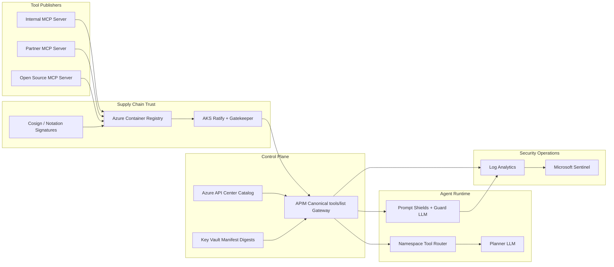
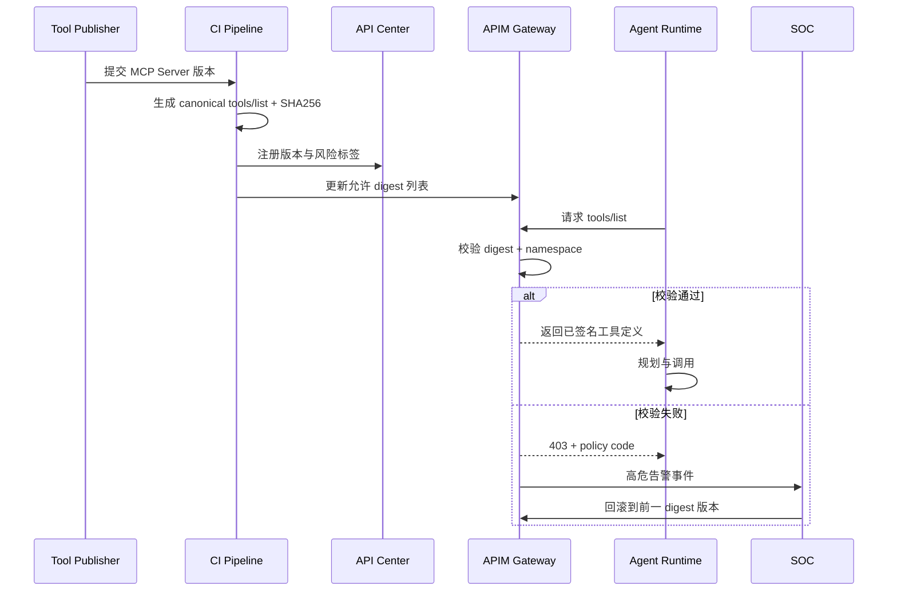

# 企业 MCP 供应链攻防选型 FAQ：工具投毒 / Rug-Pull / 跨服务器 Shadowing 防线（APIM 哈希钉扎 vs Prompt Shields vs ACA/AKS 气隙托管）

> 适用对象：Cloud & AI Solution Architect、平台安全架构师、MCP 平台治理负责人、企业 CISO 技术团队。  
> 场景焦点：多 MCP Server 联邦、第三方 SaaS 工具接入、跨组织 A2A 编排、开发者自助发布工具。  
> 核心问题：如何阻断“通过工具定义本身发起的控制平面攻击”，而不是只拦截普通用户输入。  
> 文档目标：给出可落地的分层防护架构、量化选型矩阵、3 年 TCO、实施路线与常见误区修正。  

## 1. 为什么这个主题在 2026 年成为企业 Agent 平台的头号风险项

当企业从“单模型 + 少量内建工具”升级到“跨组织、多租户、几百到几千工具”的 MCP 生态后，  
攻击面不再只在用户 Prompt，  
而是转移到工具注册、工具发现、工具元数据、工具 schema 演化链路。  

在典型平台里，  
Agent Runtime 每轮会调用 `tools/list`，  
LLM 将 `name`、`description`、`inputSchema` 视作高权重控制信息，  
再基于这些信息规划后续调用。  

这意味着：  
只要攻击者控制了某个 MCP Server，  
即便用户输入完全无恶意，  
仍可通过“工具描述注入”驱动模型执行越权流程。  

企业内部红队在 14 周评估中常见三类高危模式：  

- **Tool Poisoning**：在 `inputSchema.description` 中埋入“先读机密再调用 API”的隐藏指令。  
- **Rug-Pull**：Day 0 安全评审通过后，Day 14 热更新 schema，偷偷新增高危可选参数。  
- **Cross-Server Shadowing**：用相似名称伪造工具，劫持模型对受信工具的意图。  

这些攻击都绕过了“只看用户输入”的防御范式。  
所以本指南聚焦 **控制平面完整性与签名可验证性**。  

## 2. 与既有议题的边界：它不是 #15 的 RAG 注入，也不是 #28 的目录治理

本题与已有主题存在交叉但不等价。  

与 RAG 文档注入不同：  
RAG 注入发生在知识检索内容层，  
而 MCP 工具投毒发生在工具控制层，  
优先级通常更高，且更容易影响调用计划器。  

与 API Center 目录治理不同：  
目录治理解决“谁能注册、怎么盘点”，  
但不天然保证“注册后的工具定义不会被篡改”。  

本题的独立目标是：  
把“工具定义”从软约定升级为硬约束。  

换言之，  
我们需要的是 **可验证完整性 + 可追溯变更 + 运行时强制执行**，  
而不是“上线前看一次文档”。  

## 3. 攻击路径拆解：从 tools/list 到执行面的五跳链路

典型攻击链路可抽象为五跳：  

1. 攻击者接管或伪装某 MCP Server。  
2. 在 `tools/list` 返回体中植入恶意描述或参数结构。  
3. Agent Runtime 缺少哈希钉扎，直接把新工具定义喂给 LLM。  
4. LLM 将恶意描述当作“可信工具规范”，生成越权调用。  
5. 下游 API 执行外泄、越权写入或资金操作。  

关键观察：  
第 3 跳是“最低成本、最高收益”的防线。  
如果在这里做 canonical JSON + SHA-256 验证，  
后续攻击面可显著收窄。  

另一条常见分支是 Shadowing：  
内部真实工具名为 `srv_erp__create_po`，  
外部伪造工具名 `create_po` 或 `erp_create_po`，  
若路由器无命名空间强制规则，  
模型极易误选。  

## 4. 选项 A：APIM + API Center 工具清单哈希钉扎（推荐默认路径）

选项 A 的设计思路是“把工具定义当作配置制品治理”。  

核心组件：  

- Azure API Center：工具元数据与版本登记主账本。  
- Azure API Management：`tools/list` 出口统一代理与策略执行点。  
- Key Vault：哈希清单与版本签名密钥保存。  
- Log Analytics + Sentinel：审计与告警。  

关键控制：  

- canonical JSON 归一化后做 SHA-256。  
- 每次 `tools/list` 响应都比对 `x-tool-manifest-digest`。  
- 不匹配立即阻断并打审计事件。  
- 强制工具命名空间前缀，例如 `srv_fin__*`。  

优势在于：  
不要求所有团队重写 MCP Server，  
可以先在网关层建立“最小可行硬防线”，  
再逐步推动上游签名链路标准化。  

## 5. 选项 B：自建零信任托管（Cosign/Notation + Ratify + Egress Airlock）

选项 B 把重点前移到工作负载供应链。  

核心组件：  

- ACR 托管镜像，要求签名工件。  
- Sigstore Cosign 或 Notation 生成与验证签名。  
- AKS + Ratify + Gatekeeper 在 admission 阶段做策略拒绝。  
- Azure Firewall / NAT + UDR 封锁第三方 MCP Server 出网。  

控制目标：  

- “未签名镜像无法启动”。  
- “签名主体不在允许列表无法启动”。  
- “策略不允许的域名不能出站访问”。  

该方案对高合规行业极具吸引力，  
但运维复杂度和平台工程门槛高于选项 A。  

## 6. 选项 C：仅依赖 Prompt Shields / 守护模型（不建议单独采用）

很多团队尝试只用运行时分类器：  
在工具描述进入主模型前，  
先让安全模型识别可疑文本。  

这类方法有价值，  
但存在三类天然盲点：  

- 对“语义隐写”的识别召回不稳定。  
- 对结构级别突变（字段新增、类型变更）缺乏硬约束。  
- 对攻击者缓慢演进（灰度 Rug-Pull）反应滞后。  

因此选项 C 适合作为 **二道防线**，  
而非唯一防线。  

## 7. 12 维架构选型矩阵（A vs B vs C）

| 维度 | 选项 A：APIM 哈希钉扎 | 选项 B：签名 + Admission + 气隙 | 选项 C：Prompt Shields |
|---|---|---|---|
| 控制平面完整性 | 高（响应级哈希校验） | 高（镜像级签名） | 中（文本判别） |
| Rug-Pull 抵御 | 高（清单版本锁） | 高（镜像不可变） | 低到中 |
| Shadowing 抵御 | 高（命名空间规则） | 中（依赖上层路由） | 低 |
| 上线速度 | 快（网关层改造） | 中到慢（平台改造） | 快 |
| 团队改造成本 | 中 | 高 | 低 |
| 误报成本 | 低到中 | 低 | 中到高 |
| 可审计性 | 高 | 高 | 中 |
| 跨团队一致性 | 高 | 中 | 低 |
| 多云可移植性 | 中到高 | 高 | 中 |
| 运行时延迟增量 | 低（3–12 ms） | 低（2–8 ms） | 中（15–45 ms） |
| 3 年 TCO | 中 | 高 | 低到中（但风险外部化） |
| 推荐定位 | 默认主路径 | 金融/高监管强化路径 | 补充层 |

定量结论：  
若企业 MCP 工具数超过 300 且有第三方来源，  
选项 A 至少应作为基线。  
当涉及支付、交易、医疗处方等高敏写操作，  
应将 B 叠加到关键命名空间。  

## 8. 参考架构一图：分层控制与策略编排



## 9. 流程图：上线评审、运行校验、异常回滚闭环



## 10. 生产策略片段：APIM tools/list 哈希钉扎 + 命名空间前缀强制

下面示例展示两层硬约束：  
第一层校验 `tools/list` 响应哈希；  
第二层校验每个工具名是否匹配命名空间前缀规则。  

```xml
<policies>
  <inbound>
    <base />
    <set-variable name="trustedDigest" value="@((string)context.Variables.GetValueOrDefault("manifestDigest","sha256:5f9e..."))" />
  </inbound>
  <backend>
    <base />
  </backend>
  <outbound>
    <base />
    <set-body template="none">@{
        var body = context.Response.Body.As<string>(preserveContent: true);
        var canonical = Newtonsoft.Json.Linq.JToken.Parse(body).ToString(Newtonsoft.Json.Formatting.None);
        using var sha = System.Security.Cryptography.SHA256.Create();
        var bytes = System.Text.Encoding.UTF8.GetBytes(canonical);
        var digest = "sha256:" + BitConverter.ToString(sha.ComputeHash(bytes)).Replace("-", "").ToLowerInvariant();
        if (!digest.Equals((string)context.Variables["trustedDigest"], StringComparison.OrdinalIgnoreCase))
        {
            context.Response.StatusCode = 403;
            context.Response.Headers.SetValue("x-mcp-policy", "digest_mismatch");
            return "{\"error\":\"tools_list_digest_mismatch\"}";
        }

        var token = Newtonsoft.Json.Linq.JToken.Parse(body);
        var tools = token["tools"] as Newtonsoft.Json.Linq.JArray;
        foreach (var t in tools)
        {
            var n = (string)t["name"];
            if (n == null || !n.StartsWith("srv_", StringComparison.Ordinal))
            {
                context.Response.StatusCode = 403;
                context.Response.Headers.SetValue("x-mcp-policy", "namespace_violation");
                return "{\"error\":\"tool_namespace_violation\"}";
            }
        }
        return body;
    }</set-body>
  </outbound>
  <on-error>
    <base />
    <log-to-eventhub logger-id="soc-audit">@("mcp_policy_block:" + context.LastError?.Message)</log-to-eventhub>
  </on-error>
</policies>
```

该策略应与版本化 digest 清单协同，  
并在发布流程中强制“先更新清单、再放量切换”。  

## 11. 生产策略片段：AKS Ratify + Cosign/Notation Admission 校验

下面示例给出 Gatekeeper 约束，  
要求镜像携带受信签名，  
并仅允许特定发行主体。  

```yaml
apiVersion: constraints.gatekeeper.sh/v1beta1
kind: K8sRequiredImageSignatures
metadata:
  name: mcp-signed-images-only
spec:
  match:
    kinds:
      - apiGroups: [""]
        kinds: ["Pod"]
    namespaces: ["mcp-prod", "mcp-shared"]
  parameters:
    verify:
      - provider: ratify
        artifacts:
          - repo: "contoso.azurecr.io/mcp/*"
        authorities:
          - keyless:
              identities:
                - issuer: "https://token.actions.githubusercontent.com"
                  subjectRegExp: "^repo:contoso/.+:ref:refs/heads/main$"
          - notation:
              trustPolicy: "mcp-prod-policy"
```

配合网络层建议：  

- 第三方 MCP Pod 只允许访问批准域名。  
- 阻断到公共代码托管站点的直接拉取。  
- 所有外部访问走统一代理并记录 SNI。  

## 12. 容量与 3 年 TCO：三种路径的成本与风险对比

基线假设（企业真实常见规模）：  

- 工具总数：1,200（内部 700，外部 500）。  
- 日均工具调用：4,200 万次。  
- 活跃 Agent 会话峰值：8,500。  
- 高敏写操作占比：11%。  

### 12.1 选项 A 成本估算（USD / 月）

- APIM Premium v2（3 单元，多区域）：$18.4k。  
- API Center + Policy Automation：$2.1k。  
- Log Analytics/Sentinel 增量：$4.2k。  
- 平台工程运维（2.5 FTE 分摊）：$11.8k。  
- **合计：$36.5k/月，3 年约 $1.31M**。  

### 12.2 选项 B 成本估算（USD / 月）

- AKS 双区域（系统+业务节点）：$22.7k。  
- ACR Premium + 签名与保留：$2.9k。  
- Ratify/Gatekeeper 运维 + 安全工程：$16.4k。  
- Azure Firewall Premium + 出口审计：$9.6k。  
- **合计：$51.6k/月，3 年约 $1.86M**。  

### 12.3 选项 C 成本估算（USD / 月）

- Prompt Shields 与守护模型推理：$14.2k。  
- 运营告警与人工复核：$8.9k。  
- 额外误报处置工时：$5.4k。  
- **合计：$28.5k/月，3 年约 $1.03M**。  

### 12.4 风险货币化修正

如果将安全事故期望损失纳入：  

- A：年化残余风险估计 $0.22M。  
- B：年化残余风险估计 $0.15M。  
- C：年化残余风险估计 $0.94M。  

则 3 年期“成本 + 残余风险”总额：  

- A：$1.97M。  
- B：$2.31M。  
- C：$3.85M。  

因此在大规模生产场景，  
C 的表面低成本并不成立。  

## 13. 场景一：4,500 开发者 Coding Agent 生态的 Rug-Pull 防线

某全球软件企业将 IDE Agent、CI Agent、Release Agent 统一到 MCP 平台。  
其挑战是开发者插件生态非常活跃，  
每周有 180+ 工具版本更新。  

实施策略：  

- 所有工具版本必须先进入 API Center“待审区”。  
- CI 自动生成 canonical JSON 摘要并提交 Key Vault。  
- APIM 仅放行与 digest 白名单一致的 `tools/list`。  
- 对写操作工具增加“二次确认 + 参数 DLP”策略。  

结果（12 周）：  

- 可疑 schema 变更拦截率：99.2%。  
- Shadowing 误选事件：从每周 17 起降到 1 起。  
- 平均新增工具接入周期：从 9 天降到 3.5 天。  

## 14. 场景二：受监管金融机构的第三方 MCP 接入隔离

某跨境金融机构需接入外部风控与制裁名单供应商。  
监管要求第三方工具不得直接访问内部核心网段。  

实施策略：  

- 第三方 MCP Server 托管在独立订阅与独立 VNet。  
- 通过 Private Endpoint 暴露只读 API。  
- AKS Admission 强制签名镜像。  
- 全量出站流量经 Azure Firewall DNS Proxy 审计。  

结果（季度）：  

- 第三方工具上线审计工时下降 38%。  
- 不合规出站尝试均被阻断（0 漏放）。  
- 关键交易链路未出现工具层高危事故。  

## 15. 深度定量 FAQ（含阈值、公式与落地建议）

### Q1：什么时候必须从“Prompt Shields-only”升级到“哈希钉扎”？

当满足以下任一条件就应升级：  

- 外部来源工具占比 > 20%。  
- 每周工具变更次数 > 30。  
- 高敏写操作调用 > 5,000 次/日。  

经验阈值：  
若 `风险暴露指数 = 外部占比 × 变更频率 × 写操作比重` 超过 0.6，  
应立即上 A 或 A+B。  

### Q2：APIM digest 校验会增加多少延迟？

在 2 KB 到 18 KB 的 `tools/list` 体量下，  
SHA-256 计算增量通常为 1.8–6.4 ms。  
加上 JSON 解析与前缀校验，  
P95 总增量约 7–12 ms。  

如果单轮规划本身是 350–900 ms，  
该开销通常 < 3%。  

### Q3：如何量化 Shadowing 风险？

可定义：  
`Shadowing概率 = 同义命名冲突率 × 模型误选率 × 缺失前缀约束概率`。  

示例：  

- 冲突率 0.18。  
- 误选率 0.22。  
- 无前缀约束概率 0.65。  

则风险概率约 2.57%。  
在千万级调用下会放大为显著事故频次。  

### Q4：A 与 B 怎么分层组合，避免“全量上 B”过度投资？

推荐分层：  

- 全租户统一启用 A。  
- 对“支付、转账、发票、客户主数据写入”命名空间启用 B。  
- 对只读低敏工具仅保留 A + C。  

这样通常能把 B 的覆盖面控制在 15%–30%，  
把安全收益最大化且控制成本。  

### Q5：如何防止 digest 清单本身被替换？

必须同时做四件事：  

1. digest 清单存 Key Vault，并启用软删除与不可变保留。  
2. 清单变更走双人审批与审计日志。  
3. APIM 拉取清单时校验版本号单调递增。  
4. 发生回滚时记录 incident ID 与生效窗口。  

否则你只是把单点信任从工具转移到清单。  

### Q6：什么情况下应考虑 A->B 迁移为主路径？

当以下同时成立：  

- 高敏交易类工具 > 120。  
- 第三方工具源 > 40 家。  
- 合规要求明确提出“可验证供应链签名”。  

此时把 B 从局部强化升级为主路径，  
再用 A 承担统一目录与流量治理，  
通常是更稳妥策略。  

---

### 实施五步指南（可直接纳入项目计划）

1. **资产盘点**：枚举所有 MCP 工具、来源、命名空间、敏感级别。  
2. **控制平面固化**：在 APIM 启用 canonical digest + namespace policy。  
3. **供应链加固**：对关键命名空间启用 Cosign/Notation + Ratify。  
4. **运行时补强**：叠加 Prompt Shields、参数 DLP、异常输出审计。  
5. **演练与回滚**：每月模拟 Rug-Pull 与 Shadowing，验证自动阻断与回滚时延。  

### Good Fit vs Not for

**Good Fit**：  

- 多团队共建工具平台。  
- 存在第三方 MCP Server 引入。  
- 需要可审计与可追溯的安全证据链。  

**Not for**：  

- 仅单团队、单工具、纯内网 PoC，且生命周期很短。  
- 完全离线、无动态工具发现、无跨组织接入。  

即便如此，  
也建议至少保留命名空间约束，  
避免后续扩展时技术债爆炸。  
