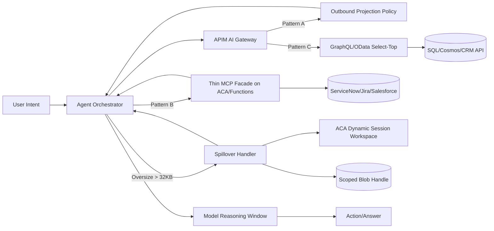
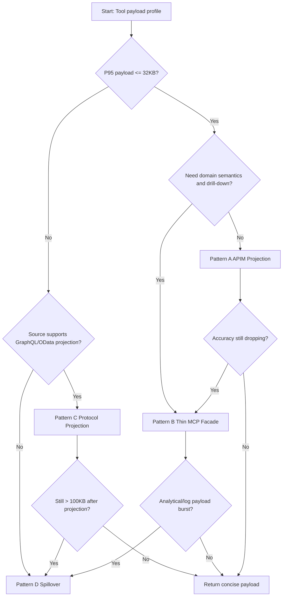

# Enterprise MCP Tool Response Shaping & Context Protection Selection FAQ: APIM Liquid Projection vs Thin MCP Façade vs GraphQL/OData Field Projection vs CodeAct Spillover
## 1. Scope and executive takeaways
This guide targets enterprise Cloud & AI Solution Architects.  
The focus is response-shaping for agent tool calls in production.  
The core failure pattern is oversized REST/OpenAPI payloads.  
Typical sources include ServiceNow, Jira, Salesforce, SIEM, ERP, and data APIs.  
A single call often returns `100KB–5MB` JSON.  
When that payload is injected directly into model context.  
You burn window budget, drain TPM quota, and degrade reasoning quality together.  
We compare four Azure-ready patterns.  
Pattern A: APIM outbound `set-body` Liquid/C# projection with byte/token caps.  
Pattern B: Thin MCP façade on ACA/Functions with `concise` and `detailed` modes.  
Pattern C: GraphQL or OData `$select/$top` projection at protocol level.  
Pattern D: spill oversized payloads to Dynamic Session workspace or scoped Blob handle.  
Quick recommendation.  
Use A for fastest estate-wide containment.  
Use B for highest task-level reasoning quality.  
Use C where data domains already expose GraphQL/OData controls.  
Use D whenever analytical or ledger payloads routinely exceed `100KB`.  
In practice, A+B+D is the dominant production baseline.  
## 2. Failure mechanics: how JSON bombs break agent reliability
The issue is not only model capability.  
It is uncontrolled input entropy.  
Most large payloads contain low-signal metadata.  
Examples include UI fields, verbose audit trails, repeated attachment descriptors, and nested history blocks.  
Those fields rarely help the current decision.  
But they consume most prompt tokens.  
In multi-turn agent flows, damage compounds.  
Early oversized tool outputs fill context high-water marks.  
Critical evidence drifts into middle segments.  
Reasoning quality drops due to lost-in-the-middle behavior.  
Tool choice and argument completeness become unstable.  
TPM impact appears in three layers.  
First, per-task token burn rises sharply.  
Second, available concurrent sessions collapse under the same quota.  
Third, teams overprovision expensive model lanes to absorb peaks.  
Operationally, this often looks like random hallucination.  
But root cause is response-shaping debt.  
So governance must move upstream.  
Treat shaping as platform control, not prompt-only remediation.  
## 3. Pattern overview
Pattern A is gateway-first and near-zero app-code change.  
It is the fastest way to reduce token waste across heterogeneous APIs.  
It centralizes policy and observability.  
Its limit is semantic compression depth.  
Pattern B is contract-first.  
It redesigns tools around decision tasks instead of CRUD mirroring.  
Default responses expose only `5–8` high-signal fields.  
Details are pulled explicitly through drill-down tools.  
Pattern C is protocol-native projection.  
GraphQL selection sets and OData column filters reduce payload at source.  
This prevents avoidable transfer and post-processing overhead.  
It works best for structured analytical domains.  
Pattern D is out-of-context spillover.  
For inherently large artifacts, store full payload outside model context.  
Return compact schema, stats, and retrieval handle in-band.  
This is essential for logs, ledgers, and investigative workflows.  
## 4. End-to-end topology for projection, façade, and spillover

Recommended control-plane layering.  
L0: byte caps, field allowlists, masking rules.  
L1: token budgets, pagination rules, retry/timeout policy.  
L2: semantic summary and drill-down policy.  
L3: observability with raw/shaped/spilled volume metrics.  
Minimum telemetry set.  
`payload_raw_bytes`, `payload_shaped_bytes`, `payload_shaped_tokens`.  
`spillover_count`, `spillover_rehydrate_ms`.  
`tool_accuracy_delta`, `context_overflow_block_rate`.  
## 5. Pattern A: APIM outbound projection with dual caps
Adoption profile.  
You already run APIM as north-south entry point.  
Backend APIs are heterogeneous and hard to refactor quickly.  
You need fast reduction of token burn in weeks, not quarters.  
Design principles.  
Define domain allowlists by business intent.  
For ticketing, keep `id`, `status`, `priority`, `assignee`, `updatedAt`, `summary`.  
Move all non-critical fields behind optional tools.  
Never dump raw object trees by default.  
Use a dual-threshold guardrail.  
Byte threshold, for example `32KB`.  
Estimated token threshold, for example `6,000`.  
If either threshold is crossed.  
Return deterministic truncation warning with cursor hints.  
Never silently cut payload.  
Advantages.  
No upstream SaaS API changes required.  
Immediate effect even for auto-generated OpenAPI wrappers.  
Centralized governance and consistent policy rollout.  
Trade-offs.  
Complex templates can raise gateway CPU cost.  
Keep Liquid focused on deterministic field projection.  
Use Pattern B or D for richer semantics and deep summarization.  
Deploy via APIM revisions and controlled canary traffic.  
## 6. Pattern B: Thin MCP façade with concise/detailed contracts
Pattern B is not “another proxy layer for everything.”  
It is a tool ergonomics layer for model reliability.  
Replace CRUD mirroring with intent-specific actions.  
Contract structure.  
`concise` mode returns high-signal compact records.  
`detailed` mode is explicit and scoped.  
`page_token` guarantees stable, resumable traversal.  
Sorted pages avoid duplicate reasoning across turns.  
Typical decomposition.  
`list_incidents_concise` for triage shortlist.  
`get_incident_detail` for one case deep context.  
`list_incident_comments` for threaded history pagination.  
`get_attachment_manifest` returns metadata only, not in-band body.  
Strengths.  
Largest improvement in multi-turn decision quality.  
Clear separation between “default evidence” and “on-demand evidence.”  
Better controllability for regulated reviews.  
Costs.  
Needs domain ownership and contract lifecycle governance.  
Requires versioning discipline and compatibility testing.  
Long-term payoff usually outweighs initial design effort.  
## 7. Pattern C: GraphQL/OData dynamic field projection
Pattern C fits organizations with structured data platform maturity.  
Projection happens near source and over standard protocol semantics.  
This reduces transfer volume before gateway shaping.  
GraphQL path.  
Validate query depth and field count in APIM GraphQL policies.  
Cap list cardinality and nested expansion depth.  
Apply denylist for high-risk fields.  
OData path.  
Use DAB or API layer allowlists for exposed columns.  
Append `$top` ceilings at gateway.  
Constrain `$expand` and wildcard projections.  
Attach tenant-scoped filters by default.  
Strengths.  
Efficient for analytical retrieval and reporting APIs.  
Lower bandwidth and memory overhead than post-hoc trimming.  
Portable across multiple tool consumers.  
Boundary conditions.  
If upstream only exposes coarse monolithic blobs.  
Pattern C alone cannot compress enough.  
Combine with Pattern D for safe execution.  
## 8. Pattern D: out-of-context scratchpad spillover
Pattern D handles unavoidable large artifacts.  
Examples: forensic logs, ledger exports, scan reports, long comment threads.  
Payloads may legitimately exceed `100KB`.  
Flow.  
Middleware intercepts oversized tool output.  
Full payload is written to ACA Dynamic Session workspace.  
Or persisted as short-TTL scoped Blob object.  
In-context response stays under about `300` tokens.  
Return schema summary, stats, and retrieval handle.  
Recommended summary fields.  
Schema key map.  
Record counts and time range.  
Top distributions and anomaly hints.  
Available filter dimensions.  
Safe follow-up commands.  
Security controls.  
Bind handle to tenant and session identity.  
Read-only by default.  
Short TTL and automatic revocation.  
Block cross-session replay and unsigned access.  
Benefits.  
Protects context windows from analytical payload storms.  
Preserves deterministic machine-driven drill-down.  
Substantially improves reliability in investigation workflows.  
## 9. Config block #1: APIM outbound projection and payload ceiling
```xml
<policies>
  <inbound>
    <base />
    <set-variable name="maxBytes" value="32768" />
    <set-variable name="maxTokens" value="6000" />
    <set-variable name="tenantId" value="@(context.Request.Headers.GetValueOrDefault(\"x-tenant-id\",\"unknown\"))" />
  </inbound>
  <backend>
    <base />
  </backend>
  <outbound>
    <base />
    <set-variable name="rawBody" value="@(context.Response.Body.As<string>(preserveContent: true))" />
    <set-variable name="rawBytes" value="@(((string)context.Variables[\"rawBody\"]).Length)" />
    <set-variable name="estimatedTokens" value="@((int)Math.Ceiling(((string)context.Variables[\"rawBody\"]).Length / 3.8))" />
    <set-body template="liquid">
{
  "mode": "concise",
  "tenantId": "{{context.Variables.tenantId}}",
  "records": [
    
    {
      "id": "{{item.id}}",
      "status": "{{item.status}}",
      "priority": "{{item.priority}}",
      "owner": "{{item.assignee.displayName}}",
      "updatedAt": "{{item.updatedAt}}",
      "summary": "{{item.shortDescription}}"
    },
    
  ],
  "nextCursor": "{{body.nextCursor}}",
  "truncated": {{ body.items.size > 20 }},
  "warning": "response shaped and capped; use nextCursor or detail tool"
}
    </set-body>
    <choose>
      <when condition="@((int)context.Variables[\"rawBytes\"] > (int)context.Variables[\"maxBytes\"] || (int)context.Variables[\"estimatedTokens\"] > (int)context.Variables[\"maxTokens\"])">
        <set-header name="x-agent-payload-shaped" exists-action="override">
          <value>true</value>
        </set-header>
      </when>
    </choose>
  </outbound>
  <on-error>
    <base />
  </on-error>
</policies>
```
Implementation notes.  
Keep shaped schema stable across revisions.  
Models learn consistent tool response structure faster.  
Make warning text machine-readable and deterministic.  
Avoid ambiguous wording that encourages policy bypass.  
## 10. Code block #2: MCP middleware for automatic spillover >32KB
```python
from __future__ import annotations
import json
import time
import hashlib
from dataclasses import dataclass
from pathlib import Path
from typing import Any, Dict, Tuple
MAX_INLINE_BYTES = 32 * 1024
MAX_INLINE_TOKENS = 6000
SPILLOVER_TTL_SECONDS = 3600
@dataclass
class SpillRef:
    handle: str
    expires_at: int
    bytes_written: int
    row_count: int
def estimate_tokens(payload: str) -> int:
    return int(len(payload) / 3.8) + 1
def write_spill(workspace: Path, tenant_id: str, tool: str, payload: str) -> SpillRef:
    now = int(time.time())
    digest = hashlib.sha256(payload.encode("utf-8")).hexdigest()[:16]
    name = f"{tenant_id}-{tool}-{now}-{digest}.json"
    target = workspace / "spillover" / name
    target.parent.mkdir(parents=True, exist_ok=True)
    target.write_text(payload, encoding="utf-8")
    row_count = len(json.loads(payload)) if payload.startswith("[") else 1
    return SpillRef(
        handle=f"artifact://spillover/{name}",
        expires_at=now + SPILLOVER_TTL_SECONDS,
        bytes_written=len(payload.encode("utf-8")),
        row_count=row_count,
    )
def shape_or_spill(tool_name: str, tenant_id: str, result: Dict[str, Any], workspace: Path) -> Tuple[Dict[str, Any], bool]:
    raw = json.dumps(result, ensure_ascii=False, separators=(",", ":"))
    bytes_len = len(raw.encode("utf-8"))
    token_len = estimate_tokens(raw)
    if bytes_len <= MAX_INLINE_BYTES and token_len <= MAX_INLINE_TOKENS:
        return {
            "mode": "inline",
            "tool": tool_name,
            "bytes": bytes_len,
            "estimatedTokens": token_len,
            "data": result,
        }, False
    ref = write_spill(workspace, tenant_id, tool_name, raw)
    summary = {
        "mode": "spillover",
        "tool": tool_name,
        "estimatedTokens": token_len,
        "bytes": bytes_len,
        "artifact": ref.handle,
        "expiresAt": ref.expires_at,
        "rowCount": ref.row_count,
        "schemaKeys": sorted(list(result.keys()))[:12] if isinstance(result, dict) else [],
        "hint": "Use follow-up filter tool with artifact handle; do not request full raw payload in-context."
    }
    return summary, True
```
Engineering guidance.  
Ship spillover as shared platform middleware.  
Do not duplicate ad hoc logic in every tool.  
Track handle lifecycle in auditable logs.  
Include creation, access, and expiry events.  
## 11. 12-dimension selection matrix and decision tree
| Dimension | Pattern A APIM projection | Pattern B Thin MCP | Pattern C GraphQL/OData | Pattern D Spillover |
|---|---|---|---|---|
| 1. Delivery speed | Very high | Medium | Medium | Medium-high |
| 2. Semantic compression quality | Medium | Very high | High | Medium |
| 3. Upstream change requirement | Low | Medium | Medium-high | Low |
| 4. Stability for oversized payloads | Medium | Medium-high | Medium | Very high |
| 5. Multi-turn accuracy lift | Medium | Very high | High | High |
| 6. Token saving potential | High | Very high | High | Very high |
| 7. Governance centralization | Very high | High | Medium-high | High |
| 8. Operational complexity | Low-medium | Medium | Medium | Medium |
| 9. Observability fit | High | High | Medium-high | High |
| 10. Compliance audit friendliness | High | Very high | High | Very high |
| 11. Cross-domain reuse | Very high | High | Medium | Medium-high |
| 12. Long-term evolution | Medium-high | Very high | High | High |

Practical strategy.  
Most enterprises should not force a single-pattern answer.  
A+B+D is the common control baseline.  
C is a strong augmentation for structured data domains.  
## 12. Quantitative benchmark: token reduction, accuracy, TPM, and TCO
> Baseline: raw OpenAPI passthrough tools, average response size `61KB`, weekday peak 380 concurrent sessions  
> Same workload set and evaluation harness across all candidates
| Option | Prompt token reduction | Multi-turn task accuracy | PTU TPM savings | Monthly TCO for 50-agent portfolio |
|---|---:|---:|---:|---:|
| Pattern A APIM projection | 58% | +8.7% | 34% | \$18,900 |
| Pattern B Thin MCP | 72% | +14.9% | 47% | \$17,400 |
| Pattern C GraphQL/OData | 63% | +11.2% | 39% | \$18,100 |
| Pattern D Spillover | 79% | +13.4% | 52% | \$17,100 |
| Combined A+B+D | 84% | +18.6% | 61% | \$16,500 |
Interpretation.  
Pattern D and A+B+D deliver the strongest token containment.  
Pattern B and A+B+D show the best accuracy consistency.  
Combined route typically wins blended cost and reliability.  
SLO guardrails.  
Keep shaping overhead under `25ms` at p95.  
Keep spillover rehydrate under `220ms` at p95.  
Alert on context-overflow block rate trend changes.  
## 13. Scenario A: ITSM triage agent for ServiceNow/Jira
Business objective.  
Automate incident triage and assignment suggestions at peak hours.  
Provide explainable rationale for human on-call handoff.  
Observed pain points.  
Ticket payloads include noisy UI metadata and long comment chains.  
Models miss SLA and priority cues in multi-turn reasoning.  
TPM pressure spikes during morning incident floods.  
Recommended architecture.  
Start with Pattern A to rapidly normalize response shape.  
Add Pattern B to split concise list, detail, comments, and attachments.  
Use Pattern D for attachment bodies and long audit trails.  
Preserve deterministic cursor-based retrieval for follow-up turns.  
Expected outcomes.  
Higher triage consistency in long conversations.  
Lower quota burn at the same throughput tier.  
Reduced false escalations in incident routing.  
## 14. Scenario B: financial audit agent over ledger workloads
Business objective.  
Support transaction traceability and anomaly investigation.  
Maintain replayable evidence for compliance review.  
Observed pain points.  
Ledger and log payloads are naturally large and verbose.  
Direct context injection causes evidence truncation in the reasoning middle.  
Sensitive fields can leak into unnecessary model context.  
Recommended architecture.  
Use Pattern C for strict column projection at query boundary.  
Auto-route oversized responses to Pattern D spillover.  
Return only schema summary and filter keys in context window.  
Apply Pattern A masking and cap policy as global fallback.  
Expected outcomes.  
Stable reasoning window even under large evidence sets.  
Auditable retrieval and reproducible investigation trails.  
Stronger regulatory response readiness.  
## 15. Day-0 / Day-2 checklist and 8 quantitative FAQs
### Day-0 (before production)
- Define `maxBytes`, `maxTokens`, and default page size per tool family.  
- Standardize concise schema with `<=8` default fields for high-frequency tools.  
- Implement deterministic warning and cursor hints in APIM responses.  
- Set spillover handle TTL policy (recommended `30–120` minutes).  
- Publish raw/shaped/spill metrics in one dashboard.  
- Apply sensitive-field denylist and masking controls.  
- Roll out by canary stages (10% -> 30% -> 100%).  
- Gate release on both token reduction and accuracy uplift.  
### Day-2 (operations)
- Review top oversized tools and spillover ratio weekly.  
- Audit multi-turn failures for middle-evidence loss weekly.  
- Validate post-warning user/tool behavior weekly.  
- Reconcile TPM peak profile and downgrade events monthly.  
- Audit spillover handle authorization and replay attempts monthly.  
- Refresh concise field sets against business KPIs monthly.  
- Rebalance A/B/C/D pattern mix quarterly.  
- Run one payload-storm chaos replay with cost analysis quarterly.  
**Q1: How much token reduction can APIM projection usually deliver?**  
A1: Common enterprise range is `45%–70%`, and can reach `80%` on metadata-heavy SaaS APIs.  
**Q2: What is the recommended default field count in Thin MCP concise mode?**  
A2: `5–8` fields is usually optimal; benefits flatten after roughly `12` default fields.  
**Q3: When should spillover become mandatory?**  
A3: Enable by policy when P95 payload stays above `32KB` or `>100KB` responses exceed `10%` of calls.  
**Q4: Can GraphQL/OData projection replace Thin MCP completely?**  
A4: No; protocol projection trims shape, while Thin MCP enforces decision-oriented tool semantics.  
**Q5: How do we measure lost-in-the-middle improvement?**  
A5: Track multi-turn accuracy, key-evidence citation hit rate, and middle-evidence omission ratio.  
**Q6: Does spillover hurt latency?**  
A6: It adds I/O, so enforce `p95 < 220ms` rehydrate and prefer local dynamic-session workspace first.  
**Q7: Why does A+B+D often have best TCO?**  
A7: It combines strongest token reduction with better concurrency headroom, often lowering monthly cost by `10%–20%`.  
**Q8: How do we prevent silent truncation misinterpretation?**  
A8: Always return deterministic warning, cursor guidance, and total-count context; never silently truncate.  
