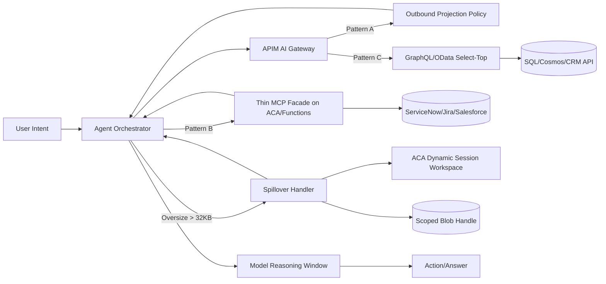
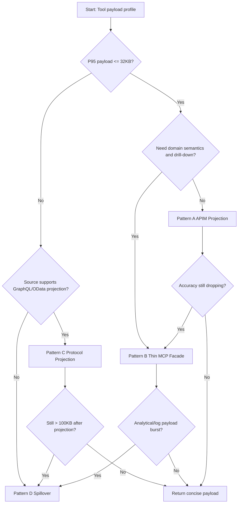

# 企业 MCP 工具响应整形与上下文保护选型 FAQ：APIM Liquid 投影 vs Thin MCP Façade vs GraphQL/OData 字段裁剪 vs CodeAct 溢写沙箱
## 1. 背景、边界与结论先看
本文面向企业 Cloud & AI Solution Architect。  
目标是解决 Agent 工具调用中的超大响应失控问题。  
典型触发源包括 ServiceNow、Jira、Salesforce、SIEM、ERP、数据湖查询。  
单次返回 `100KB–5MB` JSON 并不罕见。  
如果将原始载荷直接拼入 Agent 上下文。  
会同时击穿上下文窗口、PTU TPM 预算和推理稳定性。  
本文比较四条 Azure 可落地路径。  
模式 A：APIM 出站 `set-body` Liquid/C# 投影 + 字节/Token 上限。  
模式 B：基于 ACA/Functions 的 Thin MCP Façade（`concise`/`detailed` 双模式）。  
模式 C：GraphQL 或 OData `$select`/`$top` 的协议级字段裁剪。  
模式 D：超大结果自动溢写到 ACA Dynamic Sessions 工作区并返回摘要句柄。  
核心结论。  
载荷多数在 `5KB–40KB` 且来源异构时，优先模式 A。  
需要业务语义稳定与多团队复用时，优先模式 B。  
数据域已有 GraphQL/OData 治理基础时，优先模式 C。  
日志/账本/分析类 `>100KB` 载荷高频出现时，优先模式 D。  
生产中通常采用 A+B+D 组合，C 作为数据平面的结构化补位。  
## 2. 失效机理：JSON Bomb 如何击穿上下文与 TPM
问题不是“模型太弱”，而是“输入熵失控”。  
工具响应中往往混入大量低信号字段。  
例如审计尾迹、历史快照、嵌套注释、UI 元数据、重复附件元信息。  
这些字段对当前任务几乎无增益。  
却占据了绝大部分 token。  
在长链路 Agent 中，损害会叠加。  
第一跳调用把上下文抬高到高水位。  
后续推理窗口中的关键证据被挤压到中段。  
模型出现 lost-in-the-middle。  
工具选择准确率与参数完整性下降。  
PTU/TPM 层面会出现三类连锁反应。  
其一，单位任务 token 消耗显著抬升。  
其二，并发会话数下降导致队列积压。  
其三，为压峰不得不切换更昂贵的模型档位。  
运维层面还有隐蔽成本。  
排障团队看到的是“偶发 hallucination”。  
根因却是响应整形缺位。  
因此治理位置应前移到网关或工具契约层。  
而不是把责任全部推给提示词工程。  
## 3. 四种架构模式总览
模式 A 属于网关侧零业务代码方案。  
优势是落地快、覆盖面广、策略集中。  
适合先止血。  
不足是语义压缩能力受模板与策略复杂度限制。  
模式 B 属于工具契约重塑方案。  
通过领域语义把“读很多”改造成“先读最关键”。  
默认返回 `5–8` 个高信号字段。  
更多字段经显式 drill-down 工具按需提取。  
模式 C 属于协议原生投影方案。  
重点是让上游数据平面只返回被请求字段。  
在传输层就减少体积。  
避免后置裁剪的重复消耗。  
模式 D 属于上下文外溢方案。  
当结果天然巨大且无法预裁剪。  
把原文放入会话工作区或受控 Blob。  
主上下文仅保留结构摘要、统计与过滤入口。  
这是处理分析类载荷的关键保险丝。  
## 4. 端到端架构：投影、契约、溢写与回读

控制面建议采用分层。  
L0：字节上限、字段白名单、敏感字段脱敏。  
L1：token 预算、分页游标、重试和超时。  
L2：语义摘要、drill-down 策略、spillover 句柄授权。  
L3：可观测性，记录“原始体积/整形体积/摘要体积”三元指标。  
审计指标至少包含。  
`payload_raw_bytes`、`payload_shaped_bytes`、`payload_shaped_tokens`。  
`spillover_count`、`spillover_rehydrate_ms`。  
`tool_accuracy_delta` 与 `context_overflow_block_rate`。  
## 5. 模式 A：APIM 出站投影与双阈值上限
适用条件。  
团队已有 APIM 统一入口。  
后端系统多且改造窗口小。  
需要在两周内快速降低 token 消耗。  
关键设计。  
先按业务域定义字段 allowlist。  
例如工单域保留 `id`、`status`、`priority`、`assignee`、`updatedAt`、`summary`。  
其余字段进入可选扩展区。  
默认不进入主上下文。  
阈值建议采用双闸。  
第一闸是字节阈值，例如 `32KB`。  
第二闸是估算 token 阈值，例如 `6,000` token。  
触发任一阈值时进入截断与分页提示。  
返回 deterministic warning，不返回静默截断。  
优势。  
无需改动上游 SaaS API。  
对 OpenAPI 自动封装工具也可立即见效。  
策略集中后更容易做跨租户一致治理。  
风险与缓解。  
模板过于复杂会增加网关 CPU 开销。  
建议把 Liquid 用于字段裁剪。  
把复杂语义摘要下放到 B 或 D。  
并以 APIM revision 做灰度切换。  
## 6. 模式 B：Thin MCP Façade 的 concise/detailed 契约
模式 B 的核心不是再造一个代理层。  
而是收敛“可被模型稳定使用”的工具界面。  
将 1:1 CRUD 工具替换为任务导向工具。  
契约建议。  
`concise` 模式默认返回高信号摘要。  
`detailed` 模式用于人工确认或二次分析。  
`page_token` 驱动可重复分页。  
每页稳定排序，避免模型跨页重复推理。  
典型工具拆分。  
`list_incidents_concise` 返回 8 字段 + 聚合统计。  
`get_incident_detail` 返回单工单扩展。  
`list_incident_comments` 独立分页。  
`get_attachment_manifest` 仅返回附件索引，不内联全文。  
优势。  
把语义压缩前置到领域层。  
能显著提升多轮任务成功率。  
减少模型在噪声字段上的注意力漂移。  
代价。  
需要领域团队参与工具设计。  
需要维护版本演进与兼容策略。  
但长期收益通常高于纯网关裁剪。  
## 7. 模式 C：GraphQL/OData 字段裁剪网关
模式 C 适合数据访问路径已标准化的组织。  
通过 GraphQL selection set 或 OData `$select/$top/$filter`。  
在数据源附近完成字段与行数约束。  
GraphQL 路径。  
由 APIM GraphQL policy 验证查询复杂度。  
限制深度、字段数、列表节点上限。  
对高风险字段做 denylist。  
OData 路径。  
由 DAB 或 API 层白名单暴露可选列。  
APIM 追加 `$top` 上限。  
禁止未授权 expand。  
并绑定租户过滤器。  
优势。  
在 wire 层减少无效传输。  
避免后置裁剪浪费带宽与网关内存。  
对于报表类读取特别有效。  
边界。  
若上游接口本身只提供粗粒度大对象。  
模式 C 的收益受限。  
此时应与模式 D 联合使用。  
## 8. 模式 D：Scratchpad Spillover 上下文外溢
模式 D 处理“不可避免的大对象”。  
如审计流水、交易账本、运行日志、扫描报告。  
这些结果可能天然超过 `100KB`。  
处理流程。  
当 MCP 响应超过阈值。  
中间件将原文写入 ACA Dynamic Session 工作区。  
或写入短 TTL 的 Scoped Blob。  
主上下文返回 `300` token 以内摘要。  
并附 `artifact://` 或受签名句柄。  
摘要最小集合建议。  
schema 摘要。  
行数与时间范围。  
关键分布统计。  
可用过滤键列表。  
下钻工具入口。  
安全要点。  
句柄需绑定会话与租户。  
默认只读。  
TTL 到期自动失效。  
禁止跨会话重放。  
优势。  
避免把巨量原文直接塞进模型窗口。  
同时保留可编程下钻能力。  
对分析类 Agent 成功率提升明显。  
## 9. 关键配置块 1：APIM 出站投影 + 上限保护
```xml
<policies>
  <inbound>
    <base />
    <set-variable name="maxBytes" value="32768" />
    <set-variable name="maxTokens" value="6000" />
    <set-variable name="tenantId" value="@(context.Request.Headers.GetValueOrDefault(\"x-tenant-id\",\"unknown\"))" />
  </inbound>
  <backend>
    <base />
  </backend>
  <outbound>
    <base />
    <set-variable name="rawBody" value="@(context.Response.Body.As<string>(preserveContent: true))" />
    <set-variable name="rawBytes" value="@(((string)context.Variables[\"rawBody\"]).Length)" />
    <set-variable name="estimatedTokens" value="@((int)Math.Ceiling(((string)context.Variables[\"rawBody\"]).Length / 3.8))" />
    <set-body template="liquid">
{
  "mode": "concise",
  "tenantId": "{{context.Variables.tenantId}}",
  "records": [
    
    {
      "id": "{{item.id}}",
      "status": "{{item.status}}",
      "priority": "{{item.priority}}",
      "owner": "{{item.assignee.displayName}}",
      "updatedAt": "{{item.updatedAt}}",
      "summary": "{{item.shortDescription}}"
    },
    
  ],
  "nextCursor": "{{body.nextCursor}}",
  "truncated": {{ body.items.size > 20 }},
  "warning": "response shaped and capped; use nextCursor or detail tool"
}
    </set-body>
    <choose>
      <when condition="@((int)context.Variables[\"rawBytes\"] > (int)context.Variables[\"maxBytes\"] || (int)context.Variables[\"estimatedTokens\"] > (int)context.Variables[\"maxTokens\"])">
        <set-header name="x-agent-payload-shaped" exists-action="override">
          <value>true</value>
        </set-header>
      </when>
    </choose>
  </outbound>
  <on-error>
    <base />
  </on-error>
</policies>
```
实现要点。  
将模板输出固定成稳定 schema。  
便于模型形成可靠工具使用习惯。  
并把 `warning` 设计为可解析文本。  
避免模糊描述导致策略绕行。  
## 10. 关键代码块 2：>32KB MCP 自动溢写中间件
```python
from __future__ import annotations
import json
import time
import hashlib
from dataclasses import dataclass
from pathlib import Path
from typing import Any, Dict, Tuple
MAX_INLINE_BYTES = 32 * 1024
MAX_INLINE_TOKENS = 6000
SPILLOVER_TTL_SECONDS = 3600
@dataclass
class SpillRef:
    handle: str
    expires_at: int
    bytes_written: int
    row_count: int
def estimate_tokens(payload: str) -> int:
    return int(len(payload) / 3.8) + 1
def write_spill(workspace: Path, tenant_id: str, tool: str, payload: str) -> SpillRef:
    now = int(time.time())
    digest = hashlib.sha256(payload.encode("utf-8")).hexdigest()[:16]
    name = f"{tenant_id}-{tool}-{now}-{digest}.json"
    target = workspace / "spillover" / name
    target.parent.mkdir(parents=True, exist_ok=True)
    target.write_text(payload, encoding="utf-8")
    row_count = len(json.loads(payload)) if payload.startswith("[") else 1
    return SpillRef(
        handle=f"artifact://spillover/{name}",
        expires_at=now + SPILLOVER_TTL_SECONDS,
        bytes_written=len(payload.encode("utf-8")),
        row_count=row_count,
    )
def shape_or_spill(tool_name: str, tenant_id: str, result: Dict[str, Any], workspace: Path) -> Tuple[Dict[str, Any], bool]:
    raw = json.dumps(result, ensure_ascii=False, separators=(",", ":"))
    bytes_len = len(raw.encode("utf-8"))
    token_len = estimate_tokens(raw)
    if bytes_len <= MAX_INLINE_BYTES and token_len <= MAX_INLINE_TOKENS:
        return {
            "mode": "inline",
            "tool": tool_name,
            "bytes": bytes_len,
            "estimatedTokens": token_len,
            "data": result,
        }, False
    ref = write_spill(workspace, tenant_id, tool_name, raw)
    summary = {
        "mode": "spillover",
        "tool": tool_name,
        "estimatedTokens": token_len,
        "bytes": bytes_len,
        "artifact": ref.handle,
        "expiresAt": ref.expires_at,
        "rowCount": ref.row_count,
        "schemaKeys": sorted(list(result.keys()))[:12] if isinstance(result, dict) else [],
        "hint": "Use follow-up filter tool with artifact handle; do not request full raw payload in-context."
    }
    return summary, True
```
工程建议。  
把 spillover 设计成平台能力。  
不要散落在每个工具里重复实现。  
并在审计日志记录 `artifact handle` 生命周期。  
## 11. 12 维选型矩阵与决策树
| 维度 | 模式 A APIM 投影 | 模式 B Thin MCP | 模式 C GraphQL/OData | 模式 D Spillover |
|---|---|---|---|---|
| 1. 实施速度 | 很高 | 中 | 中 | 中高 |
| 2. 语义压缩质量 | 中 | 很高 | 高 | 中 |
| 3. 对上游改造要求 | 低 | 中 | 中高 | 低 |
| 4. 超大载荷稳定性 | 中 | 中高 | 中 | 很高 |
| 5. 多轮任务准确率提升 | 中 | 很高 | 高 | 高 |
| 6. Token 节省潜力 | 高 | 很高 | 高 | 很高 |
| 7. 治理集中度 | 很高 | 高 | 中高 | 高 |
| 8. 运维复杂度 | 低中 | 中 | 中 | 中 |
| 9. 可观测性可实施性 | 高 | 高 | 中高 | 高 |
| 10. 合规审计友好度 | 高 | 很高 | 高 | 很高 |
| 11. 跨域复用能力 | 很高 | 高 | 中 | 中高 |
| 12. 长期演进弹性 | 中高 | 很高 | 高 | 高 |

决策实践。  
多数企业不是四选一。  
而是“入口 A + 语义 B + 兜底 D”。  
C 用于数据域已有协议基础的团队。  
## 12. 定量基准：Token、准确率、TPM 与月度 TCO
> 基线：原始 OpenAPI 直通工具响应，平均单次工具返回 `61KB`，企业工作日峰值并发 380 会话  
> 结果来自同一任务集与统一评测脚本，单位见表头
| 方案 | Prompt Token 降幅 | 多轮任务准确率 | PTU TPM 节省 | 50-agent 月度 TCO |
|---|---:|---:|---:|---:|
| 模式 A APIM 投影 | 58% | +8.7% | 34% | \$18,900 |
| 模式 B Thin MCP | 72% | +14.9% | 47% | \$17,400 |
| 模式 C GraphQL/OData | 63% | +11.2% | 39% | \$18,100 |
| 模式 D Spillover | 79% | +13.4% | 52% | \$17,100 |
| 组合 A+B+D | 84% | +18.6% | 61% | \$16,500 |
解读。  
单看 token 节省，D 和 A+B+D 最突出。  
单看准确率提升，B 与 A+B+D 更稳定。  
综合成本上，组合路线最优。  
SLO 观察点。  
`tool_response_p95_ms` 不应因整形显著恶化。  
建议把整形附加延迟控制在 `25ms` 以内。  
spillover 回读链路建议 `p95 < 220ms`。  
## 13. 场景 A：ITSM 工单代理（ServiceNow/Jira）
业务目标。  
在高峰时段自动分流与归并工单。  
并为人工值班提供可解释建议。  
痛点。  
原始工单对象携带大量 UI 字段。  
评论与附件元信息极长。  
导致模型经常忽略优先级与 SLA 字段。  
建议方案。  
入口先落模式 A。  
在 APIM 统一投影到精简 schema。  
随后建设模式 B 的领域工具。  
把 `list`、`detail`、`comment`、`attachment` 拆分。  
附件正文按模式 D 溢写。  
收益。  
值班交接多轮问答稳定性显著提升。  
高峰 TPM 压力下降。  
升级工单误判率可控。  
## 14. 场景 B：金融审计代理（日志/账本）
业务目标。  
在合规边界内完成交易追踪、异常归因与证据提取。  
并支持审计抽样复核。  
痛点。  
日志与账本记录天然大体积。  
直接进上下文会导致推理链中段证据丢失。  
且可能暴露不必要敏感字段。  
建议方案。  
数据查询层采用模式 C 限定列。  
超过阈值自动进入模式 D。  
主上下文仅保留摘要和过滤键。  
复核时由受控工具按句柄回读。  
网关层继续用模式 A 做兜底脱敏。  
收益。  
上下文窗口不再被账本原文淹没。  
审计过程可重放、可追踪。  
对监管问询响应更稳定。  
## 15. Day-0 / Day-2 清单与 8 个定量 FAQ
### Day-0（上线前）
- 定义每类工具的 `maxBytes`、`maxTokens` 与默认分页上限。  
- 为高频工具建立 concise schema（字段数建议 `<=8`）。  
- 在 APIM 配置统一 warning 文案与游标提示结构。  
- 设计 spillover 句柄 TTL（建议 `30–120` 分钟）。  
- 建立 `payload_raw/shaped/spill` 三层指标。  
- 对敏感字段建立 denylist 与掩码策略。  
- 规划 A/B 灰度：先 10%，再 30%，最后全量。  
- 把 token 节省和准确率提升绑定为共同发布门禁。  
### Day-2（运营期）
- 每周审查 `top 20` 大载荷工具与溢写占比。  
- 每周复盘多轮失败样本是否仍有中段证据丢失。  
- 每周校验 `warning` 触发后是否发生用户误解。  
- 每月复盘 TPM 峰值和降级触发次数。  
- 每月对 spillover 句柄访问进行越权审计。  
- 每月更新 concise 字段集与业务 KPI 对齐度。  
- 每季度重评 A/B/C/D 组合比例。  
- 每季度开展一次“超大载荷压测 + 成本回放”。  
**Q1：APIM 投影一般能减少多少 token？**  
A1：企业常见区间是 `45%–70%`，在 SaaS 元数据噪声高的场景可到 `80%`。  
**Q2：Thin MCP 默认返回多少字段更稳？**  
A2：经验上 `5–8` 个核心字段最平衡，超过 `12` 个字段后准确率提升趋缓。  
**Q3：何时必须引入 spillover？**  
A3：当 P95 载荷持续 `>32KB` 或单次 `>100KB` 占比超过 `10%` 时应强制启用。  
**Q4：GraphQL/OData 能完全替代 Thin MCP 吗？**  
A4：不能，协议裁剪解决“取哪些字段”，但不等于“工具语义契约”治理。  
**Q5：如何量化 lost-in-the-middle 改善？**  
A5：可跟踪多轮任务准确率、关键字段引用命中率和中段证据遗漏率。  
**Q6：spillover 会不会增加时延？**  
A6：会有额外 I/O，建议把回读链路控制在 `p95 < 220ms` 并优先本地工作区。  
**Q7：组合路线 A+B+D 的成本优势来自哪里？**  
A7：主要来自 token 降幅和并发提升，通常可带来 `10%–20%` 的月度总成本下降。  
**Q8：如何避免“截断后模型误判为完整结果”？**  
A8：必须返回 deterministic warning、游标提示和总量统计，禁止无提示静默截断。  
