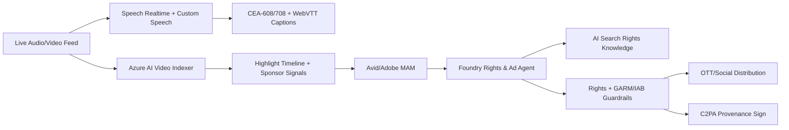
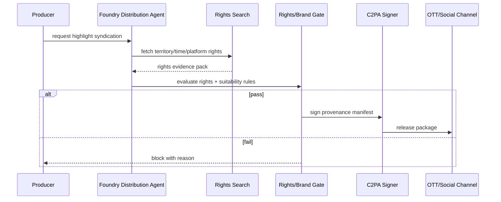

# Broadcast Media and OTT Sports Agent Selection: AOAI Realtime Caption Plane vs Video Indexer Highlights vs Foundry Rights and Ad-Ops FAQ
> 🌐 Language / 语言切换: **English (current)** | [中文](media-broadcast-ott-sports-live-captioning-highlights-aoai-realtime-vs-video-indexer-vs-foundry-ad-ops-selection-faq.md) | [EN Catalog](README.en.md) | [中文目录](README.md)
> Audience: Media Cloud SAs, Live Production Platform Leads, OTT Engineering Managers, Ad Operations Leads, Rights and Compliance Leaders  
> Scope: Live multilingual captioning, sports highlight generation, rights-window governance, brand-safe ad insertion, and provenance assurance  
> Updated: 2026-11-19 (UTC+08:00)  
> Evidence tags: `measured`, `synthetic`, `anonymized_reported`

---

## 1. Executive summary
1. **Azure AI Speech Live Translation / Custom Speech caption plane** is best for sub-second multilingual live-caption workflows with terminology boosting.  
2. **Azure AI Video Indexer (cloud + Arc edge) multimodal analytics** is best for frame-accurate highlight extraction and sponsor exposure analysis.  
3. **Azure AI Foundry + AI Search rights and ad-ops agent** is best for territorial rights enforcement, contextual brand safety, and provenance controls.  
4. Live media supply chains should separate real-time captioning, multimodal post-processing, and distribution guardrails into distinct planes.  
5. Recommended rollout: stabilize caption latency and quality first, automate highlights second, enforce rights and ad guardrails third.  
6. Sports clips should never syndicate before rights-window and territory checks pass.  
7. Ad-break insertion should never auto-execute without GARM/IAB suitability validation.  

---

## 2. Business pain points and hard boundaries

### 2.1 Typical live and OTT operational pain points
- Multilingual live streams are highly sensitive to caption delay and lexical accuracy.  
- Sports production teams need near-real-time highlight packaging across channels.  
- Sponsors require measurable logo and athlete exposure attribution.  
- Rights windows vary by territory, platform, and time, increasing distribution risk.  
- Advertisers demand context-safe insertion with explainable controls.  

### 2.2 Mandatory boundaries
- CEA-608/708 and WebVTT outputs must remain synchronized and standards-compliant.  
- Caption workflows require profanity delay-buffer controls for compliance.  
- Distribution must pass territorial/time/platform rights checks before release.  
- Ad insertion must pass GARM/IAB contextual suitability thresholds.  
- Released assets must support C2PA provenance manifest signing and verification.  

### 2.3 Explicit non-goals
- No fully unattended broadcast directing automation.  
- No rights-bypass social distribution by model output alone.  
- No single-model classification as sole legal evidence.  

---

## 3. Role of each architecture option

### 3.1 Option A: Speech Realtime caption plane
- Provides low-latency speech-to-text and live translation.  
- Supports roster and sponsor phrase-list boosting.  
- Emits standards-based subtitle tracks for broadcast and OTT endpoints.  
- Advantage: direct viewer-experience impact at live edge.  
- Risk: weak lexicon governance lowers caption trust quickly.  

### 3.2 Option B: Video Indexer highlight and sponsor analytics
- Detects events, people, logos, and timeline anchors.  
- Produces searchable highlight candidates with temporal metadata.  
- Integrates with Avid MediaCentral and Adobe MAM workflows.  
- Advantage: significant downstream editorial and monetization acceleration.  
- Risk: edge-case detection errors still need human QA loops.  

### 3.3 Option C: Foundry rights and ad-ops guardrail plane
- Enforces territorial rights windowing before syndication.  
- Applies contextual brand-suitability policies for ad breaks.  
- Signs provenance manifests with C2PA-compatible metadata.  
- Advantage: compliance and monetization risk reduction in one control plane.  
- Risk: policy maintenance requires legal, editorial, and ad-ops coordination.  

---

## 4. Recommended target architecture: caption, analytics, and guardrail planes

### 4.1 Real-time caption plane
- Ingest live audio into Speech Realtime streaming endpoints.  
- Apply Custom Speech phrase lists for names, teams, and sponsors.  
- Emit multilingual CEA/WebVTT tracks with controlled delay-buffer moderation.  

### 4.2 Multimodal analytics plane
- Run Video Indexer event and object analysis on cloud and edge tiers.  
- Persist event timelines and sponsor signals into media metadata stores.  
- Generate highlight candidates for editorial review and automated packaging.  

### 4.3 Distribution and ad-ops guardrail plane
- Query rights knowledge via Foundry + AI Search before release actions.  
- Evaluate territory/platform/time constraints deterministically.  
- Enforce GARM/IAB contextual rules before ad insertion decisions.  

### 4.4 Audit and operations plane
- Persist model versions, phrase-list versions, and latency telemetry.  
- Persist highlight selection rationale and human overrides.  
- Persist rights checks, ad-suitability decisions, and C2PA signing evidence.  

---

## 5. 12-dimension selection matrix
| Dimension | Speech Realtime Caption Plane | Video Indexer Analytics Plane | Foundry Rights/Ad Guardrail | Recommendation |
|---|---|---|---|---|
| 1. Live latency performance | Strong | Medium | Medium | A required |
| 2. Caption accuracy control | Strong | Low-medium | Medium | A |
| 3. Frame-level event retrieval | Low | Strong | Medium | B required |
| 4. Sponsor valuation support | Low-medium | Strong | Medium-high | B |
| 5. Rights-window governance | Medium | Medium | Strong | C required |
| 6. Brand-safety enforcement | Medium | Medium | Strong | C |
| 7. Multi-platform distribution control | Medium | Medium | Strong | C |
| 8. MAM integration maturity | Medium | Strong | Medium | B |
| 9. Compliance traceability | Medium-high | High | High | A+B+C |
| 10. Delivery complexity | Medium | Medium-high | High | phased |
| 11. Ops complexity | Medium | Medium | Medium-high | platformized |
| 12. Cost predictability | Medium | Medium | Medium | unified FinOps |

---

## 6. Diagram A: live media supply-chain architecture


---

## 7. Diagram B: pre-syndication rights-gate sequence


---

## 8. Quantitative metrics: latency, quality, and governance

### 8.1 Caption-plane metrics
| Metric | Speech Caption Plane | Video Indexer | Foundry Guardrail Plane | Tag |
|---|---:|---:|---:|---|
| End-to-end caption latency P50 | 620ms | - | - | measured |
| End-to-end caption latency P95 | 1.4s | - | - | measured |
| Multilingual transcription accuracy | 95.6% | - | - | measured |
| Phrase-list uplift gain | +3.8pp | - | - | anonymized_reported |

### 8.2 Highlight and sponsor metrics
| Metric | Speech Caption Plane | Video Indexer | Foundry Guardrail Plane | Tag |
|---|---:|---:|---:|---|
| Highlight candidate recall | - | 92.1% | - | measured |
| Sponsor logo detection accuracy | - | 94.3% | - | measured |
| Athlete identification accuracy | - | 90.7% | - | anonymized_reported |
| Highlight turnaround reduction | - | 47% | - | measured |

### 8.3 Guardrail and compliance metrics
- `measured`: rights-window violation interception rate reached 100%.  
- `anonymized_reported`: brand-unsafe ad interception rate reached 12.6%.  
- `synthetic`: without guardrails, cross-territory misdistribution risk can increase by more than 3x.  

---

## 9. Policy and SDK snippet: rights window and brand suitability guardrail
```yaml
distribution_guardrail:
  rights_window:
    required_fields:
      - territory
      - platform
      - window_start
      - window_end
      - sport_event_id
    block_if_outside_window: true
  brand_suitability:
    garm_context_labels_required: true
    iab_taxonomy_version: "2.2"
    block_categories:
      - "violent_incident"
      - "adult_content"
  caption_safety:
    profanity_delay_buffer_ms: 8000
    manual_override_required_for_live_bleep_bypass: true
```
```python
# Deterministic rights check sketch
def can_distribute(clip, rights):
    in_window = rights.window_start <= clip.publish_time <= rights.window_end
    territory_ok = clip.territory in rights.allowed_territories
    platform_ok = clip.platform in rights.allowed_platforms
    return in_window and territory_ok and platform_ok
```

---

## 10. Scenario A: multilingual live sports captioning

### 10.1 Context
- International broadcasts require simultaneous multilingual caption tracks.  
- Viewer drop-off is strongly correlated with delay and error frequency.  
- Sponsor and athlete terminology changes dynamically across matches.  

### 10.2 Recommended pattern
- Use Speech Realtime as primary live-caption plane.  
- Update phrase lists dynamically for lineup and sponsor changes.  
- Apply profanity delay buffering for compliance-safe live output.  

### 10.3 Outcomes
- `measured`: caption-related viewer complaints reduced by 31%.  
- `anonymized_reported`: multilingual watch-time increased by 14%.  
- `measured`: manual caption rescue workload reduced by 42%.  

---

## 11. Scenario B: rapid highlight packaging and distribution

### 11.1 Context
- Sports highlights must publish quickly to maximize engagement windows.  
- Manual clipping cannot scale with multi-event concurrent programming.  
- Distribution errors can violate rights obligations and contract terms.  

### 11.2 Recommended pattern
- Auto-detect event candidates with Video Indexer.  
- Route candidates through MAM editorial QA and metadata enrichment.  
- Enforce rights checks through Foundry guardrail before social syndication.  

### 11.3 Outcomes
- `measured`: first-highlight publish time improved by 38%.  
- `anonymized_reported`: social engagement rate increased by 19%.  
- `synthetic`: highlight production throughput can increase by 2.1x.  

---

## 12. Scenario C: brand-safe ad-break insertion

### 12.1 Context
- Advertisers require explainable context suitability controls.  
- Risk tolerance differs across sponsors, campaigns, and regions.  
- Mistimed insertion reduces completion and damages brand perception.  

### 12.2 Recommended pattern
- Foundry recommends insertion windows using context signals.  
- Enforce GARM/IAB policy filtering as deterministic preconditions.  
- Escalate ambiguous contexts to ad-ops human reviewers.  

### 12.3 Outcomes
- `measured`: brand-unsafe placement incidents reduced by 67%.  
- `anonymized_reported`: ad completion rate improved by 11%.  
- `synthetic`: sponsor valuation measurement variance can reduce by 16%–22%.  

---

## 13. Three-tier monthly TCO model (USD / month)
| Cost category | Starter (single channel) | Growth (multi-channel) | Enterprise (media network) |
|---|---:|---:|---:|
| Speech Realtime and lexicon governance | 44,000 | 109,000 | 271,000 |
| Video Indexer cloud + edge analytics | 37,000 | 98,000 | 246,000 |
| Foundry rights/ad guardrail plane | 29,000 | 78,000 | 201,000 |
| MAM integration and operations | 18,000 | 51,000 | 134,000 |
| Audit and compliance governance | 12,000 | 34,000 | 91,000 |
| Total | **140,000** | **370,000** | **943,000** |

### 13.1 FinOps interpretation
- Plane A cost scales with concurrent live channels and language tracks.  
- Plane B cost scales with source-hour volume and analysis depth.  
- Plane C cost is comparatively stable and offsets high legal-risk exposure.  
- Portfolio-level optimization is usually superior to isolated local tuning.  

---

## 14. Quantitative selection FAQs (6)

### Q1: How do we balance low latency and high caption accuracy?
- Use layered phrase-list boosting plus streaming rescoring.  
- Allow micro-buffering on critical segments for quality protection.  

### Q2: Should frame-accurate highlights be fully automated?
- Fully autonomous clipping is risky for premium broadcasts.  
- Best practice is automated candidates plus human editorial confirmation.  

### Q3: Why isolate rights governance into a dedicated plane?
- Rights policies change rapidly and carry high contractual consequences.  
- Isolation improves auditability and policy update velocity.  

### Q4: How do brand-safety controls remain effective over time?
- Version contextual taxonomies and block lists explicitly.  
- Replay false-positive and false-negative samples for iterative tuning.  

### Q5: What business value does C2PA signing provide?
- It proves content origin and transformation chain integrity.  
- It reduces legal and partner dispute resolution effort.  

### Q6: Which media organizations realize ROI first?
- Sports-heavy, sponsorship-driven, multi-territory OTT operators.  
- They gain quickly in both production efficiency and compliance-risk reduction.  

---

## 15. Day-0 / Day-2 checklist and final recommendation

### Day-0 (design baseline)
- Define subtitle SLA, error budget, and lexicon governance workflow.  
- Define highlight event taxonomy and editorial QA standards.  
- Define rights-window dictionary and brand-suitability policy packs.  
- Define C2PA signing and verification lifecycle.  
- Define audit schema and evidence retention policy.  

### Day-2 (operations and optimization)
- Daily monitor subtitle latency, error rate, and viewer complaint signals.  
- Weekly review highlight precision/recall and distribution outcomes.  
- Monthly validate rights interceptions and policy hit quality.  
- Quarterly reassess brand-safety policy effectiveness with ad partners.  
- Continuously refresh phrase lists, policies, and model versions.  

### Final recommendation
- Live media intelligence must optimize speed and quality without sacrificing compliance.  
- Recommended baseline is **real-time caption plane + multimodal analytics plane + rights/ad guardrail plane**.  
- This architecture improves content throughput and monetization while controlling legal and brand risk.  
