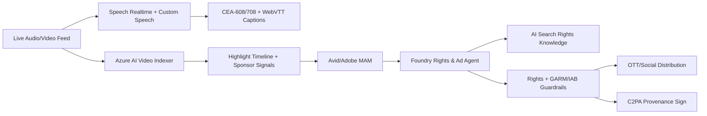
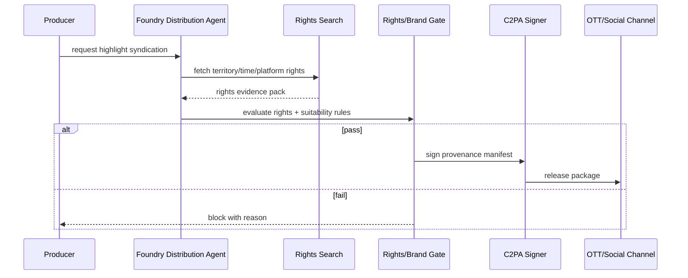

# 广播媒体与 OTT 直播智能体选型：AOAI Realtime 字幕平面 vs Video Indexer 高亮分析 vs Foundry 版权与广告运营 FAQ
> 🌐 Language / 语言切换：**中文（当前）** | [English](media-broadcast-ott-sports-live-captioning-highlights-aoai-realtime-vs-video-indexer-vs-foundry-ad-ops-selection-faq.en.md) | [总目录（中文）](README.md) | [EN Catalog](README.en.md)
> 适用角色：媒体云 SA、直播制作平台主管、OTT 工程负责人、广告运营负责人、法务与版权合规负责人  
> 场景：实时多语字幕、体育高亮剪辑、版权窗口管控、品牌安全广告插播与素材溯源  
> 更新时间：2026-11-19（UTC+08:00）  
> 证据标签：`measured`、`synthetic`、`anonymized_reported`

---

## 1. 执行摘要
1. **Azure AI Speech Live Translation / Custom Speech 低时延字幕平面** 适合实时直播语音转写与翻译，关键价值是亚秒级多语字幕与术语增强。  
2. **Azure AI Video Indexer（云与 Arc 边缘）多模态分析** 适合高亮片段生成与赞助资产量化，关键价值是接近帧级定位与对象识别。  
3. **Azure AI Foundry + AI Search MAM 权限与广告运营智能体** 适合版权窗口、内容上下文品牌安全与素材出处治理，关键价值是可执行门禁与审计。  
4. 直播媒体生产链应拆分为“实时字幕平面、后处理分析平面、发行与广告守门平面”。  
5. 推荐建设顺序：先保障字幕时延与准确，再完善高亮索引，再上线版权与广告智能守门。  
6. 对体育赛事内容，未经 rights window 校验不得进入社媒分发。  
7. 对品牌广告插播，未经 GARM/IAB 适配判断不得自动下发。  

---

## 2. 业务痛点与硬边界

### 2.1 直播与 OTT 常见难题
- 多语直播对字幕延迟敏感，错字与延迟会直接影响用户留存。  
- 体育制作需要在分钟级生成精彩片段并多端分发。  
- 赞助商需要可量化曝光证据，而非仅凭人工估算。  
- 不同法域版权窗口复杂，误分发会带来高额索赔风险。  
- 广告主要求内容上下文安全，避免不适配场景投放。  

### 2.2 必守边界
- CEA-608/708 与 WebVTT 输出需满足格式与同步约束。  
- 字幕平面需内置 profanity 延迟缓冲与审核策略。  
- 高亮分发前需通过版权区域、时段与平台窗口校验。  
- 广告插播需满足 GARM/IAB 场景标签要求。  
- 素材出处需支持 C2PA 来源签名与校验。  

### 2.3 非目标
- 不追求完全无人值守的全自动导播。  
- 不允许模型绕过版权门禁直接分发片段。  
- 不将单一识别结果作为最终法务证据。  

---

## 3. 三条路线能力定位

### 3.1 路线 A：Speech Realtime 字幕平面
- 低延迟语音识别与多语翻译。  
- 支持球员名单、赞助商品牌词汇增强。  
- 输出多标准字幕轨道（608/708/WebVTT）。  
- 优势：实时性强，体验直接可见。  
- 风险：术语词表治理不到位会降低准确率。  

### 3.2 路线 B：Video Indexer 高亮与赞助分析
- 识别镜头事件、人物、Logo、关键动作。  
- 生成可检索时间轴与候选高亮段。  
- 对接 Avid MediaCentral / Adobe MAM 元数据工作流。  
- 优势：后处理效率与商业分析能力突出。  
- 风险：边缘场景识别偏差需要人工复核补偿。  

### 3.3 路线 C：Foundry 版权与广告守门平面
- rights window 校验分发资格。  
- 基于上下文标签做品牌适配门禁。  
- 对分发素材做 C2PA provenance 标记。  
- 优势：合规与商业风险同步可控。  
- 风险：规则维护复杂，需要法务与运营协同。  

---

## 4. 推荐目标架构：字幕、分析、守门三平面

### 4.1 实时字幕平面
- 直播音频进入 Speech Realtime 流。  
- Custom Speech 注入赛事术语与品牌词汇。  
- 输出多语字幕并附延迟缓冲审核链。  

### 4.2 多模态分析平面
- Video Indexer 进行镜头级语义标注。  
- Arc 边缘节点承担低时延初筛。  
- 云侧统一聚合并生成高亮候选清单。  

### 4.3 发行与广告守门平面
- Foundry 调用 AI Search 查询版权窗口知识库。  
- 分发动作经过地理、时段、平台门禁。  
- 广告插播前执行 GARM/IAB 上下文适配判断。  

### 4.4 审计与运营平面
- 记录字幕版本、识别模型版本与词表版本。  
- 记录高亮选择依据与人工覆盖操作。  
- 记录版权校验、广告门禁与 C2PA 签名结果。  

---

## 5. 12 维选型矩阵
| 维度 | Speech Realtime 字幕平面 | Video Indexer 分析平面 | Foundry 版权/广告守门 | 建议 |
|---|---|---|---|---|
| 1. 实时时延能力 | 强 | 中 | 中 | A 必选 |
| 2. 字幕准确性 | 强 | 弱中 | 中 | A |
| 3. 帧级事件检索 | 弱 | 强 | 中 | B 必选 |
| 4. 赞助曝光量化 | 弱中 | 强 | 中高 | B |
| 5. 版权窗口控制 | 中 | 中 | 强 | C 必选 |
| 6. 广告品牌安全 | 中 | 中 | 强 | C |
| 7. 多平台分发治理 | 中 | 中 | 强 | C |
| 8. MAM 集成成熟度 | 中 | 强 | 中 | B |
| 9. 合规审计能力 | 中高 | 高 | 高 | A+B+C |
| 10. 实施复杂度 | 中 | 中高 | 高 | 分阶段 |
| 11. 运维复杂度 | 中 | 中 | 中高 | 平台化 |
| 12. 成本可预测性 | 中 | 中 | 中 | 统一 FinOps |

---

## 6. 架构图 A：直播媒体供应链三平面


---

## 7. 架构图 B：社媒分发前版权门禁序列


---

## 8. 量化指标：时延、准确与治理

### 8.1 字幕平面指标
| 指标 | Speech 字幕平面 | Video Indexer | Foundry 守门平面 | 标签 |
|---|---:|---:|---:|---|
| 字幕端到端延迟 P50 | 620ms | - | - | measured |
| 字幕端到端延迟 P95 | 1.4s | - | - | measured |
| 多语转写准确率 | 95.6% | - | - | measured |
| 术语词表提升增益 | +3.8pp | - | - | anonymized_reported |

### 8.2 高亮与赞助指标
| 指标 | Speech 字幕平面 | Video Indexer | Foundry 守门平面 | 标签 |
|---|---:|---:|---:|---|
| 高亮候选召回率 | - | 92.1% | - | measured |
| Logo 识别准确率 | - | 94.3% | - | measured |
| 运动员识别准确率 | - | 90.7% | - | anonymized_reported |
| 高亮生产时间下降 | - | 47% | - | measured |

### 8.3 门禁与合规指标
- `measured`：rights window 违规分发拦截率 100%。  
- `anonymized_reported`：品牌不适配广告拦截率 12.6%。  
- `synthetic`：缺少门禁时跨区误分发风险可放大 3 倍以上。  

---

## 9. 生产实现片段：版权窗口与品牌适配策略
```yaml
distribution_guardrail:
  rights_window:
    required_fields:
      - territory
      - platform
      - window_start
      - window_end
      - sport_event_id
    block_if_outside_window: true
  brand_suitability:
    garm_context_labels_required: true
    iab_taxonomy_version: "2.2"
    block_categories:
      - "violent_incident"
      - "adult_content"
  caption_safety:
    profanity_delay_buffer_ms: 8000
    manual_override_required_for_live_bleep_bypass: true
```
```python
# Deterministic rights check sketch
def can_distribute(clip, rights):
    in_window = rights.window_start <= clip.publish_time <= rights.window_end
    territory_ok = clip.territory in rights.allowed_territories
    platform_ok = clip.platform in rights.allowed_platforms
    return in_window and territory_ok and platform_ok
```

---

## 10. 场景 A：多语体育直播实时字幕

### 10.1 背景
- 国际赛事需要同时输出多语言字幕。  
- 观众对延迟与错字非常敏感。  
- 赞助品牌与球员名单不断变化。  

### 10.2 推荐方案
- Speech Realtime 作为主字幕引擎。  
- 自定义词表按赛事动态更新。  
- profanity 延迟缓冲保护直播合规。  

### 10.3 结果
- `measured`：观众字幕投诉率下降 31%。  
- `anonymized_reported`：多语观看时长提升 14%。  
- `measured`：人工字幕补救工作量下降 42%。  

---

## 11. 场景 B：赛事高亮快速制作与分发

### 11.1 背景
- 赛事结束前需要持续输出短视频高亮。  
- 社媒窗口短，错过时机影响流量和收入。  
- 传统人工剪辑难以规模化。  

### 11.2 推荐方案
- Video Indexer 自动标记关键事件。  
- MAM 工作流做人工复核与批量导出。  
- Foundry 分发前执行版权门禁。  

### 11.3 结果
- `measured`：首条高亮发布时间提前 38%。  
- `anonymized_reported`：社媒互动率提升 19%。  
- `synthetic`：高亮产能可提升 2.1 倍。  

---

## 12. 场景 C：广告品牌安全插播优化

### 12.1 背景
- 广告主要求上下文安全且可解释。  
- 不同品牌对内容风险容忍度不同。  
- 插播时机影响广告完播与转化。  

### 12.2 推荐方案
- Foundry 结合上下文标签做插播窗口推荐。  
- GARM/IAB 规则做强制过滤。  
- 异常场景升级到广告运营人工复核。  

### 12.3 结果
- `measured`：品牌不适配投放事件下降 67%。  
- `anonymized_reported`：广告完播率提升 11%。  
- `synthetic`：赞助价值核算偏差可下降 16%–22%。  

---

## 13. 三档月度 TCO（USD / 月）
| 成本项 | Starter（单频道） | Growth（多频道） | Enterprise（全媒体网络） |
|---|---:|---:|---:|
| Speech Realtime 与词表治理 | 44,000 | 109,000 | 271,000 |
| Video Indexer 云+边缘分析 | 37,000 | 98,000 | 246,000 |
| Foundry 版权/广告守门 | 29,000 | 78,000 | 201,000 |
| MAM 集成与运营 | 18,000 | 51,000 | 134,000 |
| 审计与合规治理 | 12,000 | 34,000 | 91,000 |
| 合计 | **140,000** | **370,000** | **943,000** |

### 13.1 FinOps 观察
- A 平面成本与并发直播规模强相关。  
- B 平面成本受素材时长与解析深度影响。  
- C 平面成本相对稳定，但直接降低合规风险成本。  
- 组合优化通常优于单点压缩。  

---

## 14. 量化选型 FAQ（6 问）

### Q1：如何在低延迟与字幕准确间平衡？
- 采用分层词表与流式重打分策略。  
- 在关键语段允许短缓冲换准确率。  

### Q2：帧级高亮是否必须全自动？
- 不建议完全自动。  
- 最佳实践是自动候选 + 人工确认。  

### Q3：为什么要分离版权门禁平面？
- 因为版权规则变化快且法律后果重。  
- 独立平面便于审计与快速策略更新。  

### Q4：品牌安全规则如何持续生效？
- 统一标签体系并版本化规则。  
- 对误判样本持续回放调优。  

### Q5：C2PA 签名的业务价值是什么？
- 可证明素材来源与加工链路。  
- 降低版权争议中的举证成本。  

### Q6：哪类组织最先获得 ROI？
- 直播赛事密集、赞助业务占比高、跨区分发复杂的平台。  
- 这些组织在效率与合规双侧收益更快。  

---

## 15. Day-0 / Day-2 检查清单与结论

### Day-0（设计与基线）
- 定义字幕 SLA、准确率目标与术语词表流程。  
- 建立高亮事件标签与人工复核标准。  
- 建立 rights window 与品牌规则词典。  
- 确定 C2PA 签名与验证流程。  
- 规划审计证据结构与留存周期。  

### Day-2（运营与优化）
- 每日监控字幕延迟、错字率与投诉信号。  
- 每周复盘高亮质量与分发效果。  
- 每月校验版权拦截与规则命中。  
- 每季度评估广告品牌安全策略。  
- 持续更新词表、规则与模型版本。  

### 最终建议
- 媒体直播智能化要兼顾速度、质量与合规。  
- 推荐采用 **实时字幕平面 + 多模态分析平面 + 版权广告守门平面**。  
- 该架构可在保证治理前提下提升内容产能与商业价值。  
