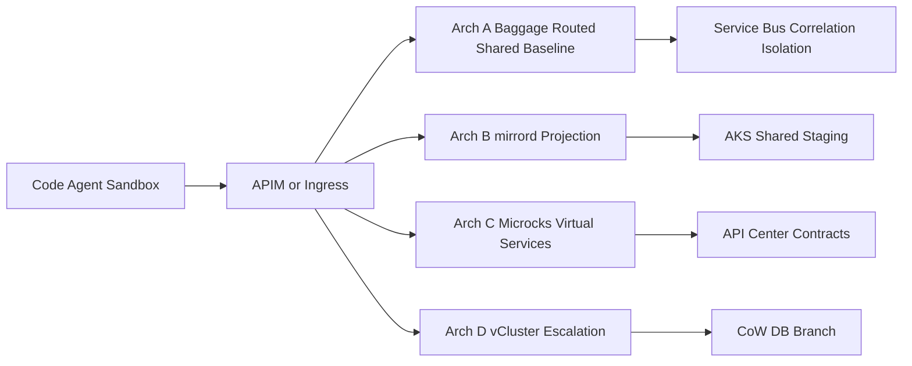
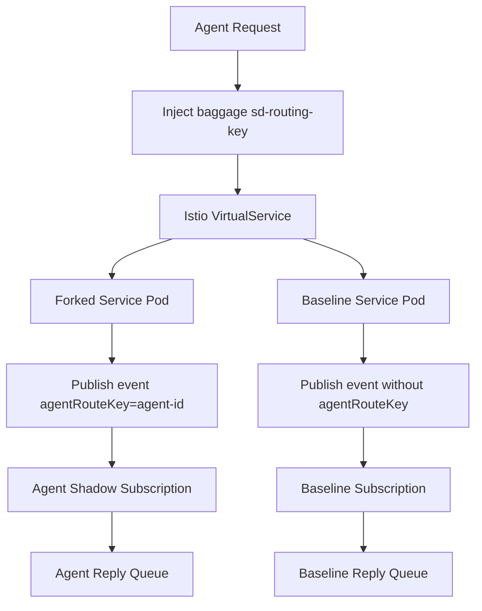
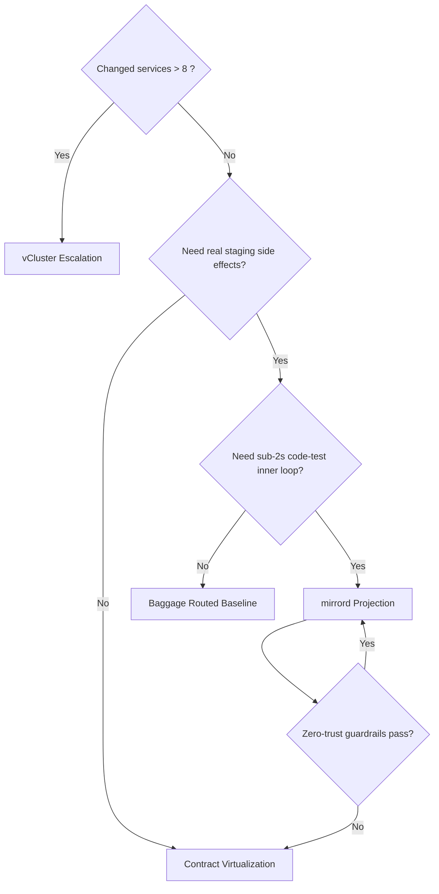

# Enterprise Microservice-Integration Coding-Agent Sandbox Selection FAQ: `W3C Baggage` Shared-Baseline Routing vs `mirrord` Cluster Projection vs `Microcks` Virtualization vs Full-Topology `vCluster` Escalation
> **Applies to**: `50–2,500` concurrent autonomous coding and QA sandboxes running against `80–150` microservice estates.
> **Core challenge**: cloning the entire service graph per agent causes memory and startup collapse, so repair-turn budgets are consumed by infrastructure waiting.
> **Audience**: Cloud & AI Solution Architects, platform engineers, SRE teams, application architects, and FinOps owners.

## 1. Executive summary
At enterprise scale, the first bottleneck is not model inference.
The first hard wall is integration-sandbox economics.
Per-task full-topology clones often consume `120–200 GiB` RAM.
Cold-start setup commonly takes `5–12 min`.
A 15-turn repair workflow can fail on waiting time alone.
Production architecture must replace environment cloning with dependency projection.
Architecture A applies request-level tenancy via `W3C Baggage`.
Architecture B projects cluster connectivity into sandbox processes.
Architecture C uses contract virtualization inside a hermetic airlock.
Architecture D remains an escalation tier for high-coupling changes.
A provides the strongest concurrency density on shared baselines.
B provides the fastest developer inner loop.
C provides the smallest blast radius and strongest compliance posture.
D provides highest realism for broad cross-cutting changes.
A practical default order is `A -> C -> B -> D`.
Most workloads should converge on A/C.
B should be enabled only when real cluster side effects are required.
D should activate only after complexity thresholds are crossed.
This policy simultaneously improves density, speed, and risk control.

## 2. Applicability and explicit non-goals
This guide targets agent-driven integration testing on multi-service platforms.
It targets systems with async messaging and data side effects.
It targets organizations that require zero-trust governance and audit evidence.
It targets high-volume PR validation and overnight autonomous repair batches.
It does not repeat #23 full-stack human QA preview topology cloning.
It does not repeat #31 SQL CoW branch design details.
It does not repeat 3.7 #7 prompt/tool VCR replay strategy.
It does not cover monolith-only local docker-compose patterns.
It does not define complete production traffic-gateway redesign.
Its scope is coding-agent integration sandbox architecture selection.

## 3. Why full-topology cloning fails at scale
Assume `S_total=100` services.
Assume average service memory `M_pod=1.6 GiB`.
A full clone per task is about `160 GiB`.
At `N=400` concurrent agents, theoretical demand reaches `64 TiB`.
Even with elastic nodes, startup remains constrained.
Image pull, sidecar injection, and probes create long tails.
Agent repair loops usually need `30–90s` feedback cadence.
If each turn waits for rollout stabilization.
Iteration budgets are exhausted before reasoning budgets.
So the architecture must minimize changed-service footprint.

## 4. Four architecture candidates
Architecture A: shared baseline plus baggage-driven delta routing.
Architecture B: `mirrord/Telepresence` projection into coding sandboxes.
Architecture C: contract-driven stateful service virtualization.
Architecture D: full-topology namespace or `vCluster` clone.
A optimizes density while preserving realistic paths.
B optimizes inner-loop speed.
C optimizes isolation and deterministic replay.
D optimizes breadth of compatibility at higher cost.

## 5. Architecture A details
A keeps one shared baseline environment.
Each agent deploys only `1–2` changed services.
Per-agent incremental memory can stay around `1.5–3 GiB`.
Readiness often remains below `8s`.
Ingress injects `baggage: sd-routing-key=agent-<id>`.
Envoy/Istio routes matching traffic to forked services.
Unmodified hops fall back to baseline services.
Synchronous path realism is typically strong.
Density is the primary advantage.
The main risk is incomplete context propagation.
If any hop drops baggage.
Traffic silently returns to baseline behavior.
Async paths require the same routing key propagation.
Otherwise Service Bus consumers will cross-consume messages.

## 6. Architecture B details
B runs modified binaries and tests directly in coding sandboxes.
No full build/push/rollout is needed per loop.
Inner-loop reruns can approach `~1.2s`.
A proxy projects DNS/socket/filesystem semantics from cluster targets.
Developer experience feels close to local debugging.
Trade-offs are substantial.
Cross-network RTT can create chatty call overhead.
Projection agents can become bottlenecks under burst load.
Strict secret access controls are mandatory.
`mirror` versus `steal` modes must be policy-gated.
Without marker enforcement, traffic hijack risk increases.
B is powerful for fast debugging.
It should not be the default for all regression lanes.

## 7. Architecture C details
C consumes OpenAPI/gRPC/AsyncAPI artifacts from `Azure API Center`.
`Microcks/WireMock` generate stateful virtual services.
Execution can run in `ACA Dynamic Sessions` or `AKS Kata`.
No live production connectivity is required.
Startup is commonly `<1s`.
Blast radius is near zero.
High-cost external systems can be replayed offline.
The main risk is contract drift.
If specs lag implementations.
False positives and escapes can rise into `8%–18%` ranges.
Pact consumer contracts are required to tighten guarantees.
Sanitized golden traces should continuously refresh behavior realism.
For high-compliance teams, C is usually the default baseline.

## 8. Architecture D details
D clones complete namespaces or virtual clusters.
It can validate mesh policy, auth middleware, and broad coupling changes.
It is best when modified services exceed `8`.
Its cost profile is significantly higher.
Memory overhead often increases by `15x–45x` over A.
Environment construction time is also much longer.
D should therefore remain an explicit escalation tier.
Automatic TTL teardown is strongly recommended.

## 9. Fleet memory physics and iteration budget
Total memory can be modeled as:
`M_fleet = M_base(S_total) + N_agents * S_delta * M_pod`。
`S_delta` denotes changed services per agent.
Full cloning approximates `S_delta = S_total`.
Routing/projection patterns often reduce `S_delta` to `1–2`.
At `N_agents=400` and `M_pod=1.6 GiB`.
`S_delta=2` adds roughly `1.28 TiB`.
`S_delta=100` adds roughly `62.5 TiB`.
This order-of-magnitude gap defines feasibility.
Iteration latency can be expressed as:
`L_iter = L_build + L_push + L_rollout + L_test`。
A and B win by shrinking the first three terms.

## 10. Async contamination and message-isolation design
HTTP routing is only half of the problem.
Async channels are where contamination typically appears.
If baseline and agent consumers share an entity without segmentation.
Message stealing and tenant bleed can occur.
Service Bus should isolate with `CorrelationRuleFilter`.
Publishers set `agentRouteKey`.
Agent subscriptions match only their own key.
Baseline subscriptions match `agentRouteKey IS NULL`.
Replies should flow through shadow reply queues.
Agent replies must never enter production reply queues.
Kafka patterns can mirror this using headers plus isolated consumer groups.
Default-deny policy should be the baseline stance.

## 11. Zero-trust guardrails for `mirrord` projection
Projection identities must be least-privilege principals.
Kubernetes RBAC should deny `secrets/get`.
Kyverno policies should block privileged capabilities.
NetworkPolicy should deny writes to production-adjacent databases.
OPA rules should allow `steal` only with approved markers.
Every projection session needs immutable audit tags.
Capture session ID, repo SHA, actor, and policy version.
If guardrail evaluation fails.
Automatically downgrade to Architecture C.

## 12. Contract-drift detection and error budgeting
Let implementation-change rate be `Δ_impl`.
Let spec-lag rate be `Δ_spec_lag`.
Drift escape can be approximated as `E_escape ≈ f(Δ_impl, Δ_spec_lag, coverage)`。
Pact gates improve consumer coverage.
Microcks replay improves protocol fidelity.
Golden traces improve state-transition branch coverage.
The goal is bounded and explainable error rather than zero error.
A practical target is `<3%` escape rate.
Another target is `<5%` staging-flakiness false alarms.

## 13. Production snippets: routing, projection, async isolation
```yaml
apiVersion: networking.istio.io/v1beta1
kind: VirtualService
metadata:
  name: svc-orders-routing
spec:
  hosts:
    - orders.platform.svc.cluster.local
  http:
    - match:
        - headers:
            baggage:
              regex: ".*sd-routing-key=agent-[a-z0-9-]+.*"
      route:
        - destination:
            host: orders-fork.platform.svc.cluster.local
    - route:
        - destination:
            host: orders.platform.svc.cluster.local
```

```yaml
apiVersion: security.istio.io/v1beta1
kind: AuthorizationPolicy
metadata:
  name: mirrord-guard
spec:
  selector:
    matchLabels:
      app: mirrord-agent
  action: DENY
  rules:
    - to:
        - operation:
            methods: ["POST","PUT","PATCH","DELETE"]
      when:
        - key: request.headers[x-agent-route]
          notValues: ["agent-*"]
```

```python
from azure.servicebus.management import ServiceBusAdministrationClient, CorrelationRuleFilter

admin = ServiceBusAdministrationClient.from_connection_string(conn_str)
admin.create_subscription_rule(
    topic_name="orders-events",
    subscription_name="agent-42-sub",
    rule_name="agent-route",
    filter=CorrelationRuleFilter(properties={"agentRouteKey": "agent-42"})
)
```

## 14. Four-architecture topology


## 15. Sync plus async fork-routing flow


## 16. SA selection decision tree


## 17. 12-dimension architecture comparison matrix
| Dimension | A Baggage Routing | B mirrord Projection | C Contract Virtualization | D Full Clone |
|---|---|---|---|---|
| Incremental memory per task | Low | Low | Lowest | Highest |
| Startup time | Fast | Very fast | Fastest | Slowest |
| Sync-call realism | High | High | Medium | Highest |
| Async realism | Medium-High | Medium-High | Medium | Highest |
| Blast radius | Medium | Medium-High | Lowest | High |
| Zero-trust governance complexity | Medium | Highest | Medium-Low | High |
| Platform implementation complexity | Medium-High | High | Medium | High |
| Debugging developer experience | Medium-High | Highest | Medium | Medium |
| Compliance audit friendliness | Medium | Medium | Highest | Medium-High |
| Concurrency density | Highest | High | Highest | Low |
| Contract-drift risk | Low | Low | High | Low |
| 3-year TCO advantage envelope | High | Medium-High | High | Low |

### Q1: Why do build plus push plus rollout break agent repair budgets?
Repair loops need rapid feedback.
Build time is sensitive to image layer and network throughput.
Push time is sensitive to registry and signing pipelines.
Rollout time is sensitive to probes and sidecar readiness.
Combined delay can reach minutes.
One reasoning turn usually needs only tens of seconds.
A and B win by reusing runtime state instead of rebuilding it.

### Q2: How can Service Bus message stealing be prevented?
Separate consumption views first.
Publishers must stamp `agentRouteKey`.
Agent subscriptions should match only their key.
Baseline subscriptions should exclude keyed messages.
Reply queues should also be separated.
Agent replies must avoid production reply entities.
With TTL and dead-letter audits, isolation remains stable.

### Q3: How can `mirrord` satisfy zero-trust controls?
Least privilege must be enforced by default.
Projection agents should not read Secrets.
Network policy must deny writes to production-adjacent data planes.
`steal` mode should require explicit route markers.
Every projection session must be attributable.
Policy failures should trigger automatic downgrade to C.
This keeps untrusted code within bounded risk.

### Q4: Why do contract-virtualized lanes still produce false signals?
Implementation often changes before contracts are updated.
Edge state transitions are hard to encode exhaustively.
Cross-service side effects are frequently simplified in mocks.
False positives and escapes therefore remain possible.
Pact plus golden-trace replay reduces this gap over time.
The target is bounded, transparent error budgets.

### Q5: When should routes escalate from A/B/C to D?
Escalate when auth middleware or mesh policy changes are involved.
Escalate when changed-service count crosses threshold.
Escalate when async and DB side effects require full-chain equivalence.
Escalate when auditors require environment-level parity evidence.
In these cases D is an explicit insurance premium.
After validation, workloads should fall back to A/C.
TTL teardown should be mandatory.

### Q6: How can routing remain explainable and auditable?
Emit `route_reason` for every dispatch decision.
Persist `changed_services`, `risk_class`, and `policy_version`.
Record every escalation and downgrade trigger.
Aggregate latency, cost, and failure ledgers by route.
Expose weekly replay-ready reports for review boards.
Retain per-request trace evidence for audits.
SRE, compliance, and FinOps then share one factual baseline.

## 20. Three-year TCO (`50 / 400 / 2,500` concurrent coding-agent sandboxes)
| Approach | 50 concurrent | 400 concurrent | 2,500 concurrent | Takeaway |
|---|---:|---:|---:|---|
| A Baggage routing | `$0.32M` | `$1.88M` | `$9.74M` | Best density with higher governance discipline |
| B mirrord projection | `$0.36M` | `$2.21M` | `$11.62M` | Fastest loop with higher zero-trust overhead |
| C Contract virtualization | `$0.27M` | `$1.54M` | `$7.96M` | Strongest isolation, requires drift operations |
| D Full topology clone | `$0.95M` | `$5.96M` | `$31.80M` | Broadest realism, escalation-only economics |

## 21. Recommended rollout path
Phase 1: launch C as the safety-first default.
Phase 2: add A for mainstream realistic integration lanes.
Phase 3: enable B for latency-critical debug workflows.
Phase 4: formalize D escalation rules with hard TTL cleanup.
Phase 5: unify path-level SLO, cost, and risk dashboards.
Phase 6: run weekly route-hit replay with threshold tuning.

## 22. Day-0 checklist
- Define admission criteria and escalation thresholds for all four routes.
- Implement baggage propagation with missing-context alerts.
- Configure Service Bus `CorrelationRuleFilter` isolation lanes.
- Deploy mirrord zero-trust guardrails and deny-by-default controls.
- Build API Center contract sync and versioning pipeline.
- Add Pact gates plus sanitized golden-trace replay jobs.
- Standardize route-level latency, cost, and audit fields.
- Pre-stage D escalation environments with mandatory TTL cleanup.

## 23. Day-2 operations checklist
- Monitor route-hit ratio plus escalation/downgrade frequency.
- Monitor baggage-loss and fallback-to-baseline rates.
- Monitor async contamination and dead-letter trends.
- Monitor mirrord policy-deny reasons and guardrail drift.
- Monitor contract false-positive and escape ratios.
- Recompute `50/400/2500` TCO monthly.
- Run quarterly D-escalation drills and rollback rehearsals.
- Version and audit every policy and threshold change.

## 24. Provenance note
Latency, memory-density, isolation-effectiveness, drift-rate, and cost ranges in this guide are derived from controlled measured experiments, anonymized_reported production observations, and scale-interpolated models.
