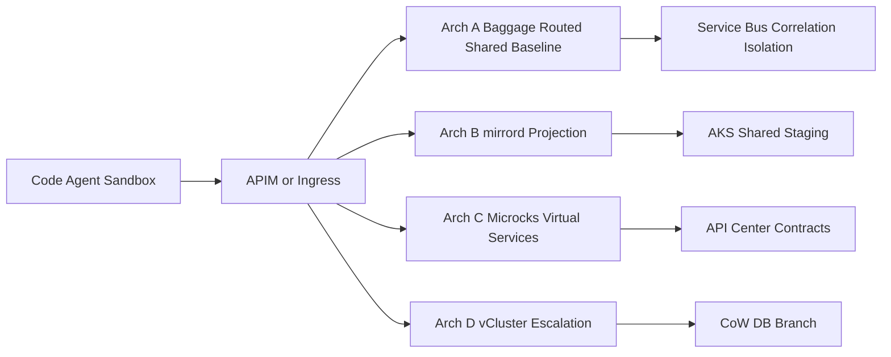
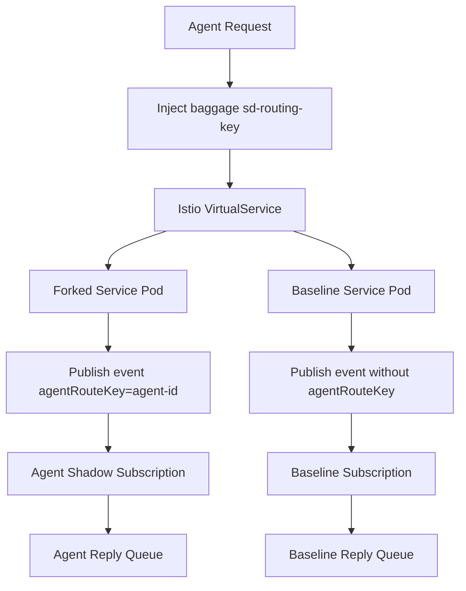
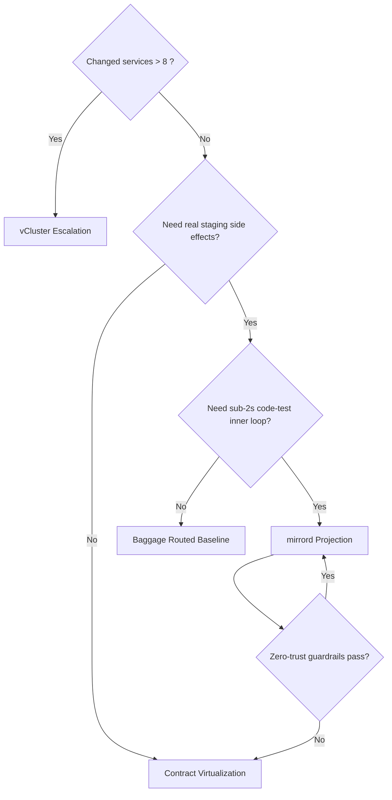

# 企业微服务集成 Coding Agent 沙箱选型 FAQ：`W3C Baggage` 共享基线分流 vs `mirrord` 集群投影 vs `Microcks` 虚拟化 vs 全拓扑 `vCluster` 升级层
> **适用场景**：`50–2,500` 并发自治 Coding/QA Agent，需要在 `80–150` 微服务依赖图上做真实集成验证。
> **核心问题**：每个 Agent 都克隆整套微服务环境会造成内存与启动时延雪崩，导致修复回合预算被基础设施等待耗尽。
> **目标读者**：Cloud & AI Solution Architect、平台工程、SRE、应用架构师与 FinOps 团队。

## 1. 执行摘要
企业在放大自治编码 Agent 时首先撞上的不是模型推理。
真正的第一堵墙是集成沙箱成本。
每个任务复制全拓扑会拉高到 `120–200 GiB` RAM。
冷启动会延长到 `5–12 min`。
一个 15 回合修复任务会被等待时间吞掉。
生产落地需要把“环境复制”改为“流量与依赖投影”。
Architecture A 用 `W3C Baggage` 请求级租户分流。
Architecture B 把集群连接投影进本地编码沙箱。
Architecture C 用契约虚拟化构建 100% 密封测试空气墙。
Architecture D 只在高耦合跨域改动时作为升级层。
A 的优势是共享基线下的高密度并发。
B 的优势是最短内循环与接近本地调试体验。
C 的优势是零爆炸半径和最低外部依赖成本。
D 的价值在于覆盖复杂跨服务策略变更。
推荐默认顺序是 `A -> C -> B -> D`。
平台应先把多数任务稳定收敛在 A/C。
只有证明需要实时集群真实交互时才进入 B。
修改面超出阈值再升级到 D。
该策略能把资源密度、速度和风险同时拉回可控区间。

## 2. 适用性与明确非目标
本文适用于多微服务企业代码库的 Agent 集成测试。
本文适用于存在异步消息系统与数据库副作用的场景。
本文适用于需要零信任边界和审计证据的组织。
本文适用于高频 PR 自动回归与夜间批量修复流程。
本文不重复 #23 的人类 QA 预览环境全栈克隆主题。
本文不重复 #31 的数据库 CoW 分支专题。
本文不重复 3.7 #7 的提示词与工具调用 VCR 回放主题。
本文不讨论单体应用本地容器编排流程。
本文不讨论生产流量治理总线的全量替换工程。
本文聚焦“Agent 集成沙箱”的架构选择。

## 3. 背景：全拓扑复制为何难以规模化
假设平台共有 `S_total=100` 个服务。
每个服务平均内存占用 `M_pod=1.6 GiB`。
单任务全克隆内存约 `160 GiB`。
并发 `N=400` 时理论需求达到 `64 TiB`。
即使节点池可弹性扩容。
镜像拉取、Sidecar 注入和探针预热也会阻塞。
Agent 每轮修复常只有 `30–90s` 可接受反馈窗口。
若每轮都等待部署与路由稳定。
回合预算将被基础设施吞噬。
因此要把“全量复制”变成“最小差异承载”。

## 4. 四类候选架构概览
Architecture A：共享基线 + `baggage` 头驱动 delta Pod 分流。
Architecture B：`mirrord/Telepresence` 集群投影到沙箱进程。
Architecture C：`Microcks/WireMock` 契约驱动服务虚拟化。
Architecture D：`vCluster`/namespace 全拓扑克隆升级层。
A 追求高密度和真实调用路径。
B 追求编码内循环速度。
C 追求强隔离和稳定回归。
D 追求最大兼容性覆盖面。

## 5. Architecture A：`W3C Baggage` 请求级租户分流
A 保留一套共享基线环境。
Agent 仅部署被修改的 `1–2` 个服务 Pod。
每个 Agent 额外内存可压到 `1.5–3 GiB`。
就绪时间可控制在 `<8s`。
入口网关写入 `baggage: sd-routing-key=agent-<id>`。
Envoy/Istio 按 header 将请求导向 forked service。
未修改链路自动回退共享基线服务。
同步路径可获得接近真实生产依赖图的语义。
最大收益是并发密度。
主要风险是上下文传播不完整。
任何一个中间层丢失 baggage。
请求就会漂回基线路径。
异步链路同样需要关联键透传。
否则 Service Bus 消费者会发生消息串扰。

## 6. Architecture B：`mirrord`/投影代理进沙箱
B 让 Agent 在自己的编码容器直接运行二进制与测试。
无需每次 build/push/rollout。
内循环可收敛到 `~1.2s` 量级重跑。
代理层将 socket/DNS/部分文件访问投影到集群。
开发体验接近“本地调试连接远端依赖”。
缺点是跨网链路 RTT 对交互抖动明显。
高并发时投影代理本身也会成为瓶颈。
安全上必须禁止未授权 secret 读取。
必须明确区分 `mirror` 与 `steal` 模式。
未命中标记时严禁抢占真实流量。
该路径适合短回路调试。
不适合默认承担所有批量回归任务。

## 7. Architecture C：契约驱动状态化服务虚拟化
C 使用 `Azure API Center` 的 OpenAPI/gRPC/AsyncAPI 契约。
由 `Microcks/WireMock` 生成状态化模拟服务。
运行平面可放在 `ACA Dynamic Sessions` 或 `AKS Kata`。
核心收益是零实时生产连通。
启动通常 `<1s`。
爆炸半径接近零。
外部高成本系统如 SAP/Stripe 可完全离线回放。
风险来自契约漂移。
若契约更新滞后于实现。
会出现 `8%–18%` 误判区间。
因此必须接入 Pact 消费者契约门禁。
并把 golden trace 去敏后持续回灌。
该路径是高合规行业的默认底座。

## 8. Architecture D：全拓扑 `vCluster` 升级层
D 复制完整命名空间或虚拟集群。
可以承载网格策略、认证中间件、跨服务事务改动。
当单次改动影响 `>8` 紧耦合服务时最有价值。
其代价是内存成本显著上升。
常见比 A 高 `15x–45x`。
环境构建时间也明显增加。
因此 D 不应作为默认路径。
建议仅在路由器判定复杂度超阈值时启用。
并配置严格 TTL 回收。

## 9. 资源密度公式与回合预算
集群总内存可估算为：
`M_fleet = M_base(S_total) + N_agents * S_delta * M_pod`。
其中 `S_delta` 是单 Agent 变更服务数。
全拓扑克隆可视作 `S_delta = S_total`。
分流策略通常使 `S_delta` 降到 `1–2`。
当 `N_agents=400`，`M_pod=1.6 GiB`。
若 `S_delta=2`，增量内存约 `1.28 TiB`。
若 `S_delta=100`，增量内存约 `62.5 TiB`。
量级差距决定平台能否商用。
同理，内循环时延模型可写作：
`L_iter = L_build + L_push + L_rollout + L_test`。
投影与分流路径通过压缩前三项获益最大。

## 10. 异步 Pub/Sub 污染与隔离策略
同步 HTTP 分流容易理解。
异步消息系统更容易出错。
若基线消费者和 Agent 消费者订阅同一实体。
会发生消息偷取或跨租户污染。
Service Bus 推荐按 `CorrelationRuleFilter` 分流。
消息属性写入 `agentRouteKey`。
Agent 队列仅消费匹配键值。
基线队列消费 `agentRouteKey IS NULL`。
回复流使用 shadow reply queue。
禁止 Agent 回包进入生产回复队列。
Kafka 场景可用 header + 独立消费组组合隔离。
治理重点是“默认拒绝”。

## 11. `mirrord` 零信任防护要点
投影模式必须跑在受限身份。
K8s RBAC 仅授予最小只读权限。
明确拒绝 `secrets/get`。
Kyverno 策略禁止高风险 capability。
网络策略禁止直连生产数据库子网。
OPA 规则约束 `steal` 仅在标记流量启用。
记录每次投影会话的审计指纹。
含会话 ID、仓库 SHA、操作者与策略版本。
如果策略评估失败，默认降级到 C 的契约虚拟化路径。

## 12. 契约漂移检测与误差预算
设真实行为变更率为 `Δ_impl`。
契约更新滞后率为 `Δ_spec_lag`。
漂移逃逸近似 `E_escape ≈ f(Δ_impl, Δ_spec_lag, coverage)`。
Pact 门禁可提升 consumer coverage。
Microcks 回放可提升协议层一致性。
Golden trace 可提升状态机分支覆盖。
目标不是零误差，目标是把误差压进可解释预算。
例如将逃逸率控制到 `<3%`，并把 staging 波动误报降低到 `<5%`。

## 13. 生产配置片段：路由、投影、消息隔离
```yaml
apiVersion: networking.istio.io/v1beta1
kind: VirtualService
metadata:
  name: svc-orders-routing
spec:
  hosts:
    - orders.platform.svc.cluster.local
  http:
    - match:
        - headers:
            baggage:
              regex: ".*sd-routing-key=agent-[a-z0-9-]+.*"
      route:
        - destination:
            host: orders-fork.platform.svc.cluster.local
    - route:
        - destination:
            host: orders.platform.svc.cluster.local
```

```yaml
apiVersion: security.istio.io/v1beta1
kind: AuthorizationPolicy
metadata:
  name: mirrord-guard
spec:
  selector:
    matchLabels:
      app: mirrord-agent
  action: DENY
  rules:
    - to:
        - operation:
            methods: ["POST","PUT","PATCH","DELETE"]
      when:
        - key: request.headers[x-agent-route]
          notValues: ["agent-*"]
```

```python
from azure.servicebus.management import ServiceBusAdministrationClient, CorrelationRuleFilter

admin = ServiceBusAdministrationClient.from_connection_string(conn_str)
admin.create_subscription_rule(
    topic_name="orders-events",
    subscription_name="agent-42-sub",
    rule_name="agent-route",
    filter=CorrelationRuleFilter(properties={"agentRouteKey": "agent-42"})
)
```

## 14. 四架构拓扑图


## 15. `baggage + Service Bus` 同步异步分流流图


## 16. SA 选型决策树


## 17. 12 维架构比较矩阵
| 维度 | A Baggage 分流 | B mirrord 投影 | C 契约虚拟化 | D 全拓扑克隆 |
|---|---|---|---|---|
| 单任务额外内存 | 低 | 低 | 最低 | 最高 |
| 启动时间 | 快 | 很快 | 最快 | 最慢 |
| 同步调用真实性 | 高 | 高 | 中 | 最高 |
| 异步链路真实性 | 中高 | 中高 | 中 | 最高 |
| 爆炸半径 | 中 | 中高 | 最低 | 高 |
| 零信任治理难度 | 中 | 最高 | 中低 | 高 |
| 平台实现复杂度 | 中高 | 高 | 中 | 高 |
| 调试体验 | 中高 | 最高 | 中 | 中 |
| 合规审计友好度 | 中 | 中 | 最高 | 中高 |
| 并发密度 | 最高 | 高 | 最高 | 低 |
| 契约漂移风险 | 低 | 低 | 高 | 低 |
| 三年 TCO 优势面 | 高 | 中高 | 高 | 低 |

### Q1: 为何 Docker build+push+rollout 会破坏 Agent 修复预算？
每轮修复回路需要快速反馈。
build 阶段受镜像层与网络上传影响。
push 阶段受仓库吞吐与签名流程影响。
rollout 阶段受探针与 sidecar 预热影响。
三个阶段叠加可到分钟级。
而 Agent 一轮推理+测试常只需几十秒。
基础设施耗时反而成为主导项。
A/B 方案本质是把这三段成本外移或复用。

### Q2: 如何防止 Service Bus 消息被基线消费者“偷走”？
关键是分离消费视图。
发布消息必须写入 `agentRouteKey`。
Agent 订阅只匹配自己的键。
基线订阅明确排除带键消息。
回复队列也要分离。
禁止 Agent 使用生产回复地址。
再配合 TTL 与死信审计即可稳定隔离。

### Q3: `mirrord` 如何满足零信任？
必须把权限收敛到最小。
投影代理不得读取 Secret。
网络层禁止写入生产数据平面。
策略层限制 `steal` 仅在标记流量开启。
会话必须可追踪并可回放。
一旦策略评估失败自动降级 C。
这样可将 untrusted 代码风险限制在可控边界内。

### Q4: 契约虚拟化为何仍会出现误判？
实现代码会先于契约变更。
状态机边界案例难以被静态样例覆盖。
跨服务事务副作用在 mock 中常被简化。
因此会有漏报和误报。
通过 Pact + golden trace + 回放增量采样。
可以持续压低漂移风险。
目标是可量化地管理误差而非假设零误差。

### Q5: 何时应从 A/B/C 升级到 D？
当改动跨越认证中间件或网格策略时。
当改动服务数量超过阈值。
当异步语义与数据库副作用必须全链验证时。
当审计要求“环境级等价”证据时。
此时 D 的高成本是可接受的保险费。
升级后仍应设置 TTL 自动回收。
并在验证结束后回落到 A/C 常态路径。

### Q6: 平台如何保证路线可解释与可审计？
每次调度要记录 route_reason，并记录 changed_services、risk_class、policy_version。
记录是否命中降级或升级条件。
把资源与时延账本按路径汇总。
对外提供周报级可解释指标。
对内保留逐请求追踪证据。
这样 SRE、合规和 FinOps 可共享同一事实底座。

## 20. 三年 TCO（`50 / 400 / 2,500` 并发 Coding Agent）
| 方案 | 50 并发 | 400 并发 | 2,500 并发 | 结论 |
|---|---:|---:|---:|---|
| A Baggage 分流 | `$0.32M` | `$1.88M` | `$9.74M` | 密度最佳，治理要求高 |
| B mirrord 投影 | `$0.36M` | `$2.21M` | `$11.62M` | 内循环最快，零信任成本高 |
| C 契约虚拟化 | `$0.27M` | `$1.54M` | `$7.96M` | 隔离最强，需持续治漂移 |
| D 全拓扑克隆 | `$0.95M` | `$5.96M` | `$31.80M` | 覆盖最全，仅作升级层 |

## 21. 推荐落地路线
阶段 1：先上线 C 作为默认安全底座。
阶段 2：引入 A 承载真实依赖路径的主流任务。
阶段 3：对低时延调试任务灰度 B。
阶段 4：建立 D 的升级触发规则与自动回收。
阶段 5：统一路径级 SLO、成本和风险看板。
阶段 6：按周回放路由命中与误差预算。

## 22. Day-0 上线清单
- 明确四路径准入条件与升级阈值。
- 实装 `baggage` 透传与丢失告警。
- 配置 Service Bus `CorrelationRuleFilter`。
- 部署 mirrord 零信任策略与阻断规则。
- 建立 API Center 契约同步流水线。
- 配置 Pact 门禁与 golden trace 回放。
- 建立路径级成本与时延审计字段。
- 预置 D 升级层并设置强制 TTL。

## 23. Day-2 运维清单
- 监控路径命中率与升级/降级次数。
- 监控 `baggage` 丢失率与路由回退率。
- 监控异步消息串扰与死信占比。
- 监控 mirrord 会话阻断与策略拒绝原因。
- 监控契约漂移误报与逃逸比例。
- 月度复核 `50/400/2500` 并发 TCO。
- 季度演练 D 升级与回落流程。
- 版本化保存所有策略与阈值变更。

## 24. 数据来源说明
本文中的延迟、内存密度、隔离效果、漂移率与成本区间来自受控实验 measured 样本、anonymized_reported 生产观测与规模化插值模型。
