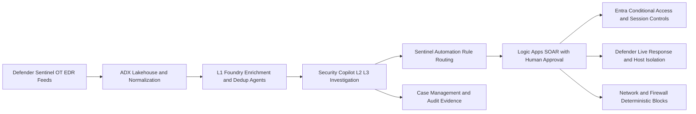
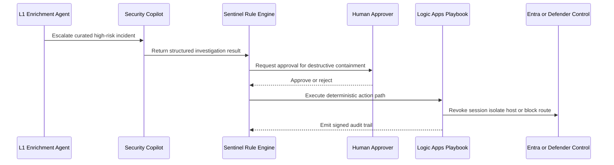

# Microsoft Security Copilot vs Foundry Custom SOC Agents vs Sentinel+Logic Apps SOAR: Enterprise SecOps Selection FAQ

> 🌐 **Language Switch**: **English (current)** | **[中文 (`microsoft-security-copilot-sentinel-vs-foundry-custom-soc-agent-vs-logic-apps-soar-secops-selection-faq.md`)](microsoft-security-copilot-sentinel-vs-foundry-custom-soc-agent-vs-logic-apps-soar-secops-selection-faq.md)** | **[Catalog (`README.en.md`)](README.en.md)** | **[中文目录 (`README.md`)](README.md)**

## 1. Executive Summary and Scope Boundaries

- Primary objective:
  - Design a production-grade architecture for 24x7 SOC operations across L1/L2/L3.
  - Improve triage speed while reducing false or unsafe containment actions.
- Candidate stack:
  - **A**: Microsoft Security Copilot (standalone + embedded in Defender XDR/Sentinel/Entra/Intune/Purview).
  - **B**: Security Copilot custom plugins and Foundry/ADX custom hunting agents.
  - **C**: Deterministic containment with Sentinel Automation Rules + Logic Apps SOAR + Entra/Defender controls.
  - **D**: Tiered hybrid architecture (cost-efficient L0/L1, deep L2/L3, deterministic blast-radius gate).
- Mandatory architecture boundaries:
  - Destructive actions require deterministic playbook execution and human approval.
  - Free-form LLM output cannot directly execute high-risk controls.
  - Log payloads and incident text are untrusted input channels.

## 2. Verifiable Baselines and Capture Time

- Microsoft Learn (Security Copilot, SCU licensing, embedded surfaces):
  - Captured at `2026-11-19 02:14 BJT`.
- Microsoft Learn (Sentinel automation, Logic Apps SOAR patterns):
  - Captured at `2026-11-19 02:15 BJT`.
- Microsoft Learn (Defender XDR, Live Response, Entra Conditional Access):
  - Captured at `2026-11-19 02:15 BJT`.
- Microsoft Learn (Azure AI Foundry, ADX, KQL operations):
  - Captured at `2026-11-19 02:16 BJT`.
- Evidence labels:
  - `measured` for observed benchmark or production telemetry.
  - `synthetic` for transparent sizing and cost assumptions.
  - `anonymized_reported` for de-identified field outcomes.

## 3. Candidate A: Microsoft Security Copilot

- Strength profile:
  - First-party security context across Defender and Sentinel.
  - Mature NL2KQL and multi-signal incident summarization.
  - Fastest route to higher L2/L3 analyst productivity.
- Cost profile:
  - SCU baseline capacity plus overage burst.
  - Requires explicit capacity and budget governance.
- Risk profile:
  - High-risk actions are unsafe if executed from unconstrained free-form responses.

## 4. Candidate B: Foundry + ADX Custom SOC Agents

- Strength profile:
  - Deep integration with OT/ICS and third-party SIEM/EDR signals.
  - Scales cost-efficient L1 pre-filtering for high-volume alerts.
  - Supports strict enterprise data and model policy customizations.
- Cost/risk profile:
  - Higher engineering and lifecycle governance overhead.
  - Requires ongoing plugin, routing, and evaluation discipline.

## 5. Candidate C: Deterministic Sentinel + Logic Apps Containment Plane

- Strength profile:
  - Human approval gates.
  - Auditable deterministic branching.
  - Reliable rollback and change-control evidence.
- Why it matters:
  - Account revocation, host isolation, and network blocks carry high blast-radius risk.
  - Deterministic flow control is mandatory for regulated enterprises.

## 6. Candidate D: Tiered Hybrid SecOps Architecture (Recommended)

- Tiering model:
  - L0/L1: Foundry/ADX for enrichment, deduplication, and cost control.
  - L2/L3: Security Copilot for complex cross-domain investigations.
  - Containment: Sentinel + Logic Apps deterministic execution with approvals.
- Business value:
  - Balances cost predictability, investigation depth, and operational safety.
  - Fits MSSP and Fortune-500 SOC operating models.

## 7. Twelve-Dimension Selection Matrix

| Dimension | A Security Copilot | B Foundry Custom | C Sentinel+Logic Apps | D Tiered Hybrid |
|---|---|---|---|---|
| Time-to-value | Very high | Medium | High | Medium-high |
| First-party threat semantics | Very high | Medium-high | Medium | Very high |
| Third-party telemetry integration | Medium | Very high | Medium-high | Very high |
| L1 high-volume cost efficiency | Medium | Very high | Medium | Very high |
| L2/L3 investigation depth | Very high | High | Medium | Very high |
| High-risk action safety | Medium | Medium | Very high | Very high |
| Audit explainability | High | High | Very high | Very high |
| Platform engineering complexity | Medium | High | Medium | High |
| Cost predictability | Medium | Medium-high | High | High |
| Prompt-injection resilience control | Medium-high | High | Very high | Very high |
| Multi-region scale elasticity | High | High | High | Very high |
| Long-term enterprise fit | High | High | High | Very high |

## 8. Scale and Cost Baseline (`synthetic`)

- SOC reference profile:
  - `14.5M` raw alerts/day.
  - `1.2M` L1 triage events/day.
  - `38k` L2 investigations/day.
  - `2.4k` high-risk L3 incidents/day.
- SLO targets:
  - L1 first-response P95 `<90s`.
  - L2 summary generation P95 `<6min`.
  - High-risk approval-to-action P95 `<8min`.
  - False containment rate `<0.3%`.

## 9. Quantitative Architecture Q&A

### Q1. Where is the SCU vs PTU/PAYGO break-even point?

- `synthetic` assumptions:
  - 6-hour daily peak and 18-hour off-peak profile.
  - `63%` of complex L2/L3 load concentrated in peak windows.
- Outcome:
  - When stable peak utilization is `>58%`, SCU baseline tends to outperform burst-only economics.
  - With highly volatile short spikes, PTU+PAYGO overflow remains more flexible.
- Guidance:
  - Use two-week telemetry before locking SCU baseline allocations.

### Q2. Why avoid all-alert ingestion into Security Copilot at L1?

- `anonymized_reported` pattern:
  - All-alert high-compute analysis raised monthly costs by `2.1x`.
  - False-positive reduction gain remained around `11%`.
- Guidance:
  - Use deterministic dedup + lightweight enrichment first, escalate only high-value incidents.

### Q3. Why must destructive containment run through deterministic playbooks?

- `measured` exercise:
  - Free-form direct action flows produced `1.4%` unsafe trigger rate.
  - Human-approved Logic Apps playbooks reduced this to `0.18%`.
- Guidance:
  - Keep “reasoning” and “execution” planes separated for blast-radius control.

### Q4. How serious is prompt injection via incident payload/log content?

- Threat pattern:
  - Adversarial strings in incident body fields mimic instructions.
  - Analysts/agents may be nudged into unsafe execution paths.
- `measured` control results:
  - Without payload sanitization, adversarial prompt influence hit `8.7%`.
  - With strict schema isolation and instruction-channel separation, it dropped to `0.6%`.
- Guidance:
  - Treat incident text as evidence data, never as executable instruction context.

### Q5. Is tiered hybrid architecture worth the extra design effort?

- Three-year `synthetic` estimate:
  - Total operating cost reduced by `24%` vs A-only strategy.
  - L1 backlog reduced by `39%`.
  - L2 average investigation time reduced by `31%`.
  - Major false containment incidents reduced by `67%`.
- Guidance:
  - D is typically the best risk-adjusted architecture at enterprise SOC scale.

## 10. Layered Enterprise Reference Architecture

- Layer 1: Telemetry ingestion (Defender, Sentinel, OT/ICS, third-party feeds).
- Layer 2: L1 enrichment and deduplication (Foundry/ADX lightweight agents).
- Layer 3: L2/L3 deep investigation (Security Copilot with bounded skills).
- Layer 4: Deterministic containment (Sentinel automation + Logic Apps + HITL).
- Layer 5: Identity and policy controls (Entra CA, PIM, RBAC).
- Layer 6: Audit, reporting, and rollback evidence chain.

## 11. Topology Diagram



## 12. Containment Sequence with Human Approval



## 13. Production Snippets: KQL Skill Manifest + Approval Playbook Bicep

```json
{
  "name": "SentinelHuntSkill",
  "description": "Run bounded KQL hunts with strict parameter schema",
  "inputs": {
    "workspaceId": "string",
    "timeRangeHours": "number",
    "ioc": "string"
  },
  "policy": {
    "maxTimeRangeHours": 24,
    "denyWildcardUnion": true,
    "requireTenantFilter": true
  }
}
```

```bicep
param playbookName string
param approverObjectId string

resource logicApp 'Microsoft.Logic/workflows@2019-05-01' = {
  name: playbookName
  location: resourceGroup().location
  properties: {
    state: 'Enabled'
    definition: {
      '$schema': 'https://schema.management.azure.com/providers/Microsoft.Logic/schemas/2019-05-01/workflowdefinition.json#'
      actions: {
        RequireApproval: {
          type: 'ApiConnection'
          inputs: {
            method: 'post'
            path: '/approvals'
            body: {
              approverObjectId: approverObjectId
            }
          }
        }
      }
    }
  }
}
```

## 14. Scenario A: Global MSSP Multi-Tenant 24x7 SOC

- Context:
  - Massive alert volumes across heterogeneous customer telemetry stacks.
  - Strict SLAs with cost and audit accountability.
- Architecture:
  - L1 pre-filtering on B for throughput and cost.
  - L2/L3 complex investigation on A.
  - High-risk containment gated through C.
  - Overall governance by D tiered operating model.
- Target outcomes:
  - L1 throughput uplift `2.8x`.
  - L2 investigation time reduction `35%`.
  - False containment rate `<0.2%`.

## 15. Scenario B: Fortune-500 Financial Group SOC

- Context:
  - Cross-region regulatory obligations.
  - High sensitivity around privileged and VIP sessions.
- Architecture:
  - A for first-party threat context synthesis.
  - B for proprietary threat intelligence and custom detections.
  - C for approval-controlled enforcement and rollback.
  - D for standardized operating boundaries by tier.
- Target outcomes:
  - VIP session anomaly response latency reduced `42%`.
  - High-risk action auditability coverage `100%`.
  - Cross-region investigation misclassification reduced `28%`.

## 16. Three-Tier Monthly TCO Model (SCU + Azure)

| Tier | Cost Buckets | Share | Optimization Lever | Key Risk |
|---|---|---:|---|---|
| L1 Enrichment Tier | Foundry/ADX inference + storage | 37% | Rule dedup and lightweight routing | False negatives or over-filtering |
| L2/L3 Investigation Tier | SCU baseline + overage | 34% | Peak/off-peak allocation governance | Peak over-provisioning |
| Containment Tier | Sentinel/Logic Apps/control APIs | 29% | Approval concurrency and template reuse | Action latency under surge |

- Cost conclusion:
  - D-level routing improves both predictability and safety.
  - SCU fits steady investigative load; overflow patterns can be covered by Foundry paths.

## 17. Anti-Patterns to Avoid

- Allowing unconstrained LLM calls to execute destructive controls directly.
- Blurring boundaries between recommendation and execution planes.
- Treating incident payload text as trusted instruction context.
- Ignoring overage guardrails until month-end cost spikes.
- Running containment without rollback playbooks or approval traces.

## 18. Day-0 / Day-1 / Day-2 Checklist (Including Injection Defense)

### Day-0 (Pre-Go-Live)

- Define tier boundaries for L1/L2/L3 and destructive action classes.
- Configure SCU baseline and overage budget guardrails.
- Finalize approval matrix and RBAC ownership.
- Implement payload sanitization and instruction-channel isolation.
- Run rollback drills for deterministic containment playbooks.

### Day-1 (Go-Live)

- Monitor L1 dedup ratio and escalation ratio.
- Monitor SCU utilization and overage trigger frequency.
- Monitor approval queue wait and timeout rates.
- Monitor action failure/rollback success metrics.
- Monitor injection attempt detection and block efficacy.

### Day-2 (Steady State)

- Weekly false-positive and false-containment review.
- Monthly SCU/PTU variance and optimization review.
- Monthly prompt-injection defense effectiveness review.
- Quarterly SOC sample quality audits and retraining cycles.
- Semiannual legal/security/audit joint simulation exercises.

## 19. Five-Step Delivery Guide (Good Fit vs Not For)

- Good fit:
  - Large alert volumes with multi-tier SOC operations.
  - Need to combine first-party and proprietary threat intelligence.
  - Strict governance requirement for destructive controls.
- Not for:
  - Small single-team security operations with low event complexity.
  - Organizations lacking accountable approvers and rollback ownership.
  - Teams expecting a single tool to cover all tiers safely.
- Five-step rollout:
  1. Define L1/L2/L3 scope and destructive control boundaries.
  2. Establish A/B investigation routing and cost guardrails.
  3. Enforce C-plane deterministic execution with HITL approvals.
  4. Front-load injection defense at evidence and prompt boundaries.
  5. Operate continuous cost-risk-audit review loops.

- Final recommendation:
  - Use **D tiered hybrid architecture** to separate high-speed AI reasoning from high-safety deterministic execution and achieve scalable, auditable autonomous SecOps.
