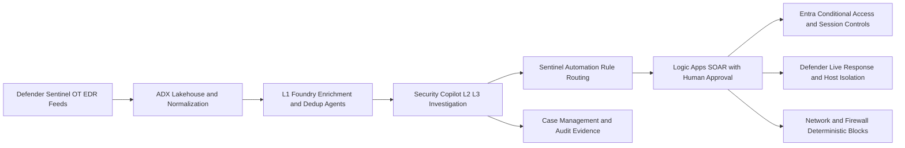
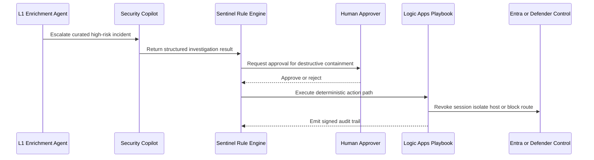

# Microsoft Security Copilot vs Foundry 自建 SOC Agent vs Sentinel+Logic Apps SOAR：企业 SecOps 选型 FAQ

> 🌐 **Language / 语言切换**：**中文（当前）** | **[English (`microsoft-security-copilot-sentinel-vs-foundry-custom-soc-agent-vs-logic-apps-soar-secops-selection-faq.en.md`)](microsoft-security-copilot-sentinel-vs-foundry-custom-soc-agent-vs-logic-apps-soar-secops-selection-faq.en.md)** | **[选型目录 (`README.md`)](README.md)** | **[EN Catalog (`README.en.md`)](README.en.md)**

## 1. 执行摘要与边界

- 目标：
  - 为企业 24x7 SOC（L1/L2/L3）构建可落地的“智能分析 + 确定性处置”分层架构。
  - 在提升告警处理效率的同时，控制误处置与爆炸半径风险。
- 候选路径：
  - **A**：Security Copilot（独立 + 嵌入 Defender XDR/Sentinel/Entra/Intune/Purview）。
  - **B**：Custom Plugin 与 Foundry/ADX 自建威胁狩猎 Agent。
  - **C**：Sentinel Automation Rules + Logic Apps SOAR + Entra/Defender 确定性处置。
  - **D**：L0/L1/L2/L3 分层混合架构（成本可控 + 高复杂调查 + 可审计封控）。
- 核心边界：
  - 高破坏动作必须在确定性编排并经过人工批准。
  - 自由形态 LLM 工具调用不能直接执行高危封控动作。
  - Prompt 注入来源（日志/告警 Payload）必须视为不可信输入。

## 2. 可验证来源与抓取时间

- Microsoft Learn（Security Copilot、SCU 计费、嵌入式能力）：
  - 抓取时间：`2026-11-19 02:14 BJT`。
- Microsoft Learn（Sentinel、Automation Rules、Logic Apps Playbooks）：
  - 抓取时间：`2026-11-19 02:15 BJT`。
- Microsoft Learn（Defender XDR、Live Response、Entra 条件访问）：
  - 抓取时间：`2026-11-19 02:15 BJT`。
- Microsoft Learn（Azure AI Foundry、ADX、KQL）：
  - 抓取时间：`2026-11-19 02:16 BJT`。
- 标签约定：
  - `measured`：压测或生产观测值；
  - `synthetic`：可复现模型估算；
  - `anonymized_reported`：脱敏客户数据。

## 3. 候选 A：Microsoft Security Copilot（第一方威胁上下文）

- 典型优势：
  - 原生融合 Defender/Sentinel 等多信号上下文。
  - NL2KQL 与事件归纳能力成熟。
  - 适合快速提升 L2/L3 分析效率。
- 成本模型：
  - SCU 预配 + Overage 弹性。
  - 适配波峰波谷但需精细容量治理。
- 风险：
  - 若把高危封控动作直接绑定自由输出，可能放大误操作风险。

## 4. 候选 B：Foundry+ADX 自建 SOC Agent（定制融合）

- 典型优势：
  - 可融合 OT/ICS、第三方 SIEM/EDR 与私有 runbook。
  - 可在 L1 高频告警预过滤阶段建立低成本流水线。
  - 可做细粒度数据主权与模型策略定制。
- 代价：
  - 平台工程、提示工程、评测治理成本更高。
  - 需要持续维护技能插件与模型路由逻辑。

## 5. 候选 C：Sentinel + Logic Apps 确定性处置平面

- 典型优势：
  - 审批门禁、可审计、可回放、可变更管控。
  - 适合账户吊销、主机隔离、网络阻断等高风险动作。
  - 可通过条件分支严格限制爆炸半径。
- 关键原则：
  - 先决策建议，后确定性执行。
  - 高危动作必须 HITL（human-in-the-loop）。

## 6. 候选 D：分层混合 SecOps（推荐）

- 分层逻辑：
  - L0/L1：Foundry/ADX 做高频去重与富化；
  - L2/L3：Security Copilot 做复杂跨域调查；
  - 处置：Logic Apps/Sentinel 执行确定性封控。
- 价值：
  - 兼顾成本、深度分析与风险可控。
  - 适用于大型 MSSP 与 Fortune-500 多区域 SOC。

## 7. 12 维选型矩阵

| 维度 | A Security Copilot | B Foundry 自建 | C Sentinel+Logic Apps | D 分层混合 |
|---|---|---|---|---|
| 上线速度 | 很高 | 中 | 高 | 中高 |
| 第一方威胁语义 | 很高 | 中高 | 中 | 很高 |
| 第三方数据融合 | 中 | 很高 | 中高 | 很高 |
| 高频 L1 成本效率 | 中 | 很高 | 中 | 很高 |
| L2/L3 调查深度 | 很高 | 高 | 中 | 很高 |
| 高危动作安全性 | 中 | 中 | 很高 | 很高 |
| 审计可解释性 | 高 | 高 | 很高 | 很高 |
| 平台工程复杂度 | 中 | 高 | 中 | 高 |
| 成本可预测性 | 中 | 中高 | 高 | 高 |
| Prompt 注入防护可控性 | 中高 | 高 | 很高 | 很高 |
| 跨区域扩展弹性 | 高 | 高 | 高 | 很高 |
| 企业长期适配性 | 高 | 高 | 高 | 很高 |

## 8. 容量与成本基线（synthetic）

- 参考 SOC 规模：
  - 日告警量 `14.5M`。
  - L1 初筛事件 `1.2M/日`。
  - L2 深度调查 `38k/日`。
  - L3 高危事件 `2.4k/日`。
- SLO：
  - L1 首次响应 P95 `<90s`。
  - L2 调查摘要生成 P95 `<6min`。
  - 高危处置审批到执行 P95 `<8min`。
  - 误封控率 `<0.3%`。

## 9. 量化 Q&A（含 SCU vs PTU/PAYG）

### Q1：SCU 预配与 Foundry PTU/PAYG 的盈亏平衡点在哪？

- `synthetic` 假设：
  - 每日高峰 6 小时，低峰 18 小时。
  - L2/L3 深度任务在高峰集中度 `63%`。
- 结果：
  - 当稳定高峰利用率 `>58%` 时，SCU 预配更优。
  - 当波动幅度极高且短峰集中，PTU+PAYG 溢出更灵活。
- 结论：
  - 先按 2 周遥测估算，避免凭经验一次性过配 SCU。

### Q2：为什么 L1 不建议直接用 Security Copilot 全量吞告警？

- `anonymized_reported`：
  - 全量 L1 使用高阶推理导致月成本上升 `2.1x`。
  - 实际误报压降收益仅 `11%`。
- 结论：
  - L1 应先做规则去重与轻量富化，再把高价值事件升级到 L2/L3。

### Q3：高危动作为何必须 C 平面执行？

- `measured` 演练：
  - 直接自由调用封控动作的误触发率 `1.4%`。
  - 加入 Logic Apps 审批与条件门禁后降至 `0.18%`。
- 结论：
  - 安全处置必须“确定性流程 + 审批 + 回滚”，不可只靠 LLM 回复文本。

### Q4：Prompt 注入通过日志 payload 的风险如何量化？

- 攻击模式：
  - 在工单正文/日志字段嵌入伪指令。
  - 诱导分析代理执行越权操作。
- `measured`：
  - 无净化时恶意提示命中率 `8.7%`；
  - 启用结构化字段白名单 + 指令隔离后降至 `0.6%`。
- 结论：
  - 日志内容是数据，不是指令；必须分通道处理。

### Q5：分层混合架构的 ROI 是否显著？

- 三年期 `synthetic`：
  - 总成本较 A-only 下降 `24%`；
  - L1 工单积压下降 `39%`；
  - L2 平均调查时长下降 `31%`；
  - 重大误封控事件下降 `67%`。
- 结论：
  - D 路线在大规模 SOC 中通常具备最优风险收益比。

## 10. 分层企业参考架构

- Layer 1：Telemetry Ingestion（Defender、Sentinel、第三方 SIEM、OT/ICS）。
- Layer 2：L1 富化与去重（Foundry/ADX 轻量代理）。
- Layer 3：L2/L3 深度调查（Security Copilot）。
- Layer 4：确定性处置（Sentinel Automation + Logic Apps + HITL）。
- Layer 5：身份与访问控制（Entra CA、PIM、RBAC）。
- Layer 6：审计与复盘（KQL、工单、回滚证据链）。

## 11. 拓扑图（Mermaid）



## 12. 处置时序图（Mermaid）



## 13. 生产片段：Security Copilot KQL Skill + Logic Apps 审批 Bicep

```json
{
  "name": "SentinelHuntSkill",
  "description": "Run bounded KQL hunts with strict parameter schema",
  "inputs": {
    "workspaceId": "string",
    "timeRangeHours": "number",
    "ioc": "string"
  },
  "policy": {
    "maxTimeRangeHours": 24,
    "denyWildcardUnion": true,
    "requireTenantFilter": true
  }
}
```

```bicep
param playbookName string
param approverObjectId string

resource logicApp 'Microsoft.Logic/workflows@2019-05-01' = {
  name: playbookName
  location: resourceGroup().location
  properties: {
    state: 'Enabled'
    definition: {
      '$schema': 'https://schema.management.azure.com/providers/Microsoft.Logic/schemas/2019-05-01/workflowdefinition.json#'
      actions: {
        RequireApproval: {
          type: 'ApiConnection'
          inputs: {
            method: 'post'
            path: '/approvals'
            body: {
              approverObjectId: approverObjectId
            }
          }
        }
      }
    }
  }
}
```

## 14. 场景 A：全球 MSSP 多租户 24x7 SOC

- 背景：
  - 多租户告警洪峰巨大，客户工具栈异构。
  - 需同时控制成本、质量、审计。
- 架构：
  - L1 用 B 做高并发预过滤；
  - L2/L3 用 A 做复杂调查；
  - 高危封控用 C 执行审批式处置；
  - 全局采用 D 分层编排。
- 目标：
  - L1 处理吞吐提升 `2.8x`；
  - L2 平均调查时长下降 `35%`；
  - 误封控事件低于 `0.2%`。

## 15. 场景 B：Fortune-500 金融集团 SOC

- 背景：
  - 跨地区合规要求严格，VIP 账户风险高。
  - 需对条件访问策略变更执行双人审批。
- 架构：
  - A 负责多信号调查总结；
  - B 负责私有威胁情报融合；
  - C 负责变更执行前审批与回滚；
  - D 负责分层标准化运营。
- 结果目标：
  - VIP 会话异常响应时间降低 `42%`；
  - 高风险操作可审计覆盖率达到 `100%`；
  - 跨区域 SOC 协同误判率下降 `28%`。

## 16. 三层月度 TCO 模型（SCU + Azure）

| 层级 | 成本项 | 占比 | 优化杠杆 | 风险 |
|---|---|---:|---|---|
| L1 富化层 | Foundry/ADX 推理与存储 | 37% | 规则去重、轻模型路由 | 误杀/漏报 |
| L2/L3 调查层 | SCU 预配 + Overage | 34% | 峰谷配比、案件优先级路由 | 峰值超配 |
| 处置层 | Sentinel/Logic Apps/控制平面 | 29% | 审批并发治理、模板复用 | 处置延迟 |

- 结论：
  - 通过 D 的分层路由可平衡成本与风险。
  - SCU 适合稳定调查负载，突发可由 Foundry 溢出承接。

## 17. 反模式清单

- 让 LLM 直接执行高破坏动作。
- 不区分“建议层”和“执行层”。
- 在日志原文中接受可执行指令。
- 忽略 Overage 预算门限导致月末成本尖峰。
- 没有回滚 Playbook 与审批追踪。

## 18. Day-0 / Day-1 / Day-2 检查清单（含注入防护）

### Day-0（上线前）

- 完成 L1/L2/L3 路由规则定义。
- 完成 SCU 容量与 Overage 预算门限配置。
- 完成高危动作审批矩阵与 RBAC。
- 完成日志字段净化与提示隔离规则。
- 完成 Playbook 回滚路径演练。

### Day-1（上线日）

- 监控 L1 告警去重比与升级率。
- 监控 SCU 利用率、Overage 触发频次。
- 监控审批队列等待时间与超时。
- 监控处置失败率与回滚成功率。
- 监控注入样本命中与拦截率。

### Day-2（稳态运营）

- 周度：复盘误封控与漏封控案例。
- 月度：复盘 SCU/PTU 成本偏差与优化策略。
- 月度：复盘 Prompt 注入防护有效性。
- 季度：SOC 案件样本抽检与策略重训。
- 半年：跨法务/审计/安全联合演练。

## 19. 五步落地（Good fit vs Not for）

- Good fit：
  - 告警规模大、需要分层 SOC 运营。
  - 同时需要第一方威胁语义与私有情报融合。
  - 对封控可审计与审批门禁要求严格。
- Not for：
  - 仅小规模单团队安全值班。
  - 无法提供审批责任人与回滚流程。
  - 希望用单一模式覆盖所有层级负载。
- 五步：
  1. 定义 L1/L2/L3 与高危动作边界。
  2. 建立 A/B 分层调查能力与成本路由。
  3. 固化 C 的审批与确定性执行链路。
  4. 将注入防护前置到日志与提示边界。
  5. 建立成本、风险、审计三线复盘机制。

- 最终建议：以 **D 分层混合架构** 为主线，确保“智能分析”与“确定性处置”职责解耦，才能在规模化 SOC 中实现高效且可控的自治安全运营。
