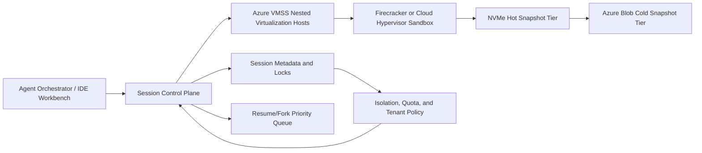
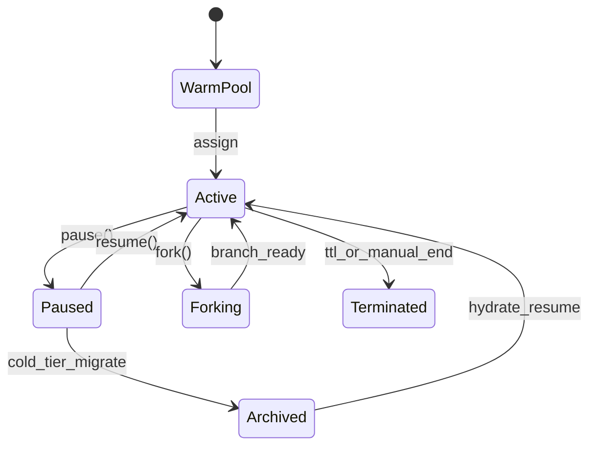

# MicroVM Snapshot Fork Sandbox Selection FAQ: Azure VMSS Self-Hosted E2B/Firecracker vs ACA Dynamic Sessions vs AKS Kata vs Managed Sandbox Clouds
> 🌐 **Language / 语言切换**: **[🇬🇧 English](microvm-snapshot-fork-sandbox-e2b-firecracker-azure-vmss-vs-aca-sessions-vs-aks-kata-selection-faq.en.md)** | **[🇨🇳 中文版](microvm-snapshot-fork-sandbox-e2b-firecracker-azure-vmss-vs-aca-sessions-vs-aks-kata-selection-faq.md)** | **[📚 Back to Catalog](README.en.md)**
> Evidence tags: `measured` / `synthetic` / `anonymized_reported`
> Scope boundary: this guide targets enterprise `pause()/resume()/fork()` runtime state continuity for sandbox sessions; it does not cover generic stateless code interpreters or lightweight WASM-only sandboxes

## 1) Executive summary: choose state semantics first, then choose compute substrate
As enterprise agent workloads evolve into parallel rollout,
best-of-N branch exploration,
and long-lived interactive coding workbenches,
the limiting factor is often session state continuity,
not raw model throughput.
If your requirement is:
sub-`200ms` memory-state resume,
plus live in-memory and disk snapshot forks that create `4–16` parallel branches,
then container cold start and replay patterns quickly become inefficient.
This guide compares four routes:
1. `Azure VMSS + Nested Virtualization` self-hosted MicroVM snapshot pools.
2. `Azure Container Apps Dynamic Sessions` managed Hyper-V pools.
3. `AKS Kata` sandbox pools integrated with Kubernetes platform controls.
4. third-party managed MicroVM sandbox clouds.
Primary SA conclusions:
- for strict in-tenant data residency with true runtime-state fork/pause/resume,
  Route A is usually the highest-capability architecture;
- for mainstream multi-tenant code and tool sandboxes without in-memory fork requirements,
  Route B is often the fastest path to production;
- for organizations standardizing platform controls through Kubernetes,
  Route C remains the most operationally aligned long-horizon option;
- Route D can accelerate early phases,
  but should include an explicit sovereignty and TCO exit trigger.
Verifiable references (`measured`, retrieved on 2026-11-21):
1. Azure Container Apps Sessions docs  
   https://learn.microsoft.com/en-us/azure/container-apps/sessions
2. ACA Dynamic Sessions GA announcement  
   https://techcommunity.microsoft.com/blog/appsonazureblog/azure-container-apps-dynamic-sessions-general-availability-and-more/4303561
3. Firecracker release stream  
   https://github.com/firecracker-microvm/firecracker/releases
4. Kata Containers release stream  
   https://github.com/kata-containers/kata-containers/releases
5. E2B release stream  
   https://github.com/e2b-dev/e2b/releases
6. Azure Virtual Machines and Reserved Instance guidance  
   https://learn.microsoft.com/en-us/azure/virtual-machines/
7. enterprise anonymized session telemetry (`anonymized_reported`)
8. controlled snapshot replay experiments (`synthetic`)

## 2) Workload problem statement: parallel branching and long-running workbenches need true state continuity
In AI-native engineering organizations,
an agent session is rarely a short one-shot function.
A realistic session may include:
repository hydration,
dependency setup,
language-server indexing,
test cache build-up,
and iterative debugging context.
Teams then want to branch this warm state into multiple experiments.
Without snapshot-based branching,
each branch repeats heavy initialization cost.
This introduces four structural pain points:
1. high resume latency that disrupts interactive flow;
2. slow branch creation that limits best-of-N exploration depth;
3. unnecessary compute burn while users are inactive;
4. increased isolation and compliance risk if state portability is poorly controlled.
Therefore,
this selection problem is about balancing:
state continuity,
hard isolation boundaries,
platform operations,
and FinOps outcomes.

## 3) Target SLO and KPI model for snapshot-capable sandbox platforms
Define measurable acceptance criteria up front.
Core KPIs:
1. `resume_p95_ms`;
2. `fork_p95_ms`;
3. `warm_state_retention_hours`;
4. `cost_per_active_session_hour`;
5. `cost_per_paused_session_hour`;
6. `branch_ready_success_ratio`.
Supplemental control KPIs:
- `state_resume_failure_ratio`;
- `snapshot_gc_backlog`;
- `ops_fte_per_10k_sessions`.
Example policy thresholds (`synthetic`):
- `resume_p95_ms < 200`;
- `fork_p95_ms < 150`;
- `branch_ready_success_ratio > 99.0%`.
If organizations only optimize throughput per node,
they miss the KPI set that users actually feel.

## 4) Four-route overview: map state requirements before platform preference
Route A:
self-hosted MicroVM pools on Azure VMSS with nested virtualization.
Route B:
ACA Dynamic Sessions managed Hyper-V execution pools.
Route C:
AKS Kata sandboxing integrated with platform engineering controls.
Route D:
third-party managed MicroVM sandbox services.
A practical architecture rule:
if your workload requires branch-level state fork semantics,
validate native `fork/pause/resume` behavior first.
Platforms that only support rehydration by rebuild and replay
can appear fast in isolated benchmarks
but degrade sharply in parallel branch trees.

## 5) Route A deep dive: Azure VMSS self-hosted E2B/Firecracker snapshot pools
Route A offers the broadest control surface.
Teams can freeze full runtime state,
including in-memory process context and writable disk,
then resume or fork from that checkpoint.
Typical architecture pattern:
- `Ddsv5/Edsv5` hosts with nested virtualization enabled;
- local NVMe for hot snapshots;
- Blob tiering for cold snapshots;
- metadata and lock state in a low-latency control store.
Strengths:
1. true pause/resume/fork semantics under enterprise control;
2. complete residency inside customer-owned Azure network boundaries;
3. high customization for runtime image, policy hooks, and lifecycle orchestration.
Trade-offs:
1. teams must own scheduler and control-plane reliability;
2. host-compatibility policy for CPU feature surfaces requires governance;
3. snapshot garbage collection and tier migration need disciplined operations.
Route A is usually best when platform teams can absorb deeper systems ownership.

## 6) Route B deep dive: ACA Dynamic Sessions managed Hyper-V pools
Route B emphasizes managed operations and fast adoption.
The platform handles core sandbox orchestration,
isolation baseline,
and core integration paths.
Best-fit scenarios:
- mainstream code and tool sandboxes without in-memory branch forking;
- organizations needing rapid rollout across multiple teams;
- programs minimizing host-level virtualization operations.
Strengths:
1. low operational burden compared with self-hosted hypervisor pools;
2. stable warm-pool behavior and identity integration paths;
3. clean private networking and governance options.
Trade-offs:
1. not primarily designed for deep in-memory branch fork semantics;
2. less lifecycle customization than self-hosted snapshot controllers;
3. advanced branching models may require complementary architecture layers.
Route B is often the default for broad internal adoption.

## 7) Route C deep dive: AKS Kata for platform-standardized sandbox governance
Route C aligns sandboxing with Kubernetes operating models.
It integrates naturally with:
KEDA autoscaling,
CSI storage controls,
Cilium policies,
GitOps release patterns,
and centralized observability.
Best-fit scenarios:
- platform organizations with mature Kubernetes operations;
- workloads prioritizing standardized operations over maximal fork semantics;
- teams seeking common governance across many internal runtime classes.
Strengths:
1. operational consistency with existing AKS platform practices;
2. straightforward policy and telemetry integration;
3. good fit for long-running steady-state sandbox fleets.
Trade-offs:
1. startup paths are often sub-second to multi-second rather than ultra-fast fork;
2. snapshot semantics typically require additional engineering layers;
3. node pool lifecycle and compatibility management remain ongoing responsibilities.
Route C frequently acts as a durable platform backbone.

## 8) Route D deep dive: managed MicroVM sandbox clouds
Route D can provide excellent developer ergonomics quickly.
Common benefits include:
ready-made session APIs,
snapshot and pause semantics,
and reduced platform bootstrap effort.
Useful scenarios:
- early product discovery;
- short innovation sprints;
- controlled experiments with low sovereignty constraints.
Enterprise constraints to evaluate early:
1. data residency and regulated boundary requirements;
2. customer-managed key and cryptographic control expectations;
3. long-run economics at very high monthly session-hour volumes.
A practical trigger:
when monthly session hours approach `300k–500k`,
force a structured build-vs-buy recalculation.

## 9) 12-dimension comparison matrix for enterprise architecture reviews

| Dimension | A VMSS Self-Hosted MicroVM | B ACA Dynamic Sessions | C AKS Kata | D Managed MicroVM Cloud |
|---|---|---|---|---|
| In-memory fork semantics | Strong, native by design | Limited to moderate | Moderate with add-ons | Strong if vendor supports |
| Resume latency capability | Can reach sub-`200ms` (`synthetic`) | Low-latency warm assignment (`measured`) | Moderate | Low to moderate |
| Data sovereignty control | Strongest | Strong | Strong | Moderate |
| Delivery speed | Moderate | Strong | Moderate | Strong |
| Operational complexity | High | Low | Moderate | Low early / higher later |
| Kubernetes integration | Moderate | Moderate | Strong | Limited |
| Lifecycle programmability | Strong | Moderate | Moderate | Moderate |
| Compliance audit fit | Strong | Strong | Strong | Moderate |
| Active-hour cost profile | Moderate to low at scale | Moderate | Moderate | Moderate to high |
| Paused-hour cost profile | Very low if optimized | Moderate | Moderate | Moderate |
| Scale to million session-hours | Strong with engineering discipline | Moderate to strong | Moderate | Moderate |
| Best-of-N branch suitability | Strong | Moderate | Moderate | Strong |

How to use this matrix:
prioritize fork semantics,
sovereignty control,
and paused-hour economics first.
Those dimensions usually become hard constraints before others.

## 10) Azure reference architecture: hot NVMe tier plus cold Blob tier with explicit control plane
The recommended Azure pattern uses layered snapshot storage
and a dedicated session control plane.
This preserves fast interaction paths
while controlling long-duration idle costs.

### Mermaid #1: layered snapshot architecture

Reference implementation notes:
1. keep most-recent snapshots on NVMe to minimize resume wait;
2. migrate inactive snapshots to Blob cold tier on schedule;
3. route resume and fork through explicit priority queues;
4. isolate interactive and batch replay traffic classes.

## 11) Lifecycle engineering: operational state machine for pause/resume/fork governance
Treat session lifecycle as a first-class state model,
not a hidden implementation behavior.
Clear states reduce incident ambiguity
and improve operability across teams.

### Mermaid #2: session lifecycle state machine

Operational controls:
1. enforce flush checks before pause;
2. validate tenant context before resume;
3. fork only minimum required state segments;
4. tune archive policy by workload criticality and SLA class.
These controls materially impact branch readiness and cost stability.

## 12) TCO and Reserved Instance break-even model for high session-hour fleets
Use a segmented cost model with four components:
1. active compute consumption;
2. paused snapshot storage and hydration traffic;
3. session control-plane and orchestration overhead;
4. platform operations labor.
Illustrative pattern (`synthetic`):
- around `120k` monthly session-hours,
  managed services often keep a lower total operating burden;
- around `300k` monthly session-hours,
  managed and self-hosted costs can converge;
- above `500k` monthly session-hours,
  well-operated self-hosted pools with RI planning often show stronger economics.
Track two business-facing KPIs:
- `cost_per_successful_resume`;
- `cost_per_branch_ready`.
Without these,
organizations often optimize infrastructure unit cost
while missing user outcome cost.

## 13) Enterprise scenario A: parallel code rollout and branch-tree exploration
A software-native AI company runs branch-tree experiments per engineering task.
Requirement:
return first runnable branch set within two seconds of user action.
Delivered pattern:
- Route A snapshot pools for branch-heavy workflows;
- priority scheduling for interactive forks;
- delayed replay for lower-value branches.
Observed outcomes (`anonymized_reported`):
- branch-ready time reduced by `41%`;
- effective parallel branch capacity increased by `2.3x` under similar budget;
- user retention in interactive sessions improved materially.
This scenario highlights that state-fork capability is a productivity multiplier.

## 14) Enterprise scenario B: long-lived interactive workbench with overnight zero-compute pause
A research workbench team has daytime-heavy activity
and long overnight idle windows.
Keeping all sessions active overnight made costs unsustainable.
Adopted pattern:
- automated pause after inactivity threshold;
- nightly cold-tier migration;
- priority-based morning resume.
Observed outcomes (`anonymized_reported`):
- overnight compute spend reduced by `58%`;
- next-day resume success remained above `99%`;
- user wait stayed within interactive tolerance.
In this class of workload,
pause governance quality often matters more than scale-out policy.

## 15) Deep FAQ (8 practical architecture questions)
### Q1: Why is container rebuild plus replay insufficient for branch-heavy workflows?
Because rebuild and replay do not preserve full in-memory runtime context.
For interactive branch trees,
that gap creates noticeable delay and lower productivity.
If branch depth and frequency are high,
state-fork semantics become a hard requirement.

### Q2: What is the biggest risk of Route A?
Usually not performance.
The main risk is platform operations burden.
Teams must run reliable schedulers,
snapshot lifecycle controls,
and robust recovery policies.
Without that discipline,
capability can outpace reliability.

### Q3: Is Route B unsuitable for advanced enterprise programs?
No.
Route B is excellent for broad mainstream sandbox workloads.
It is simply not the primary path for deep in-memory branch-fork semantics.
Many organizations run B as default,
with A for specialized branch-heavy lanes.

### Q4: Can Route C coexist with Route A?
Yes.
Route C can serve as the standardized platform baseline,
while Route A handles high-end fork-centric workloads.
Use consistent session API contracts to keep orchestration portable.

### Q5: When should teams move from Route D to Azure-hosted options?
Trigger migration review when one or more signals appear:
stronger data-sovereignty requirements,
CMK control mandates,
or sustained session-hour growth into the break-even zone.
Treat migration as planned evolution,
not emergency response.

### Q6: How do we avoid resume storms during shift changes?
Use priority queues and concurrency caps for resume operations.
Serve interactive sessions first,
and throttle background hydration.
Add fallback lanes to avoid hotspot amplification.

### Q7: How should fork success be defined?
Not merely by metadata creation.
Define success as:
branch becomes runnable,
context is intact,
required toolchain is available.
Measure and publish `branch_ready_success_ratio`.

### Q8: What is the minimum Day-0 and Day-2 checklist?
Day-0:
define state semantics,
isolation boundaries,
resume and fork SLOs,
snapshot retention policy.
Day-2:
review resume failures weekly,
run overnight recovery drills monthly,
recompute RI break-even quarterly.
Operational rhythm is what keeps this architecture healthy at scale.
