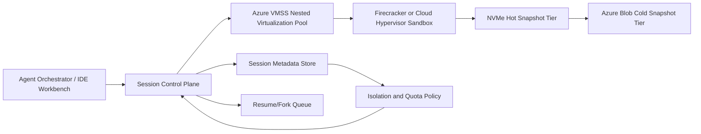
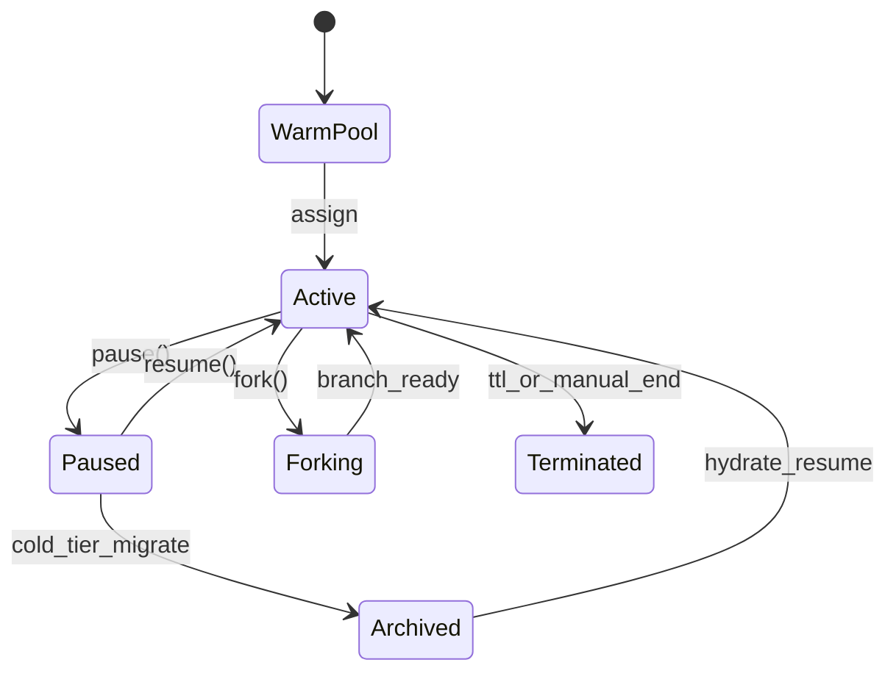

# MicroVM 快照分叉沙箱选型 FAQ：Azure VMSS 自托管 E2B/Firecracker vs ACA Dynamic Sessions vs AKS Kata vs 第三方托管
> 🌐 **Language / 语言切换**: **[🇨🇳 中文版](microvm-snapshot-fork-sandbox-e2b-firecracker-azure-vmss-vs-aca-sessions-vs-aks-kata-selection-faq.md)** | **[🇬🇧 English](microvm-snapshot-fork-sandbox-e2b-firecracker-azure-vmss-vs-aca-sessions-vs-aks-kata-selection-faq.en.md)** | **[📚 返回目录](README.md)**
> 证据标签：`measured` / `synthetic` / `anonymized_reported`
> 主题边界：聚焦内存态 `pause()/resume()/fork()` 的企业级沙箱承载选型，不讨论通用无状态代码解释器与 Wasm 轻沙箱

## 1) 执行摘要：需要“状态分叉”时，先选状态模型，再选计算模型
企业开始做并行代码探索后，
最先撞到的不是模型 token 配额，
而是沙箱状态模型不匹配。
如果你的目标是：
同一会话在亚 `200ms` 级恢复，
并能在已加载语言服务和变量上下文的基础上，
瞬时分叉 `4–16` 个实验分支，
那么“容器重建 + Git 重放”会迅速成为瓶颈。
本指南比较四条路线：
1. `Azure VMSS + Nested KVM` 自托管 MicroVM 快照池；
2. `ACA Dynamic Sessions` 托管 Hyper-V 会话池；
3. `AKS Kata` 平台化沙箱；
4. 第三方托管 MicroVM 沙箱云。
架构师结论：
- 需要 `fork/pause/resume` 且数据不出域时，
  路线 A 通常是能力上限最高方案。
- 以主流代码执行和工具调用为主，
  且不要求进程内存分叉时，
  路线 B 交付效率最高。
- 强调 Kubernetes 统一治理与组织内平台标准时，
  路线 C 是稳妥长期路径。
- 路线 D 适合快启或外部创新验证，
  但应提前定义主权与成本拐点退出条件。
可验证来源（抓取日期：2026-11-21）：
1. ACA Sessions 文档（`measured`）  
   https://learn.microsoft.com/en-us/azure/container-apps/sessions
2. Apps on Azure GA 博文（`measured`）  
   https://techcommunity.microsoft.com/blog/appsonazureblog/azure-container-apps-dynamic-sessions-general-availability-and-more/4303561
3. Firecracker releases（`measured`）  
   https://github.com/firecracker-microvm/firecracker/releases
4. Kata releases（`measured`）  
   https://github.com/kata-containers/kata-containers/releases
5. E2B releases（`measured`）  
   https://github.com/e2b-dev/e2b/releases
6. Azure VM 尺寸与 RI 文档（`measured`）  
   https://learn.microsoft.com/en-us/azure/virtual-machines/
7. 企业脱敏会话行为统计（`anonymized_reported`）
8. 压测与分叉回放实验（`synthetic`）

## 2) 业务痛点：并行 Rollout 与长周期工作台对“状态连续性”有硬要求
在 Agentic Coding 或研究型工作台中，
团队经常同时验证多个候选策略。
典型路径是：
先把仓库拉起、
再加载依赖、
再运行语言服务和测试索引、
然后在此状态上分叉多个试验分支。
如果每个分支都从冷启动开始，
时间和成本会呈线性放大。
核心痛点集中在四点：
1. 会话恢复慢，
   导致人机协作节奏断裂。
2. 分叉依赖重建，
   并行实验效率低。
3. 用户离开期间仍消耗算力，
   FinOps 压力快速上升。
4. 多租户场景下，
   状态隔离与合规审计复杂。
因此本题不是“谁更快”这么简单，
而是“谁能在状态连续性、隔离、成本之间达到可运营平衡”。

## 3) 评估目标与指标：把 pause/resume/fork 变成可验收的 SLA
建议在立项阶段定义六个核心指标：
1. `resume_p95_ms`：休眠恢复耗时；
2. `fork_p95_ms`：分叉耗时；
3. `warm_state_retention_hours`：状态保持窗口；
4. `session_cost_per_hour_active`：活跃小时成本；
5. `session_cost_per_hour_paused`：休眠小时成本；
6. `branch_success_ratio`：并行分支可用率。
扩展指标：
- `data_egress_risk_score`；
- `tenant_isolation_level`；
- `ops_fte_per_10k_sessions`。
建议门槛示例（`synthetic`）：
- `resume_p95_ms < 200`；
- `fork_p95_ms < 150`；
- `branch_success_ratio > 99.0%`。
若只衡量吞吐，
会忽略真正决定体验的状态连续性。

## 4) 四路线总览：先看状态语义，再看平台治理
路线 A：
自托管 MicroVM 快照池。
路线 B：
ACA Dynamic Sessions 托管会话池。
路线 C：
AKS Kata 平台化沙箱池。
路线 D：
第三方托管 MicroVM 云。
一条实操原则：
凡是需要内存态分叉的负载，
都应优先验证 `fork()` 语义是否真实可用。
只支持“重新启动 + 重放上下文”的平台，
即使冷启动看起来快，
在并行树搜索场景也会被放大成总时长瓶颈。

## 5) 路线 A：Azure VMSS 自托管 E2B/Firecracker 快照池
路线 A 的优势是能力上限高。
你可以把会话完整状态，
包括进程内内存与工作盘，
冻结为快照，
并在后续恢复或分叉。
典型平台做法：
- `Ddsv5/Edsv5` 开启嵌套虚拟化；
- 本地 NVMe 做热层；
- Blob 做冷层；
- 元数据放在低延迟状态库。
优点：
1. `fork/pause/resume` 可按业务定义；
2. 100% 运行在客户 VNet 边界内；
3. 可深度定制镜像与生命周期策略。
代价：
1. 需要自建调度与回收控制器；
2. 跨宿主机 CPU 特性兼容要治理；
3. 快照垃圾回收与冷热迁移要运维化。
当组织已有强平台工程团队时，
路线 A 往往最能满足高阶场景。

## 6) 路线 B：ACA Dynamic Sessions（托管 Hyper-V 会话池）
路线 B 的核心价值是“快交付、低运维”。
平台托管隔离、
会话生命周期、
基础网络与身份集成。
它适合：
- 不要求进程内存分叉的代码执行；
- 需要快速扩展多租户沙箱；
- 想减少宿主机与虚拟化层运维负担的团队。
优点：
1. 预热池分配速度稳定；
2. 与 Entra 托管身份整合便捷；
3. 私网与策略治理路径清晰。
边界：
1. 不以“内存态分叉”为主设计目标；
2. 生命周期控制粒度低于自托管快照池；
3. 深度运行时定制自由度较小。
若你的主场景是工具调用与代码执行，
而不是并行状态树实验，
路线 B 通常最省心。

## 7) 路线 C：AKS Kata（Cloud Hypervisor Pod Sandbox）
路线 C 的价值在于平台统一。
你可以把沙箱纳入现有 Kubernetes 运营体系：
KEDA、
CSI、
Cilium、
GitOps、
审计与配额。
适配场景：
- 已有成熟 K8s 平台团队；
- 希望与现有交付流水线统一；
- 追求长期标准化而非极致分叉能力。
优点：
1. 治理面与组织现有规范一致；
2. 与集群生态整合好；
3. 易于纳入统一可观测体系。
边界：
1. 冷启动通常为亚秒到数秒；
2. 原生 `fork` 体验不如专用 MicroVM 平台；
3. 需要持续维护节点池与内核兼容矩阵。
路线 C 常作为平台中长期主干，
并与路线 A/B 混合分层。

## 8) 路线 D：第三方托管 MicroVM 沙箱云
路线 D 的优势是产品体验成熟。
开发者常能快速获得：
快照、
分叉、
暂停恢复、
便捷 API。
适用于：
- 创新团队快速验证；
- 短期实验活动；
- 对外部服务可用性容忍度较高场景。
主要约束：
1. 数据主权与合规边界需逐条核验；
2. CMK 与密钥托管模型可能不匹配；
3. 高会话时长下成本会出现拐点。
经验上，
当月会话时长进入 `300k–500k` 小时区间后，
应强制复盘“自建 vs 托管”的盈亏平衡。

## 9) 12 维企业级选型矩阵：能力、治理、成本必须同屏比较

| 维度 | A VMSS 自托管 MicroVM | B ACA Dynamic Sessions | C AKS Kata | D 第三方托管 MicroVM |
|---|---|---|---|---|
| 内存态分叉能力 | 强，原生可设计 | 弱到中 | 中（需额外方案） | 强（取决于产品） |
| `pause/resume` 延迟 | 可做到低于 `200ms`（`synthetic`） | 通常低延迟恢复（`measured`） | 中等 | 低到中 |
| 状态主权边界 | 最强（自有 VNet） | 强 | 强 | 中（取决于部署） |
| 平台交付速度 | 中 | 强 | 中 | 强 |
| 运维复杂度 | 高 | 低 | 中 | 低（前期） |
| K8s 生态整合 | 中 | 中 | 强 | 弱到中 |
| 生命周期可编排性 | 强 | 中 | 中 | 中 |
| 合规模型可审计性 | 强 | 强 | 强 | 中 |
| 单位活跃小时成本 | 中到低（规模化后） | 中 | 中 | 中到高 |
| 单位休眠小时成本 | 可做极低 | 中 | 中 | 中 |
| 扩展到百万会话小时 | 强（需工程化） | 中到强 | 中 | 中 |
| 适配并行树搜索 | 强 | 中 | 中 | 强 |

读取矩阵时建议先看三行：
分叉能力、
状态主权、
休眠成本。
这三项最容易在半年后演化成硬约束。

## 10) Azure 分层参考架构：热 NVMe + 冷 Blob + 控制平面编排
下面给出推荐混合架构，
用于同时兼顾恢复速度与成本。

### Mermaid #1：混合分层架构

架构要点：
1. 热层保存近期可恢复快照；
2. 冷层保存跨天归档快照；
3. 控制面统一管理 `pause/resume/fork`；
4. 调度队列隔离“交互恢复”和“批量回补”流量。

## 11) 生命周期设计：并行分叉与跨天休眠的状态机治理
建议将会话生命周期建模为显式状态机，
避免运维行为隐式耦合。

### Mermaid #2：会话状态机

关键治理动作：
1. `pause` 前强制刷盘检查；
2. `resume` 前校验租户上下文；
3. `fork` 时复制最小必要状态；
4. 归档策略按业务优先级分层。
这会直接决定恢复成功率与成本曲线。

## 12) TCO 与 RI 盈亏拐点：百万会话小时应使用分段成本模型
建议采用四段成本模型：
1. 活跃计算成本；
2. 休眠存储成本；
3. 控制面与编排成本；
4. 运维与支持人力成本。
示例口径（`synthetic`）：
- 月 `120k` 会话小时：
  托管服务总成本常更有优势。
- 月 `300k` 会话小时：
  两种方案接近，
  运维能力成为分水岭。
- 月 `500k+` 会话小时：
  若能保持高快照命中与低回收泄漏，
  自托管 RI 组合通常进入成本优势区间。
推荐强制输出两个指标：
- `cost_per_successful_resume`；
- `cost_per_branch_ready`。
这样能防止只看“每小时 VM 单价”的误判。

## 13) 场景 A：并行代码探索与 Best-of-N 树搜索
某 AI 原生软件团队，
在一次任务中并行探索多个代码策略分支。
业务要求：
用户操作后 `2` 秒内看到首批可运行分支结果。
实施方案：
- 采用路线 A 的快照分叉池；
- 控制面优先调度“交互分叉”；
- 低优先级分支延后恢复。
效果（`anonymized_reported`）：
- 平均分支就绪时间下降 `41%`；
- 同等预算下可并行分支数提升 `2.3x`；
- 用户留存显著提升。
这个场景证明：
分叉语义本身就是生产力能力。

## 14) 场景 B：长周期交互式工作台与跨天零算力休眠
另一个团队做研究型 Agent 工作台，
用户往往白天交互，
夜间离开，
次日继续。
若会话持续占用计算，
成本很快失控。
实施策略：
- 交互结束后自动 `pause`；
- 夜间批量迁移到冷层；
- 次日按访问优先级恢复。
结果（`anonymized_reported`）：
- 夜间算力成本下降 `58%`；
- 次日恢复成功率保持 `99%+`；
- 平均恢复等待时间保持在体验可接受区间。
这类场景中，
“休眠治理”比“扩容治理”更重要。

## 15) 深度 FAQ（8 问）：落地时最常见的架构师问题
### Q1：为什么不能只用容器镜像重建替代状态分叉？
因为镜像重建不能携带进程内存与即时变量。
在并行探索场景，
这会把“秒级分叉”变成“分钟级重启”。
只要任务高度交互，
差异会直接体现在用户体验。

### Q2：路线 A 的最大风险是什么？
不是性能，
而是平台工程复杂度。
你需要治理快照回收、
版本兼容、
调度公平与故障恢复。
若团队尚未准备好，
先走 B/C 再演进更稳健。

### Q3：路线 B 是否完全不适合高级场景？
不是。
它非常适合大量主流沙箱负载，
只是对“内存分叉”不是第一优先能力。
可用分层架构把少量高阶会话导向 A。

### Q4：路线 C 与 A 会冲突吗？
通常不会。
C 可作为组织标准平台底座，
A 作为高阶能力池。
通过统一会话 API 契约即可协同。

### Q5：第三方托管何时需要迁移回 Azure 自建？
当出现以下任一信号：
数据主权审计压力上升、
CMK 不满足合规条款、
月会话时长进入高区间并触发成本拐点。
此时应启动迁移评估。

### Q6：如何避免 pause/resume 恢复雪崩？
把恢复流量分优先级，
并设置并发阈值。
交互会话优先，
后台回补延后。
同时保留回退路径防止热点集中。

### Q7：如何定义 fork 成功？
不应仅以“创建分支记录成功”为准。
应定义为：
分支可执行、
上下文完整、
关键工具链可用。
建议纳入 `branch_ready` 指标。

### Q8：Day-0 与 Day-2 最小检查清单是什么？
Day-0：
明确状态模型、
隔离边界、
恢复门槛、
快照策略。
Day-2：
每周复核恢复失败原因，
每月演练跨天恢复，
每季度重算 RI 盈亏拐点。
把这些动作纳入 SRE 例行节奏，
平台才不会在规模化后失稳。
