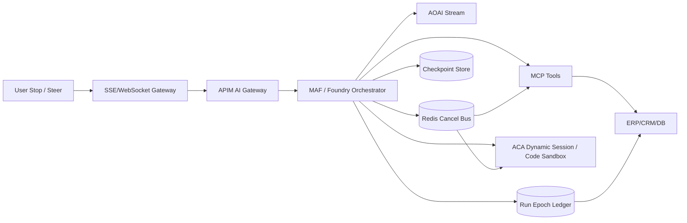
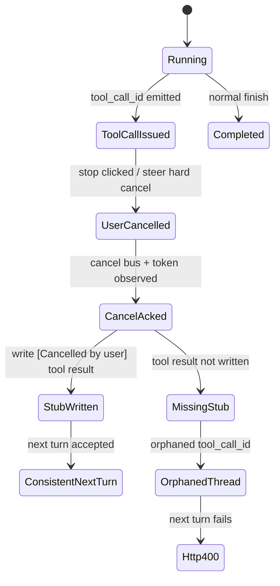

# Enterprise Mid-Flight Agent Cancellation and Live Steering Selection FAQ: Cooperative Cancel Trees + Turn-Boundary Queues vs `run_epoch` Fencing vs Checkpoint Forking

> 🌐 **Language Switch**: [中文](./mid-flight-agent-cancellation-live-steering-cooperative-abort-mcp-cancel-vs-turn-boundary-queue-vs-epoch-fencing-selection-faq.md) | **English (current)**
> **Audience**: Cloud & AI Solution Architects, enterprise agent-platform owners, application architecture boards, SRE/DevSecOps teams, risk and audit stakeholders.
> **Scope**: Production design for the moment a user clicks Stop or sends a mid-run course correction while multi-agent workflows are streaming across model endpoints, MCP tools, and code sandboxes, with focus on cancellation latency, thread integrity, zombie side-effect prevention, and auditable consistency.

## 1. Problem framing: why mid-flight cancellation is a first-class enterprise control, not a UI convenience
In demo-grade systems, cancellation is often implemented as “close the SSE socket” or “stop sending UI deltas.”  
In enterprise production, however, execution spans gateways, orchestrators, model streams, tool calls, asynchronous callbacks, and stateful write paths, so one disconnected transport channel does not imply the run actually stopped.  

The highest-cost failures are not obvious stop failures, but partial-stop corruption patterns.  
Typical examples include model output halted while MCP write calls continue in background queues, or tool calls emitted without terminal tool results, causing the next turn to fail with orphaned `tool_call_id` protocol errors.  

Therefore, cancellation must be treated as an end-to-end execution contract rather than a front-end interaction event.  
A robust design must simultaneously minimize zombie token burn, preserve thread-level protocol consistency, and fence delayed side effects from cancelled execution branches.  

## 2. Four-pattern portfolio: upgrade “Stop” into a governed execution-control plane
Pattern A introduces a cooperative cancellation tree with an out-of-band cancel bus so stop signals propagate across protocol boundaries even when reverse proxies or intermediaries absorb half-close semantics.  
Pattern B adds turn-boundary live steering so user course corrections can be injected at safe atomic boundaries without replaying everything from scratch.  

Pattern C enforces monotonic `run_epoch` fencing with compare-and-check semantics on write paths, then triggers compensating sagas for partially committed actions after cancellation races.  
Pattern D enables checkpoint-forked steering where a new branch continues from `step_k` while the superseded branch is drained or archived for governance evidence and side-by-side review.  

These patterns are complementary, not mutually exclusive alternatives.  
Most mature platforms make A the baseline, layer B for interaction efficiency, require C for mutation-heavy business flows, and apply D to long-running analytical or approval-intensive workflows.  

## 3. Reference architecture: stop/steer signal propagation across control and data planes


The architecture intentionally treats cancellation control and side-effect governance as one integrated system boundary.  
Stopping token generation without governing downstream writes may improve perceived UX while still leaving expensive business and audit inconsistency debt.  

## 4. Pattern A: cooperative cancellation tree plus out-of-band cancel bus for `<250ms` convergence
Pattern A optimizes for deterministic stop propagation under heterogeneous network behavior.  
Because some L7 gateways and stream intermediaries can hide transport-level close semantics, cancellation should be propagated through both orchestrator-level cancellation tokens and an explicit bus-level broadcast path.  

This dual-path design materially reduces zombie execution tails during gateway jitter or service-tier partial outages.  
Even if one path lags, worker components can still observe cancellation from the alternate path and terminate bounded work promptly.  

The second requirement is protocol closure hygiene.  
Every cancelled tool invocation must emit a deterministic terminal stub such as `[Cancelled by user]` so subsequent turns never face missing tool-result state and protocol-level thread corruption.  

## 5. Pattern B: turn-boundary live steering with priority interrupt queue
In real enterprise usage, user intent changes mid-flight far more often than users demand full hard-stop replay.  
A planner running through budget analysis may receive a correction like “switch currency to EUR and exclude APAC,” where restarting from step zero wastes both latency and model budget.  

Pattern B separates Soft Steer and Hard Cancel-and-Replay policies.  
Soft Steer injects corrections at atomic step boundaries and preserves completed read-only work plus reusable prompt-cache prefixes, while Hard Cancel is reserved for semantic conflict or risk-policy breaches requiring immediate branch termination.  

To work reliably in DAG-style multi-agent graphs, turn boundaries must be explicit and auditable.  
A practical rule is to allow boundary steering only after side-effect-free steps, with queue metadata including scope, priority, and expiration to prevent stale steering instructions from overriding newer business intent.  

## 6. Pattern C: monotonic `run_epoch` fencing plus durable compensation to eliminate zombie writes
The most dangerous race is “cancel observed before write dispatch in one component, but after dispatch in another.”  
A cancelled sub-agent can still deliver an already-buffered write to ERP/CRM hundreds of milliseconds later unless every write ingress validates branch liveness.  

Pattern C requires each active branch to carry a strictly monotonic `run_epoch`.  
Any mutating request must include that epoch, and APIM/service/database ingress must compare it against the currently active epoch, rejecting stale values as deterministic race fallout rather than business-valid writes.  

For multi-step partial commits, compensation must be first-class and replayable.  
Durable compensation flows should be idempotent by operation key, so post-cancel cleanup can succeed under retries and distributed retries without introducing secondary inconsistencies.  

## 7. Pattern D: checkpoint-forked steering for long-running workflows
Long-lived enterprise workflows often cannot afford repeated full replay after each steering instruction.  
Pattern D forks a new immutable branch from checkpoint `step_k`, applies updated intent there, and drains or archives the superseded branch as governed historical evidence.  

This model preserves continuity for in-flight work while giving users fast directional control.  
It is especially effective in regulated review pipelines where teams need both forward progress and defensible history of discarded or superseded branches.  

Branch governance must include retention and cleanup strategy.  
Without explicit TTL, archival class, and compaction policy, checkpoint storage can grow into a hidden cost center and eventually slow orchestration-state operations.  

## 8. Thread-corruption and zombie-execution state machine: why cancellation stubs are non-negotiable


This state machine captures a practical production failure mode that is frequently misdiagnosed as random API instability.  
In most cases, the true root cause is protocol-incomplete cancellation handling where tool-call lifecycle was initiated but never closed with a deterministic terminal record.  

Treating cancellation as a valid terminal state with mandatory stub writeback prevents that class of thread corruption.  
It also improves replay and audit fidelity because user intent, cancellation trigger, and system branch outcome remain coherently linked in one execution ledger.  

## 9. Quantitative model: zombie token waste, cancellation latency, and steering reuse gains
Let average generation throughput be `r` tokens/second and cancellation propagation latency be `L` milliseconds; expected zombie-token waste per cancelled run is approximately `w = r * L / 1000`.  
If monthly cancellation volume is `N`, then monthly zombie waste is `W = N * w`, which maps directly into model spend and GPU/throughput opportunity cost.  

Example: with `r=180`, `L=220ms`, and `N=2,000,000`, waste is `39.6` tokens/run and `79.2M` tokens/month.  
If the same platform runs at `L=900ms` without cooperative convergence controls, monthly waste rises to `324M` tokens, making cancellation latency a major FinOps lever rather than a pure UX metric.  

For steering, replay avoidance can be estimated with `saved_tokens = replay_tokens * prefix_reuse_rate`.  
At `8,000` replay tokens and `80%` reusable prefix/read-only preservation, each soft-steered run avoids roughly `6,400` tokens of rework.  

| Metric | Baseline (no cooperative controls) | Target (A+B+C) | Improvement |
|---|---:|---:|---:|
| Cancellation propagation P95 | `900ms` | `220ms` | `-75.6%` |
| Zombie tokens per cancel (`r=180`) | `162` | `39.6` | `-75.6%` |
| Monthly zombie tokens (`N=2M`) | `324M` | `79.2M` | `-244.8M` |
| Steering-trigger replay ratio | `100%` | `10%–25%` | `-75%` to `-90%` |
| Thread `HTTP 400` corruption rate | `0.8%` | `<0.05%` | materially reduced |

## 10. 12-dimension comparison matrix: cancellation control, steering UX, and consistency posture
| Dimension | Pattern A Cooperative Cancel Tree | Pattern B Turn-Boundary Queue | Pattern C `run_epoch` Fencing | Pattern D Checkpoint Fork |
|---|---|---|---|---|
| Stop convergence speed | Very high | Medium | Medium | Medium |
| Mid-run steering UX | Medium | High | Medium | High |
| Zombie side-effect prevention | Medium | Low | Very high | Medium-high |
| Conversation-thread integrity | High | High | High | High |
| Write-path consistency strength | Medium | Low | Very high | High |
| Long-horizon recovery capability | Medium | Medium | High | Very high |
| Implementation complexity | Medium | Medium | High | High |
| Observability clarity | High | High | High | Medium-high |
| Audit explainability | High | Medium-high | High | Very high |
| Intrusiveness to existing systems | Low-to-medium | Medium | Medium-high | Medium-high |
| Direct cost-saving potential | High | High | Medium-high | Medium |
| Recommended adoption order | First | Second | Required for mutating flows | Add for long workflows |

The matrix reinforces a practical adoption strategy: A provides platform safety baseline, B drives interactive efficiency, C protects business consistency, and D unlocks sustainable long-run steering in complex processes.  
Skipping C in mutation-heavy domains often yields short-term UX gains while silently accumulating high-impact financial and compliance risk.  

## 11. Three-year TCO and token-savings model: translating control quality into financial outcomes
The table below assumes `50M` monthly requests, `4%` mid-flight cancellation rate, and `6%` steering events in a multi-tenant enterprise deployment.  
Cost categories include model/token waste, unnecessary tool execution, incident triage and rollback labor, compensation overhead, audit investigation time, and platform implementation/operations investment.  

| Option | 3-year model + tool waste cost (USD) | 3-year incident/rollback cost (USD) | 3-year platform control investment (USD) | 3-year total (USD) |
|---|---:|---:|---:|---:|
| Baseline (none of A/B/C/D) | 5,240,000 | 1,680,000 | 420,000 | 7,340,000 |
| A+B | 3,420,000 | 1,020,000 | 760,000 | 5,200,000 |
| A+B+C | 3,080,000 | 420,000 | 980,000 | 4,480,000 |
| A+B+C+D | 2,960,000 | 360,000 | 1,240,000 | 4,560,000 |

Over a typical three-year planning horizon, A+B+C is frequently the strongest total-cost equilibrium.  
D provides strategic value when long-lived branches and audit-grade branch comparisons are frequent enough to justify additional checkpoint governance and storage lifecycle investment.  

## 12. Production implementation (Python): MAF + Redis cancel bus + MCP `notifications/cancelled`
```python
import asyncio
import json
import time
from dataclasses import dataclass
from typing import Optional

import redis.asyncio as redis

@dataclass
class RunContext:
    tenant_id: str
    run_id: str
    run_epoch: int
    cancelled: bool = False
    cancel_reason: Optional[str] = None

class CancelBus:
    def __init__(self, redis_url: str):
        self._redis = redis.from_url(redis_url, decode_responses=True)

    async def publish_cancel(self, tenant_id: str, run_id: str, reason: str):
        payload = {
            "tenant_id": tenant_id,
            "run_id": run_id,
            "reason": reason,
            "ts_ms": int(time.time() * 1000),
        }
        await self._redis.publish(f"agent.cancel.{tenant_id}", json.dumps(payload))

    async def subscribe(self, tenant_id: str):
        pubsub = self._redis.pubsub()
        await pubsub.subscribe(f"agent.cancel.{tenant_id}")
        return pubsub

async def stream_agent(ctx: RunContext, cancel_bus: CancelBus, mcp_client, model_client, convo_store):
    pubsub = await cancel_bus.subscribe(ctx.tenant_id)
    cancel_listener = asyncio.create_task(_watch_cancel(ctx, pubsub))
    try:
        async for chunk in model_client.stream(run_id=ctx.run_id):
            if ctx.cancelled:
                await model_client.close_stream(run_id=ctx.run_id)
                await mcp_client.notify_cancelled(run_id=ctx.run_id, reason=ctx.cancel_reason or "user_cancelled")
                await convo_store.append_tool_result(
                    run_id=ctx.run_id,
                    tool_call_id=chunk.get("tool_call_id"),
                    result={
                        "status": "cancelled",
                        "message": "[Cancelled by user]",
                        "run_epoch": ctx.run_epoch,
                    },
                )
                return {"status": "cancelled"}
            await convo_store.append_delta(run_id=ctx.run_id, delta=chunk)
        return {"status": "completed"}
    finally:
        cancel_listener.cancel()
        await pubsub.close()

async def _watch_cancel(ctx: RunContext, pubsub):
    async for msg in pubsub.listen():
        if msg["type"] != "message":
            continue
        body = json.loads(msg["data"])
        if body.get("run_id") == ctx.run_id:
            ctx.cancelled = True
            ctx.cancel_reason = body.get("reason", "user_cancelled")
            return
```

This implementation highlights two production-critical behaviors: explicit cancellation notification to MCP participants and deterministic terminal tool-result stubbing.  
Those two guarantees are what keep the next turn protocol-safe under partial-stream interruption and mid-flight user abort events.  

## 13. Production implementation (C#): `run_epoch` fence validation and compensation scheduling
```csharp
public sealed record ToolWriteRequest(
    string TenantId,
    string RunId,
    long RunEpoch,
    string OperationId,
    string PayloadJson
);

public interface IEpochStore
{
    Task<long> GetActiveEpochAsync(string tenantId, string runId, CancellationToken ct);
}

public interface ICompensationScheduler
{
    Task ScheduleAsync(string tenantId, string runId, string operationId, string reason, CancellationToken ct);
}

public sealed class EpochFencingHandler
{
    private readonly IEpochStore _epochStore;
    private readonly ICompensationScheduler _compensator;

    public EpochFencingHandler(IEpochStore epochStore, ICompensationScheduler compensator)
    {
        _epochStore = epochStore;
        _compensator = compensator;
    }

    public async Task<IResult> HandleAsync(ToolWriteRequest req, CancellationToken ct)
    {
        var activeEpoch = await _epochStore.GetActiveEpochAsync(req.TenantId, req.RunId, ct);
        if (req.RunEpoch != activeEpoch)
        {
            await _compensator.ScheduleAsync(
                req.TenantId,
                req.RunId,
                req.OperationId,
                reason: $"stale_epoch:{req.RunEpoch}!=active:{activeEpoch}",
                ct);
            return Results.Conflict(new
            {
                status = "rejected",
                code = "stale_run_epoch",
                activeEpoch,
                requestEpoch = req.RunEpoch
            });
        }

        // Real write path should enforce operation-key idempotency
        await PersistWithIdempotencyAsync(req, ct);
        return Results.Ok(new { status = "applied", runEpoch = req.RunEpoch });
    }

    private static Task PersistWithIdempotencyAsync(ToolWriteRequest req, CancellationToken ct)
    {
        return Task.CompletedTask;
    }
}
```

The combination of epoch compare-and-check, explicit conflict rejection, and compensation scheduling creates deterministic behavior under cancellation races.  
From an audit perspective, that deterministic rejection path is often more valuable than attempting best-effort silent reconciliation after stale writes have already landed.  

## 14. Enterprise scenario A: global retail bank with strict consistency and mandatory regulatory replay
This environment requires that user cancellation immediately blocks any further financial side effects and leaves a fully explainable audit trail.  
A+B+C is the standard recommendation: cooperative low-latency stop, policy-governed steering boundaries, and hard epoch fencing on all mutating flows.  

The operational pain point is usually delayed downstream writes that arrive after visible cancellation in the user channel.  
C-pattern fences at APIM/service/database ingress remove ambiguity by rejecting stale branch writes and triggering compensations through governed durable workflows.  

Checkpoint-forking can be added where investigative or review branches are required.  
That allows compliance teams to preserve superseded analytical paths without freezing business throughput for active branch continuation.  

## 15. Enterprise scenario B plus quantitative Q&A and Day-0/Day-2 checklist
In high-growth coding-agent SaaS, users frequently steer runs while they are still in progress, so cancellation control must preserve both responsiveness and consistency.  
A+B should be default platform behavior, C should guard all mutating operations, and D should be enabled where long-lived branches are common and side-by-side branch audits matter.  

Maturity should be measured with explicit operational metrics rather than anecdotal user feedback.  
Cancellation P95, zombie-token ratio, stale-write rejection rate, and thread-corruption rate form a practical minimum control dashboard for production governance.  

| Question | Recommended quantitative answer |
|---|---|
| Q1: What cancellation-latency target is realistic? | Set P95 `<250ms` and measure per tenant/region to avoid global averages hiding tail risk. |
| Q2: Why is `[Cancelled by user]` tool stubbing mandatory? | It can reduce next-turn orphan-thread failure rates from sub-percent levels to `<0.05%`. |
| Q3: How to estimate soft-steering value? | Use `prefix_reuse_rate * average_replay_tokens`; many production stacks achieve `75%–90%` reuse in read-heavy paths. |
| Q4: Does epoch fencing add noticeable latency? | It adds small compare overhead, typically far cheaper than rollback and incident labor from stale writes. |
| Q5: When is checkpoint forking worth enabling? | When workflows span hours/days with frequent directional revisions and audit branch retention requirements. |
| Q6: What defines cancellation-governance maturity? | Stable performance on cancellation P95, zombie-token ratio, stale-write rejects, and thread-corruption rate. |

**Day-0 (pre-go-live)**
- Standardize cancellation protocol contracts across UI, gateway, orchestrator, model stream, MCP notifications, and terminal tool-result stubs.  
- Deploy highly available cancel-bus topology and validate convergence under proxy behaviors that absorb transport half-close signals.  
- Enforce `run_epoch` and operation-key idempotency for every mutating endpoint; reject requests missing fencing metadata.  
- Define Soft Steer vs Hard Cancel policy boundaries per workflow step class and side-effect sensitivity.  
- Run thread-integrity replay tests proving that cancelled tool calls always close with deterministic terminal records.  

**Day-2 (operations)**
- Review cancellation tail-latency and zombie-token spikes weekly, including per-region gateway and tool-node variance.  
- Monitor stale-write rejects and compensation completion rates; auto-escalate compensation failures to human incident queues.  
- Track steering-hit rate and replay ratio to continuously tune turn-boundary granularity and queue-priority policy.  
- Control checkpoint branch growth with retention/archival thresholds to prevent hidden storage and state-management drift.  
- Publish monthly cost-benefit reports linking cancellation controls to token savings, incident reduction, and platform spend.  
