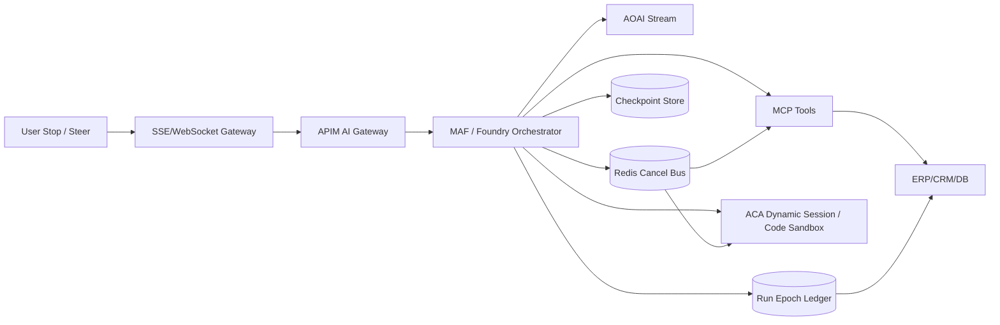
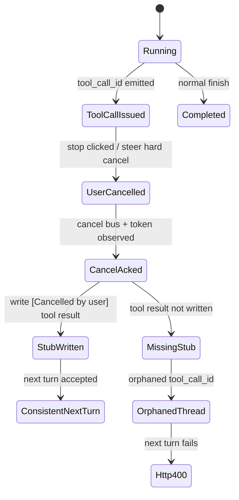

# 企业 Mid-Flight Agent 取消与实时改道选型 FAQ：协作取消树 + Turn-Boundary 队列 vs `run_epoch` 栅栏 vs Checkpoint Fork

> 🌐 **Language Switch**：**中文（当前）** | [English](./mid-flight-agent-cancellation-live-steering-cooperative-abort-mcp-cancel-vs-turn-boundary-queue-vs-epoch-fencing-selection-faq.en.md)
> **受众**：Cloud & AI Solution Architect、Agent 平台负责人、应用架构委员会、SRE/DevSecOps、企业流程与审计团队。
> **范围**：聚焦“用户在执行中点击 Stop 或发送中途改道指令”时，如何在多智能体、MCP 工具、代码沙箱和长事务工作流中安全停止、可控转向、杜绝僵尸副作用，并保持线程一致性与审计可追踪性。

## 1. 问题定义：为什么 Mid-Flight 取消是企业 Agent 的一等公民能力
在演示环境里，很多团队把取消操作等同于“前端断开 SSE”或“后端丢弃当前响应”。  
但在企业生产中，执行链路通常跨越网关、编排器、模型流、工具调用、数据库写入和外部系统回调，单点断流并不等于链路真正停止。  

最常见的灾难不是“停止失败”，而是“部分停止导致状态破碎”。  
例如模型流已经停了，但下游 MCP 写操作仍在排队执行，或工具调用已完成却没写回 tool 结果，下一轮会话直接触发 `HTTP 400 orphaned tool_call_id`。  

因此取消能力必须被建模为端到端协议，而不是 UI 动作。  
企业要同时解决三类问题：第一，快速止损 token 与算力；第二，保持会话线程一致；第三，防止取消后延迟到达的写操作污染业务系统。  

## 2. 四种模式总览：从“停止按钮”升级为“执行治理平面”
Pattern A 建立协作式取消树和带外 Cancel Bus，把用户中断信号传到每个执行节点，并落地统一的取消结果桩。  
Pattern B 提供 Turn-Boundary 改道队列，让“软改道”在原执行链路安全边界注入，而“硬取消”才触发重放，减少不必要重算。  

Pattern C 用单调递增 `run_epoch` 做写入栅栏，再配合 Durable 补偿 Saga，阻断取消后的迟到写入和跨系统不一致。  
Pattern D 利用 checkpoint 分叉，把中途改道变成“新分支执行 + 旧分支归档/排空”，既保留审计证据，也支持对比分析。  

四种模式是互补的执行控制层，不是互斥方案。  
生产平台通常以 A 为默认底座，在高交互场景加 B，在强一致业务场景叠加 C，在长流程探索场景叠加 D。  

## 3. 参考架构：Stop/Steer 信号在多平面的传播与治理


该架构强调“取消信号与业务写入必须同等治理”。  
如果只管模型流关闭而不治理工具副作用，平台会在业务系统侧留下隐性一致性债务，后续排障与审计成本远高于当次 token 节省。  

## 4. Pattern A：协作取消树 + 带外 Cancel Bus（端到端 `<250ms` 止损）
Pattern A 的关键目标是让取消信号跨越协议边界可靠到达。  
在现实网络中，L7 反向代理、边缘网关或中间缓存层可能吞掉 TCP 半关闭语义，因此不能依赖单一路径断连。  

推荐做法是双路径传播：控制路径经 APIM/编排器 CancellationToken 下发，数据路径经 Redis Pub/Sub 或 Stream 广播取消事件。  
这样即使某条链路出现抖动或网关行为差异，执行节点仍能在短窗口内感知取消并终止工作。  

线程一致性是 Pattern A 的第二核心。  
当工具调用被取消时，系统必须合成确定性的 `[Cancelled by user]` 工具结果桩并写回会话轨迹，避免下一轮请求引用到“已发起但无回执”的 tool_call_id。  

## 5. Pattern B：Turn-Boundary 实时改道与优先级中断队列
企业用户常见诉求不是“全停”，而是“中途改方向”。  
例如财务分析流程运行到第 4 步时，用户追加“改为 EUR、排除 APAC”，这类变更若直接硬取消并重跑会浪费大量已完成的只读步骤。  

Pattern B 把改道分为 Soft Steer 与 Hard Cancel 两类。  
Soft Steer 在原子步骤边界注入新约束，保留已完成只读结果与缓存前缀；Hard Cancel 只用于语义冲突或安全策略要求立即中止的场景。  

在多代理 DAG 中，Turn-Boundary 需要明确可中断点。  
推荐把可中断点定义为“无外部写副作用的步骤结束处”，并在队列里标注 steering 优先级、影响范围和过期时间，防止历史指令覆盖新决策。  

## 6. Pattern C：`run_epoch` 栅栏 + Durable 补偿（清理取消后僵尸副作用）
分布式系统中最危险的竞态是“取消先到、写入后到”。  
例如用户在 `t0` 取消，某子代理在 `t0+400ms` 才把已排队的写请求发到 ERP，若后端无栅栏校验就会产生僵尸写入。  

Pattern C 要求每次执行分支都有单调递增 `run_epoch`，写请求必须携带该 epoch。  
网关、数据库或服务层在处理写入时执行 compare-and-check：只有请求 epoch 等于当前活动 epoch 才允许提交，否则直接拒绝并记录为 stale write。  

当跨系统事务部分提交时，Durable 补偿 Saga 必须可重放且幂等。  
这意味着每个写步骤都要有补偿语义和唯一业务键，确保取消触发后可以在可控窗口内回收已落地副作用。  

## 7. Pattern D：Checkpoint Fork 分支化改道（长流程不中断迭代）
对于多小时甚至跨天工作流，频繁整链路重放不可接受。  
Pattern D 在 checkpoint `step_k` 上分叉新分支执行，把用户新意图映射到分支上下文，而旧分支进入排空、冻结或归档状态。  

这种模式特别适合探索式分析、复杂编制与多轮审阅。  
团队可以保留原分支用于审计和差异比对，同时让新分支按最新业务约束继续推进，避免“改一个条件就全量返工”。  

分支化治理必须定义保留与清理策略。  
建议基于风险等级和审计要求设置分支 TTL、归档级别与自动清理窗口，防止 checkpoint 存储无限增长。  

## 8. 线程腐化与僵尸执行状态机：为什么必须写回取消结果桩


该状态机展示了“取消后不补桩”的直接后果：线程腐化并在下一轮爆发。  
很多团队把 `HTTP 400` 归因于接口不稳定，实际上根因是会话日志不满足协议完整性。  

只要把取消视为一种合法终态，并写入标准化结果桩，线程就能保持可继续执行。  
这也是后续审计重放的关键，因为它明确记录了用户意图和系统行为的对应关系。  

## 9. 量化模型：僵尸 token 浪费、取消时延与改道收益
设单次运行平均 token 速率为 `r` token/s，取消传播总时延为 `L` 毫秒，则僵尸 token 浪费近似 `w = r * L / 1000`。  
若平台每月触发 `N` 次取消，则月度浪费为 `W = N * w`，可直接映射为模型成本。  

示例：`r=180 token/s`、`L=220ms`、`N=2,000,000`，则 `w=39.6`，`W≈79.2M token/月`。  
当取消链路从 `900ms` 优化到 `220ms`，在同等负载下可减少约 `122M token/月` 的僵尸消耗。  

Turn-Boundary 改道收益可用“重放避免率”衡量。  
若平均每次重跑需 `8,000 token`，Soft Steer 保留 `80%` 前缀并复用已完成只读步骤，则单次可节省约 `6,400 token`。  

| 指标 | 基线（无协作取消） | 目标（A+B+C） | 改善 |
|---|---:|---:|---:|
| 取消传播 P95 | `900ms` | `220ms` | `-75.6%` |
| 单次取消僵尸 token（`r=180`） | `162` | `39.6` | `-75.6%` |
| 月度僵尸 token（`N=2M`） | `324M` | `79.2M` | `-244.8M` |
| 改道重放占比 | `100%` | `10%–25%` | `-75%` 到 `-90%` |
| 线程 `HTTP 400` 腐化率 | `0.8%` | `<0.05%` | 显著下降 |

## 10. 12 维度对比矩阵：取消治理、改道体验与一致性风险
| 维度 | Pattern A 协作取消树 | Pattern B Turn-Boundary 队列 | Pattern C `run_epoch` 栅栏 | Pattern D Checkpoint Fork |
|---|---|---|---|---|
| 取消速度 | 极高 | 中 | 中 | 中 |
| 用户改道体验 | 中 | 高 | 中 | 高 |
| 僵尸副作用防护 | 中 | 低 | 极高 | 中高 |
| 会话线程一致性 | 高 | 高 | 高 | 高 |
| 写入一致性强度 | 中 | 低 | 极高 | 高 |
| 长流程恢复能力 | 中 | 中 | 高 | 极高 |
| 协议实现复杂度 | 中 | 中 | 高 | 高 |
| 运维可观测性 | 高 | 高 | 高 | 中高 |
| 审计可解释性 | 高 | 中高 | 高 | 极高 |
| 对现有系统侵入 | 低到中 | 中 | 中高 | 中高 |
| 成本节省潜力 | 高 | 高 | 中高 | 中 |
| 推荐优先级 | 先做 | 第二层 | 强事务场景必做 | 长流程场景叠加 |

矩阵结论是：A 是基础能力，B 决定交互体验，C 决定业务一致性底线，D 决定长流程可持续性。  
在企业落地中，若只做 A+B 而缺少 C，短期体验会改善但仍会留下高风险迟到写入隐患。  

## 11. 三年 TCO 与 token 节省：从“体验优化”转化为财务可见收益
下表以月请求 `50M`、中途取消率 `4%`、改道率 `6%` 的多租户平台为参考。  
成本项包含模型 token、无效工具执行、人工排障、补偿回滚、审计取证和平台开发运维投入。  

| 方案 | 三年模型与工具浪费成本（USD） | 三年故障排障/回滚成本（USD） | 三年平台治理投入（USD） | 三年总计（USD） |
|---|---:|---:|---:|---:|
| 基线（无 A/B/C/D） | 5,240,000 | 1,680,000 | 420,000 | 7,340,000 |
| A+B | 3,420,000 | 1,020,000 | 760,000 | 5,200,000 |
| A+B+C | 3,080,000 | 420,000 | 980,000 | 4,480,000 |
| A+B+C+D | 2,960,000 | 360,000 | 1,240,000 | 4,560,000 |

从三年总量看，A+B+C 往往是最佳平衡点。  
D 在探索式长流程占比高、审计比对要求严的组织里价值更大，尤其适合咨询、金融研究、复杂供应链协同等场景。  

## 12. 生产实现（Python）：MAF + Redis Cancel Bus + MCP `notifications/cancelled`
```python
import asyncio
import json
import time
from dataclasses import dataclass
from typing import Optional

import redis.asyncio as redis

@dataclass
class RunContext:
    tenant_id: str
    run_id: str
    run_epoch: int
    cancelled: bool = False
    cancel_reason: Optional[str] = None

class CancelBus:
    def __init__(self, redis_url: str):
        self._redis = redis.from_url(redis_url, decode_responses=True)

    async def publish_cancel(self, tenant_id: str, run_id: str, reason: str):
        payload = {
            "tenant_id": tenant_id,
            "run_id": run_id,
            "reason": reason,
            "ts_ms": int(time.time() * 1000),
        }
        await self._redis.publish(f"agent.cancel.{tenant_id}", json.dumps(payload))

    async def subscribe(self, tenant_id: str):
        pubsub = self._redis.pubsub()
        await pubsub.subscribe(f"agent.cancel.{tenant_id}")
        return pubsub

async def stream_agent(ctx: RunContext, cancel_bus: CancelBus, mcp_client, model_client, convo_store):
    pubsub = await cancel_bus.subscribe(ctx.tenant_id)
    cancel_listener = asyncio.create_task(_watch_cancel(ctx, pubsub))
    try:
        async for chunk in model_client.stream(run_id=ctx.run_id):
            if ctx.cancelled:
                await model_client.close_stream(run_id=ctx.run_id)
                await mcp_client.notify_cancelled(run_id=ctx.run_id, reason=ctx.cancel_reason or "user_cancelled")
                await convo_store.append_tool_result(
                    run_id=ctx.run_id,
                    tool_call_id=chunk.get("tool_call_id"),
                    result={
                        "status": "cancelled",
                        "message": "[Cancelled by user]",
                        "run_epoch": ctx.run_epoch,
                    },
                )
                return {"status": "cancelled"}
            await convo_store.append_delta(run_id=ctx.run_id, delta=chunk)
        return {"status": "completed"}
    finally:
        cancel_listener.cancel()
        await pubsub.close()

async def _watch_cancel(ctx: RunContext, pubsub):
    async for msg in pubsub.listen():
        if msg["type"] != "message":
            continue
        body = json.loads(msg["data"])
        if body.get("run_id") == ctx.run_id:
            ctx.cancelled = True
            ctx.cancel_reason = body.get("reason", "user_cancelled")
            return
```

该实现强调两点：第一，取消不仅关闭模型流，还会向 MCP 广播取消通知；第二，即使中途终止也会写入标准化工具结果桩。  
这样可保障后续会话轮次不会因缺失 tool 结果而断裂。  

## 13. 生产实现（C#）：`run_epoch` 栅栏校验与补偿触发
```csharp
public sealed record ToolWriteRequest(
    string TenantId,
    string RunId,
    long RunEpoch,
    string OperationId,
    string PayloadJson
);

public interface IEpochStore
{
    Task<long> GetActiveEpochAsync(string tenantId, string runId, CancellationToken ct);
}

public interface ICompensationScheduler
{
    Task ScheduleAsync(string tenantId, string runId, string operationId, string reason, CancellationToken ct);
}

public sealed class EpochFencingHandler
{
    private readonly IEpochStore _epochStore;
    private readonly ICompensationScheduler _compensator;

    public EpochFencingHandler(IEpochStore epochStore, ICompensationScheduler compensator)
    {
        _epochStore = epochStore;
        _compensator = compensator;
    }

    public async Task<IResult> HandleAsync(ToolWriteRequest req, CancellationToken ct)
    {
        var activeEpoch = await _epochStore.GetActiveEpochAsync(req.TenantId, req.RunId, ct);
        if (req.RunEpoch != activeEpoch)
        {
            await _compensator.ScheduleAsync(
                req.TenantId,
                req.RunId,
                req.OperationId,
                reason: $"stale_epoch:{req.RunEpoch}!=active:{activeEpoch}",
                ct);
            return Results.Conflict(new
            {
                status = "rejected",
                code = "stale_run_epoch",
                activeEpoch,
                requestEpoch = req.RunEpoch
            });
        }

        // 执行真实写入（需幂等键）
        await PersistWithIdempotencyAsync(req, ct);
        return Results.Ok(new { status = "applied", runEpoch = req.RunEpoch });
    }

    private static Task PersistWithIdempotencyAsync(ToolWriteRequest req, CancellationToken ct)
    {
        // 示例占位：实际实现应包含 operationId 幂等校验
        return Task.CompletedTask;
    }
}
```

该处理器把“取消后迟到写入”转化为可判定、可拒绝、可补偿事件。  
在审计视角，冲突拒绝日志与补偿调度记录共同构成完整证据链。  

## 14. 企业场景一：全球零售银行（强审计 + 强一致清算）
该场景要求用户停止操作后不得再产生任何账务副作用。  
推荐组合为 A+B+C，默认 Turn-Boundary 软改道，但涉及资金落账、风控状态变更等步骤必须启用硬取消并强制 epoch 校验。  

银行常见痛点是跨系统延迟写入与人工撤销成本高。  
通过 C 模式可以在写入入口阻断 stale 请求，并把不可逆动作前置到显式审批节点，显著降低账务冲正与审计解释成本。  

若业务流程涉及长周期调查链路，可按需叠加 D 做分支化审阅。  
这样既满足监管追溯，也避免在调查中频繁整链路重跑。  

## 15. 企业场景二 + 量化 Q&A + Day-0/Day-2 检查单
高增长 Coding Agent SaaS 往往有大量“边执行边改需求”的用户交互。  
推荐以 A+B 为默认能力，并在仓库写操作、工单创建、CI 触发等有副作用步骤引入 C；对长任务审阅和 A/B 策略对比引入 D。  

该组合可在保证交互流畅的同时控制风险。  
平台应把取消 P95、僵尸 token 比例、stale write 拒绝率和线程腐化率纳入核心 SLO，持续验证“体验提升是否以一致性债务为代价”。  

| 问题 | 建议答案（量化） |
|---|---|
| Q1：取消传播目标值应是多少？ | 建议 P95 `<250ms`，并按租户与区域分别观测，避免全局均值掩盖尾部风险。 |
| Q2：为什么必须写 `[Cancelled by user]` 工具桩？ | 因为可把下一轮 orphan `tool_call_id` 失败率从亚百分点级压到 `<0.05%`。 |
| Q3：Soft Steer 节省值怎么估？ | 以 `prefix_reuse_rate * average_replay_tokens` 估算，常见可达 `75%–90%` 前缀复用。 |
| Q4：`run_epoch` 是否会增加延迟？ | 会有毫秒级比较开销，但通常远小于僵尸写入引发的补偿与人工回滚成本。 |
| Q5：何时必须启用 D？ | 当流程跨小时/跨天且中途改道频繁，或需要分支审计比对时。 |
| Q6：如何衡量取消治理成熟度？ | 看四项：取消 P95、僵尸 token 比率、stale write 拒绝率、线程腐化率。 |

**Day-0（上线前）**
- 定义取消协议：UI 信号、网关透传、编排层 token、工具层通知、结果桩格式全部标准化。  
- 建立 Cancel Bus 高可用基线，验证网关吞半关闭场景下仍可在目标时延内收敛。  
- 对所有写操作引入 `run_epoch` 校验与幂等键，拒绝无 epoch 或 stale epoch 请求。  
- 在关键流程配置 Soft Steer 与 Hard Cancel 策略边界，明确何时可保留已完成步骤。  
- 完成线程完整性回放测试，确保取消后下一轮不会出现 orphaned `tool_call_id`。  

**Day-2（运行中）**
- 每周复盘取消链路尾延迟与僵尸 token 波峰，定位是否由某区域网关或工具节点造成。  
- 监控 stale write 拒绝与补偿成功率，若补偿失败需自动升级人工处置。  
- 追踪改道命中率与重放占比，持续优化 Turn-Boundary 粒度与优先级策略。  
- 对 checkpoint 分支数量、存储占用和归档时延设置阈值，防止分支膨胀。  
- 每月输出“取消治理成本-收益报告”，把 token 节省、事故减少与平台投入统一核算。  
