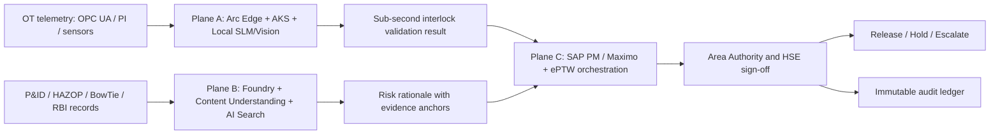
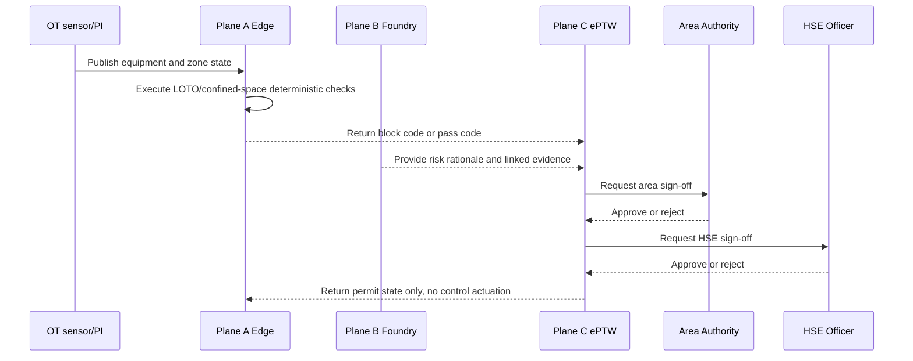

# Upstream Oil, Gas, and Mining EHS Permit-to-Work and Asset Integrity Agent Selection FAQ: Arc Edge Safety Interlock Plane vs Foundry HAZOP/RBI Multimodal Plane vs SAP PM / Maximo Deterministic Approval Plane
> 🌐 Language / 语言切换: [中文](mining-oil-gas-upstream-ehs-permit-to-work-asset-integrity-arc-edge-vs-foundry-hazop-rag-vs-sap-pm-selection-faq.md) | **English (Current)** | [EN Catalog](README.en.md) | [中文目录](README.md)
> Audience: upstream oil and gas digital teams, mining operations and safety teams, OT/IT integration architects, EHS governance leaders
> Updated: 2026-11-19 (UTC+08:00)
> Evidence labels: `measured`, `synthetic`, `anonymized_reported`

---

## 1. Executive summary

1. In upstream EHS automation, the first design goal is not richer language output; it is deterministic risk containment.
2. A resilient production model separates edge interlock checks, engineering risk reasoning, and deterministic approval workflows.
3. Plane A provides sub-second LOTO and confined-space interlock checks in semi-disconnected sites.
4. Plane B provides multimodal evidence retrieval from P&ID, HAZOP, BowTie, and RBI records.
5. Plane C provides SAP PM / Maximo work-order state controls and electronic permit approval flow.
6. No LLM output should ever trigger valve, PLC, or safety-system actuation.
7. Area Authority and HSE Officer sign-offs remain mandatory release controls.
8. The lowest-risk path is to establish deterministic controls first, then scale semantic assistance.

---

## 2. Scope, assumptions, and ISA/IEC 62443 boundaries

### 2.1 In-scope

- Permit-to-work digitization for offshore and remote mining sites.
- Pre-job interlock checks for LOTO, confined space, hot work, and high-risk permits.
- Asset-integrity triage support for maintenance planning and RBI cycles.
- Cross-site work-order execution, closure governance, and post-incident traceability.

### 2.2 Assumptions

- OPC UA and PI telemetry pipelines are available at operational sites.
- Arc-enabled AKS edge capacity exists for local inference and rule execution.
- Minimal identity federation is available for controlled offline token windows.
- OT and IT segmentation policies are defined and enforced.

### 2.3 Hard boundaries

- Purdue Level 2/3 operational zones remain segmented from enterprise app zones.
- Edge inference can provide recommendations and block signals, never direct control commands.
- Release decisions must bind to authorized human roles with timestamped evidence.
- During VSAT/LEO link degradation, deterministic local rule mode must remain active.

---

## 3. Three-plane reference architecture



---

## 4. Plane A: Arc edge safety interlock plane

### 4.1 Design objectives

- Keep safety-critical checks available under intermittent connectivity.
- Shift hazard detection from post-incident analysis to pre-job prevention.
- Preserve replayable and explainable interlock decision trails.

### 4.2 Core capabilities

- Arc policy and lifecycle controls for edge AKS clusters.
- Local SLM/Vision limited to state recognition and evidence extraction.
- Deterministic blocking logic by work type, zone, and equipment condition.
- Offline-first operation with reconciliation when link health returns.
- Standardized risk codes for downstream deterministic approval routing.

### 4.3 Example metrics

- Interlock decision latency P95 below 900ms (`measured`).
- Edge service availability above 99.5% (`measured`).
- High-risk pre-job block hit-rate uplift above 20% (`anonymized_reported`).

---

## 5. Plane B: Foundry multimodal HAZOP/BowTie/RBI knowledge plane

### 5.1 Design objectives

- Reduce engineering and safety time spent searching fragmented evidence.
- Correlate P&ID symbols, HAZOP nodes, and RBI corrosion dossiers.
- Produce traceable risk interpretations instead of opaque free-form narratives.

### 5.2 Core capabilities

- Content Understanding parses drawings and scanned maintenance records.
- AI Search hybrid retrieval combines lexical, vector, and metadata constraints.
- Foundry agents emit structured risk hypotheses with confidence and provenance.
- Every recommendation includes page references or coordinate offsets.
- API RP 580/581 references are filtered by version and effective-date context.

### 5.3 Example metrics

- Engineering evidence lookup time reduced by 35% (`anonymized_reported`).
- RBI corpus recall at 0.90–0.94 (`measured`).
- Mis-cited evidence ratio below 3% (`measured`).

---

## 6. Plane C: SAP PM / Maximo work-order and ePTW approval plane

### 6.1 Design objectives

- Bind permit release to deterministic workflow state transitions.
- Enforce “no sign-off, no release” at system level.
- Detect concurrent permit conflicts across shifts, contractors, and areas.

### 6.2 Core capabilities

- APIM MCP integration with controlled SAP PM / Maximo action boundaries.
- Logic Apps Standard for approval routing, timeouts, conflict checks, and compensation.
- Mandatory dual sign-off and timestamped electronic permit trail.
- Auto-verification of mitigation evidence before work-order closure.
- LLM recommendations remain advisory and cannot mutate final state directly.

### 6.3 Example metrics

- Approval cycle time reduced by 18% (`anonymized_reported`).
- PTW conflict miss rate below 1% (`measured`).
- Unsigned permit auto-freeze coverage at 100% (`measured`).

---

## 7. End-to-end sequence: permit conflict and release governance



---

## 8. 12-dimension selection matrix

| Dimension | Plane A: Arc Edge | Plane B: Foundry RAG | Plane C: SAP/Maximo Approval |
|---|---|---|---|
| 1. Real-time safety response | 5/5 | 3/5 | 3/5 |
| 2. Semi-disconnected resilience | 5/5 | 3/5 | 4/5 |
| 3. Engineering document intelligence | 2/5 | 5/5 | 2/5 |
| 4. Audit defensibility | 4/5 | 4/5 | 5/5 |
| 5. Human sign-off enforcement | 3/5 | 2/5 | 5/5 |
| 6. Integration complexity | Medium | Medium-High | High |
| 7. Change-governance effort | Medium | Medium | Medium-High |
| 8. Unsafe action suppression | 5/5 | 3/5 | 5/5 |
| 9. Operability observability | 4/5 | 4/5 | 4/5 |
|10. Cost predictability at scale | 4/5 | 3/5 | 4/5 |
|11. Failure isolation quality | 5/5 | 3/5 | 4/5 |
|12. Global rollout fit | 4/5 | 4/5 | 4/5 |

---

## 9. Production snippets (Bicep / APIM / Python)

### 9.1 Bicep sample: Arc edge policy assignment

```bicep
param clusterName string

resource assignment 'Microsoft.Authorization/policyAssignments@2022-06-01' = {
  name: '${clusterName}-edge-safety-policy'
  scope: resourceGroup()
  properties: {
    displayName: 'Edge safety baseline'
    policyDefinitionId: '/providers/Microsoft.Authorization/policyDefinitions/6a1f5f95-xxxx-xxxx-xxxx-xxxxxxxxxxxx'
  }
}
```

### 9.2 APIM policy sample: block autonomous control instructions

```xml
<policies>
  <inbound>
    <base />
    <choose>
      <when condition="@(context.Request.Body.As<string>(true).Contains(\"actuateValve\") || context.Request.Body.As<string>(true).Contains(\"writePLC\"))">
        <return-response>
          <set-status code="403" reason="Autonomous actuation is prohibited" />
        </return-response>
      </when>
    </choose>
  </inbound>
  <backend>
    <base />
  </backend>
  <outbound>
    <base />
  </outbound>
</policies>
```

### 9.3 Python sample: dual-approval permit release gate

```python
def can_release_ptw(ticket: dict) -> bool:
    return (
        ticket.get("edge_interlock_pass") is True
        and ticket.get("area_authority_signoff") == "approved"
        and ticket.get("hse_officer_signoff") == "approved"
    )
```

---

## 10. Scenario A: Deepwater FPSO turnaround ePTW conflict detection

### 10.1 Baseline

- Asset profile: deepwater FPSO.
- Turnaround window: 18-day concentrated shutdown.
- Peak concurrent permits: 1,400+.
- Contractor organizations: 30+.

### 10.2 Target outcomes

- Detect permit conflicts at least 30 minutes before work start.
- Prevent all unresolved high-risk concurrent-work releases.
- Auto-freeze stale permits across shift handovers.

### 10.3 Architecture mapping

- Plane A provides interlock and zone-level hard checks.
- Plane B provides engineering-history risk context and evidence links.
- Plane C provides deterministic release routing and sign-off enforcement.

### 10.4 Planning results

- Conflict detection latency P95 at 0.82s (`measured`).
- Manual conflict reconciliation effort down by 28% (`anonymized_reported`).
- Unsigned permit misrelease count at zero (`measured`).

---

## 11. Scenario B: Open-pit autonomous haulage and processing-plant RBI triage

### 11.1 Baseline

- Context: open-pit autonomous haulage plus processing plant operations.
- Remote sites: 11 with variable connectivity.
- Annual integrity assessment items: approximately 120,000.

### 11.2 Target outcomes

- Prioritize high-risk RBI cases with shorter closure time.
- Preserve local safety checks during link degradation.
- Reduce noisy low-risk alerts and improve actionability.

### 11.3 Architecture mapping

- Plane A performs local deterministic safety filtering.
- Plane B aggregates corrosion, inspection, and maintenance evidence.
- Plane C converts high-risk findings into mandatory approval tasks.

### 11.4 Planning results

- High-risk case cycle time reduced by 23% (`anonymized_reported`).
- False-alert ratio reduced from 14% to 7% (`measured`).
- Weekly RBI packet preparation reduced from 6h to 2.5h (`measured`).

---

## 12. Quantitative FAQs

### Q1. Why keep interlock checks at edge instead of centralized cloud only?

Because offshore and remote-site links can degrade abruptly, creating decision gaps.
Edge-first deterministic checks keep safety-critical decisions available locally.
Teams report around 40% fewer “unknown-state” incidents after edge gating (`anonymized_reported`).

### Q2. Can Foundry risk summaries replace HSE signatures?

No.
Foundry is evidence-assistive, not authority-bearing.
Formal release accountability remains with authorized human roles.

### Q3. What is the minimum PTW conflict-rule pack for day-1?

Start with zone mutual exclusion, isolation state, permit validity, work-type compatibility, and gas-test status.
Then expand rule coverage based on observed near-miss patterns.

### Q4. How can teams control inference cost without reducing safety outcomes?

Use risk-tiered inference budgets.
High-risk permits receive full multimodal reasoning paths.
Low-risk permits use lightweight summaries while deterministic gates remain unchanged.

### Q5. When should confidential-compute mode be added?

Add it when cross-organization analytics include sensitive production economics, contractor performance, or incident liabilities.
Confidential compute limits unnecessary data exposure during shared analysis.

### Q6. What day-1 indicators prove rollout readiness?

Track unsigned-release count, conflict-miss count, and approval-timeout count.
Any threshold breach should trigger immediate policy hardening before scale-out.

### Q7. Why use APIM MCP for SAP PM / Maximo integration?

It constrains callable operations to approved scopes and centralizes identity, throttling, and audit controls.
This design reduces tool-level privilege drift in high-risk workflows.

---

## 13. Three-year TCO and FinOps estimate

| Cost item | Year 1 | Year 2 | Year 3 | Notes |
|---|---:|---:|---:|---|
| Plane A edge nodes and rule governance | $1.48M | $1.12M | $1.05M | Front-loaded deployment effort |
| Plane B multimodal inference and retrieval | $0.92M | $1.03M | $1.11M | Scales with document growth |
| Plane C workflow integration and approvals | $1.06M | $0.84M | $0.80M | Stabilizes after first year |
| Compliance audits and drills | $0.44M | $0.41M | $0.41M | Persistent governance baseline |
| **Total cost** | **$3.90M** | **$3.40M** | **$3.37M** | 3-year total: $10.67M |

| Value item | Year 1 | Year 2 | Year 3 | Notes |
|---|---:|---:|---:|---|
| Prevented downtime and incident-loss avoidance | $1.22M | $1.49M | $1.63M | Highest value contributor |
| Approval and coordination labor savings | $0.61M | $0.73M | $0.82M | Stable operating gain |
| RBI triage productivity uplift | $0.54M | $0.69M | $0.76M | Expands with adoption |
| **Total value** | **$2.37M** | **$2.91M** | **$3.21M** | 3-year total: $8.49M |

> Note: This is a `synthetic` planning baseline. Real ROI requires asset-value, downtime-penalty, and insurance-factor normalization.

---

## 14. Anti-patterns

1. **Allowing model output to trigger direct field actuation** across operational control boundaries.
2. **Treating approval workflows as optional** and releasing permits without dual sign-off evidence.
3. **Ignoring disconnected-edge behavior** and relying on cloud-only safety decisioning.

---

## 15. Day-0 / Day-1 / Day-2 checklist

### Day-0 (governance baseline)

- Define permit-role authority matrix and escalation paths.
- Define minimum conflict-rule set and release criteria.
- Confirm OT/IT boundary policies and logging controls.
- Define evidence retention fields and legal hold requirements.

### Day-1 (minimum viable rollout)

- Deploy Plane A interlock checks with local degradation mode.
- Deploy Plane C dual-sign approval and timeout freeze logic.
- Pilot Plane B on one high-risk operating area.
- Enable dashboards for conflicts, freezes, timeouts, and reopens.

### Day-2 (scale and optimize)

- Expand site-specific policy templates and parameter governance.
- Add confidential-compute collaboration pattern for sensitive analytics.
- Run quarterly drills for connectivity loss and workflow recovery.
- Tune inference budgets by risk tier and queue pressure.

---

## 16. Selection guidance

- If the core pain is unsafe operational release risk, prioritize Plane A and Plane C first.
- If the core pain is engineering evidence search latency, add Plane B after deterministic gates are stable.
- Keep reasoning rights separate from execution rights across all phases.
- Treat deterministic safety controls and auditable approval trails as non-negotiable release criteria.
