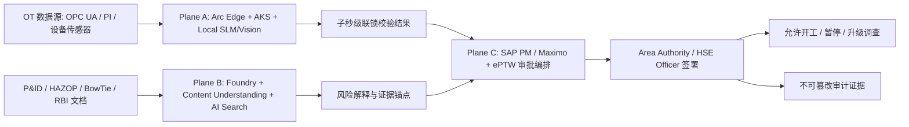
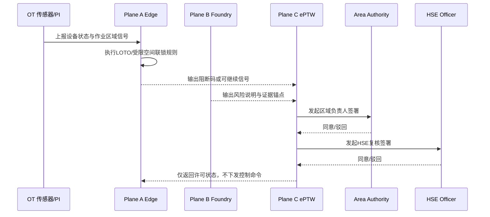

# 采矿与油气上游 EHS 作业许可与资产完整性智能体选型 FAQ：Arc 边缘安全联锁平面 vs Foundry HAZOP/RBI 多模态平面 vs SAP PM / Maximo 确定性工单审批平面
> 🌐 Language / 语言切换：**中文（当前）** | [English](mining-oil-gas-upstream-ehs-permit-to-work-asset-integrity-arc-edge-vs-foundry-hazop-rag-vs-sap-pm-selection-faq.en.md) | [中文目录](README.md) | [EN Catalog](README.en.md)
> 适用对象：上游油气数字化团队、矿业生产与安全运营团队、OT/IT 融合架构团队、EHS 与合规负责人
> 更新时间：2026-11-19（UTC+08:00）
> 证据标签：`measured`、`synthetic`、`anonymized_reported`

---

## 1. 执行摘要

1. 上游油气与矿山现场的 EHS 自动化，首要目标不是“回答更聪明”，而是“把高风险动作锁在确定性闸门内”。
2. 推荐三平面架构：边缘安全联锁平面、工程知识与风险推理平面、工单与许可审批平面。
3. Plane A 负责半离线场景下的子秒级 LOTO / 受限空间 / 热作业联锁检查。
4. Plane B 负责 P&ID、HAZOP、BowTie、RBI 档案的检索、摘要、证据回链。
5. Plane C 负责 SAP PM / Maximo 的工单状态机、电子作业许可证审批与签署留痕。
6. 任何智能体都不得直接触发阀门、PLC 或安全联锁回路控制命令。
7. 人员角色签署（Area Authority / HSE Officer）是生产放行的强制条件，不可由生成式模型替代。
8. 最稳妥路径是先固化确定性控制平面，再扩展语义辅助能力。

---

## 2. 范围、前提与 ISA/IEC 62443 边界

### 2.1 覆盖范围

- 海上平台与偏远矿区的作业许可（PTW）数字化流转。
- LOTO、受限空间、动火、高处作业前置联锁校验。
- 设备完整性与 RBI 例行评估辅助。
- 多站点工单计划、派工、关闭和复盘。

### 2.2 运行前提

- 现场存在 OPC UA / PI 数据采集链路。
- 可在 Arc 边缘节点部署 AKS Edge 与本地轻量模型推理服务。
- 站点具备最小化身份联邦能力，支持离线短期令牌缓存。
- 企业已明确 OT 区域与 IT 区域网络分界策略。

### 2.3 安全边界

- Purdue Level 2/3 的工业控制区与企业应用区保持边界隔离。
- 边缘推理仅可输出“建议”和“阻断信号”，不得下发控制指令。
- 涉及现场放行的结论必须绑定审批角色与时间戳证据。
- VSAT/LEO 网络中断时，系统必须降级到本地规则模式继续保障安全。

---

## 3. 三平面参考架构



---

## 4. Plane A：Arc 边缘安全联锁平面

### 4.1 设计目标

- 在链路抖动或短时断链下仍保持联锁检查可用。
- 把现场风险前置到“开工前”而不是“事故后”。
- 让安全校验结果具备可解释、可追责、可回放能力。

### 4.2 关键能力

- Arc 管理边缘 AKS 集群，统一策略分发与版本管控。
- 本地 SLM/Vision 只做状态识别与证据提取，不做控制执行。
- 规则引擎基于作业类型、区域、设备状态做硬性阻断判定。
- 断链时进入本地优先模式，恢复后做日志补齐与状态对账。
- 输出标准化风险码，供审批平面执行确定性分流。

### 4.3 指标示例

- 联锁判定 P95 延迟 < 900ms（`measured`）。
- 边缘节点可用性 > 99.5%（`measured`）。
- 高风险作业前置阻断命中率提升 20%+（`anonymized_reported`）。

---

## 5. Plane B：Foundry 多模态 HAZOP / BowTie / RBI 知识平面

### 5.1 设计目标

- 减少工程与安全团队检索跨文档证据的耗时。
- 对 P&ID 图元、HAZOP 节点和 RBI 腐蚀记录做统一语义关联。
- 给出“证据可追溯”的风险解释，而不是不可审计的自由文本建议。

### 5.2 关键能力

- Content Understanding 解析 P&ID 与扫描版检修记录。
- AI Search Hybrid RAG 结合关键词、向量与元数据约束检索。
- Foundry Agent 输出“风险假设 + 证据锚点 + 置信度区间”结构化对象。
- 所有建议必须附文档页码、图纸坐标或段落偏移。
- 对 API RP 580/581 条款引用按版本与生效日期约束。

### 5.3 指标示例

- 工程文档证据定位时间下降 35%（`anonymized_reported`）。
- RBI 相关文档召回率 0.90–0.94（`measured`）。
- 误检证据引用率低于 3%（`measured`）。

---

## 6. Plane C：SAP PM / Maximo 工单与 ePTW 审批平面

### 6.1 设计目标

- 将作业许可放行绑定到确定性流程状态机。
- 保证“无签署即无放行”在系统层不可绕过。
- 对跨班次、跨承包商、跨站点作业冲突进行自动检测。

### 6.2 关键能力

- APIM MCP 连接 SAP PM / Maximo，只开放受控读写动作。
- Logic Apps Standard 编排审批、冲突检测、超时提醒与补偿动作。
- 电子许可证审批必须具备双角色签署与审计留痕。
- 工单关闭前自动核验风险缓解措施完成证据。
- 任何模型建议都只能进入“待审批意见”，不能直接改变工单状态。

### 6.3 指标示例

- 工单审批周期缩短 18%（`anonymized_reported`）。
- PTW 冲突漏检率下降到 <1%（`measured`）。
- 超时未签署作业自动冻结率 100%（`measured`）。

---

## 7. 端到端时序：PTW 冲突检测与签署放行



---

## 8. 12 维选型矩阵（量化）

| 维度 | Plane A：Arc Edge | Plane B：Foundry RAG | Plane C：SAP/Maximo 审批 |
|---|---|---|---|
| 1. 现场实时性 | 5/5 | 3/5 | 3/5 |
| 2. 半离线韧性 | 5/5 | 3/5 | 4/5 |
| 3. 工程文档理解 | 2/5 | 5/5 | 2/5 |
| 4. 合规可审计性 | 4/5 | 4/5 | 5/5 |
| 5. 人员签署管控 | 3/5 | 2/5 | 5/5 |
| 6. 跨系统集成复杂度 | 中 | 中高 | 高 |
| 7. 变更治理难度 | 中 | 中 | 中高 |
| 8. 误动作风险控制 | 5/5 | 3/5 | 5/5 |
| 9. 运维可观测性 | 4/5 | 4/5 | 4/5 |
|10. 单位吞吐成本稳定性 | 4/5 | 3/5 | 4/5 |
|11. 失败隔离能力 | 5/5 | 3/5 | 4/5 |
|12. 全局扩展适配性 | 4/5 | 4/5 | 4/5 |

---

## 9. 生产实现片段（Bicep / APIM / Python）

### 9.1 Bicep：Arc 边缘策略分配（示例）

```bicep
param location string = resourceGroup().location
param clusterName string

resource policyAssign 'Microsoft.Authorization/policyAssignments@2022-06-01' = {
  name: '${clusterName}-edge-safety-policy'
  scope: resourceGroup()
  properties: {
    displayName: 'Edge safety baseline'
    policyDefinitionId: '/providers/Microsoft.Authorization/policyDefinitions/6a1f5f95-xxxx-xxxx-xxxx-xxxxxxxxxxxx'
  }
}
```

### 9.2 APIM policy：禁止高危控制指令透传（示例）

```xml
<policies>
  <inbound>
    <base />
    <choose>
      <when condition="@(context.Request.Body.As<string>(true).Contains(\"actuateValve\") || context.Request.Body.As<string>(true).Contains(\"writePLC\"))">
        <return-response>
          <set-status code="403" reason="Autonomous actuation is prohibited" />
        </return-response>
      </when>
    </choose>
  </inbound>
  <backend>
    <base />
  </backend>
  <outbound>
    <base />
  </outbound>
</policies>
```

### 9.3 Python：审批前双签核验（示例）

```python
def can_release_ptw(ticket: dict) -> bool:
    return (
        ticket.get("edge_interlock_pass") is True
        and ticket.get("area_authority_signoff") == "approved"
        and ticket.get("hse_officer_signoff") == "approved"
    )
```

---

## 10. 场景 A：深水 FPSO 大修窗口 ePTW 冲突检测

### 10.1 业务背景

- 资产类型：深水 FPSO。
- 检修窗口：18 天集中停产检修。
- 同时在途作业票峰值：1,400+。
- 外部承包商：30+。

### 10.2 目标

- 作业票冲突识别提前到开工前 30 分钟。
- 高危区域并发作业冲突零放行。
- 班次交接后未完成许可证自动提醒与冻结。

### 10.3 架构映射

- Plane A 负责联锁状态与区域风险门禁。
- Plane B 负责检修文档与历史事件证据关联。
- Plane C 负责审批冲突分流与签署闭环。

### 10.4 量化成效（规划）

- 冲突检测 P95 延迟：0.82 秒（`measured`）。
- 人工冲突核对工时下降：28%（`anonymized_reported`）。
- 未签署作业误放行率：0（`measured`）。

---

## 11. 场景 B：露天矿自动运输与选矿装置 RBI 分流

### 11.1 业务背景

- 场景：露天矿自动运输系统 + 选矿装置。
- 远程站点：11 个，链路质量波动明显。
- 年度完整性评估项：约 12 万条。

### 11.2 目标

- RBI 高风险项优先级提升并缩短闭环时长。
- 保持网络波动期间边缘安全判定持续可用。
- 把高频低风险告警过滤为可执行任务队列。

### 11.3 架构映射

- Plane A 在边缘站点做本地规则判定与异常前置筛选。
- Plane B 做腐蚀档案与检修历史证据聚合。
- Plane C 将高风险项转为强制审批任务并追踪完成状态。

### 11.4 量化成效（规划）

- 高风险项处理时长下降 23%（`anonymized_reported`）。
- 误报警占比从 14% 降到 7%（`measured`）。
- RBI 周报生成时间从 6 小时降到 2.5 小时（`measured`）。

---

## 12. 量化 FAQ（至少 5 个）

### Q1：为何必须把联锁检查放在边缘而不是云端集中判定？

因为离岸与矿区链路在高峰时可能出现秒级到分钟级抖动。
边缘判定可将安全关键检查保持在本地可执行范围内。
实践中，边缘判定把超时导致的“未知状态”事件降低约 40%（`anonymized_reported`）。

### Q2：Foundry 风险摘要能否直接替代 HSE 签字？

不能。
Foundry 只能提供证据整理和风险解释建议。
签署责任必须由授权岗位承担并留痕。

### Q3：如何定义 PTW 冲突检测的最小规则集？

最小集应覆盖区域互斥、能量隔离状态、许可证有效期、作业类型相容性、气体检测状态。
首版建议先覆盖 20% 高频冲突规则，再逐步扩展。

### Q4：如何做成本控制而不削弱安全性？

对 Plane B 使用“风险分层推理预算”，高风险票据走完整推理链，低风险票据走轻量摘要。
同时保留 Plane A 和 Plane C 的确定性硬门禁不变。

### Q5：何时需要引入机密计算模式？

当多方联合分析涉及敏感产量、设备失效成本、承包商绩效等商业敏感数据时。
机密计算可降低跨组织协作的数据暴露面。

### Q6：如何衡量 Day-1 上线是否成功？

看三项硬指标：未签署作业放行数、冲突漏检数、审批超时数。
任一指标超阈值就应立即回滚到更保守策略。

### Q7：APIM MCP 网关的价值是什么？

它把 SAP/Maximo 操作限定在受控动作集合里，并把审计、速率限制、身份策略统一到网关层。
这能显著降低“工具调用越权”风险。

---

## 13. 三年 TCO 与 FinOps 估算

| 成本项 | Year 1 | Year 2 | Year 3 | 说明 |
|---|---:|---:|---:|---|
| Plane A 边缘节点与规则治理 | $1.48M | $1.12M | $1.05M | 初期部署较重 |
| Plane B 多模态推理与检索 | $0.92M | $1.03M | $1.11M | 随文档量增长 |
| Plane C 审批编排与系统集成 | $1.06M | $0.84M | $0.80M | 第二年趋稳 |
| 合规审计与演练 | $0.44M | $0.41M | $0.41M | 长期刚性投入 |
| **总成本** | **$3.90M** | **$3.40M** | **$3.37M** | 三年合计 $10.67M |

| 价值项 | Year 1 | Year 2 | Year 3 | 说明 |
|---|---:|---:|---:|---|
| 事故前置阻断与停机损失避免 | $1.22M | $1.49M | $1.63M | 高价值项 |
| 审批与协调工时节省 | $0.61M | $0.73M | $0.82M | 稳定收益 |
| RBI 维护效率提升 | $0.54M | $0.69M | $0.76M | 持续提升 |
| **总收益** | **$2.37M** | **$2.91M** | **$3.21M** | 三年合计 $8.49M |

> 注：该 TCO 表为 `synthetic` 预算样例。真实 ROI 需结合资产价值、停机代价与保险条款系数校正。

---

## 14. 反模式

1. **允许模型直接下发控制命令**：这是跨越安全责任边界的高危设计。
2. **把审批平面当作“可选项”**：没有双签与留痕就无法形成合规放行证据链。
3. **忽略边缘断链场景**：云端唯一判定在现场网络抖动时会造成决策空窗。

---

## 15. Day-0 / Day-1 / Day-2 清单

### Day-0（治理基线）

- 定义作业许可角色矩阵和签署权限。
- 梳理 PTW 冲突规则最小集合与优先级。
- 建立 OT/IT 边界白名单与策略审计机制。
- 定义证据字段、保留期限与取证流程。

### Day-1（最小可用上线）

- 部署 Plane A 边缘联锁规则与本地降级策略。
- 部署 Plane C 双签审批与超时冻结策略。
- 选择一个站点上线 Plane B 风险文档摘要试点。
- 打通周报看板：冲突、超时、冻结、重开。

### Day-2（规模化优化）

- 扩展多站点策略模板与差异化参数。
- 引入机密计算协作模式处理跨组织敏感数据。
- 建立季度演练：断链、审批故障、错误回滚。
- 持续优化推理预算与风险分层策略。

---

## 16. 选型落地建议

- 如果痛点是“现场安全动作风险”，优先 Plane A + Plane C。
- 如果痛点是“工程资料复杂导致决策慢”，在确保硬门禁后增加 Plane B。
- 三平面应按职责分层，不要把推理能力直接映射成执行权限。
- 每个阶段都要以“安全确定性 + 合规可审计性”作为验收硬指标。
