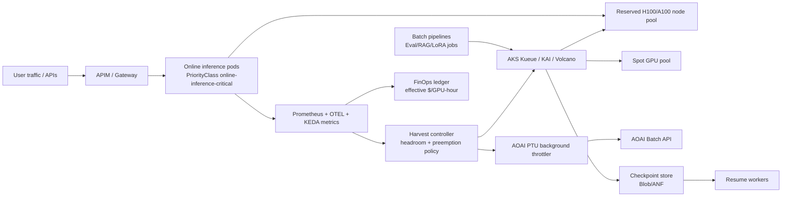
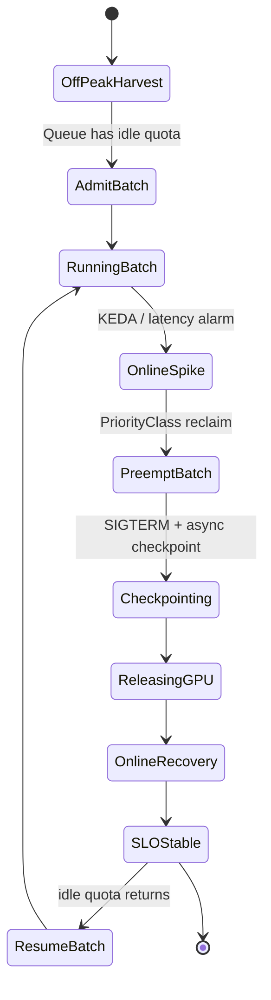

# Enterprise Mixed Online/Batch GPU Harvesting Selection FAQ: AKS `Kueue` + preemption vs KAI/Volcano fair-share vs split Spot pool vs PTU + Batch

> 🌐 **Language Switch**: [中文](./mixed-online-batch-gpu-harvesting-aks-kueue-preemption-vs-kai-scheduler-mig-vs-spot-pool-vs-ptu-batch-selection-faq.md) | **English (current)**
> **Audience**: Cloud & AI Solution Architects, platform engineering owners, GPU SRE/FinOps teams, model-serving teams, and enterprise data/agent platform operators.
> **Scope**: Production architecture choices for reclaiming off-peak GPU idle valleys from daytime online inference clusters for nighttime RAG re-embedding, agent evaluation sweeps, and LoRA post-training without breaking online TTFT and P95 latency SLOs.

## 1. Problem framing: why most enterprise GPU fleets stay expensive and underutilized even when they are “always busy”
In many enterprises, online model-serving clusters are reserved for daytime critical paths while batch evaluation and embedding pipelines are placed on separate nightly fleets, which appears operationally safe but usually creates hard resource silos that keep overall utilization low.  
The measurable consequence is that expensive H100/A100 reservations often remain in the `25%–45%` utilization range across the full day even when both online and offline demand are individually high at different times, because the platform cannot move capacity across time windows fast enough.  
This creates a structural FinOps issue where teams debate model optimization and token shaving while the larger waste comes from unused reserved GPU-hours that were already prepaid and cannot be recovered unless the platform supports deterministic preemption and safe backfill.  

The central architecture question is therefore not “how to run batch cheaper,” but “how to reclaim `60%–75%` off-peak idle capacity from reserved online clusters without violating daytime SLOs or introducing cross-workload interference.”  
A production answer requires queue governance, priority fencing, isolation boundaries, and checkpoint-aware interruption handling so that online workloads can reclaim capacity within strict bounds while batch jobs resume with minimal lost progress.  
Without this control-plane discipline, harvesting attempts quickly fail due to SLO regressions, noisy-neighbor effects, and operator distrust, causing organizations to retreat to permanently separated pools despite poor economics.  

## 2. Four architecture patterns (A/B/C/D): control philosophy and operating envelope
**Architecture A** uses AKS + `Kueue` cohort quota lending with strict priority preemption and whole-GPU or hardware `MIG` partitioning, so nightly opportunistic jobs can borrow idle capacity and be evicted quickly when daytime online demand rises.  
**Architecture B** uses `NVIDIA KAI Scheduler` or `Volcano` for hierarchical fair-share and topology-aware gang placement, with checkpoint-on-preempt pipelines that cap lost work to a bounded recovery window.  
**Architecture C** physically separates pools into reserved online GPUs plus elastic Spot batch GPUs, maximizing latency isolation at the cost of lower harvesting efficiency and higher cold-start volatility for nightly runs.  
**Architecture D** keeps online baseline on Azure OpenAI PTU and routes non-urgent heavy jobs to Batch API, with an off-peak throttler that safely consumes PTU slack while preserving daytime headroom guarantees.  

These patterns are not mutually exclusive; mature platforms commonly run A or B inside self-hosted AKS lanes, C for regulated isolation domains, and D for managed-model workloads where API-level throughput controls are more practical than node-level scheduling controls.  
The architecture decision should be made from reclaim latency tolerance, compliance isolation requirements, checkpoint cost, and operational complexity tolerance, not from one-dimensional cost-per-hour comparisons alone.  

## 3. End-to-end reference architecture: online lane, harvest lane, control loops, and policy evidence


This architecture separates serving traffic, batch admission, and policy control loops so that each decision path has explicit ownership and measurable failure domains rather than one opaque autoscaling mechanism trying to solve every trade-off.  
The online lane owns user SLOs and must remain reclaim-first, while the harvest lane owns opportunistic throughput and must remain interruption-tolerant by design; mixing these objectives without guardrails is the fastest way to lose both performance and cost predictability.  
The control loop should write every reclaim and preemption decision into auditable telemetry so that platform teams can prove that cost gains were achieved without hidden degradation and can explain incidents through replayable policy evidence.  

## 4. Architecture A deep dive: AKS + Kueue cohort lending, priority preemption, MIG or whole-GPU boundaries, and warm headroom
Architecture A relies on `ClusterQueue` nominal quotas for online lanes and bounded `borrowingLimit` for offline lanes, allowing batch jobs to consume idle GPUs only when online demand is below reserve thresholds and preemption rights are explicitly configured.  
The key operational requirement is deterministic reclaim latency: when KEDA signals daytime pressure, online workloads with `PriorityClass: online-inference-critical` must preempt opportunistic pods and regain GPU slots within a predictable envelope such as `<15–30s` under normal conditions.  

Headroom is mandatory because preemption is not instantaneous and cold container/image paths still exist, so a warm reserve of `10%–15%` online capacity usually provides the buffer needed to absorb demand spikes while preemptions and pending pod admissions converge.  
Isolation should avoid MPS or time-slicing for strict SLO lanes; use whole-GPU pinning or hardware MIG slices where boundaries are enforced at hardware level to prevent HBM and memory-bandwidth contention from cross-lane workloads.  

For capacity math, online reclaim safety can be approximated by ensuring warm capacity plus reclaimable capacity during `T_reclaim` exceeds predicted burst demand during the same interval, otherwise TTFT spikes occur before scheduler control loops complete.  
In practice, Architecture A delivers strong reclaim economics when online and batch curves are anti-correlated and teams can invest in scheduler policy engineering, preemption drills, and continuous queue hygiene.  

## 5. Architecture B deep dive: KAI/Volcano fair-share, topology-aware gang scheduling, and checkpoint-on-preempt
Architecture B is preferred when multiple business units compete for scarce multi-GPU jobs and simple priority-only models cause chronic starvation or poor topology placement for NVLink-dependent workloads.  
Hierarchical fair-share with DRF-like behavior allows organizations to encode BU-level entitlements while still reclaiming unused shares, creating a governance model that is auditable and politically sustainable in shared GPU platforms.  

Topology-aware gang scheduling is crucial for LoRA post-training, RFT, and large eval sweeps where cross-GPU communication cost dominates; poor placement can erase any theoretical utilization gain by increasing step latency and extending job wall-clock time.  
Checkpoint-on-preempt pipelines must be first-class, not an afterthought, because opportunistic workloads will be interrupted by design; robust SIGTERM handlers plus async checkpoint writes to Blob/ANF keep lost progress bounded, often below two minutes for well-tuned jobs.  

Architecture B usually offers better multi-tenant fairness than pure Kueue preemption trees, but it also raises platform complexity through additional scheduling plugins, policy tuning, and deeper GPU-topology observability requirements.  
Choose B when fairness and topology efficiency are strategic requirements, not when the team only needs lightweight nighttime backfill with minimal control-plane overhead.  

## 6. Architecture C deep dive: physical pool separation with reserved online GPUs plus Spot batch GPUs
Architecture C maximizes deterministic online latency by eliminating host-level sharing between online and batch workloads, which is often necessary in regulated sectors where strict latency SLO and tenant isolation are non-negotiable contractual obligations.  
The online pool is fixed or slowly changing and optimized for predictability, while nightly batch capacity is sourced from Spot pools where eviction risk is accepted and mitigated through checkpointing and queue retries.  

This model reduces reclaim-policy complexity because online and batch interference is structurally minimized, but it also lowers harvesting efficiency since idle online capacity cannot always be reused and Spot availability may degrade exactly when nightly windows are tight.  
Cold-start and eviction behavior become first-order concerns, so IMDS Scheduled Events handling, node-image pre-pull strategy, and fallback queues are critical to prevent batch SLAs from collapsing under Spot volatility.  

Architecture C is therefore a risk-first design: it buys operational and compliance clarity at the price of reduced aggregate utilization and potentially higher blended cost per completed batch job during constrained Spot periods.  
It should be selected deliberately when isolation assurance outweighs maximum harvesting efficiency.  

## 7. Architecture D deep dive: AOAI PTU baseline + off-peak backfill throttler + Batch API discount lane
Architecture D is optimized for managed model-serving footprints where throughput is governed at token quota level rather than Kubernetes GPU nodes, making PTU slack harvesting and Batch API routing the most practical control knobs.  
Daytime traffic stays on PTU baseline to preserve deterministic online latency, while off-peak periods run background work through a dynamic token-bucket throttler that consumes only measured slack and immediately backs off as online utilization rises.  

For non-urgent jobs, Batch API provides a separate discounted capacity path and reduces contention with interactive workloads, often yielding significant cost improvement without requiring deep cluster scheduler engineering.  
The design challenge is safe throttling: background jobs must not consume PTU headroom that online spikes need, so throttler control loops should combine rolling TPM utilization, queue age, and preconfigured safety floors before admitting additional load.  

Architecture D simplifies operations for managed-model organizations but trades some determinism and portability compared with self-hosted cluster-level controls, especially when teams need strict topology placement or custom GPU execution semantics.  
Use D when model endpoints are primarily managed and the organization values quota-native governance with lower platform-operations burden.  

## 8. Diurnal utilization and effective cost math: from siloed `38%` to harvested `84%` on `64x H100`
Let total reserved GPU-hours in a period be `H_total`, online productive hours `H_online`, harvested batch productive hours `H_harvest`, and interruption loss `H_loss`; effective utilization is `U_eff = (H_online + H_harvest - H_loss) / H_total`.  
Effective GPU-hour cost can be approximated as `C_eff = C_reserved_total / (H_total * U_eff)`, which means utilization gains directly lower unit cost even when reservation spend is fixed.  

Example with `64x H100` and annual reserved capacity: if siloed operations yield `U_eff = 0.38`, then `C_eff` is roughly `1 / 0.38 = 2.63x` baseline normalized unit cost, while harvested operations at `U_eff = 0.84` reduce that multiplier to `1 / 0.84 = 1.19x`.  
Relative improvement in effective cost is approximately `(2.63 - 1.19) / 2.63 ≈ 54.8%`, showing why harvesting is often the largest controllable lever before model-level optimization in mature enterprise fleets.  

Reclaim safety can be expressed as `Headroom_nodes >= ceil((Burst_qps * Reclaim_latency_s) / Pods_per_node * Safety_factor)`, where reclaim latency includes preemption decision, pod termination grace, and online pod startup convergence.  
If reclaim latency rises from `20s` to `60s` while burst profile stays constant, required warm headroom can roughly triple, which erodes harvesting gains and often signals that checkpoint and preemption control loops need tuning.  

## 8.1 Reclaim state machine: online-first guardrail with checkpoint-safe interruption


This state machine ensures the platform never treats preemption as failure but as expected control flow, with checkpoint persistence and resume admission explicitly encoded into the lifecycle.  
The highest-risk anti-pattern is reclaim without checkpoint discipline, because each preemption then becomes full recompute debt that can erase most harvesting economics during volatile demand periods.  

## 9. 12-dimension head-to-head matrix: performance, economics, and operating complexity
| Dimension | A: AKS + Kueue + preemption | B: KAI/Volcano fair-share | C: Reserved + Spot split pools | D: PTU + Batch API |
|---|---|---|---|---|
| 1. Online SLO protection | High (with headroom) | High | Very high | High |
| 2. Harvesting efficiency | Very high | High | Medium | High |
| 3. Multi-BU fairness | Medium | Very high | Medium | Medium |
| 4. Topology-aware multi-GPU placement | Medium | Very high | Medium | Low |
| 5. Preemption recovery quality | High | Very high | Medium | N/A at node level |
| 6. Isolation assurance | High (MIG/whole-GPU) | High | Very high | High (quota-level) |
| 7. Control-plane complexity | Medium | High | Medium | Low-medium |
| 8. Spot volatility exposure | Low | Low-medium | High | Low |
| 9. FinOps transparency | High | High | Medium | High |
| 10. Portability across model stacks | High | High | High | Medium |
| 11. Regulated latency fit | High | High | Very high | High |
| 12. Recommended role | Primary harvest baseline | Fair-share heavy enterprise | Compliance-first isolation | Managed endpoint optimization |

The matrix indicates that no pattern dominates every enterprise objective, so architecture should be chosen per workload domain and governance constraints rather than by one global platform policy.  
A often becomes the default in AKS-centric enterprises, B is selected where BU fairness and gang placement quality are strategic, C remains mandatory for strict isolation contracts, and D is strongest in managed endpoint operating models.  

## 10. Quantitative Q&A (Q1–Q6): recurring architecture-review questions
### Q1: How much warm headroom is usually required to keep TTFT stable during reclaim
Most large deployments start with `10%–15%` warm GPU headroom and then tune using reclaim-latency and burst telemetry rather than static assumptions.  
Headroom below this range frequently causes temporary queue starvation during preemption cycles, while significantly higher values can suppress harvesting gains and reduce economic impact.  
Final values should be derived from observed burst envelopes, pod startup time, and acceptable TTFT error budgets.  

### Q2: Why avoid CUDA MPS/time-slicing for strict online lanes
MPS and time-slicing improve packing but can introduce HBM bandwidth and cache interference that is difficult to predict under mixed workload shapes.  
For strict latency SLO lanes, whole-GPU or hardware MIG boundaries provide clearer performance isolation and simpler incident attribution.  
Use MPS/time-slicing only in explicitly non-critical or separately governed lanes.  

### Q3: What preemption-loss target should checkpoint pipelines meet
A practical production target is to cap lost progress per preemption event below two minutes for long-running batch jobs.  
If observed loss regularly exceeds this envelope, nightly harvesting windows erode and effective cost improvements decline rapidly.  
This is often solved by reducing checkpoint payload granularity and decoupling metadata commits from heavy artifact writes.  

### Q4: When should Architecture B be preferred over A
Choose B when multiple BUs require auditable fair-share guarantees and when NVLink topology-aware gang placement materially affects training/eval efficiency.  
If fairness disputes and topology inefficiencies are recurring governance blockers, B often repays its extra complexity through higher organizational trust and better multi-GPU throughput.  
If the primary goal is simple off-peak backfill with limited tenants, A is usually sufficient.  

### Q5: How risky is relying on Spot pools for nightly deadlines
Spot is cost-attractive but deadline risk rises with eviction waves and regional supply variability, especially near quarter-end or large market events.  
Critical nightly deadlines need fallback plans such as reserved backstop quotas, flexible deadline classes, or selective migration to managed batch lanes.  
Treat Spot as opportunistic acceleration, not as the only path for business-critical overnight completion.  

### Q6: How do PTU backfill throttlers avoid daytime SLO regressions
They must enforce hard safety floors on online TPM headroom and react to latency/utilization signals with immediate decay before admitting more background load.  
Background controllers should be fail-closed, so telemetry gaps or abnormal spikes automatically reduce or stop backfill rather than continue optimistic consumption.  
This converts PTU harvesting into a bounded control problem rather than a best-effort queue drain behavior.  

## 11. Production config block A: AKS Kueue cohort lending, priorities, and reclaim-safe boundaries
```yaml
apiVersion: scheduling.k8s.io/v1
kind: PriorityClass
metadata:
  name: online-inference-critical
value: 1000000
globalDefault: false
preemptionPolicy: PreemptLowerPriority
description: "Highest priority for user-facing inference pods."
---
apiVersion: scheduling.k8s.io/v1
kind: PriorityClass
metadata:
  name: batch-opportunistic
value: 1000
globalDefault: false
preemptionPolicy: Never
description: "Opportunistic batch jobs, preemptible by online lanes."
---
apiVersion: kueue.x-k8s.io/v1beta1
kind: ResourceFlavor
metadata:
  name: h100-mig-1g
spec:
  nodeLabels:
    accelerator.nvidia.com/gpu: h100
    gpu.nvidia.com/mig.profile: 1g.10gb
---
apiVersion: kueue.x-k8s.io/v1beta1
kind: ResourceFlavor
metadata:
  name: h100-whole
spec:
  nodeLabels:
    accelerator.nvidia.com/gpu: h100
    gpu.nvidia.com/mode: whole
---
apiVersion: kueue.x-k8s.io/v1beta1
kind: ClusterQueue
metadata:
  name: online-cq
spec:
  cohort: enterprise-gpu
  resourceGroups:
    - coveredResources: ["nvidia.com/gpu"]
      flavors:
        - name: h100-whole
          resources:
            - name: nvidia.com/gpu
              nominalQuota: 56
              borrowingLimit: 0
---
apiVersion: kueue.x-k8s.io/v1beta1
kind: ClusterQueue
metadata:
  name: batch-cq
spec:
  cohort: enterprise-gpu
  preemption:
    reclaimWithinCohort: Any
    borrowWithinCohort:
      policy: LowerPriority
  resourceGroups:
    - coveredResources: ["nvidia.com/gpu"]
      flavors:
        - name: h100-whole
          resources:
            - name: nvidia.com/gpu
              nominalQuota: 8
              borrowingLimit: 48
---
apiVersion: kueue.x-k8s.io/v1beta1
kind: LocalQueue
metadata:
  name: online-lq
  namespace: inference
spec:
  clusterQueue: online-cq
---
apiVersion: kueue.x-k8s.io/v1beta1
kind: LocalQueue
metadata:
  name: batch-lq
  namespace: nightly-jobs
spec:
  clusterQueue: batch-cq
---
apiVersion: kueue.x-k8s.io/v1beta1
kind: WorkloadPriorityClass
metadata:
  name: wpc-online
value: 1000000
---
apiVersion: kueue.x-k8s.io/v1beta1
kind: WorkloadPriorityClass
metadata:
  name: wpc-batch
value: 1000
---
apiVersion: apps/v1
kind: Deployment
metadata:
  name: online-vllm
  namespace: inference
spec:
  replicas: 28
  selector:
    matchLabels:
      app: online-vllm
  template:
    metadata:
      labels:
        app: online-vllm
    spec:
      priorityClassName: online-inference-critical
      terminationGracePeriodSeconds: 15
      nodeSelector:
        accelerator.nvidia.com/gpu: h100
      containers:
        - name: server
          image: ghcr.io/org/vllm-online:stable
          resources:
            limits:
              nvidia.com/gpu: 1
          readinessProbe:
            httpGet:
              path: /health
              port: 8000
---
apiVersion: batch/v1
kind: Job
metadata:
  name: nightly-rag-reembed
  namespace: nightly-jobs
  labels:
    kueue.x-k8s.io/queue-name: batch-lq
spec:
  parallelism: 64
  completions: 64
  template:
    spec:
      priorityClassName: batch-opportunistic
      restartPolicy: Never
      terminationGracePeriodSeconds: 30
      containers:
        - name: worker
          image: ghcr.io/org/rag-reembed:nightly
          env:
            - name: CHECKPOINT_URI
              value: "abfss://ckpt@contosodata.dfs.core.windows.net/nightly/reembed/"
          resources:
            limits:
              nvidia.com/gpu: 1
```

This baseline intentionally keeps online and batch quotas explicit so borrowing behavior remains auditable and reproducible rather than hidden in ad-hoc autoscaler side effects.  
Before production rollout, run preemption game days that validate reclaim-to-ready latency under realistic burst traffic and confirm checkpoint integrity under repeated interruptions.  

## 12. Production config block B: PTU off-peak dynamic backfill controller with safety floors
```python
from __future__ import annotations

import dataclasses
import time
from typing import Dict, Optional


@dataclasses.dataclass
class PTUMetrics:
    timestamp_s: int
    online_tpm_used: int
    online_tpm_limit: int
    p95_latency_ms: float
    error_rate: float
    queue_depth: int


@dataclasses.dataclass
class BackfillPolicy:
    min_online_headroom_ratio: float = 0.15
    max_background_tpm: int = 120000
    max_latency_ms: float = 1200.0
    max_error_rate: float = 0.02
    ramp_step_tpm: int = 5000
    decay_step_tpm: int = 10000
    cooldown_s: int = 30


class PTUBackfillController:
    def __init__(self, policy: BackfillPolicy) -> None:
        self.policy = policy
        self.current_background_tpm = 0
        self.last_change_ts = 0

    def _headroom_ratio(self, m: PTUMetrics) -> float:
        if m.online_tpm_limit <= 0:
            return 0.0
        return max(0.0, (m.online_tpm_limit - m.online_tpm_used) / m.online_tpm_limit)

    def _must_decay(self, m: PTUMetrics) -> bool:
        if self._headroom_ratio(m) < self.policy.min_online_headroom_ratio:
            return True
        if m.p95_latency_ms > self.policy.max_latency_ms:
            return True
        if m.error_rate > self.policy.max_error_rate:
            return True
        return False

    def _can_ramp(self, m: PTUMetrics) -> bool:
        if self._headroom_ratio(m) < self.policy.min_online_headroom_ratio:
            return False
        if m.p95_latency_ms > self.policy.max_latency_ms:
            return False
        if m.error_rate > self.policy.max_error_rate:
            return False
        return m.queue_depth > 0

    def reconcile(self, m: PTUMetrics) -> int:
        if m.timestamp_s - self.last_change_ts < self.policy.cooldown_s:
            return self.current_background_tpm

        if self._must_decay(m):
            self.current_background_tpm = max(
                0, self.current_background_tpm - self.policy.decay_step_tpm
            )
            self.last_change_ts = m.timestamp_s
            return self.current_background_tpm

        if self._can_ramp(m):
            self.current_background_tpm = min(
                self.policy.max_background_tpm,
                self.current_background_tpm + self.policy.ramp_step_tpm,
            )
            self.last_change_ts = m.timestamp_s

        return self.current_background_tpm


def choose_lane(
    job_deadline_minutes: int,
    online_headroom_ratio: float,
    batch_quota_available: bool,
) -> str:
    if job_deadline_minutes <= 30:
        return "interactive-online-lane"
    if batch_quota_available and job_deadline_minutes >= 120:
        return "aoai-batch-api-lane"
    if online_headroom_ratio >= 0.20:
        return "ptu-background-backfill-lane"
    return "defer-and-retry-window"


def simulate_controller() -> None:
    controller = PTUBackfillController(BackfillPolicy())
    samples = [
        PTUMetrics(int(time.time()), 680000, 1000000, 820.0, 0.006, 400),
        PTUMetrics(int(time.time()) + 40, 760000, 1000000, 980.0, 0.008, 320),
        PTUMetrics(int(time.time()) + 80, 900000, 1000000, 1400.0, 0.021, 310),
        PTUMetrics(int(time.time()) + 120, 700000, 1000000, 860.0, 0.007, 280),
    ]
    for s in samples:
        bg = controller.reconcile(s)
        print(
            f"ts={s.timestamp_s} headroom={controller._headroom_ratio(s):.2f} "
            f"p95={s.p95_latency_ms:.0f} err={s.error_rate:.3f} queue={s.queue_depth} "
            f"bg_tpm={bg}"
        )


if __name__ == "__main__":
    simulate_controller()
```

This controller is intentionally fail-closed: any signal that indicates reduced online safety immediately decays background throughput before it attempts additional backfill.  
Production variants should add persisted state, hysteresis windows, and policy signatures so on-call teams can validate that runtime behavior matches approved governance envelopes.  

## 13. Enterprise scenarios and 3-year TCO: where each architecture wins in practice
### Scenario A: global customer-support copilots with strict daytime TTFT and heavy nightly eval/re-embedding
This scenario usually fits Architecture A plus selective D because online latency is mission critical while nightly data refresh and evaluation volume is large enough to justify aggressive off-peak harvesting.  
A enforces deterministic node-level reclaim and D absorbs non-urgent sweeps through Batch API, reducing daytime contention while still improving effective reserved-capacity economics.  

### Scenario B: regulated financial services with strict isolation and audited BU quotas
This scenario often needs C for hard isolation boundaries plus B for auditable fair-share in shared internal research lanes, because host-level co-tenancy concerns and business-unit entitlement governance are equally important.  
The combined model keeps regulated latency paths isolated while still enabling controlled internal harvesting and replayable allocation evidence for audit and governance forums.  

### 3-year TCO comparison (`64x H100` baseline, normalized same business output target)
| Pattern | Year 1 | Year 2 | Year 3 | 3-year total | Notes |
|---|---:|---:|---:|---:|---|
| Siloed baseline (no harvesting) | $19.6M | $19.2M | $18.8M | $57.6M | Avg utilization ~38% |
| A: Kueue harvest | $15.2M | $14.8M | $14.5M | $44.5M | Utilization ~84%, reclaim drills needed |
| B: KAI/Volcano + checkpoint | $15.8M | $15.3M | $14.9M | $46.0M | Better fairness/topology, higher ops cost |
| C: split reserved + Spot | $16.7M | $16.2M | $15.8M | $48.7M | Strong isolation, Spot volatility risk |
| D: PTU + Batch backfill | $14.9M | $14.6M | $14.3M | $43.8M | Managed-lane efficiency, quota tuning required |

TCO leadership can shift by region and contract mix, but every modeled case shows that reclaim-safe harvesting materially outperforms hard silo baselines when policy and checkpoint controls are mature.  
The economic upside should still be evaluated with risk-adjusted metrics, including SLO penalties and incident response burden, so teams avoid over-optimizing for raw utilization at the expense of service reliability.  

## 14. Day-0 / Day-2 checklist: production rollout and sustained operations
### Day-0 checklist
- Define online SLO guardrails and explicit preemption reclaim targets (`<15–30s`) before enabling any harvesting policy.  
- Configure queue classes, quotas, and borrowing limits with clear ownership; reject implicit defaults that obscure entitlement semantics.  
- Enforce whole-GPU or MIG boundaries for strict online lanes and document approved exceptions for opportunistic lanes.  
- Implement SIGTERM checkpoint handlers and recovery tests for all preemptible job types before they enter shared cohorts.  
- Instrument utilization, reclaim latency, checkpoint loss time, and effective `$/GPU-hour` in a single FinOps/SRE dashboard.  

### Day-2 checklist
- Run weekly reclaim game days to verify preemption behavior under realistic peak traffic and scheduler backpressure.  
- Audit fairness and quota-drift reports across BUs to detect silent starvation or entitlement over-consumption.  
- Track Spot eviction distribution and maintain fallback policy for deadline-sensitive nightly windows.  
- Tune PTU backfill controller thresholds with real latency and error envelopes, keeping policy changes versioned and auditable.  
- Re-evaluate architecture mix quarterly as workload shapes and compliance constraints evolve, not only when incidents occur.  

## 15. Decision summary: recommended adoption path for most enterprise AI platforms
For AKS-centric enterprises, start with Architecture A as the default harvesting baseline because it offers strong reclaim economics with controllable operational complexity, then add B where fair-share governance and topology-aware placement become strategic requirements.  
Use C where regulated workloads require hard physical separation and where contractual latency penalties make even brief co-tenancy ambiguity unacceptable, and deploy D for managed-model domains where PTU and Batch API controls can deliver large gains without deep cluster-level scheduling changes.  

The durable strategy is policy-driven composition rather than one universal scheduler choice: each lane should have explicit reclaim contracts, isolation semantics, and checkpoint guarantees tied to business criticality.  
When those contracts are encoded in platform controls and continuously validated, enterprises can convert off-peak idle valleys into measurable throughput and cost gains without sacrificing daytime user experience or governance confidence.  

