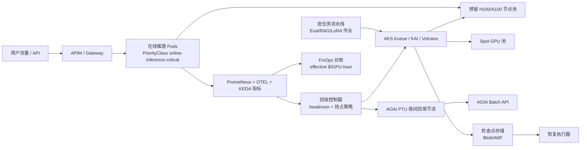
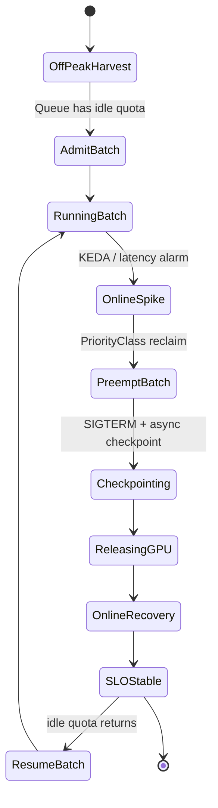

# 企业混合在线推理与离线批处理 GPU 产能回收选型 FAQ：AKS `Kueue` 抢占回收 vs KAI/Volcano 公平调度 vs Spot 分池 vs PTU + Batch

> 🌐 **Language Switch**：**中文（当前）** | [English](./mixed-online-batch-gpu-harvesting-aks-kueue-preemption-vs-kai-scheduler-mig-vs-spot-pool-vs-ptu-batch-selection-faq.en.md)
> **受众**：Cloud & AI Solution Architect、平台工程负责人、GPU SRE/FinOps 团队、模型服务团队、企业数据与智能体平台运营团队。
> **范围**：面向生产环境的 GPU 产能回收架构决策，解决白天在线推理集群在夜间低谷的闲置容量复用问题，用于 RAG 重嵌入、Agent 评测扫场与 LoRA 后训练，同时不突破白天在线 TTFT 与 P95 延迟 SLO。

## 1. 问题定义：为什么企业 GPU 集群“看起来一直在忙”，但总体利用率和单位成本仍然很差
很多企业把白天在线推理和夜间离线任务分成两套资源池，组织上看更安全，职责上也更清晰，但这种静态分割会让昂贵的 H100/A100 预留容量在大量时段处于不可回收的空转状态。  
从平台数据看，在线与离线需求在时间维度通常呈错峰分布，可是当调度控制面不能做快速借额、可证据抢占与断点恢复时，资源只能被“逻辑上绑定”在各自池子里，导致整体利用率长期停在 `25%–45%`。  
这会让 FinOps 讨论失焦，团队不断优化 Token 或算子细节，却忽略了更大的成本黑洞来自已经预付但未被使用的 GPU-hour。  

因此核心问题不是“批任务怎么更便宜”，而是“如何在不牺牲白天在线体验的前提下，把预留集群夜间 `60%–75%` 的空谷回收成可用产能”。  
这不是单点调度参数问题，而是一个跨调度、隔离、优先级、检查点与运行治理的组合工程，需要明确在线优先的回收契约和可验证的中断恢复路径。  
若没有这套契约，任何回收尝试都容易在首次高峰冲击时触发 TTFT 抖动和运维不信任，最后平台又退回“硬隔离但高浪费”的旧模式。  

## 2. 四类架构模式（A/B/C/D）：控制哲学与适用边界
**架构 A**：AKS + `Kueue` `Cohort` 借额 + 优先级抢占 + whole-GPU 或硬件 `MIG` 隔离，让夜间批任务借用空闲在线容量，并在白天流量回升时被确定性回收。  
**架构 B**：`NVIDIA KAI Scheduler` / `Volcano` 分层公平队列与拓扑感知 gang 调度，结合抢占即检查点，保证多 BU 共池场景下的公平性与恢复效率。  
**架构 C**：物理分池（预留在线池 + Spot 批处理池），通过零宿主共享换取最强隔离确定性，但代价是容量回收效率下降与 Spot 波动暴露。  
**架构 D**：`Azure OpenAI PTU` 白天基线 + 夜间动态回填节流 + `Batch API` 折扣通道，在托管模型场景下通过配额控制回收空闲吞吐。  

四种模式并非互斥，成熟企业往往按业务域叠加：AKS 主力域采用 A 或 B，强监管域采用 C，托管模型域采用 D。  
选型应以“回收时延容忍度、隔离强度要求、中断恢复代价、平台运维复杂度承受能力”为主，而不是只看单维度的 GPU 单价。  

## 3. 端到端参考架构：在线通道、回收通道、控制环路与审计证据分层


该架构的关键是把“在线 SLO 保证”和“离线吞吐回收”拆成不同控制路径，分别定义目标函数和故障边界，避免单一自动扩缩容机制承担互相冲突的职责。  
在线通道必须是 reclaim-first，离线通道必须是 interruption-tolerant，控制器负责把两者通过可解释策略绑定到一起，并把每次决策写入可审计证据链。  
当出现抖动时，平台可快速判断是借额策略失配、抢占时序过慢、检查点链路退化还是 Batch 回填阈值错误，而不是笼统归因为“GPU 资源紧张”。  

## 4. 架构 A 深潜：AKS + Kueue 借额配额、优先级抢占、MIG/整卡隔离与热备余量
架构 A 通过 `ClusterQueue` 的 `nominalQuota` 与 `borrowingLimit` 把在线基线容量和离线可借额度显式化，确保夜间作业只在空闲窗口借用资源，而不是长期侵占在线保底。  
当白天在线流量上升，`PriorityClass: online-inference-critical` 的推理 Pod 通过抢占策略回收 opportunistic 批任务占用，并在目标窗口（例如 `<15–30s`）内恢复在线容量。  

回收策略必须配合 `10%–15%` 的 warm headroom，因为抢占与重调度并非零时延，若没有热备缓冲，流量突增时会在回收收敛前直接打穿 TTFT 预算。  
隔离策略建议在线关键通道使用 whole-GPU 或硬件 MIG，避免 MPS/time-slicing 在 HBM 带宽和缓存层面带来不可预测干扰，从而降低跨工作负载性能串扰。  

可用性判据应包含“回收速度 + 启动速度 + 缓冲容量”三项联动，而不是只看单次抢占是否发生。  
实践中，当在线与离线时序错峰明显且平台具备调度工程能力时，A 通常是收益/复杂度比最优的主力方案。  

## 5. 架构 B 深潜：KAI/Volcano 分层公平、拓扑感知 Gang 调度与抢占后检查点恢复
当多个 BU 长期共享 GPU 且业务权重差异显著时，仅靠优先级抢占容易出现“强势队列持续吞吐、弱势队列长期饥饿”的治理争议。  
架构 B 通过分层公平队列与 DRF 风格配额可借机制，把组织公平性纳入调度内核，既保障核心业务下限，也允许空闲份额在可审计规则内被回收利用。  

对于 LoRA 后训练、RFT、评测扫场等多卡任务，拓扑感知 gang placement 的价值非常高，因为 NVLink/PCIe 结构不合理会显著放大训练步耗，吞噬本应得到的回收收益。  
抢占即检查点是 B 的关键能力，要求作业在 `SIGTERM` 后快速落盘检查点并可异步恢复，通常把单次抢占损失压到 `<2` 分钟，避免回收策略变成重复计算债务。  

架构 B 的代价是平台复杂度上升，包括调度插件维护、拓扑观测建设、策略持续调优和跨 BU 运营机制。  
当企业把公平治理和高质量多卡调度作为长期能力建设目标时，B 的复杂度成本通常是可接受且可回收的。  

## 6. 架构 C 深潜：物理分池（预留在线池 + Spot 批池）与 Scheduled Events 护栏
架构 C 通过物理隔离确保在线与离线不共享宿主层资源，能在强监管场景下提供最清晰的责任边界与最小串扰风险。  
在线池按 SLA 和容量预测稳定运行，批任务主要消化 Spot 池弹性，结合 IMDS Scheduled Events 感知驱逐提前量进行检查点和重排。  

该模式的优点是在线体验最稳，风险沟通最简单，审计陈述也最直观。  
缺点是预留池空闲无法充分回收，且 Spot 供给波动可能在关键夜窗放大完工风险，导致批任务端到端成本和时效抖动上升。  

因此 C 是风险优先设计，而不是效率优先设计。  
它适合“宁可牺牲部分回收效率，也不接受在线通道任何共池不确定性”的行业与合同约束。  

## 7. 架构 D 深潜：PTU 白天基线 + 夜间动态回填 + Batch API 折扣并行通道
在托管模型场景，节点级调度不可见或不易控制，最有效的杠杆转为配额级策略：白天 PTU 保证在线吞吐，夜间通过动态节流器安全消费剩余 TPM。  
非紧急批任务可优先进入 Batch API 折扣通道，用独立配额换取更低成本和更低在线干扰，再由回填控制器根据在线头寸动态调整补偿吞吐。  

该模式的关键不是“把空余吃满”，而是“永不穿透在线安全底线”。  
节流器应联合实时延迟、错误率、在线利用率和队列年龄判断是否放量，并在信号异常时 fail-closed 快速降载。  

架构 D 运维门槛较低，适合托管端点占比高的团队，但在拓扑控制、跨模型可移植性和底层隔离可解释性上不如 AKS 自托管方案。  
当组织偏好配额治理而非节点治理时，D 往往能以更少平台工程投入换来显著回收收益。  

## 8. 日周期利用率与有效成本数学：`64x H100` 从 `38%` 提升到 `84%` 的回收收益
设总预留 GPU-hour 为 `H_total`，在线有效小时为 `H_online`，夜间回收有效小时为 `H_harvest`，抢占损耗为 `H_loss`，则有效利用率为 `U_eff = (H_online + H_harvest - H_loss) / H_total`。  
若总预留成本为 `C_reserved_total`，有效单位成本可写作 `C_eff = C_reserved_total / (H_total * U_eff)`，即在预留成本固定时，利用率提升会直接压低单位产能成本。  

以 `64x H100` 年度预留为例，若资源孤岛模式只有 `U_eff=0.38`，其归一化单位成本倍率约为 `1/0.38=2.63x`；若回收后达到 `U_eff=0.84`，倍率降为 `1/0.84=1.19x`。  
对应相对降幅约 `(2.63-1.19)/2.63≈54.8%`，这也是为什么产能回收常常比模型微优化更快改变总体成本结构。  

在线安全余量可近似表示为 `Headroom_nodes >= ceil((Burst_qps * Reclaim_latency_s) / Pods_per_node * Safety_factor)`。  
若回收时延从 `20s` 恶化到 `60s`，在相同突发流量下所需热备容量会接近三倍，这通常意味着抢占链路、镜像热身或检查点策略需要优先优化。  

### 8.1 回收状态机：在线优先护栏与检查点友好中断


该状态机把“抢占”定义为预期控制流而非异常，确保每次中断都经过标准化检查点与恢复路径，避免回收策略把夜间吞吐变成重复计算。  
最危险的反模式是“可抢占但不可恢复”，这会让回收收益在高波动时段被重算成本吞噬，最终平台团队失去对回收策略的信任。  

## 9. 12 维对比矩阵：性能、经济性与运维复杂度
| 维度 | A：AKS + Kueue 抢占回收 | B：KAI/Volcano 公平调度 | C：预留+Spot 物理分池 | D：PTU + Batch API |
|---|---|---|---|---|
| 1. 在线 SLO 保护 | 高（依赖 headroom） | 高 | 极高 | 高 |
| 2. 回收效率 | 极高 | 高 | 中 | 高 |
| 3. 多 BU 公平治理 | 中 | 极高 | 中 | 中 |
| 4. 多卡拓扑放置质量 | 中 | 极高 | 中 | 低 |
| 5. 抢占恢复质量 | 高 | 极高 | 中 | 节点层不适用 |
| 6. 隔离确定性 | 高（MIG/整卡） | 高 | 极高 | 高（配额层） |
| 7. 控制面复杂度 | 中 | 高 | 中 | 中低 |
| 8. Spot 波动暴露 | 低 | 低中 | 高 | 低 |
| 9. FinOps 可解释性 | 高 | 高 | 中 | 高 |
| 10. 技术栈可移植性 | 高 | 高 | 高 | 中 |
| 11. 强监管延迟契合度 | 高 | 高 | 极高 | 高 |
| 12. 推荐定位 | 主力回收基线 | 公平/拓扑重场景 | 合规隔离优先场景 | 托管端点优化场景 |

矩阵结论是“按域组合”而非“单一统治”。  
多数 AKS 平台以 A 为主，公平性与拓扑要求高的域引入 B，强监管域采用 C，托管模型域采用 D。  
只有把不同业务域映射到正确控制模式，平台才能同时守住体验和成本。  

## 10. 定量问答（Q1–Q6）：架构评审高频问题
### Q1：在线通道通常需要多少热备余量才能稳定回收
实践中常见起始值是 `10%–15%`，再按真实突发曲线和回收时延校准。  
低于该区间容易在抢占收敛前出现 TTFT 抖动，高于该区间则会明显压缩可回收空间。  
最终值应由 SLO 预算和实测回收链路时延共同决定。  

### Q2：为什么在线关键通道不建议默认启用 MPS/time-slicing
因为这两种共享方式会引入 HBM 带宽和缓存层竞争，混载时延尾部更难预测。  
对严格在线 SLO 场景，whole-GPU 或硬件 MIG 的边界更清晰，问题定位也更直接。  
MPS/time-slicing 更适合明确标记的非关键 opportunistic 通道。  

### Q3：抢占后检查点恢复应控制在什么量级
生产经验通常以单次抢占损失 `<2` 分钟为目标上限。  
若长期高于该值，夜间回收收益会被重复计算成本显著侵蚀。  
优先优化检查点粒度、落盘并发和恢复元数据路径可以快速改善该指标。  

### Q4：何时应优先选择 B 而不是 A
当平台长期面临多 BU 资源公平争议，或多卡任务对拓扑放置质量极为敏感时，B 的收益会显著超过其复杂度成本。  
A 更适合“先把夜间回收跑起来”的主力路径，B 更适合“把共池治理做深做稳”的组织阶段。  
选择标准应由治理目标驱动，而非单一技术偏好。  

### Q5：Spot 批池在夜间截止场景的风险有多大
Spot 成本优势明显，但在供给紧张窗口驱逐率会抬升，关键夜窗完工风险随之增加。  
应为硬截止任务准备预留回退通道、弹性截止等级或 Batch API 兜底，不可把 Spot 作为唯一保障路径。  
把 Spot 定义为“机会增益层”而不是“硬承诺层”更符合企业治理现实。  

### Q6：PTU 夜间回填节流如何避免白天 SLO 回归
控制器必须维护在线安全底线，并在延迟、错误率或头寸异常时立即降载，默认 fail-closed。  
同时要对策略变更做版本化和审计，确保回填行为与批准策略一致。  
这样回收才是可控工程，而不是“吃空闲”的运气行为。  

## 11. 生产配置块 A：AKS Kueue Cohort 借额、优先级与回收护栏 YAML
```yaml
apiVersion: scheduling.k8s.io/v1
kind: PriorityClass
metadata:
  name: online-inference-critical
value: 1000000
globalDefault: false
preemptionPolicy: PreemptLowerPriority
description: "Highest priority for user-facing inference pods."
---
apiVersion: scheduling.k8s.io/v1
kind: PriorityClass
metadata:
  name: batch-opportunistic
value: 1000
globalDefault: false
preemptionPolicy: Never
description: "Opportunistic batch jobs, preemptible by online lanes."
---
apiVersion: kueue.x-k8s.io/v1beta1
kind: ResourceFlavor
metadata:
  name: h100-mig-1g
spec:
  nodeLabels:
    accelerator.nvidia.com/gpu: h100
    gpu.nvidia.com/mig.profile: 1g.10gb
---
apiVersion: kueue.x-k8s.io/v1beta1
kind: ResourceFlavor
metadata:
  name: h100-whole
spec:
  nodeLabels:
    accelerator.nvidia.com/gpu: h100
    gpu.nvidia.com/mode: whole
---
apiVersion: kueue.x-k8s.io/v1beta1
kind: ClusterQueue
metadata:
  name: online-cq
spec:
  cohort: enterprise-gpu
  resourceGroups:
    - coveredResources: ["nvidia.com/gpu"]
      flavors:
        - name: h100-whole
          resources:
            - name: nvidia.com/gpu
              nominalQuota: 56
              borrowingLimit: 0
---
apiVersion: kueue.x-k8s.io/v1beta1
kind: ClusterQueue
metadata:
  name: batch-cq
spec:
  cohort: enterprise-gpu
  preemption:
    reclaimWithinCohort: Any
    borrowWithinCohort:
      policy: LowerPriority
  resourceGroups:
    - coveredResources: ["nvidia.com/gpu"]
      flavors:
        - name: h100-whole
          resources:
            - name: nvidia.com/gpu
              nominalQuota: 8
              borrowingLimit: 48
---
apiVersion: kueue.x-k8s.io/v1beta1
kind: LocalQueue
metadata:
  name: online-lq
  namespace: inference
spec:
  clusterQueue: online-cq
---
apiVersion: kueue.x-k8s.io/v1beta1
kind: LocalQueue
metadata:
  name: batch-lq
  namespace: nightly-jobs
spec:
  clusterQueue: batch-cq
---
apiVersion: kueue.x-k8s.io/v1beta1
kind: WorkloadPriorityClass
metadata:
  name: wpc-online
value: 1000000
---
apiVersion: kueue.x-k8s.io/v1beta1
kind: WorkloadPriorityClass
metadata:
  name: wpc-batch
value: 1000
---
apiVersion: apps/v1
kind: Deployment
metadata:
  name: online-vllm
  namespace: inference
spec:
  replicas: 28
  selector:
    matchLabels:
      app: online-vllm
  template:
    metadata:
      labels:
        app: online-vllm
    spec:
      priorityClassName: online-inference-critical
      terminationGracePeriodSeconds: 15
      nodeSelector:
        accelerator.nvidia.com/gpu: h100
      containers:
        - name: server
          image: ghcr.io/org/vllm-online:stable
          resources:
            limits:
              nvidia.com/gpu: 1
          readinessProbe:
            httpGet:
              path: /health
              port: 8000
---
apiVersion: batch/v1
kind: Job
metadata:
  name: nightly-rag-reembed
  namespace: nightly-jobs
  labels:
    kueue.x-k8s.io/queue-name: batch-lq
spec:
  parallelism: 64
  completions: 64
  template:
    spec:
      priorityClassName: batch-opportunistic
      restartPolicy: Never
      terminationGracePeriodSeconds: 30
      containers:
        - name: worker
          image: ghcr.io/org/rag-reembed:nightly
          env:
            - name: CHECKPOINT_URI
              value: "abfss://ckpt@contosodata.dfs.core.windows.net/nightly/reembed/"
          resources:
            limits:
              nvidia.com/gpu: 1
```

该配置把在线保底、离线借额、抢占优先级和隔离边界全部显式化，便于审计与演练复现。  
上线前应进行抢占演练，验证在真实突发流量下从告警触发到在线 Pod 就绪的全链路回收时延。  

## 12. 生产配置块 B：PTU 夜间动态回填节流控制器（在线安全底线优先）
```python
from __future__ import annotations

import dataclasses
import time
from typing import Dict, Optional


@dataclasses.dataclass
class PTUMetrics:
    timestamp_s: int
    online_tpm_used: int
    online_tpm_limit: int
    p95_latency_ms: float
    error_rate: float
    queue_depth: int


@dataclasses.dataclass
class BackfillPolicy:
    min_online_headroom_ratio: float = 0.15
    max_background_tpm: int = 120000
    max_latency_ms: float = 1200.0
    max_error_rate: float = 0.02
    ramp_step_tpm: int = 5000
    decay_step_tpm: int = 10000
    cooldown_s: int = 30


class PTUBackfillController:
    def __init__(self, policy: BackfillPolicy) -> None:
        self.policy = policy
        self.current_background_tpm = 0
        self.last_change_ts = 0

    def _headroom_ratio(self, m: PTUMetrics) -> float:
        if m.online_tpm_limit <= 0:
            return 0.0
        return max(0.0, (m.online_tpm_limit - m.online_tpm_used) / m.online_tpm_limit)

    def _must_decay(self, m: PTUMetrics) -> bool:
        if self._headroom_ratio(m) < self.policy.min_online_headroom_ratio:
            return True
        if m.p95_latency_ms > self.policy.max_latency_ms:
            return True
        if m.error_rate > self.policy.max_error_rate:
            return True
        return False

    def _can_ramp(self, m: PTUMetrics) -> bool:
        if self._headroom_ratio(m) < self.policy.min_online_headroom_ratio:
            return False
        if m.p95_latency_ms > self.policy.max_latency_ms:
            return False
        if m.error_rate > self.policy.max_error_rate:
            return False
        return m.queue_depth > 0

    def reconcile(self, m: PTUMetrics) -> int:
        if m.timestamp_s - self.last_change_ts < self.policy.cooldown_s:
            return self.current_background_tpm

        if self._must_decay(m):
            self.current_background_tpm = max(
                0, self.current_background_tpm - self.policy.decay_step_tpm
            )
            self.last_change_ts = m.timestamp_s
            return self.current_background_tpm

        if self._can_ramp(m):
            self.current_background_tpm = min(
                self.policy.max_background_tpm,
                self.current_background_tpm + self.policy.ramp_step_tpm,
            )
            self.last_change_ts = m.timestamp_s

        return self.current_background_tpm


def choose_lane(
    job_deadline_minutes: int,
    online_headroom_ratio: float,
    batch_quota_available: bool,
) -> str:
    if job_deadline_minutes <= 30:
        return "interactive-online-lane"
    if batch_quota_available and job_deadline_minutes >= 120:
        return "aoai-batch-api-lane"
    if online_headroom_ratio >= 0.20:
        return "ptu-background-backfill-lane"
    return "defer-and-retry-window"


def simulate_controller() -> None:
    controller = PTUBackfillController(BackfillPolicy())
    samples = [
        PTUMetrics(int(time.time()), 680000, 1000000, 820.0, 0.006, 400),
        PTUMetrics(int(time.time()) + 40, 760000, 1000000, 980.0, 0.008, 320),
        PTUMetrics(int(time.time()) + 80, 900000, 1000000, 1400.0, 0.021, 310),
        PTUMetrics(int(time.time()) + 120, 700000, 1000000, 860.0, 0.007, 280),
    ]
    for s in samples:
        bg = controller.reconcile(s)
        print(
            f"ts={s.timestamp_s} headroom={controller._headroom_ratio(s):.2f} "
            f"p95={s.p95_latency_ms:.0f} err={s.error_rate:.3f} queue={s.queue_depth} "
            f"bg_tpm={bg}"
        )


if __name__ == "__main__":
    simulate_controller()
```

该控制器采用 fail-closed 策略，任何在线安全信号异常都会先降载再观察，避免背景任务“误吃”在线保底头寸。  
生产版本建议补充策略签名、状态持久化和滞后窗口，以便审计系统可回放“为什么在某一时刻放量或降载”。  

## 13. 企业场景与三年 TCO：不同模式在真实组织中的胜出条件
### 场景 A：全球客服 Copilot，白天在线强实时、夜间大规模评测和重嵌入
该场景通常采用 A + D 组合最优。  
A 负责节点层快速回收与在线护栏，D 负责把非紧急批任务导向 Batch 折扣通道并在 PTU 空闲窗口安全回填，兼顾体验与成本。  

### 场景 B：强监管金融集团，在线延迟契约严格且 BU 配额治理复杂
该场景通常需要 C + B 组合。  
C 提供最强物理隔离保证，B 在共享研究域提供可审计公平调度和拓扑感知效率，平衡合规确定性与组织资源利用效率。  

### 三年 TCO 对比（`64x H100` 基线、同等业务产出）
| 方案 | Year 1 | Year 2 | Year 3 | 三年总计 | 说明 |
|---|---:|---:|---:|---:|---|
| 资源孤岛基线（无回收） | $19.6M | $19.2M | $18.8M | $57.6M | 平均利用率约 38% |
| A：Kueue 抢占回收 | $15.2M | $14.8M | $14.5M | $44.5M | 利用率约 84%，需持续演练 |
| B：KAI/Volcano + 检查点 | $15.8M | $15.3M | $14.9M | $46.0M | 公平/拓扑更优，运维更复杂 |
| C：预留+Spot 分池 | $16.7M | $16.2M | $15.8M | $48.7M | 隔离强，Spot 波动风险高 |
| D：PTU + Batch 回填 | $14.9M | $14.6M | $14.3M | $43.8M | 托管通道收益高，需配额调优 |

在多数测算中，只要回收控制可用，都会显著优于“完全孤岛”模式。  
但成本评估必须加入风险修正，例如 SLO 违约成本、抢占恢复失败成本和事故处置负担，避免只追求表面利用率。  

## 14. Day-0 / Day-2 清单：从上线到稳态运营
### Day-0（上线前）
- 先定义在线 SLO 护栏与抢占回收目标（如 `<15–30s`），再开启任何回收策略。  
- 显式配置在线保底、离线借额和优先级策略，避免隐式默认导致配额语义不清。  
- 在线关键通道采用 whole-GPU 或 MIG，明确共享例外审批边界。  
- 所有可抢占批任务必须先通过 SIGTERM 检查点与恢复演练。  
- 把利用率、回收时延、检查点损耗和 effective `$/GPU-hour` 汇总到统一观测看板。  

### Day-2（运行后）
- 每周执行抢占演练，验证高峰回收链路和在线恢复收敛时间。  
- 审计多 BU 队列公平与配额漂移，提前发现长期饥饿或过度借额。  
- 追踪 Spot 驱逐分布并维护关键夜窗回退策略。  
- 按实测延迟与错误率动态校准 PTU 回填阈值，策略变更保持可审计。  
- 按季度复盘架构组合，随业务形态与合规约束调整 A/B/C/D 比例。  

## 15. 决策总结：企业平台推荐采用路径
对 AKS 主导的平台，建议先以 A 建立可控回收基线，再在公平治理和拓扑效率成为瓶颈时引入 B。  
对强监管或强合同约束域，优先使用 C 保证隔离确定性；对托管模型域，优先使用 D 以较低平台工程成本释放夜间空闲吞吐。  

长期最优解不是单一调度器，而是按业务关键性分层组合策略，并把“回收契约、隔离边界、恢复上限、证据审计”固化到平台控制面。  
当这些契约持续被验证并可回放解释时，企业才能在规模增长中同时获得体验稳定性与成本下降，而不是在二者之间被动取舍。  

