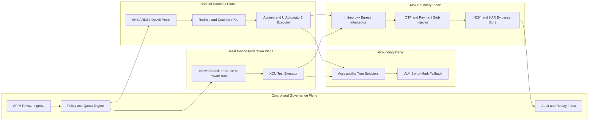
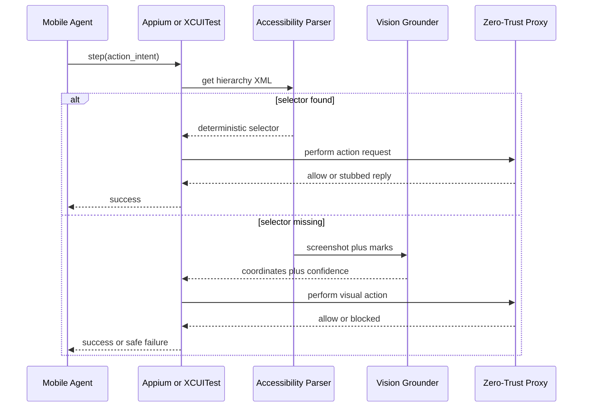

# Enterprise Mobile App-Use and Autonomous Mobile QA Agent Sandbox FAQ: AKS ARM64 Redroid/Cuttlefish vs Cloud Device Farms vs Accessibility+VLM Hybrid Grounding
> 🌐 **Language Switch**: [中文](mobile-app-use-agent-sandbox-aks-arm64-redroid-vs-cloud-device-farm-vs-appium-vlm-selection-faq.md) | **English (current)**  
> Audience: Principal Cloud & AI Solution Architects, mobile quality engineering leaders, platform teams, FinOps, SRE, and compliance reviewers.  
> Scope: Online Android and iOS autonomous execution architecture, not desktop CUA and not browser-only CDP topics.  
> Objective: Balance concurrency density, hardware realism, isolation, compliance, and TCO for enterprise mobile agent fleets.  

## 1. Executive outcome: mobile agent success depends on balancing density and realism
Enterprise mobile-agent programs face two structural tensions.  
First, Android regression requires very high concurrent density.  
Second, iOS and secure hardware flows require real-device realism.  
Optimizing only for density usually sacrifices hardware fidelity coverage.  
Optimizing only for realism often destroys cost and queue predictability.  
Therefore the architecture must be layered, not monolithic.  
This guide defines four composable architecture paths.  
Path A: AKS ARM64 Redroid/Cuttlefish high-density Android sandboxes.  
Path B: federated real-device farms for iOS and hardware-bound flows.  
Path C: accessibility-tree first action grounding with VLM fallback.  
Path D: zero-trust egress with OTP and payment stubbing plus forensic replay.  
Path A solves scale and unit economics for Android-heavy loops.  
Path B solves realism constraints that containers cannot emulate.  
Path C solves action reliability and visual-token budget control.  
Path D solves risk containment and auditable evidence requirements.  
Together these paths improve both coverage quality and operating efficiency.  

## 2. Business and control boundaries: define non-negotiables before platform choice
Autonomous mobile agents are not traditional scripted test bots.  
They can plan multi-step actions dynamically across uncertain UI states.  
That raises the blast radius of incorrect actions significantly.  
Compliance boundaries typically include four mandatory guardrails.  
One, payment and funds-transfer isolation.  
Two, prevention of notification and SMS storm side effects.  
Three, privacy and credential leakage controls.  
Four, forensic replay completeness for audit reconstruction.  
Technical boundaries also matter early.  
iOS cannot be containerized as an equivalent production substitute.  
Secure Enclave and passkey paths require real hardware semantics.  
OEM GPU and driver variance affects rendering and gesture behavior.  
x86-to-ARM translation introduces instability and performance jitter.  
A single execution plane cannot cover all these constraints safely.  
Architects should split execution domains and unify governance centrally.  
That design keeps velocity high while preserving safety boundaries.  

## 3. Four-path architecture positioning for mobile agent enterprises
Path A is the Android high-throughput execution backbone.  
Path B is the realism assurance layer for iOS and hardware features.  
Path C is the deterministic-to-visual action grounding engine.  
Path D is the risk and evidence control shell.  
Path A is best for PR-triggered broad regression throughput.  
Path B is best for release-candidate realism and acceptance checks.  
Path C is best for stable interaction across heterogeneous UI frameworks.  
Path D is best for production-safety and audit readiness.  
A and B are complementary planes, not substitutes.  
A gives cost-efficient scale while B certifies hardware truth.  
C and D are not optional enhancements.  
Without C, reliability and token economics degrade together.  
Without D, autonomous behavior can reach prohibited production rails.  
Recommended rollout order is A plus D first, then B plus C expansion.  
This sequence usually maximizes early ROI under bounded risk.  

## 4. Twelve-dimension architecture comparison matrix
| Dimension | A: AKS ARM64 Redroid/Cuttlefish | B: Federated Real-Device Farm | C: Accessibility+VLM Hybrid Grounding | D: Zero-Trust + Stubbing + Replay |
|---|---|---|---|---|
| Concurrency density | Very high | Medium | High | Medium |
| iOS realism fidelity | Low | Very high | Medium | Medium |
| Android execution efficiency | Very high | Medium | High | Medium |
| Initial delivery speed | Medium | High | Medium | Medium |
| Operational complexity | Medium-high | Low-medium | Medium | Medium |
| Cost predictability | High | Medium | High | High |
| Action reliability | Medium | High | Very high | High |
| Compliance boundary control | Medium-high | Medium | Medium | Very high |
| Forensic replay strength | High | Medium | High | Very high |
| Multi-tenant isolation | High | Medium | High | High |
| Cross-version coverage | High | High | High | Medium-high |
| Three-year TCO convergence | Very high | Medium | High | High |
Weighting should follow workload criticality.  
Digital banking programs typically prioritize compliance and replay strength.  
Marketplace operations programs often prioritize concurrency and TCO.  
A shared scoring template reduces architecture review friction significantly.  

## 5. Path A deep dive: native ARM64 Cobalt 100 Android density on AKS
Path A creates a high-density Android execution backbone.  
`Standard_D16ps_v6` and `D32ps_v6` nodes provide ARM64-native capacity.  
Native ARM64 avoids x86-to-ARM translation side effects.  
Translation layers often fail first on JNI and graphics paths.  
Native execution improves stability and reduces long-tail latency variance.  
Redroid is suitable for dense containerized Android sessions.  
Cuttlefish is suitable for richer system-level emulation requirements.  
Both should use snapshot or overlay reset discipline.  
Reset windows can be kept under `<5s` in tuned environments.  
Typical stable packing ranges from `25` to `50` sessions per node.  
Actual density depends on test flow complexity and rendering load.  
Path A should be treated as the default regression highway.  
It cannot replace iOS and secure hardware validation requirements.  
Therefore it must interoperate with Path B by design.  

## 6. Path B deep dive: federated real-device plane through private APIM tunnels
Path B covers realism boundaries that containers cannot satisfy.  
iOS IPA workflows require real-device or Apple-native environments.  
FaceID, passkeys, eSIM, BLE, and NFC paths also require hardware truth.  
Commercial farms provide quick scale and broad model coverage.  
Private Mac+iPhone racks provide sovereignty and custom control.  
APIM private connectivity should front all farm access.  
This centralizes identity, quota, and audit policy enforcement.  
It also prevents direct credential sprawl into test orchestration scripts.  
Path B carries higher per-minute economics than Path A.  
So it should be reserved for critical realism checkpoints.  
High-frequency broad regression should remain mostly on Path A.  
This layered model sharply reduces expensive real-device minute burn.  
And it directs premium capacity to business-critical validation steps.  

## 7. Path C deep dive: deterministic accessibility selectors first, VLM fallback second
Path C starts with deterministic selector resolution.  
Native views are handled via UIAutomator2 or XCUITest trees.  
This path can resolve most actions in sub-`20ms` class latency.  
It also avoids heavy visual-token consumption.  
However cross-platform rendering stacks can hide semantic trees.  
Examples include Flutter canvas, Skia surfaces, and Unity overlays.  
When semantic selectors fail, VLM Set-of-Mark fallback is required.  
Fallback should be gated and crop-scoped to limit token spend.  
Visual grounding should never become the default for every step.  
In thirty-step mobile flows, hybrid routing yields major savings.  
It preserves coverage for hard visual surfaces without runaway costs.  
Path C is a reliability and economics balancing mechanism.  
It should be integrated with confidence-aware recovery policies.  

## 8. Path D deep dive: zero-trust egress and synthetic OTP/payment boundaries
Autonomous mobile agents must not hit production payment rails directly.  
They must not trigger real customer SMS and notification cascades.  
Path D enforces capability testing without real-world side effects.  
Egress should pass through policy interceptors such as mitmproxy tiers.  
High-risk domains and endpoints should be blocked or stubbed by default.  
OTP validation should rely on synthetic injectors, not live gateways.  
FIDO2 tests should run only in controlled hardware test zones.  
Every session should emit synchronized H.264 and HAR evidence.  
Artifacts must be linked with build, tenant, and execution identity.  
That supports forensic replay and regulator-grade audit trails.  
Path D is a launch prerequisite, not optional hardening.  
Without it, autonomous scaling becomes compliance debt accumulation.  

## 9. Reference architecture topology for mobile autonomous execution

The topology separates execution, grounding, and governance concerns cleanly.  
That separation improves ownership clarity and incident triage speed.  
It also keeps risk controls visible in architecture review artifacts.  

## 10. Sequence model: accessibility-first execution with visual fallback and policy gate

This sequence enforces deterministic first and visual second.  
Riskful operations remain behind explicit policy controls.  
That is essential for both economics and compliance confidence.  

## 11. Quantitative Q&A for architecture boards and FinOps review
**Q1: Why is native ARM64 on Cobalt 100 preferable to x86 translation for Android fleets?**  
A1: Translation overhead and JNI edge-case instability increase CPU and crash probability; native ARM64 removes conversion penalties and improves consistency.  
**Q2: How does SaaS device-farm pricing (`$0.08–$0.20/min`) compare with AKS ARM64 at scale?**  
A2: For sustained high concurrency, dedicated ARM64 pools typically cross into lower unit economics than minute-billed external farms.  
**Q3: How is `25–50` sandbox sessions per node estimated safely?**  
A3: Use p95 CPU, memory, render load, and interaction-step latency under stress, then reserve at least `20%` safety headroom for spikes.  
**Q4: Are binderfs and ashmem boundaries enough for multi-tenant isolation?**  
A4: Usually yes for standard QA workloads, but high-sensitivity tenants may require Kata or VM isolation overlays for stricter kernel separation.  
**Q5: Accessibility XML versus pure visual VLM for a 30-step flow—what changes?**  
A5: If `80%+` of steps resolve via XML selectors, visual token demand drops sharply and latency tails improve materially.  
**Q6: Why can pure visual automation be expensive even when accurate?**  
A6: Every step incurs screenshot processing and model inference cost, creating linear token growth across long workflows.  
**Q7: Why can iOS not be fully replaced by Android-like container emulation?**  
A7: Secure Enclave, signing chain behavior, and hardware-attested capability paths require physical Apple hardware semantics.  
**Q8: How do teams prevent autonomous agents from triggering real payments and OTP rails?**  
A8: Enforce proxy policy gates with synthetic stubs and deny-by-default routing for production-grade transaction endpoints.  
These Q&As should be versioned with architecture decision records.  
They anchor cross-team alignment on measurable constraints and tradeoffs.  

## 12. Production IaC sample: AKS ARM64 Android sandbox pool and reset jobs
```yaml
apiVersion: apps/v1
kind: StatefulSet
metadata:
  name: redroid-sandbox
  namespace: mobile-agent
spec:
  serviceName: redroid-sandbox
  replicas: 24
  selector:
    matchLabels:
      app: redroid-sandbox
  template:
    metadata:
      labels:
        app: redroid-sandbox
    spec:
      nodeSelector:
        kubernetes.io/arch: arm64
        node.kubernetes.io/instance-type: Standard_D16ps_v6
      containers:
        - name: redroid
          image: redroid/redroid:android14-arm64
          securityContext:
            privileged: true
          env:
            - name: BINDERFS_ENABLED
              value: "true"
            - name: ADB_PORT
              value: "5555"
          volumeMounts:
            - name: data
              mountPath: /data
          resources:
            requests:
              cpu: "500m"
              memory: "2Gi"
            limits:
              cpu: "2"
              memory: "4Gi"
  volumeClaimTemplates:
    - metadata:
        name: data
      spec:
        accessModes: ["ReadWriteOnce"]
        storageClassName: managed-csi-premium
        resources:
          requests:
            storage: 20Gi
---
apiVersion: batch/v1
kind: CronJob
metadata:
  name: sandbox-reset-overlayfs
  namespace: mobile-agent
spec:
  schedule: "*/15 * * * *"
  jobTemplate:
    spec:
      template:
        spec:
          nodeSelector:
            kubernetes.io/arch: arm64
          containers:
            - name: reset
              image: mcr.microsoft.com/oss/busybox/busybox:latest
              command: ["/bin/sh","-c","/scripts/reset_overlayfs.sh --max-reset-seconds=5"]
          restartPolicy: OnFailure
```
The sample emphasizes ARM64 scheduling and fast environment reset discipline.  
Production variants should add tenant quota labels and policy admission checks.  
Each reset event should emit structured audit logs for replay correlation.  

## 13. Production code sample: accessibility-to-vision fallback mobile executor
```python
from dataclasses import dataclass
from typing import Optional, Dict, Any


@dataclass
class ActionIntent:
    action: str
    target: str
    value: Optional[str] = None


def find_by_accessibility(tree_xml: str, target: str) -> Optional[Dict[str, Any]]:
    if target in tree_xml:
        return {"strategy": "a11y", "selector": f"text={target}"}
    return None


def vision_fallback(vlm_client, screenshot_b64: str, target: str) -> Dict[str, Any]:
    prompt = f"Locate '{target}' and return tap coordinates with confidence."
    result = vlm_client.ground(prompt=prompt, image_base64=screenshot_b64)
    return {"strategy": "vision", "x": result["x"], "y": result["y"], "confidence": result["confidence"]}


def execute_step(driver, vlm_client, tree_xml: str, screenshot_b64: str, intent: ActionIntent):
    hit = find_by_accessibility(tree_xml, intent.target)
    if hit:
        driver.perform_selector_action(hit["selector"], intent.action, intent.value)
        return {"path": "a11y", "status": "ok"}
    grounded = vision_fallback(vlm_client, screenshot_b64, intent.target)
    if grounded["confidence"] < 0.72:
        return {"path": "vision", "status": "blocked_low_confidence"}
    driver.tap(grounded["x"], grounded["y"])
    return {"path": "vision", "status": "ok", "confidence": grounded["confidence"]}
```
This executor hard-codes deterministic-first behavior intentionally.  
Low-confidence visual outcomes are blocked for safety by default.  
That pattern reduces accidental taps on high-risk controls.  

## 14. Enterprise scenarios and FinOps table for mobile autonomous operations
### Scenario A: digital retail bank autonomous regression and payment journey assurance
The bank runs mobile regression on every pull request.  
Android requires around `400` concurrent autonomous sessions.  
iOS payment-critical paths require real-device truth validation.  
Path A serves as the Android regression backbone.  
Path B covers iOS realism and hardware-trust boundaries.  
Path C minimizes visual-token overhead in routine flows.  
Path D blocks real payment and OTP side effects safely.  
The result is shorter regression windows with auditable controls preserved.  
### Scenario B: super-app and e-commerce marketplace merchant-ops compliance copilot
This workflow spans mini-program and cross-framework pages.  
Accessibility coverage is inconsistent across rendering stacks.  
The platform uses selector-first then visual fallback routing.  
High-risk actions are guarded with policy and optional human confirmation.  
Every execution stores synchronized video and network evidence artifacts.  
That enables continuous large-scale checks without uncontrolled risk growth.  
### FinOps TCO comparison
| Metric | Baseline: all external device-farm minutes | Combined: A backbone + B critical realism + C/D governance | Delta |
|---|---:|---:|---:|
| Android concurrent sessions | 120 | 420 | +250% |
| iOS critical-path realism coverage | 100% | 100% | Flat |
| Average per-PR regression duration | 142 min | 46 min | -68% |
| Visual tokens per 30-step flow | 7,200 | 1,450 | -80% |
| Monthly execution spend | $310k | $118k | -62% |
| Monthly rerun incidents | 1,280 | 390 | -70% |
| Evidence completeness rate | 71% | 98% | +27pp |
| Business acceptability | Variable | Stable | Improved |
TCO gains come from layered routing, not one-off tuning tricks.  
Premium real-device minutes are reserved for highest-value validations only.  
Bulk regression moves to efficient ARM64 backbone capacity.  

## 15. Day-0 and Day-2 twelve-item checklist for operational readiness
- Define explicit ownership boundaries for Android backbone and iOS realism planes.  
- Establish ARM64 pool quota baselines and tenant budget enforcement.  
- Version Android sandbox images and snapshot reset policies formally.  
- Route high-risk actions through policy gates with evidence-linked approvals.  
- Stub payment, OTP, and notification interfaces by default in test environments.  
- Enforce accessibility-first grounding and bounded visual fallback policies.  
- Block low-confidence visual actions and require safe retry or human review.  
- Persist H.264, HAR, and structured step logs for every autonomous run.  
- Review real-device minute burn weekly with FinOps stakeholders.  
- Analyze crash and compatibility distribution patterns every week.  
- Run monthly multi-tenant stress and node-failure game-day drills.  
- Refresh device matrix and compliance controls quarterly.  
This checklist separates launch readiness from sustained operations discipline.  
Execution rigor determines whether mobile-agent ROI remains durable.  
