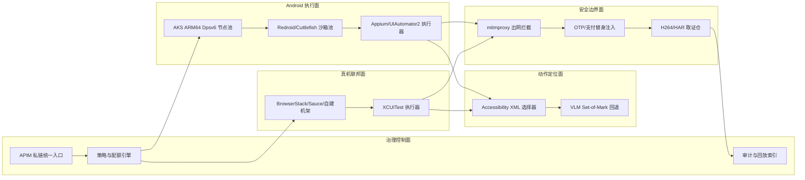
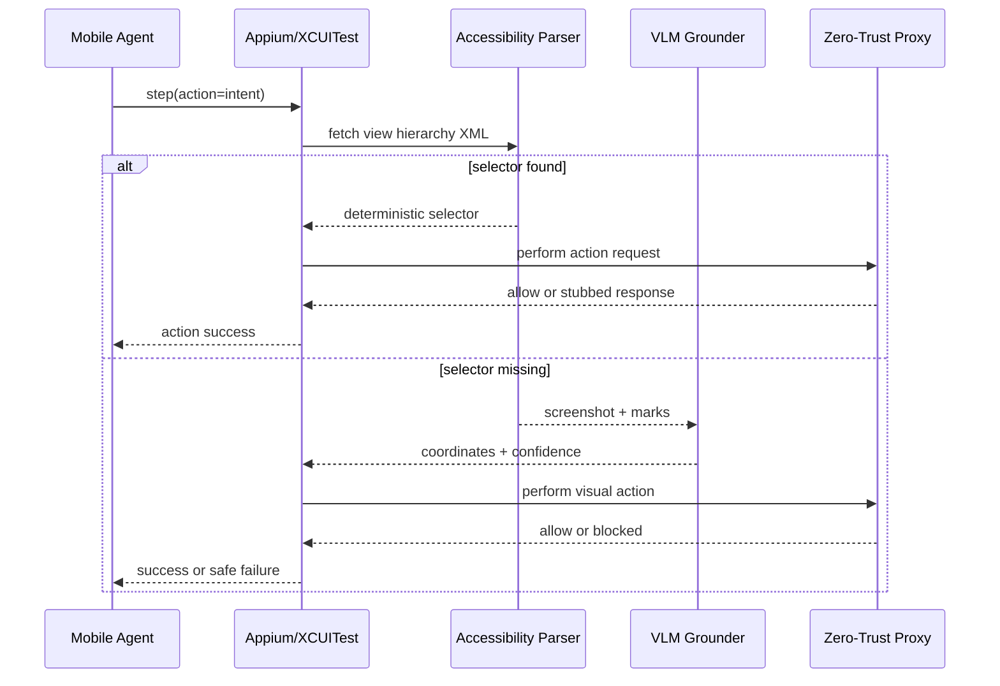

# 企业移动 App-Use 与自治移动 QA 智能体沙箱选型 FAQ：AKS ARM64 Redroid/Cuttlefish vs 云真机农场 vs Accessibility+VLM 混合定位
> 🌐 **Language Switch**: **中文（当前）** | [English](mobile-app-use-agent-sandbox-aks-arm64-redroid-vs-cloud-device-farm-vs-appium-vlm-selection-faq.en.md)  
> 读者对象：Cloud & AI 首席架构师、移动测试平台主管、平台工程、FinOps、SRE、合规与安全审计团队。  
> 范围边界：聚焦 Android/iOS 移动智能体在线执行与回归测试沙箱架构，不讨论桌面 CUA 与浏览器 CDP 专题。  
> 决策目标：在移动端高并发自治操作场景下，同时满足吞吐、真实性、隔离、合规、成本与可追溯性。  

## 1. 执行摘要：移动智能体平台的关键矛盾是“密度”与“真实性”
企业移动智能体落地通常先遇到两个现实矛盾。  
第一是 Android 大规模并发执行密度需求。  
第二是 iOS 与硬件能力真实性约束。  
仅追求密度会牺牲设备真实能力覆盖。  
仅追求真机会导致成本和排队不可控。  
因此移动智能体架构必须分层而非单栈。  
本指南给出四条可组合路线。  
路线 A：AKS ARM64 原生 Redroid/Cuttlefish 高密度沙箱。  
路线 B：联邦真机农场覆盖 iOS 与硬件特性。  
路线 C：Accessibility 树与 VLM 混合动作定位。  
路线 D：零信任出网与 OTP/支付替身注入。  
路线 A 解决规模与成本。  
路线 B 解决真实硬件与合规验证。  
路线 C 解决自动化动作稳定性与 token 成本。  
路线 D 解决自治行为边界与审计可追溯。  
四路线组合可同时提升覆盖率与可经营性。  

## 2. 业务约束与平台边界：先定红线再定技术栈
移动自治执行与传统自动化不同。  
它会在多步推理中动态发起操作。  
因此“错误动作”的风险显著放大。  
合规红线通常包含四类。  
第一类是支付与资金动作隔离。  
第二类是生产通知与 SMS 风暴防护。  
第三类是个人隐私与凭据泄露防护。  
第四类是回放取证与审计完整性。  
技术红线也有四类。  
第一是 iOS 不支持容器化仿真替代真机。  
第二是 Secure Enclave/Passkeys 需实硬件。  
第三是 OEM GPU/驱动差异会影响渲染路径。  
第四是 x86 转译 ARM 的稳定性和性能衰减。  
因此不应试图用单一执行面覆盖所有场景。  
架构应按风险与能力拆分执行域。  
并通过统一治理面做策略、审计和成本回收。  

## 3. 四路径定位：把“执行”与“验证”分成可治理平面
路径 A 是 Android 并发执行主平面。  
路径 B 是真机能力验证平面。  
路径 C 是动作定位与回退决策平面。  
路径 D 是边界防护与审计证据平面。  
路径 A 面向每 PR 高频回归与探索。  
路径 B 面向上线前硬件关键路径验收。  
路径 C 面向跨框架 UI 可靠点击与输入。  
路径 D 面向高风险动作的硬防线。  
A 与 B 不是替代关系。  
A 做高密度覆盖，B 做真实性背书。  
C 与 D 也不是可选增强。  
没有 C 会让自动化稳定性与成本失衡。  
没有 D 会让自治代理触碰真实生产风险。  
推荐落地顺序是 A+D 先行，B+C 随后并入。  
这样可在控制风险前提下快速释放收益。  

## 4. 十二维对比矩阵：从架构评审到预算评审统一口径
| 维度 | A AKS ARM64 Redroid/Cuttlefish | B 云真机农场联邦 | C Accessibility+VLM 混合定位 | D 零信任与替身注入 |
|---|---|---|---|---|
| 并发密度 | 极高 | 中 | 高 | 中 |
| iOS 真实性 | 低 | 极高 | 中 | 中 |
| Android 执行效率 | 极高 | 中 | 高 | 中 |
| 首次上线速度 | 中 | 高 | 中 | 中 |
| 运维复杂度 | 中高 | 低中 | 中 | 中 |
| 成本可预测性 | 高 | 中 | 高 | 高 |
| 动作稳定性 | 中 | 高 | 极高 | 高 |
| 合规边界可控性 | 中高 | 中 | 中 | 极高 |
| 故障可回放性 | 高 | 中 | 高 | 极高 |
| 多租户隔离能力 | 高 | 中 | 高 | 高 |
| 跨版本覆盖能力 | 高 | 高 | 高 | 中高 |
| 三年 TCO 收敛 | 极高 | 中 | 高 | 高 |
矩阵建议按场景分配权重。  
移动银行会提高合规与可回放权重。  
电商运营会提高并发与成本权重。  
跨部门共享一套权重模板可减少争议。  

## 5. 路线 A 详解：AKS ARM64 Cobalt 100 原生 Android 沙箱密度
路线 A 的核心价值是原生 ARM64 执行。  
`D16ps_v6` 与 `D32ps_v6` 可提供稳定密度。  
避免 x86 到 ARM 转译导致的不确定行为。  
在转译路径中，JNI 与图形库最容易出错。  
原生 ARM64 可显著降低崩溃与超时波动。  
Redroid 适合高密度容器化执行。  
Cuttlefish 适合更强系统级仿真需求。  
两者都应配合 overlayfs 快照重置。  
重置窗口可控制在 `<5s` 级别。  
单节点常见可承载 `25–50` 实例并发。  
容量取决于测试步骤与渲染复杂度。  
路线 A 适合作为“持续回归主干道”。  
但它无法替代 iOS 真机与 Secure Enclave 验证。  
因此必须与路线 B 联动治理。  

## 6. 路线 B 详解：APIM 私链联邦真机农场与 iOS 真实性闭环
路线 B 解决容器无法覆盖的真实硬件边界。  
iOS IPA 执行必须依赖真实设备或官方模拟体系。  
FaceID、Passkeys、eSIM、BLE/NFC 等能力同理。  
SaaS 真机平台可提供快速覆盖。  
企业自建 Mac+iPhone 机架可提供主权控制。  
推荐通过 APIM 私有连接统一入口。  
这样能统一鉴权、配额与审计策略。  
同时避免测试脚本直接暴露供应商凭据。  
路线 B 的成本按分钟计费更高。  
因此应把它定位为“关键路径验证层”。  
高频常规回归仍应留在 A 路线。  
通过分层可显著降低真机分钟消耗。  
并把昂贵资源集中给高价值验证步骤。  

## 7. 路线 C 详解：Accessibility 树优先 + VLM 视觉回退
路线 C 的核心是“先确定性，后感知性”。  
原生控件优先使用 UIAutomator2/XCUITest 树定位。  
这一路径可在 `<20ms` 完成大量动作解析。  
且几乎不消耗 LLM 视觉 token。  
问题在于跨端框架渲染层常隐藏语义树。  
如 Flutter Canvas、Skia、Unity 场景。  
此时需回退到 VLM Set-of-Mark 定位。  
视觉定位应仅在树定位失败后触发。  
并对截图区域做裁剪以限制 token。  
此混合策略在 30 步流程里可显著降本。  
同时保持复杂页面的操作可达性。  
路线 C 是稳定性与成本的平衡器。  
应与错误恢复与重试策略一体设计。  

## 8. 路线 D 详解：零信任出网、OTP 支付替身与法证回放
自治移动智能体不能直接连生产支付链路。  
也不能真实触发客户 SMS 与推送。  
路线 D 的目标是“能力可测，风险可控”。  
出网层应通过 mitmproxy/策略代理拦截。  
对高风险域名与接口执行 deny 或 stub。  
OTP 应使用虚拟注入器而非真实网关。  
FIDO2 测试应在受控硬件沙箱内进行。  
所有会话需落地 H.264 + HAR 双证据。  
并绑定测试用例、版本、租户与操作者。  
这样才能支持审计与事故回溯。  
路线 D 不是附加项。  
它是企业上线自治移动代理的前提条件。  

## 9. 参考架构图：移动智能体执行、真机联邦与治理分层

图中把执行、定位、治理与边界明确分离。  
这有助于按团队拆分职责。  
也能减少故障定位时的跨域扯皮。  

## 10. 时序图：A11y 优先动作执行与 VLM 回退闭环

该时序确保视觉调用仅在必要时触发。  
并把风险动作放在网关后审计。  
这对成本与合规都关键。  

## 11. 定量问答：评审会必须回答的八个硬问题
**Q1：ARM64 Cobalt 100 与 x86+libhoudini 的差异有多大？**  
A1：在 JNI 密集场景，x86 转译常出现更高 CPU 与崩溃率；原生 ARM64 可显著降低转译开销与不稳定峰值。  
**Q2：SaaS 真机 `$0.08–$0.20/分钟` 与 AKS ARM64 何时打平？**  
A2：当并发长期高于数十至上百会话并持续运行时，自建 ARM64 池通常更快进入成本优势区间。  
**Q3：`25–50` 容器/节点是如何估算的？**  
A3：以 CPU 核、内存、GPU 合成负载和步骤复杂度做压测分位，保留 `20%` 峰值余量后得出稳态密度。  
**Q4：`binderfs`/ashmem 隔离是否足够多租户？**  
A4：对多数企业 QA 租户足够，但高敏租户可叠加 Kata/VM 级隔离来降低内核共享风险。  
**Q5：Accessibility 树与纯视觉定位精度与成本如何取舍？**  
A5：树定位在原生控件上更快更便宜，视觉定位覆盖复杂渲染；混合策略通常可同时提升稳定性与成本效率。  
**Q6：30 步移动流程 token 成本如何下降？**  
A6：若 `80%+` 步骤命中树定位，仅剩少数视觉回退步骤，整体视觉 token 与延迟都显著下降。  
**Q7：为什么 iOS 无法完全容器化替代？**  
A7：Secure Enclave、系统签名链与硬件交互路径要求真实设备语义，容器无法等价复现。  
**Q8：如何避免自治代理触发真实支付链路？**  
A8：把支付、OTP、通知接口统一走替身层，并在代理侧强制高风险动作必须经过策略门。  
这些问答应纳入架构决策记录。  
并由平台与安全共同签字确认。  

## 12. 生产 IaC 片段：AKS ARM64 Android 沙箱池与快照重置作业
```yaml
apiVersion: apps/v1
kind: StatefulSet
metadata:
  name: redroid-sandbox
  namespace: mobile-agent
spec:
  serviceName: redroid-sandbox
  replicas: 24
  selector:
    matchLabels:
      app: redroid-sandbox
  template:
    metadata:
      labels:
        app: redroid-sandbox
    spec:
      nodeSelector:
        kubernetes.io/arch: arm64
        node.kubernetes.io/instance-type: Standard_D16ps_v6
      containers:
        - name: redroid
          image: redroid/redroid:android14-arm64
          securityContext:
            privileged: true
          env:
            - name: BINDERFS_ENABLED
              value: "true"
            - name: ADB_PORT
              value: "5555"
          volumeMounts:
            - name: data
              mountPath: /data
          resources:
            requests:
              cpu: "500m"
              memory: "2Gi"
            limits:
              cpu: "2"
              memory: "4Gi"
  volumeClaimTemplates:
    - metadata:
        name: data
      spec:
        accessModes: ["ReadWriteOnce"]
        storageClassName: managed-csi-premium
        resources:
          requests:
            storage: 20Gi
---
apiVersion: batch/v1
kind: CronJob
metadata:
  name: sandbox-reset-overlayfs
  namespace: mobile-agent
spec:
  schedule: "*/15 * * * *"
  jobTemplate:
    spec:
      template:
        spec:
          nodeSelector:
            kubernetes.io/arch: arm64
          containers:
            - name: reset
              image: mcr.microsoft.com/oss/busybox/busybox:latest
              command: ["/bin/sh","-c","/scripts/reset_overlayfs.sh --max-reset-seconds=5"]
          restartPolicy: OnFailure
```
示例强调 ARM64 节点选择与重置作业。  
生产环境应加入租户标签与配额策略。  
并对每次重置写入审计事件。  

## 13. 生产代码片段：UIAutomator2 树定位到 VLM 回退执行器
```python
from dataclasses import dataclass
from typing import Optional, Dict, Any


@dataclass
class ActionIntent:
    action: str
    target: str
    value: Optional[str] = None


def find_by_accessibility(tree_xml: str, target: str) -> Optional[Dict[str, Any]]:
    if target in tree_xml:
        return {"strategy": "a11y", "selector": f"text={target}"}
    return None


def vision_fallback(vlm_client, screenshot_b64: str, target: str) -> Dict[str, Any]:
    prompt = f"Locate '{target}' and return tap coordinates with confidence."
    result = vlm_client.ground(prompt=prompt, image_base64=screenshot_b64)
    return {"strategy": "vision", "x": result["x"], "y": result["y"], "confidence": result["confidence"]}


def execute_step(driver, vlm_client, tree_xml: str, screenshot_b64: str, intent: ActionIntent):
    hit = find_by_accessibility(tree_xml, intent.target)
    if hit:
        driver.perform_selector_action(hit["selector"], intent.action, intent.value)
        return {"path": "a11y", "status": "ok"}
    grounded = vision_fallback(vlm_client, screenshot_b64, intent.target)
    if grounded["confidence"] < 0.72:
        return {"path": "vision", "status": "blocked_low_confidence"}
    driver.tap(grounded["x"], grounded["y"])
    return {"path": "vision", "status": "ok", "confidence": grounded["confidence"]}
```
执行器把确定性优先写死在控制流中。  
并对低置信视觉结果执行安全阻断。  
这可防止自治代理误触发高风险控件。  

## 14. 企业场景与 FinOps：并发、覆盖、真实性三者平衡
### 场景 A：数字零售银行移动端回归与支付旅程自治验证
该银行每个 PR 触发多机型回归。  
Android 侧并发目标约 `400` 会话。  
iOS 侧关键路径必须真机验证。  
银行采用 A 路线做 Android 主干执行。  
采用 B 路线做 iOS 与硬件能力验收。  
采用 C 路线降低视觉 token 消耗。  
采用 D 路线隔离真实支付与 OTP。  
结果是回归窗口显著缩短。  
同时保持审计可追溯与合规通过率。  
### 场景 B：超级 App 与电商平台商家运营 Copilot 巡检
该场景涉及小程序与跨端框架页面。  
Accessibility 树覆盖度不稳定。  
平台先走树定位，再回退 VLM。  
对高风险入口启用强制人工确认。  
并把所有动作证据落地 Blob。  
这让大规模巡检可持续运行。  
同时控制了误操作风险。  
### FinOps TCO 对比表
| 指标 | 基线：全部外部真机分钟计费 | 组合：A 主干 + B 关键验证 + C/D 治理 | 变化 |
|---|---:|---:|---:|
| Android 并发会话上限 | 120 | 420 | +250% |
| iOS 关键路径覆盖 | 100% | 100% | 持平 |
| 平均单 PR 回归时长 | 142 分钟 | 46 分钟 | -68% |
| 视觉 token/30 步流程 | 7,200 | 1,450 | -80% |
| 月度设备执行成本 | \$310k | \$118k | -62% |
| 月度异常重跑次数 | 1,280 | 390 | -70% |
| 审计证据完整率 | 71% | 98% | +27pp |
| 业务可接受性 | 波动 | 稳定 | 提升 |
TCO 改善来自分层而非单点优化。  
关键是把昂贵真机资源用于高价值步骤。  
并把大规模回归迁移到 ARM64 主干池。  

## 15. Day-0 / Day-2 十二项清单：移动自治平台可运营化落地
- 定义 Android 主干与 iOS 真机的职责边界。  
- 建立 ARM64 节点池容量与租户配额基线。  
- 为 Redroid/Cuttlefish 制定镜像与快照版本策略。  
- 强制高风险动作走策略门并记录审批轨迹。  
- 对支付、OTP、通知接口统一替身注入。  
- 设定 Accessibility 优先与视觉回退阈值。  
- 建立视觉回退低置信阻断和人工复核机制。  
- 对每次执行保存 H.264 + HAR + 结构化日志。  
- 将真机分钟消耗纳入每周 FinOps 审核。  
- 每周复盘崩溃分布与设备兼容性异常。  
- 每月做跨租户压测与节点故障演练。  
- 每季度更新机型矩阵与合规控制清单。  
以上清单覆盖上线与持续运营关键动作。  
执行质量决定平台是否能长期稳定降本。  
