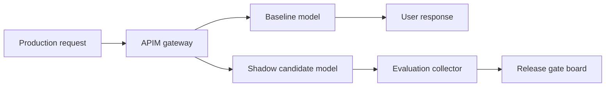
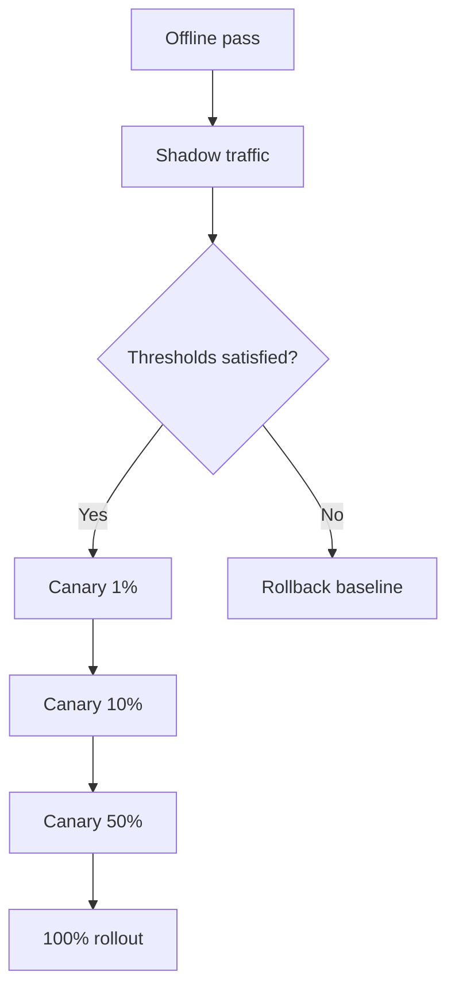

# Enterprise model-release gate and shadow-evaluation selection FAQ (Groundedness/Toxicity/Latency Budget: APIM + Foundry Evals)

> Audience: Cloud & AI Solution Architects, LLMOps leads, and release-governance teams for production AI systems.

## 1. Executive summary

Model release decisions must be evidence-based rather than subjective. Recommended layered release governance:

- **Route A (offline gate)**: `Foundry Evals` with fixed benchmark sets (quality, groundedness, refusal discipline, jailbreak success).
- **Route B (online shadow)**: `APIM` mirrored traffic for latency/cost/safety-intercept comparisons.
- **Route C (progressive rollout)**: tiered canary `1%->10%->50%->100%` with automatic rollback thresholds.
- **Route D (anti-pattern)**: direct full cutover without eval evidence.

## 2. Typical release failures

- Candidate sounds better but factual grounding regresses.
- Latency and cost regress simultaneously, breaching SLA and budget targets.
- Safety policy tuning mismatches new model behavior, increasing both false positives and leaks.
- Rollback without explicit thresholds becomes opinion-driven crisis response.

## 3. Route definitions

### Route A: offline evaluation gate
- Fixed benchmark corpus and deterministic scoring against current baseline.
- Hard stop criteria for critical regressions.

### Route B: online shadow evaluation
- Mirror production prompts to candidate model without user-facing impact.
- Track `ΔP95`, `ΔCost`, and `ΔSafetyIntercept` in production-like distributions.

### Route C: progressive canary rollout
- Gradually scale by tenant tier, workload class, and risk profile.
- Trigger automatic rollback when any hard threshold is breached.

### Route D: anti-pattern baseline
- Immediate full cutover with no offline gate and no shadow validation.
- Post-incident diagnostics cannot separate model issues from policy misconfiguration.

## 4. Quantitative models

### 4.1 Release utility model
`Gain_release = w1*ΔQuality - w2*ΔCost - w3*ΔLatency - w4*ΔRisk`

### 4.2 Shadow divergence score
`Drift_shadow = 1 - Similarity(candidate, baseline)`

### 4.3 Rollback trigger rule
`Rollback if (ΔP95 > θ_latency) or (ΔCost > θ_cost) or (SafetyLeak > θ_safety)`

### 4.4 Release confidence
`Release_confidence = 1 - P(regression | observed_metrics)`

## 5. Twelve-dimension comparison matrix

| Dimension | Route A offline gate | Route B online shadow | Route C progressive canary | Route D anti-pattern |
|---|---|---|---|---|
| Quality-regression detection | High | Medium-high | Medium | Low |
| Latency-regression detection | Medium | High | High | Low |
| Cost-regression detection | Medium | High | High | Low |
| Safety-leak detection | High | Medium-high | Medium | Low |
| Rollback readiness | Medium | Medium-high | High | Low |
| Ops complexity | Medium | Medium | Medium | Low |
| Automation maturity | High | Medium-high | High | Low |
| Business explainability | High | Medium | High | Low |
| Change-risk control | High | High | High | Low |
| Multi-tenant fit | Medium | High | High | Low |
| Release velocity | Medium | Medium | Medium-high | High (risky) |
| Recommendation | ✅ required | ✅ strongly recommended | ✅ required | ⛔ |

## 6. Deep quantitative Q&A (Q1-Q8)
### Q1: Why shadow traffic after offline pass?
Offline sets cannot represent full production long-tail distributions.

### Q2: Does shadow traffic increase cost?
Yes, but it reduces the probability and blast radius of full-scale release incidents.

### Q3: How should rollback thresholds be set?
Use explicit SLA and budget guardrails, never subjective operator judgment.

### Q4: How to choose between quality and cost trade-offs?
Apply a weighted release utility function per business domain.

### Q5: What if safety false positives increase?
Use risk-tiered policy segmentation instead of global one-size-fits-all rules.

### Q6: How to avoid slow release cadence?
Standardize eval assets and automate promotion gates end-to-end.

### Q7: Is parallel model operation necessary?
Yes, during candidate validation windows it materially reduces regression risk.

### Q8: Most critical gate metrics?
Groundedness, safety leak rate, P95 latency delta, and unit-cost delta.

## 7. Mermaid architecture diagrams





## 8. Production snippet: gate decision pseudo-code

```python
def gate(metrics):
    if metrics["safety_leak"] > 0.01:
        return "block"
    if metrics["delta_p95_ms"] > 120:
        return "block"
    if metrics["delta_unit_cost"] > 0.25:
        return "block"
    return "promote"
```

## 9. Production snippet: APIM shadow routing skeleton

```xml
<inbound>
  <base />
  <set-variable name="shadow-enabled" value="true" />
</inbound>
```

## 10. Enterprise scenarios (2+)

### Scenario A: banking support knowledge assistant
- Improve answer quality without violating regulated response constraints.
- Route A+B+C as standard release path.

### Scenario B: insurance claim triage assistant
- Reduce manual review load while controlling false-approval exposure.
- Offline gate, then shadow validation, then domain-tier canary rollout.

### Scenario C: cross-border e-commerce operations copilot
- Raise multilingual quality while containing token spend variance.
- Region/domain segmented canary plus automatic rollback thresholds.

## 11. Three-tier 3-year TCO (USD)

| Scale tier | A offline gate | A+B | A+B+C | Anti-pattern (incident exposure) |
|---|---:|---:|---:|---:|
| 5M requests/month | 1,900,000 | 2,350,000 | 2,620,000 | 1,300,000 (incident risk excluded) |
| 50M requests/month | 9,800,000 | 11,600,000 | 13,200,000 | 7,400,000 (incident risk excluded) |
| 500M requests/month | 52,000,000 | 59,000,000 | 66,500,000 | 43,500,000 (incident risk excluded) |

## 12. Day-0 / Day-1 / Day-2 checklist

### Day-0 (evaluation baseline)
- lock benchmark sets, thresholds, rollback conditions, and accountable owners.

### Day-1 (pipeline rollout)
- integrate offline evals, shadow telemetry, progressive canary, and automated rollback.

### Day-2 (continuous operations)
- monitor regression rate, safety leaks, P95 drift, and cost variance with iterative tuning.

## 13. Good fit vs Not for

### ✅ Good fit
- High-traffic, high-risk enterprise AI systems with strict SLA and governance requirements.
- Organizations requiring auditable release-decision evidence chains.

### ⛔ Not for
- One-off demos and temporary prototypes.
- Teams unwilling to invest in foundational LLMOps automation.

## 14. Five-step rollout guide
1. Define hard release redlines and rollback triggers.
2. Implement offline evaluation gates.
3. Add shadow traffic observability and comparative analysis.
4. Enforce progressive canary with automatic rollback.
5. Continuously recalibrate thresholds and eval assets after each release.

## 15. Core KPIs
- `groundedness_delta`
- `safety_leak_rate`
- `delta_p95_ms`
- `delta_unit_cost`
- `rollback_trigger_rate`

## 16. Final recommendation
Treat A (offline gate) + C (progressive rollout) as mandatory; enable B (shadow) by default for medium/high-risk domains; prohibit D.
