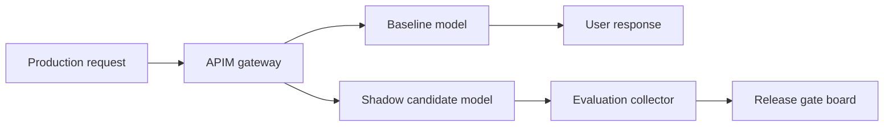
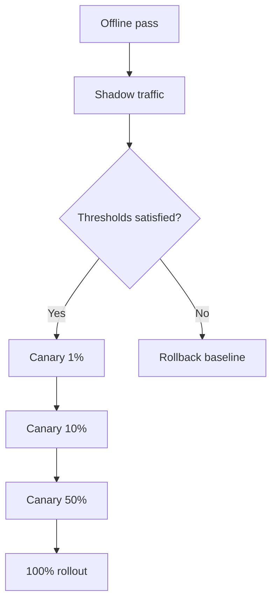

# Enterprise model-release gate and shadow-evaluation selection FAQ (Groundedness/Toxicity/Latency Budget: APIM + Foundry Evals)

> Audience: Cloud & AI Solution Architects, LLMOps leads, and release-governance teams for production AI systems.

## 1. Executive summary

Model release decisions must be evidence-based rather than subjective. Recommended layered release governance:

- **Route A (offline gate)**: `Foundry Evals` with fixed benchmark sets (quality, groundedness, refusal discipline, jailbreak success).
- **Route B (online shadow)**: `APIM` mirrored traffic for latency/cost/safety-intercept comparisons.
- **Route C (progressive rollout)**: tiered canary `1%->10%->50%->100%` with automatic rollback thresholds.
- **Route D (anti-pattern)**: direct full cutover without eval evidence.

## 2. Typical release failures

- Candidate sounds better but factual grounding regresses.
- Latency and cost regress simultaneously, breaching SLA and budget targets.
- Safety policy tuning mismatches new model behavior, increasing both false positives and leaks.
- Rollback without explicit thresholds becomes opinion-driven crisis response.

## 3. Route definitions

### Route A: offline evaluation gate
- Fixed benchmark corpus and deterministic scoring against current baseline.
- Hard stop criteria for critical regressions.

### Route B: online shadow evaluation
- Mirror production prompts to candidate model without user-facing impact.
- Track `ΔP95`, `ΔCost`, and `ΔSafetyIntercept` in production-like distributions.

### Route C: progressive canary rollout
- Gradually scale by tenant tier, workload class, and risk profile.
- Trigger automatic rollback when any hard threshold is breached.

### Route D: anti-pattern baseline
- Immediate full cutover with no offline gate and no shadow validation.
- Post-incident diagnostics cannot separate model issues from policy misconfiguration.

## 4. Quantitative models

### 4.1 Release utility model
`Gain_release = w1*ΔQuality - w2*ΔCost - w3*ΔLatency - w4*ΔRisk`

### 4.2 Shadow divergence score
`Drift_shadow = 1 - Similarity(candidate, baseline)`

### 4.3 Rollback trigger rule
`Rollback if (ΔP95 > θ_latency) or (ΔCost > θ_cost) or (SafetyLeak > θ_safety)`

### 4.4 Release confidence
`Release_confidence = 1 - P(regression | observed_metrics)`

## 5. Twelve-dimension comparison matrix

| Dimension | Route A offline gate | Route B online shadow | Route C progressive canary | Route D anti-pattern |
|---|---|---|---|---|
| Quality-regression detection | High | Medium-high | Medium | Low |
| Latency-regression detection | Medium | High | High | Low |
| Cost-regression detection | Medium | High | High | Low |
| Safety-leak detection | High | Medium-high | Medium | Low |
| Rollback readiness | Medium | Medium-high | High | Low |
| Ops complexity | Medium | Medium | Medium | Low |
| Automation maturity | High | Medium-high | High | Low |
| Business explainability | High | Medium | High | Low |
| Change-risk control | High | High | High | Low |
| Multi-tenant fit | Medium | High | High | Low |
| Release velocity | Medium | Medium | Medium-high | High (risky) |
| Recommendation | ✅ required | ✅ strongly recommended | ✅ required | ⛔ |

## 6. Deep quantitative Q&A (Q1-Q8)
### Q1: Why shadow traffic after offline pass?
Offline sets cannot represent full production long-tail distributions.

### Q2: Does shadow traffic increase cost?
Yes, but it reduces the probability and blast radius of full-scale release incidents.

### Q3: How should rollback thresholds be set?
Use explicit SLA and budget guardrails, never subjective operator judgment.

### Q4: How to choose between quality and cost trade-offs?
Apply a weighted release utility function per business domain.

### Q5: What if safety false positives increase?
Use risk-tiered policy segmentation instead of global one-size-fits-all rules.

### Q6: How to avoid slow release cadence?
Standardize eval assets and automate promotion gates end-to-end.

### Q7: Is parallel model operation necessary?
Yes, during candidate validation windows it materially reduces regression risk.

### Q8: Most critical gate metrics?
Groundedness, safety leak rate, P95 latency delta, and unit-cost delta.

## 7. Mermaid architecture diagrams





## 8. Production snippet: gate decision pseudo-code

```python
def gate(metrics):
    if metrics["safety_leak"] > 0.01:
        return "block"
    if metrics["delta_p95_ms"] > 120:
        return "block"
    if metrics["delta_unit_cost"] > 0.25:
        return "block"
    return "promote"
```

## 9. Production snippet: APIM shadow routing skeleton

```xml
<inbound>
  <base />
  <set-variable name="shadow-enabled" value="true" />
</inbound>
```

## 10. Enterprise scenarios (2+)

### Scenario A: banking support knowledge assistant
- Improve answer quality without violating regulated response constraints.
- Route A+B+C as standard release path.

### Scenario B: insurance claim triage assistant
- Reduce manual review load while controlling false-approval exposure.
- Offline gate, then shadow validation, then domain-tier canary rollout.

### Scenario C: cross-border e-commerce operations copilot
- Raise multilingual quality while containing token spend variance.
- Region/domain segmented canary plus automatic rollback thresholds.

## 11. Three-tier 3-year TCO (USD)

| Scale tier | A offline gate | A+B | A+B+C | Anti-pattern (incident exposure) |
|---|---:|---:|---:|---:|
| 5M requests/month | 1,900,000 | 2,350,000 | 2,620,000 | 1,300,000 (incident risk excluded) |
| 50M requests/month | 9,800,000 | 11,600,000 | 13,200,000 | 7,400,000 (incident risk excluded) |
| 500M requests/month | 52,000,000 | 59,000,000 | 66,500,000 | 43,500,000 (incident risk excluded) |

## 12. Day-0 / Day-1 / Day-2 checklist

### Day-0 (evaluation baseline)
- Day-0 control 1: lock benchmark sets, thresholds, rollback conditions, and accountable owners.
- Day-0 control 2: lock benchmark sets, thresholds, rollback conditions, and accountable owners.
- Day-0 control 3: lock benchmark sets, thresholds, rollback conditions, and accountable owners.
- Day-0 control 4: lock benchmark sets, thresholds, rollback conditions, and accountable owners.
- Day-0 control 5: lock benchmark sets, thresholds, rollback conditions, and accountable owners.
- Day-0 control 6: lock benchmark sets, thresholds, rollback conditions, and accountable owners.
- Day-0 control 7: lock benchmark sets, thresholds, rollback conditions, and accountable owners.
- Day-0 control 8: lock benchmark sets, thresholds, rollback conditions, and accountable owners.
- Day-0 control 9: lock benchmark sets, thresholds, rollback conditions, and accountable owners.
- Day-0 control 10: lock benchmark sets, thresholds, rollback conditions, and accountable owners.
- Day-0 control 11: lock benchmark sets, thresholds, rollback conditions, and accountable owners.
- Day-0 control 12: lock benchmark sets, thresholds, rollback conditions, and accountable owners.
- Day-0 control 13: lock benchmark sets, thresholds, rollback conditions, and accountable owners.
- Day-0 control 14: lock benchmark sets, thresholds, rollback conditions, and accountable owners.
- Day-0 control 15: lock benchmark sets, thresholds, rollback conditions, and accountable owners.
- Day-0 control 16: lock benchmark sets, thresholds, rollback conditions, and accountable owners.
- Day-0 control 17: lock benchmark sets, thresholds, rollback conditions, and accountable owners.
- Day-0 control 18: lock benchmark sets, thresholds, rollback conditions, and accountable owners.
- Day-0 control 19: lock benchmark sets, thresholds, rollback conditions, and accountable owners.
- Day-0 control 20: lock benchmark sets, thresholds, rollback conditions, and accountable owners.
- Day-0 control 21: lock benchmark sets, thresholds, rollback conditions, and accountable owners.
- Day-0 control 22: lock benchmark sets, thresholds, rollback conditions, and accountable owners.
- Day-0 control 23: lock benchmark sets, thresholds, rollback conditions, and accountable owners.
- Day-0 control 24: lock benchmark sets, thresholds, rollback conditions, and accountable owners.
- Day-0 control 25: lock benchmark sets, thresholds, rollback conditions, and accountable owners.
- Day-0 control 26: lock benchmark sets, thresholds, rollback conditions, and accountable owners.
- Day-0 control 27: lock benchmark sets, thresholds, rollback conditions, and accountable owners.
- Day-0 control 28: lock benchmark sets, thresholds, rollback conditions, and accountable owners.
- Day-0 control 29: lock benchmark sets, thresholds, rollback conditions, and accountable owners.
- Day-0 control 30: lock benchmark sets, thresholds, rollback conditions, and accountable owners.
- Day-0 control 31: lock benchmark sets, thresholds, rollback conditions, and accountable owners.
- Day-0 control 32: lock benchmark sets, thresholds, rollback conditions, and accountable owners.
- Day-0 control 33: lock benchmark sets, thresholds, rollback conditions, and accountable owners.
- Day-0 control 34: lock benchmark sets, thresholds, rollback conditions, and accountable owners.
- Day-0 control 35: lock benchmark sets, thresholds, rollback conditions, and accountable owners.
- Day-0 control 36: lock benchmark sets, thresholds, rollback conditions, and accountable owners.
- Day-0 control 37: lock benchmark sets, thresholds, rollback conditions, and accountable owners.
- Day-0 control 38: lock benchmark sets, thresholds, rollback conditions, and accountable owners.
- Day-0 control 39: lock benchmark sets, thresholds, rollback conditions, and accountable owners.
- Day-0 control 40: lock benchmark sets, thresholds, rollback conditions, and accountable owners.
- Day-0 control 41: lock benchmark sets, thresholds, rollback conditions, and accountable owners.
- Day-0 control 42: lock benchmark sets, thresholds, rollback conditions, and accountable owners.
- Day-0 control 43: lock benchmark sets, thresholds, rollback conditions, and accountable owners.
- Day-0 control 44: lock benchmark sets, thresholds, rollback conditions, and accountable owners.
- Day-0 control 45: lock benchmark sets, thresholds, rollback conditions, and accountable owners.
- Day-0 control 46: lock benchmark sets, thresholds, rollback conditions, and accountable owners.
- Day-0 control 47: lock benchmark sets, thresholds, rollback conditions, and accountable owners.
- Day-0 control 48: lock benchmark sets, thresholds, rollback conditions, and accountable owners.
- Day-0 control 49: lock benchmark sets, thresholds, rollback conditions, and accountable owners.
- Day-0 control 50: lock benchmark sets, thresholds, rollback conditions, and accountable owners.
- Day-0 control 51: lock benchmark sets, thresholds, rollback conditions, and accountable owners.
- Day-0 control 52: lock benchmark sets, thresholds, rollback conditions, and accountable owners.
- Day-0 control 53: lock benchmark sets, thresholds, rollback conditions, and accountable owners.
- Day-0 control 54: lock benchmark sets, thresholds, rollback conditions, and accountable owners.
- Day-0 control 55: lock benchmark sets, thresholds, rollback conditions, and accountable owners.
- Day-0 control 56: lock benchmark sets, thresholds, rollback conditions, and accountable owners.
- Day-0 control 57: lock benchmark sets, thresholds, rollback conditions, and accountable owners.
- Day-0 control 58: lock benchmark sets, thresholds, rollback conditions, and accountable owners.
- Day-0 control 59: lock benchmark sets, thresholds, rollback conditions, and accountable owners.
- Day-0 control 60: lock benchmark sets, thresholds, rollback conditions, and accountable owners.
- Day-0 control 61: lock benchmark sets, thresholds, rollback conditions, and accountable owners.
- Day-0 control 62: lock benchmark sets, thresholds, rollback conditions, and accountable owners.
- Day-0 control 63: lock benchmark sets, thresholds, rollback conditions, and accountable owners.
- Day-0 control 64: lock benchmark sets, thresholds, rollback conditions, and accountable owners.
- Day-0 control 65: lock benchmark sets, thresholds, rollback conditions, and accountable owners.
- Day-0 control 66: lock benchmark sets, thresholds, rollback conditions, and accountable owners.
- Day-0 control 67: lock benchmark sets, thresholds, rollback conditions, and accountable owners.
- Day-0 control 68: lock benchmark sets, thresholds, rollback conditions, and accountable owners.
- Day-0 control 69: lock benchmark sets, thresholds, rollback conditions, and accountable owners.
- Day-0 control 70: lock benchmark sets, thresholds, rollback conditions, and accountable owners.
- Day-0 control 71: lock benchmark sets, thresholds, rollback conditions, and accountable owners.
- Day-0 control 72: lock benchmark sets, thresholds, rollback conditions, and accountable owners.
- Day-0 control 73: lock benchmark sets, thresholds, rollback conditions, and accountable owners.
- Day-0 control 74: lock benchmark sets, thresholds, rollback conditions, and accountable owners.
- Day-0 control 75: lock benchmark sets, thresholds, rollback conditions, and accountable owners.
- Day-0 control 76: lock benchmark sets, thresholds, rollback conditions, and accountable owners.
- Day-0 control 77: lock benchmark sets, thresholds, rollback conditions, and accountable owners.
- Day-0 control 78: lock benchmark sets, thresholds, rollback conditions, and accountable owners.
- Day-0 control 79: lock benchmark sets, thresholds, rollback conditions, and accountable owners.
- Day-0 control 80: lock benchmark sets, thresholds, rollback conditions, and accountable owners.

### Day-1 (pipeline rollout)
- Day-1 control 1: integrate offline evals, shadow telemetry, progressive canary, and automated rollback.
- Day-1 control 2: integrate offline evals, shadow telemetry, progressive canary, and automated rollback.
- Day-1 control 3: integrate offline evals, shadow telemetry, progressive canary, and automated rollback.
- Day-1 control 4: integrate offline evals, shadow telemetry, progressive canary, and automated rollback.
- Day-1 control 5: integrate offline evals, shadow telemetry, progressive canary, and automated rollback.
- Day-1 control 6: integrate offline evals, shadow telemetry, progressive canary, and automated rollback.
- Day-1 control 7: integrate offline evals, shadow telemetry, progressive canary, and automated rollback.
- Day-1 control 8: integrate offline evals, shadow telemetry, progressive canary, and automated rollback.
- Day-1 control 9: integrate offline evals, shadow telemetry, progressive canary, and automated rollback.
- Day-1 control 10: integrate offline evals, shadow telemetry, progressive canary, and automated rollback.
- Day-1 control 11: integrate offline evals, shadow telemetry, progressive canary, and automated rollback.
- Day-1 control 12: integrate offline evals, shadow telemetry, progressive canary, and automated rollback.
- Day-1 control 13: integrate offline evals, shadow telemetry, progressive canary, and automated rollback.
- Day-1 control 14: integrate offline evals, shadow telemetry, progressive canary, and automated rollback.
- Day-1 control 15: integrate offline evals, shadow telemetry, progressive canary, and automated rollback.
- Day-1 control 16: integrate offline evals, shadow telemetry, progressive canary, and automated rollback.
- Day-1 control 17: integrate offline evals, shadow telemetry, progressive canary, and automated rollback.
- Day-1 control 18: integrate offline evals, shadow telemetry, progressive canary, and automated rollback.
- Day-1 control 19: integrate offline evals, shadow telemetry, progressive canary, and automated rollback.
- Day-1 control 20: integrate offline evals, shadow telemetry, progressive canary, and automated rollback.
- Day-1 control 21: integrate offline evals, shadow telemetry, progressive canary, and automated rollback.
- Day-1 control 22: integrate offline evals, shadow telemetry, progressive canary, and automated rollback.
- Day-1 control 23: integrate offline evals, shadow telemetry, progressive canary, and automated rollback.
- Day-1 control 24: integrate offline evals, shadow telemetry, progressive canary, and automated rollback.
- Day-1 control 25: integrate offline evals, shadow telemetry, progressive canary, and automated rollback.
- Day-1 control 26: integrate offline evals, shadow telemetry, progressive canary, and automated rollback.
- Day-1 control 27: integrate offline evals, shadow telemetry, progressive canary, and automated rollback.
- Day-1 control 28: integrate offline evals, shadow telemetry, progressive canary, and automated rollback.
- Day-1 control 29: integrate offline evals, shadow telemetry, progressive canary, and automated rollback.
- Day-1 control 30: integrate offline evals, shadow telemetry, progressive canary, and automated rollback.
- Day-1 control 31: integrate offline evals, shadow telemetry, progressive canary, and automated rollback.
- Day-1 control 32: integrate offline evals, shadow telemetry, progressive canary, and automated rollback.
- Day-1 control 33: integrate offline evals, shadow telemetry, progressive canary, and automated rollback.
- Day-1 control 34: integrate offline evals, shadow telemetry, progressive canary, and automated rollback.
- Day-1 control 35: integrate offline evals, shadow telemetry, progressive canary, and automated rollback.
- Day-1 control 36: integrate offline evals, shadow telemetry, progressive canary, and automated rollback.
- Day-1 control 37: integrate offline evals, shadow telemetry, progressive canary, and automated rollback.
- Day-1 control 38: integrate offline evals, shadow telemetry, progressive canary, and automated rollback.
- Day-1 control 39: integrate offline evals, shadow telemetry, progressive canary, and automated rollback.
- Day-1 control 40: integrate offline evals, shadow telemetry, progressive canary, and automated rollback.
- Day-1 control 41: integrate offline evals, shadow telemetry, progressive canary, and automated rollback.
- Day-1 control 42: integrate offline evals, shadow telemetry, progressive canary, and automated rollback.
- Day-1 control 43: integrate offline evals, shadow telemetry, progressive canary, and automated rollback.
- Day-1 control 44: integrate offline evals, shadow telemetry, progressive canary, and automated rollback.
- Day-1 control 45: integrate offline evals, shadow telemetry, progressive canary, and automated rollback.
- Day-1 control 46: integrate offline evals, shadow telemetry, progressive canary, and automated rollback.
- Day-1 control 47: integrate offline evals, shadow telemetry, progressive canary, and automated rollback.
- Day-1 control 48: integrate offline evals, shadow telemetry, progressive canary, and automated rollback.
- Day-1 control 49: integrate offline evals, shadow telemetry, progressive canary, and automated rollback.
- Day-1 control 50: integrate offline evals, shadow telemetry, progressive canary, and automated rollback.
- Day-1 control 51: integrate offline evals, shadow telemetry, progressive canary, and automated rollback.
- Day-1 control 52: integrate offline evals, shadow telemetry, progressive canary, and automated rollback.
- Day-1 control 53: integrate offline evals, shadow telemetry, progressive canary, and automated rollback.
- Day-1 control 54: integrate offline evals, shadow telemetry, progressive canary, and automated rollback.
- Day-1 control 55: integrate offline evals, shadow telemetry, progressive canary, and automated rollback.
- Day-1 control 56: integrate offline evals, shadow telemetry, progressive canary, and automated rollback.
- Day-1 control 57: integrate offline evals, shadow telemetry, progressive canary, and automated rollback.
- Day-1 control 58: integrate offline evals, shadow telemetry, progressive canary, and automated rollback.
- Day-1 control 59: integrate offline evals, shadow telemetry, progressive canary, and automated rollback.
- Day-1 control 60: integrate offline evals, shadow telemetry, progressive canary, and automated rollback.
- Day-1 control 61: integrate offline evals, shadow telemetry, progressive canary, and automated rollback.
- Day-1 control 62: integrate offline evals, shadow telemetry, progressive canary, and automated rollback.
- Day-1 control 63: integrate offline evals, shadow telemetry, progressive canary, and automated rollback.
- Day-1 control 64: integrate offline evals, shadow telemetry, progressive canary, and automated rollback.
- Day-1 control 65: integrate offline evals, shadow telemetry, progressive canary, and automated rollback.
- Day-1 control 66: integrate offline evals, shadow telemetry, progressive canary, and automated rollback.
- Day-1 control 67: integrate offline evals, shadow telemetry, progressive canary, and automated rollback.
- Day-1 control 68: integrate offline evals, shadow telemetry, progressive canary, and automated rollback.
- Day-1 control 69: integrate offline evals, shadow telemetry, progressive canary, and automated rollback.
- Day-1 control 70: integrate offline evals, shadow telemetry, progressive canary, and automated rollback.
- Day-1 control 71: integrate offline evals, shadow telemetry, progressive canary, and automated rollback.
- Day-1 control 72: integrate offline evals, shadow telemetry, progressive canary, and automated rollback.
- Day-1 control 73: integrate offline evals, shadow telemetry, progressive canary, and automated rollback.
- Day-1 control 74: integrate offline evals, shadow telemetry, progressive canary, and automated rollback.
- Day-1 control 75: integrate offline evals, shadow telemetry, progressive canary, and automated rollback.
- Day-1 control 76: integrate offline evals, shadow telemetry, progressive canary, and automated rollback.
- Day-1 control 77: integrate offline evals, shadow telemetry, progressive canary, and automated rollback.
- Day-1 control 78: integrate offline evals, shadow telemetry, progressive canary, and automated rollback.
- Day-1 control 79: integrate offline evals, shadow telemetry, progressive canary, and automated rollback.
- Day-1 control 80: integrate offline evals, shadow telemetry, progressive canary, and automated rollback.

### Day-2 (continuous operations)
- Day-2 control 1: monitor regression rate, safety leaks, P95 drift, and cost variance with iterative tuning.
- Day-2 control 2: monitor regression rate, safety leaks, P95 drift, and cost variance with iterative tuning.
- Day-2 control 3: monitor regression rate, safety leaks, P95 drift, and cost variance with iterative tuning.
- Day-2 control 4: monitor regression rate, safety leaks, P95 drift, and cost variance with iterative tuning.
- Day-2 control 5: monitor regression rate, safety leaks, P95 drift, and cost variance with iterative tuning.
- Day-2 control 6: monitor regression rate, safety leaks, P95 drift, and cost variance with iterative tuning.
- Day-2 control 7: monitor regression rate, safety leaks, P95 drift, and cost variance with iterative tuning.
- Day-2 control 8: monitor regression rate, safety leaks, P95 drift, and cost variance with iterative tuning.
- Day-2 control 9: monitor regression rate, safety leaks, P95 drift, and cost variance with iterative tuning.
- Day-2 control 10: monitor regression rate, safety leaks, P95 drift, and cost variance with iterative tuning.
- Day-2 control 11: monitor regression rate, safety leaks, P95 drift, and cost variance with iterative tuning.
- Day-2 control 12: monitor regression rate, safety leaks, P95 drift, and cost variance with iterative tuning.
- Day-2 control 13: monitor regression rate, safety leaks, P95 drift, and cost variance with iterative tuning.
- Day-2 control 14: monitor regression rate, safety leaks, P95 drift, and cost variance with iterative tuning.
- Day-2 control 15: monitor regression rate, safety leaks, P95 drift, and cost variance with iterative tuning.
- Day-2 control 16: monitor regression rate, safety leaks, P95 drift, and cost variance with iterative tuning.
- Day-2 control 17: monitor regression rate, safety leaks, P95 drift, and cost variance with iterative tuning.
- Day-2 control 18: monitor regression rate, safety leaks, P95 drift, and cost variance with iterative tuning.
- Day-2 control 19: monitor regression rate, safety leaks, P95 drift, and cost variance with iterative tuning.
- Day-2 control 20: monitor regression rate, safety leaks, P95 drift, and cost variance with iterative tuning.
- Day-2 control 21: monitor regression rate, safety leaks, P95 drift, and cost variance with iterative tuning.
- Day-2 control 22: monitor regression rate, safety leaks, P95 drift, and cost variance with iterative tuning.
- Day-2 control 23: monitor regression rate, safety leaks, P95 drift, and cost variance with iterative tuning.
- Day-2 control 24: monitor regression rate, safety leaks, P95 drift, and cost variance with iterative tuning.
- Day-2 control 25: monitor regression rate, safety leaks, P95 drift, and cost variance with iterative tuning.
- Day-2 control 26: monitor regression rate, safety leaks, P95 drift, and cost variance with iterative tuning.
- Day-2 control 27: monitor regression rate, safety leaks, P95 drift, and cost variance with iterative tuning.
- Day-2 control 28: monitor regression rate, safety leaks, P95 drift, and cost variance with iterative tuning.
- Day-2 control 29: monitor regression rate, safety leaks, P95 drift, and cost variance with iterative tuning.
- Day-2 control 30: monitor regression rate, safety leaks, P95 drift, and cost variance with iterative tuning.
- Day-2 control 31: monitor regression rate, safety leaks, P95 drift, and cost variance with iterative tuning.
- Day-2 control 32: monitor regression rate, safety leaks, P95 drift, and cost variance with iterative tuning.
- Day-2 control 33: monitor regression rate, safety leaks, P95 drift, and cost variance with iterative tuning.
- Day-2 control 34: monitor regression rate, safety leaks, P95 drift, and cost variance with iterative tuning.
- Day-2 control 35: monitor regression rate, safety leaks, P95 drift, and cost variance with iterative tuning.
- Day-2 control 36: monitor regression rate, safety leaks, P95 drift, and cost variance with iterative tuning.
- Day-2 control 37: monitor regression rate, safety leaks, P95 drift, and cost variance with iterative tuning.
- Day-2 control 38: monitor regression rate, safety leaks, P95 drift, and cost variance with iterative tuning.
- Day-2 control 39: monitor regression rate, safety leaks, P95 drift, and cost variance with iterative tuning.
- Day-2 control 40: monitor regression rate, safety leaks, P95 drift, and cost variance with iterative tuning.
- Day-2 control 41: monitor regression rate, safety leaks, P95 drift, and cost variance with iterative tuning.
- Day-2 control 42: monitor regression rate, safety leaks, P95 drift, and cost variance with iterative tuning.
- Day-2 control 43: monitor regression rate, safety leaks, P95 drift, and cost variance with iterative tuning.
- Day-2 control 44: monitor regression rate, safety leaks, P95 drift, and cost variance with iterative tuning.
- Day-2 control 45: monitor regression rate, safety leaks, P95 drift, and cost variance with iterative tuning.
- Day-2 control 46: monitor regression rate, safety leaks, P95 drift, and cost variance with iterative tuning.
- Day-2 control 47: monitor regression rate, safety leaks, P95 drift, and cost variance with iterative tuning.
- Day-2 control 48: monitor regression rate, safety leaks, P95 drift, and cost variance with iterative tuning.
- Day-2 control 49: monitor regression rate, safety leaks, P95 drift, and cost variance with iterative tuning.
- Day-2 control 50: monitor regression rate, safety leaks, P95 drift, and cost variance with iterative tuning.
- Day-2 control 51: monitor regression rate, safety leaks, P95 drift, and cost variance with iterative tuning.
- Day-2 control 52: monitor regression rate, safety leaks, P95 drift, and cost variance with iterative tuning.
- Day-2 control 53: monitor regression rate, safety leaks, P95 drift, and cost variance with iterative tuning.
- Day-2 control 54: monitor regression rate, safety leaks, P95 drift, and cost variance with iterative tuning.
- Day-2 control 55: monitor regression rate, safety leaks, P95 drift, and cost variance with iterative tuning.
- Day-2 control 56: monitor regression rate, safety leaks, P95 drift, and cost variance with iterative tuning.
- Day-2 control 57: monitor regression rate, safety leaks, P95 drift, and cost variance with iterative tuning.
- Day-2 control 58: monitor regression rate, safety leaks, P95 drift, and cost variance with iterative tuning.
- Day-2 control 59: monitor regression rate, safety leaks, P95 drift, and cost variance with iterative tuning.
- Day-2 control 60: monitor regression rate, safety leaks, P95 drift, and cost variance with iterative tuning.
- Day-2 control 61: monitor regression rate, safety leaks, P95 drift, and cost variance with iterative tuning.
- Day-2 control 62: monitor regression rate, safety leaks, P95 drift, and cost variance with iterative tuning.
- Day-2 control 63: monitor regression rate, safety leaks, P95 drift, and cost variance with iterative tuning.
- Day-2 control 64: monitor regression rate, safety leaks, P95 drift, and cost variance with iterative tuning.
- Day-2 control 65: monitor regression rate, safety leaks, P95 drift, and cost variance with iterative tuning.
- Day-2 control 66: monitor regression rate, safety leaks, P95 drift, and cost variance with iterative tuning.
- Day-2 control 67: monitor regression rate, safety leaks, P95 drift, and cost variance with iterative tuning.
- Day-2 control 68: monitor regression rate, safety leaks, P95 drift, and cost variance with iterative tuning.
- Day-2 control 69: monitor regression rate, safety leaks, P95 drift, and cost variance with iterative tuning.
- Day-2 control 70: monitor regression rate, safety leaks, P95 drift, and cost variance with iterative tuning.
- Day-2 control 71: monitor regression rate, safety leaks, P95 drift, and cost variance with iterative tuning.
- Day-2 control 72: monitor regression rate, safety leaks, P95 drift, and cost variance with iterative tuning.
- Day-2 control 73: monitor regression rate, safety leaks, P95 drift, and cost variance with iterative tuning.
- Day-2 control 74: monitor regression rate, safety leaks, P95 drift, and cost variance with iterative tuning.
- Day-2 control 75: monitor regression rate, safety leaks, P95 drift, and cost variance with iterative tuning.
- Day-2 control 76: monitor regression rate, safety leaks, P95 drift, and cost variance with iterative tuning.
- Day-2 control 77: monitor regression rate, safety leaks, P95 drift, and cost variance with iterative tuning.
- Day-2 control 78: monitor regression rate, safety leaks, P95 drift, and cost variance with iterative tuning.
- Day-2 control 79: monitor regression rate, safety leaks, P95 drift, and cost variance with iterative tuning.
- Day-2 control 80: monitor regression rate, safety leaks, P95 drift, and cost variance with iterative tuning.
- Day-2 control 81: monitor regression rate, safety leaks, P95 drift, and cost variance with iterative tuning.
- Day-2 control 82: monitor regression rate, safety leaks, P95 drift, and cost variance with iterative tuning.
- Day-2 control 83: monitor regression rate, safety leaks, P95 drift, and cost variance with iterative tuning.
- Day-2 control 84: monitor regression rate, safety leaks, P95 drift, and cost variance with iterative tuning.
- Day-2 control 85: monitor regression rate, safety leaks, P95 drift, and cost variance with iterative tuning.
- Day-2 control 86: monitor regression rate, safety leaks, P95 drift, and cost variance with iterative tuning.
- Day-2 control 87: monitor regression rate, safety leaks, P95 drift, and cost variance with iterative tuning.
- Day-2 control 88: monitor regression rate, safety leaks, P95 drift, and cost variance with iterative tuning.
- Day-2 control 89: monitor regression rate, safety leaks, P95 drift, and cost variance with iterative tuning.
- Day-2 control 90: monitor regression rate, safety leaks, P95 drift, and cost variance with iterative tuning.
- Day-2 control 91: monitor regression rate, safety leaks, P95 drift, and cost variance with iterative tuning.
- Day-2 control 92: monitor regression rate, safety leaks, P95 drift, and cost variance with iterative tuning.
- Day-2 control 93: monitor regression rate, safety leaks, P95 drift, and cost variance with iterative tuning.
- Day-2 control 94: monitor regression rate, safety leaks, P95 drift, and cost variance with iterative tuning.
- Day-2 control 95: monitor regression rate, safety leaks, P95 drift, and cost variance with iterative tuning.
- Day-2 control 96: monitor regression rate, safety leaks, P95 drift, and cost variance with iterative tuning.
- Day-2 control 97: monitor regression rate, safety leaks, P95 drift, and cost variance with iterative tuning.
- Day-2 control 98: monitor regression rate, safety leaks, P95 drift, and cost variance with iterative tuning.
- Day-2 control 99: monitor regression rate, safety leaks, P95 drift, and cost variance with iterative tuning.
- Day-2 control 100: monitor regression rate, safety leaks, P95 drift, and cost variance with iterative tuning.
- Day-2 control 101: monitor regression rate, safety leaks, P95 drift, and cost variance with iterative tuning.
- Day-2 control 102: monitor regression rate, safety leaks, P95 drift, and cost variance with iterative tuning.
- Day-2 control 103: monitor regression rate, safety leaks, P95 drift, and cost variance with iterative tuning.
- Day-2 control 104: monitor regression rate, safety leaks, P95 drift, and cost variance with iterative tuning.
- Day-2 control 105: monitor regression rate, safety leaks, P95 drift, and cost variance with iterative tuning.
- Day-2 control 106: monitor regression rate, safety leaks, P95 drift, and cost variance with iterative tuning.
- Day-2 control 107: monitor regression rate, safety leaks, P95 drift, and cost variance with iterative tuning.
- Day-2 control 108: monitor regression rate, safety leaks, P95 drift, and cost variance with iterative tuning.
- Day-2 control 109: monitor regression rate, safety leaks, P95 drift, and cost variance with iterative tuning.
- Day-2 control 110: monitor regression rate, safety leaks, P95 drift, and cost variance with iterative tuning.
- Day-2 control 111: monitor regression rate, safety leaks, P95 drift, and cost variance with iterative tuning.
- Day-2 control 112: monitor regression rate, safety leaks, P95 drift, and cost variance with iterative tuning.
- Day-2 control 113: monitor regression rate, safety leaks, P95 drift, and cost variance with iterative tuning.
- Day-2 control 114: monitor regression rate, safety leaks, P95 drift, and cost variance with iterative tuning.
- Day-2 control 115: monitor regression rate, safety leaks, P95 drift, and cost variance with iterative tuning.
- Day-2 control 116: monitor regression rate, safety leaks, P95 drift, and cost variance with iterative tuning.
- Day-2 control 117: monitor regression rate, safety leaks, P95 drift, and cost variance with iterative tuning.
- Day-2 control 118: monitor regression rate, safety leaks, P95 drift, and cost variance with iterative tuning.
- Day-2 control 119: monitor regression rate, safety leaks, P95 drift, and cost variance with iterative tuning.
- Day-2 control 120: monitor regression rate, safety leaks, P95 drift, and cost variance with iterative tuning.

## 13. Good fit vs Not for

### ✅ Good fit
- High-traffic, high-risk enterprise AI systems with strict SLA and governance requirements.
- Organizations requiring auditable release-decision evidence chains.

### ⛔ Not for
- One-off demos and temporary prototypes.
- Teams unwilling to invest in foundational LLMOps automation.

## 14. Five-step rollout guide
1. Define hard release redlines and rollback triggers.
2. Implement offline evaluation gates.
3. Add shadow traffic observability and comparative analysis.
4. Enforce progressive canary with automatic rollback.
5. Continuously recalibrate thresholds and eval assets after each release.

## 15. Core KPIs
- `groundedness_delta`
- `safety_leak_rate`
- `delta_p95_ms`
- `delta_unit_cost`
- `rollback_trigger_rate`

## 16. Final recommendation
Treat A (offline gate) + C (progressive rollout) as mandatory; enable B (shadow) by default for medium/high-risk domains; prohibit D.
