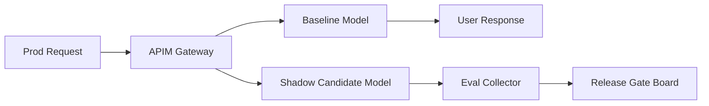
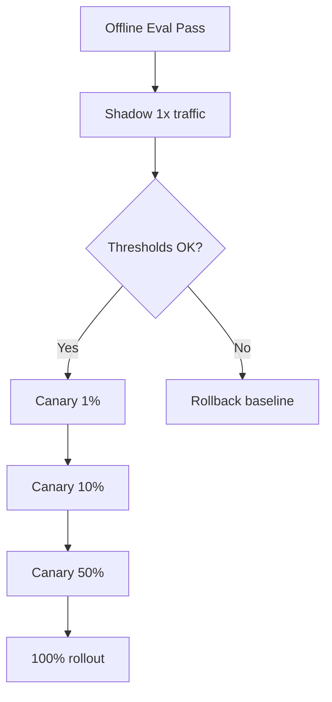

# 企业模型发布门禁与影子评测选型 FAQ（Groundedness/Toxicity/Latency Budget：APIM + Foundry Evals）

> 面向对象：Cloud & AI Solution Architect、LLMOps 负责人、平台发布治理与风险控制团队。

## 1. 执行摘要

企业模型发布不能依赖“主观体验好像更聪明了”，必须采用可复验的发布门禁。推荐三层架构：

- **Route A（离线门禁）**：`Foundry Evals` + 固定样本集评测（准确率、Groundedness、拒答率、越狱率）。
- **Route B（在线影子）**：`APIM` 影子流量复制 + 成本/时延/拦截率对照。
- **Route C（渐进发布）**：租户/场景分层金丝雀 `1%->10%->50%->100%`，附自动回退阈值。
- **Route D（反模式）**：无评测即全量切换。

## 2. 常见发布事故

- 回答更“会说”但事实性下降，Groundedness 回归未被发现。
- 延迟成本同时升高，业务 SLA 和预算一起失守。
- 内容安全拦截策略与新模型不匹配，误拦与漏拦同时上升。
- 回滚缺少硬阈值，导致事故处置靠人拍脑袋。

## 3. 路线定义

### Route A：离线评测门禁
- 固定版本数据集 + 固定评测配置，比较候选模型与基线模型。
- 用红线指标设置阻断发布（如越狱成功率、事实错误率）。

### Route B：在线影子评测
- 生产请求镜像到候选模型，仅记录结果，不影响用户响应。
- 计算 `ΔP95`、`ΔCost`、`ΔSafetyIntercept`。

### Route C：渐进分层发布
- 按租户等级、业务域、风险级别逐步放量。
- 达到自动回退阈值立即回切基线模型。

### Route D：反模式
- 直接全量切换，不做离线评测和影子验证。
- 事故后无法快速定位是模型问题还是策略问题。

## 4. 定量模型

### 4.1 发布收益函数
`Gain_release = w1*ΔQuality - w2*ΔCost - w3*ΔLatency - w4*ΔRisk`

### 4.2 影子一致性偏差
`Drift_shadow = 1 - Similarity(candidate, baseline)`

### 4.3 回退触发条件
`Rollback if (ΔP95 > θ_latency) or (ΔCost > θ_cost) or (SafetyLeak > θ_safety)`

### 4.4 发布可靠性
`Release_confidence = 1 - P(regression | observed_metrics)`

## 5. 12 维对比矩阵

| 维度 | Route A 离线评测 | Route B 在线影子 | Route C 渐进发布 | Route D 反模式 |
|---|---|---|---|---|
| 质量回归识别 | 高 | 中高 | 中 | 低 |
| 时延回归识别 | 中 | 高 | 高 | 低 |
| 成本回归识别 | 中 | 高 | 高 | 低 |
| 安全漏拦识别 | 高 | 中高 | 中 | 低 |
| 可回滚性 | 中 | 中高 | 高 | 低 |
| 运维复杂度 | 中 | 中 | 中 | 低 |
| 自动化程度 | 高 | 中高 | 高 | 低 |
| 业务可解释性 | 高 | 中 | 高 | 低 |
| 变更风险控制 | 高 | 高 | 高 | 低 |
| 多租户适配 | 中 | 高 | 高 | 低 |
| 发布速度 | 中 | 中 | 中高 | 高（冒险） |
| 结论 | ✅ 必选 | ✅ 强烈建议 | ✅ 必选 | ⛔ |

## 6. 深度问答（Q1-Q8）
### Q1：离线评测通过后为何还要影子流量？
离线集无法覆盖全部生产长尾输入，影子流量能补齐真实分布。

### Q2：影子流量会增加线上成本吗？
会增加评测期成本，但能显著降低全量事故成本。

### Q3：如何设置自动回退阈值？
按业务 SLA 与预算红线设定硬阈值，不接受人工“感觉可接受”。

### Q4：质量和成本冲突如何决策？
用收益函数统一评估，明确不同业务场景权重。

### Q5：安全误拦上升如何处理？
细分策略层级，区分高风险与普通场景，避免一刀切。

### Q6：发布节奏太慢怎么办？
建立标准化评测资产与流水线，把慢变成自动化。

### Q7：多模型并行是否必要？
关键阶段必要，可显著降低单点模型回归风险。

### Q8：最关键的门禁指标是什么？
Groundedness、Safety leak、P95 latency、unit cost。

## 7. Mermaid 架构图





## 8. 生产片段：门禁决策伪代码

```python
def gate(metrics):
    if metrics["safety_leak"] > 0.01:
        return "block"
    if metrics["delta_p95_ms"] > 120:
        return "block"
    if metrics["delta_unit_cost"] > 0.25:
        return "block"
    return "promote"
```

## 9. 生产片段：APIM 影子路由示意

```xml
<inbound>
  <base />
  <set-variable name="shadow-enabled" value="true" />
</inbound>
```

## 10. 企业场景（2+）

### 场景 A：银行客服知识问答
- 目标：提升回答准确率但不能牺牲合规回复约束。
- 方案：A+B+C 全链路门禁与回退。

### 场景 B：保险理赔辅助 Agent
- 目标：降低人工复核成本，同时控制误判带来的赔付风险。
- 方案：先离线评测，再影子验证，再分区灰度。

### 场景 C：跨境电商运营 Copilot
- 目标：多语言响应提质，同时控制 token 成本波动。
- 方案：按区域与业务域分层金丝雀。

## 11. 三档三年 TCO（USD）

| 规模档位 | A 离线门禁 | A+B | A+B+C | 反模式（事故暴露） |
|---|---:|---:|---:|---:|
| 500 万请求/月 | 1,900,000 | 2,350,000 | 2,620,000 | 1,300,000（不含事故） |
| 5,000 万请求/月 | 9,800,000 | 11,600,000 | 13,200,000 | 7,400,000（不含事故） |
| 5 亿请求/月 | 52,000,000 | 59,000,000 | 66,500,000 | 43,500,000（不含事故） |

## 12. Day-0 / Day-1 / Day-2 清单

### Day-0（评测基线）
- 固化评测数据集、指标阈值、回退策略与责任人。

### Day-1（流水线落地）
- 打通离线评测、影子采样、金丝雀发布与回退自动化。

### Day-2（持续运营）
- 监控回归率、漏拦率、P95、成本波动并持续调参。

## 13. Good fit vs Not for

### ✅ Good fit
- 高流量、高风险、强 SLA 的企业 AI 生产系统。
- 需要可审计发布决策链的组织。

### ⛔ Not for
- 临时 Demo 或一次性活动页面。
- 无法投入基础 LLMOps 能力建设的团队。

## 14. 五步落地指南
1. 明确发布红线与回退触发条件。
2. 构建离线评测门禁。
3. 建立影子流量观测与对照分析。
4. 实施分层金丝雀与自动回退。
5. 每轮发布复盘更新阈值与评测资产。

## 15. 核心 KPI
- `groundedness_delta`
- `safety_leak_rate`
- `delta_p95_ms`
- `delta_unit_cost`
- `rollback_trigger_rate`

## 16. 最终建议
A（离线门禁）+ C（渐进发布）是必须项，B（在线影子）在中高风险场景应默认开启；D 禁止。
