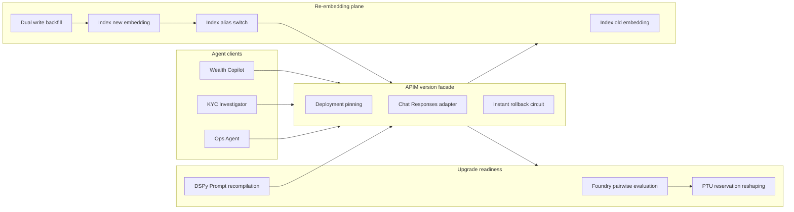
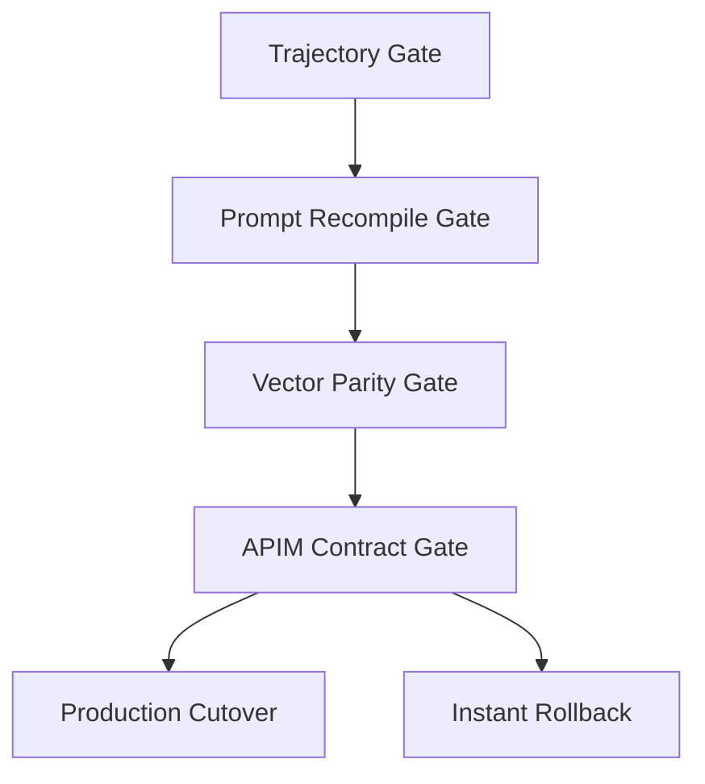

# Enterprise Foundation Model Retirement and Cross-Generation Upgrade FAQ: Foundry Trajectory Evaluation & PTU Re-scope vs DSPy/PromptWizard Prompt Recompile vs AI Search Alias Re-embedding vs APIM Version Facade

> 🌐 **Language Switch**: [中文](model-retirement-version-upgrade-foundry-eval-vs-dspy-promptwizard-vs-search-alias-reembed-selection-faq.md) | **English (current)**

> Audience: Cloud & AI Solution Architects, platform engineering leads, LLMOps/SRE teams, and compliance governance owners.
> Scope: enterprise production migration under 6-12 month model retirement windows on Azure; no base-model training topics.

## 1. Executive summary and migration verdict

For enterprises operating 50-200+ production agents, model retirement is a program-level migration, not a single endpoint rename.
When organizations perform only SDK-level edits, they commonly see delayed regressions in tool schema fidelity, reasoning-token inflation, and retrieval drift.
The recommended strategy is a four-plane architecture executed in parallel: A evaluation and PTU reshaping, B prompt recompilation, C vector re-hydration, and D gateway contract decoupling.
- **Plane A**: Foundry upgrade readiness and pairwise trajectory evaluation for measurable behavior parity.
- **Plane B**: DSPy MIPROv2 and PromptWizard recompilation to replace manual prompt patching.
- **Plane C**: AI Search index alias dual-write backfill for zero-downtime embedding generation shifts.
- **Plane D**: APIM version facade with Chat/Responses adapter and instant rollback circuit.

Where PTU reservations exist, reservation re-scoping must be treated as a first-class migration stream; otherwise the project can pass quality gates but fail financially.
The target outcome is not “migration completed,” but “migration completed with auditable resilience and no business-visible instability.”

## 2. Boundaries, non-goals, and success criteria

Program-level success criteria:
- End-to-end quality regression remains within 1.5 percentage points on critical journeys.
- Tool-call schema conformance stays at or above 99.5%.
- Availability remains within existing SLO range during migration windows.
- Post-switch NDCG@10 and MRR@10 remain at least 98% of baseline.
- Rollback can be triggered in under five seconds through the gateway control plane.

Explicit non-goals:
- No introduction of new foundational model training frameworks in this cycle.
- No parallel redesign of every internal tool protocol during retirement execution.
- No assumption that one migration cycle repays all historical prompt debt.
- No unbounded expansion of evaluation data into a full annotation program.

## 3. Four-way architecture comparison (A/B/C/D)

The four planes address four failure families: model behavior drift, prompt contract drift, vector compatibility drift, and API contract drift.
Plane A measures and gates, plane B compiles and stabilizes, plane C migrates and flips safely, and plane D absorbs client-side variability.
For regulated or multi-tenant enterprises, these planes should be planned as synchronized workstreams with shared release checkpoints.

| Plane | Primary objective | Core Azure components | Mandatory gate | Rollback strategy |
|---|---|---|---|---|
| A | Behavioral parity | Foundry Evaluation, App Insights, PTU management | trajectory and latency parity | traffic fallback to legacy deployment |
| B | Prompt contract stability | Azure ML, DSPy, PromptWizard, Foundry | schema and refusal stability | prompt artifact rollback |
| C | Vector generation migration | AI Search, index alias, Cosmos/Blob events | NDCG/MRR/RRF parity | atomic alias rollback |
| D | API and deployment abstraction | APIM AI Gateway, policy adapters | contract mapping and failover | sub-5-second backend revert |

## 4. End-to-end reference architecture (Mermaid)



## 5. Option A: Foundry readiness matrix and PTU side-by-side migration

Option A turns subjective migration confidence into auditable parity evidence.
- Build a golden trajectory set across tool execution, retrieval QA, long-reasoning, and refusal-control tasks.
- Compare not only correctness but also token shape, argument structure, latency, and refusal pathways.
- Execute pairwise scoring in Foundry and publish drift heatmaps by scenario and tenant segment.
- Route failed trajectories to explicit remediation lanes: prompt fixes, schema fixes, or policy fixes.
- Keep side-by-side PTU lanes active before any in-place reservation consolidation.

Capacity recommendations:
- Keep at least 1.2x legacy baseline during dual-run windows.
- Cap high-traffic canary to 20% until parity remains stable for multiple business cycles.
- Validate PTU reservations at D-14, D-7, and D-1 checkpoints.
- Freeze cross-region routing policy before opening broad canary cohorts.

## 6. Option B: Programmatic prompt recompilation with DSPy and PromptWizard

Option B addresses brittle prompt behavior when moving from one model family to another.
- Decompose prompt assets into instruction, tool hints, and few-shot layers.
- Use DSPy MIPROv2 to search robust candidate prompts and calibration examples.
- Use PromptWizard objective tuning for constrained domains with strict formatting requirements.
- Treat compiled prompt packs as versioned release artifacts, not inline text edits.
- Release prompt packs only when they pass trajectory and schema gates from Plane A.

Practical guidance:
- For tool tasks, prioritize deterministic units, enums, and nullability handling.
- For reasoning tasks, enforce bounded verbosity to control token variance.
- For compliance tasks, preserve explicit refusal and escalation semantics.
- For multilingual workloads, maintain language-specific few-shot sets.

## 7. Option C: Zero-downtime vector re-hydration with alias and event dual-write

Embedding generation migration can silently degrade retrieval quality while API health still appears green.
Option C provides an operationally safe pattern for re-embedding and index switching without user-visible downtime.
- Keep old and new indexes online in parallel and route externally via a single alias.
- Trigger incremental re-embedding through Cosmos DB change feed or blob event pipelines.
- Backfill cold historical corpora in tiered waves by tenant, domain, and freshness class.
- Gate cutover with RRF overlap, NDCG@10, and MRR@10 parity thresholds.
- Flip alias only when parity remains stable across multiple days and segments.

## 8. Option D: APIM version facade, API adapter, and instant rollback

Option D decouples client release cadence from backend retirement cadence.
- APIM centralizes deployment names, api-version mapping, and cohort routing decisions.
- Policy adapters normalize max_tokens and max_completion_tokens semantics plus reasoning_effort controls.
- Chat/Responses contract translation is handled at the gateway boundary.
- Tenant cohorts are shifted progressively with independent telemetry and rollback thresholds.
- On gate breach, APIM rolls traffic back to legacy backends in under five seconds.

## 9. 12-dimension architecture matrix

| Dimension | A Foundry Eval + PTU | B DSPy Prompt Recompile | C Search Alias Re-embed | D APIM Facade |
|---|---|---|---|---|
| Core risk reduced | behavior drift | prompt drift | vector drift | API drift |
| Release speed impact | medium | medium | medium-high | low |
| Client code impact | medium | medium | medium | low |
| Observability strength | high | high | high | high |
| Rollback speed | medium | medium | high | high |
| Data engineering dependency | low | low | high | low |
| Platform engineering dependency | high | medium | high | high |
| Compliance evidence value | high | medium | high | high |
| FinOps leverage | high | medium | medium | medium |
| Multi-tenant fit | high | medium | high | high |
| Typical deployment order | first | with A | after A/B | throughout |
| Residual risk if omitted | high | medium-high | high | high |

## 10. Governance guardrails and operating controls

- Guardrail 1: do not retire legacy models before trajectory parity evidence is complete.
- Guardrail 2: do not approve releases without tool schema regression coverage.
- Guardrail 3: do not execute alias cutover without scripted alias rollback paths.
- Guardrail 4: do not allow clients to bind directly to retiring deployment names.
- Guardrail 5: do not stack PTU reshaping and major prompt rewrites in one narrow window.
- Guardrail 6: do not perform global cutovers without tenant-level quality reporting.
- Guardrail 7: do not execute irreversible billing-shape changes inside finance freeze windows.
- Guardrail 8: do not run unprotected model swaps during regulated reporting windows.
- Guardrail 9: do not bypass APIM for production traffic lacking policy telemetry.
- Guardrail 10: do not rely on averages while ignoring tail-tenant degradation signals.

## 11. Production snippet A: Foundry pairwise trajectory gate (Python)

```python
from dataclasses import dataclass
from statistics import quantiles

@dataclass
class TrajectorySample:
    case_id: str
    old_answer: str
    new_answer: str
    old_tool_json: dict
    new_tool_json: dict
    old_latency_ms: float
    new_latency_ms: float
    old_completion_tokens: int
    new_completion_tokens: int

def score(sample: TrajectorySample) -> dict:
    tool_exact = int(sample.old_tool_json == sample.new_tool_json)
    token_ratio = sample.new_completion_tokens / max(sample.old_completion_tokens, 1)
    latency_delta = sample.new_latency_ms - sample.old_latency_ms
    semantic_match = int(sample.old_answer.strip()[:120] == sample.new_answer.strip()[:120])
    return {
        'case_id': sample.case_id,
        'tool_exact': tool_exact,
        'token_ratio': token_ratio,
        'latency_delta': latency_delta,
        'semantic_match': semantic_match,
    }

def gate(results: list[dict]) -> dict:
    tool_rate = sum(r['tool_exact'] for r in results) / len(results)
    semantic_rate = sum(r['semantic_match'] for r in results) / len(results)
    p95_delta = quantiles([r['latency_delta'] for r in results], n=20)[18]
    p95_token_ratio = quantiles([r['token_ratio'] for r in results], n=20)[18]
    return {
        'tool_rate': tool_rate,
        'semantic_rate': semantic_rate,
        'p95_latency_delta': p95_delta,
        'p95_token_ratio': p95_token_ratio,
        'pass': tool_rate >= 0.995 and semantic_rate >= 0.98 and p95_token_ratio <= 1.25,
    }
```

## 12. Production snippet B: Search alias flip and dual-write backfill (Python)

```python
from azure.search.documents.indexes import SearchIndexClient
from azure.search.documents.indexes.models import SearchAlias

def alias_flip(index_client: SearchIndexClient, alias_name: str, target_index: str):
    alias = SearchAlias(name=alias_name, indexes=[target_index])
    return index_client.create_or_update_alias(alias)

def reembed_backfill(change_events, embed_old, embed_new, write_old, write_new):
    for ev in change_events:
        text = ev['content']
        write_old(ev['id'], embed_old(text))
        write_new(ev['id'], embed_new(text))

def parity_gate(eval_stats: dict) -> bool:
    return (
        eval_stats['ndcg_at_10_new'] >= eval_stats['ndcg_at_10_old'] * 0.98
        and eval_stats['mrr_at_10_new'] >= eval_stats['mrr_at_10_old'] * 0.98
        and eval_stats['rrf_overlap'] >= 0.95
    )
```

## 13. Production snippet C: APIM contract adapter and PTU Bicep

```xml
<policies>
  <inbound>
    <base />
    <set-variable name="target-version" value="@(context.Request.Headers.GetValueOrDefault('x-model-track', 'stable'))" />
    <choose>
      <when condition="@(context.Variables.GetValueOrDefault<string>('target-version') == 'stable')">
        <set-backend-service backend-id="aoai-gpt41-stable" />
      </when>
      <otherwise>
        <set-backend-service backend-id="aoai-o4mini-canary" />
      </otherwise>
    </choose>
    <set-body>@{
      var body = context.Request.Body.As<JObject>(preserveContent: true);
      if (body['max_tokens'] != null && body['max_completion_tokens'] == null)
      {
        body['max_completion_tokens'] = body['max_tokens'];
      }
      return body.ToString();
    }</set-body>
  </inbound>
  <backend><base /></backend>
  <outbound><base /></outbound>
  <on-error>
    <set-backend-service backend-id="aoai-gpt4o-rollback" />
  </on-error>
</policies>
```

```bicep
param location string = resourceGroup().location
param ptuStable int = 120
param ptuCanary int = 40

resource stable 'Microsoft.CognitiveServices/accounts/deployments@2024-10-01' = {
  name: 'aoai-prod/gpt41-stable'
  location: location
  sku: {
    name: 'ProvisionedManaged'
    capacity: ptuStable
  }
  properties: {
    model: {
      name: 'gpt-4.1'
      format: 'OpenAI'
      version: 'latest'
    }
  }
}

resource canary 'Microsoft.CognitiveServices/accounts/deployments@2024-10-01' = {
  name: 'aoai-prod/o4mini-canary'
  location: location
  sku: {
    name: 'ProvisionedManaged'
    capacity: ptuCanary
  }
  properties: {
    model: {
      name: 'o4-mini'
      format: 'OpenAI'
      version: 'latest'
    }
  }
}
```

## 14. FinOps migration economics and enterprise scenarios

### 14.1 Three-year TCO (USD $k)

| Cost bucket | A-led | B-led | C-led | D-led | Combined pattern |
|---|---:|---:|---:|---:|---:|
| Platform compute and PTU | 5,420 | 4,880 | 4,650 | 4,910 | 5,130 |
| Evaluation and telemetry | 1,260 | 1,040 | 920 | 980 | 1,180 |
| Retrieval and re-embedding | 620 | 580 | 1,920 | 610 | 1,430 |
| Gateway and traffic governance | 480 | 450 | 510 | 1,180 | 980 |
| Engineering and operations labor | 2,350 | 2,780 | 2,460 | 2,210 | 2,540 |
| **Three-year total** | **10,130** | **9,730** | **10,460** | **9,890** | **11,260** |

The combined pattern costs more at face value during migration windows, but materially reduces rollback incidents and compliance exposure.

### 14.2 Scenario A: global tier-1 bank (85 regulated agents + 120M vectors)

- Target: migrate major regulated workloads from gpt-4o to gpt-4.1 before quarterly reporting freeze.
- Risks: KYC schema drift, explanation consistency, and cross-region PTU misallocation.
- Outcome: 70% flow migration in four weeks with no major audit findings.
- Metric change: tool-schema fidelity improved from 98.9% to 99.7%.
- Cost outcome: six-week dual-run overhead of 8.2%, followed by 13.5% quarterly savings.

### 14.3 Scenario B: multi-tenant enterprise SaaS ISV (200+ tenant agents)

- Target: migrate legacy gpt-4o prompt estate to gpt-4.1/o4-mini tiered lanes.
- Risks: tenant-specific template variance and uneven migration quality.
- Outcome: DSPy recompilation and APIM cohort split enabled stable staged migration.
- Metric change: p95 latency dropped 22% and average token cost dropped 19%.
- Ops outcome: median rollback trigger time stayed under 3.2 seconds.



## 15. Quantitative FAQ, rollout steps, checklist, and fit boundaries

### 15.1 Quantitative FAQ (8 questions)

**Q1. Why must planes A and D be implemented together instead of evaluation only?**
- Evaluation alone does not protect client/backend contract drift.
- SDK parameter semantics can break while model quality appears healthy.
- Plane A detects behavior drift while plane D absorbs contract drift.
- Separating them often breaks practical rollback pathways.
- Running both together constrains failures to tenant or cohort scope.

**Q2. Why does PTU migration often degrade latency even when capacity seems sufficient?**
- New model token output patterns can increase service time per request.
- Concurrency assumptions are frequently reused without recalibration.
- Cross-region route and reservation topology may become misaligned.
- Queue depth should be revalidated at 15-minute granularity during canary.
- Tail metrics usually reveal hidden saturation earlier than averages.

**Q3. How can teams determine whether prompt recompilation outperforms manual edits?**
- Judge stability across mixed workloads, not isolated best-case samples.
- Require sustained schema conformance above release thresholds.
- Track refusal and escalation rates against governed operating bands.
- Verify multilingual maintainability rather than single-language gains.
- If weekly manual hotfixes exceed three, move to programmatic recompilation.

**Q4. How do we prevent false parity during embedding dimension migration?**
- Measure NDCG, MRR, and business outcome metrics together.
- Vector similarity alone can hide semantic dilution.
- Run targeted human review for critical tenant cohorts.
- Tune RRF blending weights for old and new embedding spaces separately.
- Require multi-day parity stability before alias cutover.

**Q5. Why is a sub-5-second rollback objective important?**
- Production failures emerge during high-load windows where time budgets are small.
- Long rollback paths amplify retries and queue storms.
- Gateway-level rollback bypasses slower app redeploy cycles.
- Fast rollback preserves failure evidence for diagnosis.
- Regulated environments treat rollback speed as a control effectiveness metric.

**Q6. How should cohort traffic shifting remain fair in multi-tenant SaaS?**
- Segment cohorts by tenant tier, risk profile, and time sensitivity.
- Shift high-value tenants first but preserve stricter rollback thresholds.
- Use low-traffic tenants for tail-risk detection with explicit safeguards.
- Maintain cohort-specific quality and cost telemetry.
- Avoid concentrating migration risk and cost on one tenant class.

**Q7. How do we align migration accounting with finance and procurement controls?**
- Track dual-run cost, rollback cost, and avoided incident cost separately.
- Snapshot cost telemetry weekly and reconcile with traffic logs.
- Map model switches to billing-cycle boundaries.
- Model PTU opportunity and penalty costs as explicit line items.
- Publish traceable reports for joint finance-procurement governance.

**Q8. What objective signals indicate retirement completion?**
- Two full billing cycles with no major rollback events.
- All critical agents pass agreed SLO and quality gates on new lanes.
- Legacy deployments are decommissioned and credentials reclaimed.
- Legacy vector indexes are archived with audit evidence.
- Runbooks and ownership handoffs are fully accepted by operations.

### 15.2 Five-step rollout plan (0-180 days)

**Step 1 (D-45 to D-21): baseline freeze and impact-map closure**
- Enumerate affected agents, tools, indexes, gateways, and PTU reservations.
- Freeze baseline metrics and stratify golden trajectory samples.
- Validate rollback chain end-to-end in a rehearsal environment.
- Lock migration windows away from business peak periods.
- Publish charter, ownership matrix, and escalation policy.

**Step 2 (D-20 to D-7): A/B plane validation**
- Run pairwise trajectory evaluation and publish drift dashboards.
- Recompile prompts for failed trajectories until gates pass.
- Recalculate PTU fit against new token and latency envelopes.
- Verify tool schema, units, enums, and nullability consistency.
- Produce first release candidate pack.

**Step 3 (D-6 to D-2): C plane backfill and retrieval parity**
- Start incremental dual-write and historical re-embedding batches.
- Validate parity by tenant, domain, and freshness tiers.
- Log all below-threshold cases with corrective actions.
- Prepare alias flip and rollback scripts with dry-run evidence.
- Confirm business-side benchmark query packs.

**Step 4 (D-1 to D+7): D plane progressive cutover and guardrails**
- Shift cohorts from 1% to 50% under gated telemetry.
- Trigger instant rollback when quality or latency gates are breached.
- Publish quality-and-cost scorecards every two hours.
- Keep legacy lanes warm and avoid irreversible changes.
- Complete first-round business acceptance.

**Step 5 (D+8 to D+45): closure, legacy retirement, and reuse assets**
- Decommission legacy deployments and legacy index writes in stages.
- Reconcile tenant billing and migration attribution ledgers.
- Complete retrospective and runbook updates.
- Template migration gates into standard release pipelines.
- Preserve reusable assets for the next retirement cycle.

### 15.3 Day-0 and Day-2 checklist (12 items)

- Day-0: full inventory of affected deployments and SDK touchpoints is traceable.
- Day-0: APIM adapter policies passed preproduction regression.
- Day-0: Foundry trajectory baseline covers high-risk business journeys.
- Day-0: PTU reservation and peak-load simulation results are reconciled.
- Day-0: alias cutover and rollback scripts are executable and reviewed.
- Day-0: legacy rollback credentials are valid and least-privileged.
- Day-2: cohort split dashboards are generated automatically each hour.
- Day-2: any failing tenant can revert to legacy lane within five seconds.
- Day-2: embedding parity metrics stayed within gates for three days.
- Day-2: dual-run cost variance is reviewed and approved by finance.
- Day-2: runbooks are updated and on-call training is completed.
- Day-2: legacy index archive and disposal evidence is auditable.


### 15.4 Operating cadence (weekly, monthly, quarterly)

**Weekly cadence**
- Monday: trajectory drift and high-risk tenant checks.
- Tuesday: prompt recompilation outcomes and failed-case triage.
- Wednesday: retrieval parity and query quality variance review.
- Thursday: APIM cohort routing and rollback telemetry review.
- Friday: publish quality and cost governance digest.

**Monthly cadence**
- Recalibrate migration gates and operating thresholds.
- Re-shape PTU reservations based on observed utilization patterns.
- Reconcile dual-run economics against financial plan.
- Review tenant-level business KPI impact and satisfaction signals.
- Refresh runbooks and duty rotation readiness.

**Quarterly cadence**
- Execute full retirement-window and rollback drills.
- Run cross-region fault injection and recovery verification.
- Audit control evidence quality and trace completeness.
- Reconcile procurement terms with evolving model retirement cadence.
- Reprioritize next-generation migration roadmap.

### 15.5 ADR highlights
- ADR-01: establish gateway facade before widening migration blast radius.
- ADR-02: enforce tool-schema and token-profile gates in the same release guard.
- ADR-03: require alias-based atomic cutover for embedding generation changes.
- ADR-04: treat prompt recompilation output as immutable release artifacts.
- ADR-05: enforce tenant-tier-aware gates instead of one global threshold.
- ADR-06: report both cost and recovered business value in FinOps governance.

### 15.6 Good fit and Not for

**Good fit**
- Enterprises with 50+ production agents and explicit retirement deadlines.
- Teams with APIM governance entry points and baseline observability coverage.
- Regulated industries requiring complete control traceability.
- Organizations willing to operate dual-run windows with strict gates.
- Programs able to coordinate application, data, and platform workstreams.

**Not for**
- Single pilot agents without release governance maturity.
- Architectures with unmanaged direct client-to-model endpoint coupling.
- Environments lacking baseline telemetry and evaluation assets.
- Programs demanding immediate savings while rejecting dual-run stabilization.
- Teams treating retirement as coding-only work instead of operations engineering.

### 15.7 Closing note

Enterprise retirement and cross-generation upgrades succeed when model behavior, prompt contracts, vector lifecycle, and gateway control are engineered as one system.
With reusable A/B/C/D assets, each future retirement cycle becomes faster, safer, and easier to audit.
The recommended next step is to institutionalize this blueprint as a standard platform governance control.

