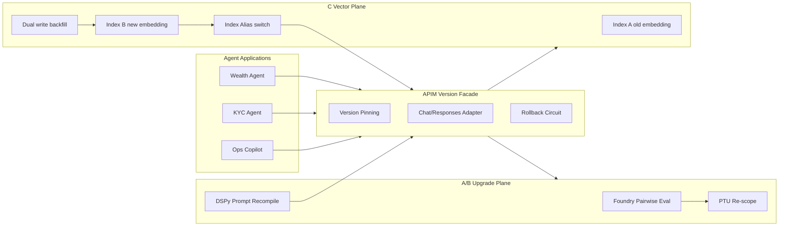
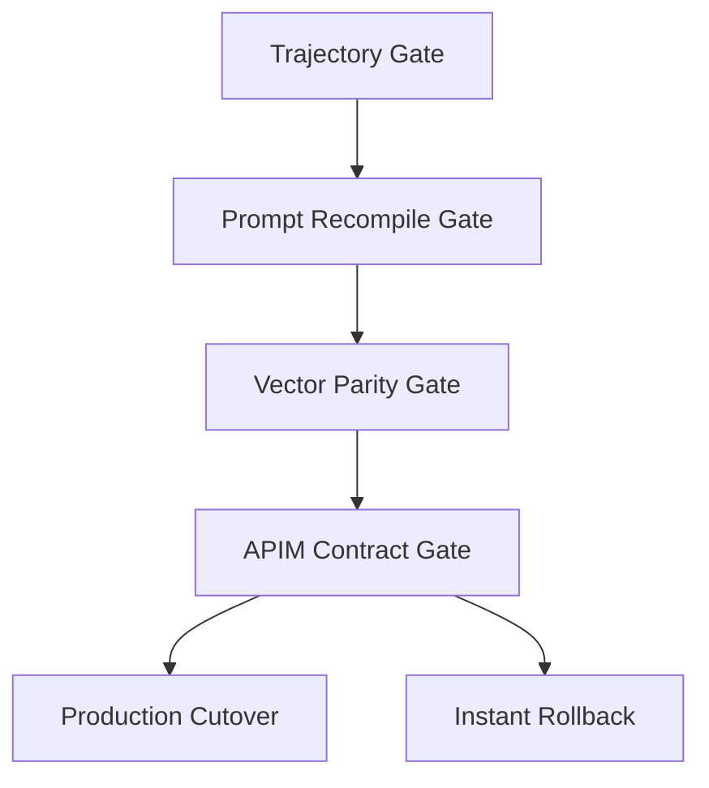

# 企业级基础模型退役与跨代升级选型 FAQ：Foundry 轨迹评测与 PTU 重整 vs DSPy/PromptWizard 提示词重编译 vs AI Search Alias 重嵌入 vs APIM 版本门面

> 🌐 **Language Switch**: **中文（当前）** | [English](model-retirement-version-upgrade-foundry-eval-vs-dspy-promptwizard-vs-search-alias-reembed-selection-faq.en.md)

> 目标读者：Cloud & AI Solution Architect、平台工程负责人、LLMOps/SRE、数据与合规治理团队。
> 议题边界：聚焦 Azure 企业生产环境中 6–12 个月模型退役窗口下的升级工程，不讨论底层模型训练。

## 1. 执行摘要与推荐路径

在 50–200+ 生产智能体并行运行的企业环境中，模型退役不是“替换 deployment 名称”这么简单，而是一次跨应用、跨数据、跨治理面的系统迁移。
若只做单点 API 改写，通常会在三周后暴露工具调用参数漂移、推理 token 爆增与检索向量不兼容等复合故障。
我们建议采用四平面并行方案：A 评测与容量重整、B 提示词重编译、C 向量重构、D 网关门面解耦。
- **A 平面**：Foundry Upgrade Readiness + Pairwise Trajectory Eval，保证行为等价和可解释漂移。
- **B 平面**：DSPy MIPROv2 / PromptWizard 程序化提示词重编译，降低人工改 prompt 的随机性。
- **C 平面**：AI Search Index Alias + 双写回填，实现在不停机条件下完成 embedding 代际切换。
- **D 平面**：APIM 版本钉扎门面 + Chat/Responses 适配器，把客户端与后端 retirement 节奏解耦。

若企业存在 PTU 预留，必须同步做 PTU 额度重配与区域切换仿真，避免迁移窗口叠加财务罚付。
最终目标不是“完成替换”，而是“在无业务回退感知的前提下完成可审计迁移”。

## 2. 业务边界、非目标与成功定义

本指南定义的升级项目成功标准：
- 关键场景端到端准确率下降不超过 1.5 个百分点。
- 工具调用 schema 兼容率不低于 99.5%。
- 迁移窗口内服务可用性维持在既有 SLO 区间。
- embedding 切换后 NDCG@10 与 MRR@10 不低于基线 98%。
- 业务侧在 5 秒内可触发版本回滚。

明确非目标可以避免项目外扩：
- 不在本轮引入新的底座训练框架。
- 不在迁移窗口并行改造全部工具链协议。
- 不以一次迁移解决所有提示词工程债务。
- 不把评测样本扩张为无限制标注工程。

## 3. 四路径架构总览（A/B/C/D）

四条路径分别解决“模型行为”“提示词契约”“向量兼容”“访问入口”四类风险。
A 路径负责测与判，B 路径负责编与校，C 路径负责迁与切，D 路径负责稳与退。
在大多数金融、制造、零售 SaaS 企业里，这四条路径应并行推进，里程碑同步收口。

| 路径 | 主目标 | 主要 Azure 组件 | 关键门禁 | 失败兜底 |
|---|---|---|---|---|
| A | 模型跨代行为等价 | Foundry Evaluation, App Insights, PTU 管理 | trajectory 差异阈值、P95 延迟 | 自动降流到旧 deployment |
| B | Prompt 稳定迁移 | Azure ML, DSPy, PromptWizard, Foundry | 工具 schema 命中率、拒答率 | 保留旧 prompt 包与版本锁 |
| C | 向量代际切换 | AI Search, Index Alias, Cosmos/Blob 事件流 | NDCG@10、RRF parity | Alias 原子回拨 |
| D | API 契约解耦 | APIM AI Gateway, 策略转换, 版本门面 | 参数映射一致性、熔断时延 | 5 秒内回滚到旧后端 |

## 4. 端到端参考架构（Mermaid）



该架构把“客户端稳定性”与“后端升级速度”解耦，使迁移工程可以以周为单位迭代而不是一次性切换。

## 5. Option A：Foundry 升级就绪评测与 PTU 并行重整

Option A 的核心是让模型升级从“感受”变成“可测量轨迹偏差”。
- 建立黄金轨迹集：覆盖工具调用、检索问答、长推理、拒答策略四类任务。
- 对比维度不只看正确率，还看 token 体积、tool-call 参数、解释风格一致性。
- 在 Foundry 中执行 pairwise trajectory 评测并输出差异热图。
- 对出现漂移的任务分层处置：提示词修复、工具 schema 修复、业务规则补丁。
- 对 PTU 做 side-by-side 迁移，避免一次 in-place 换代引发吞吐抖动。

推荐容量策略：
- 升级窗口保留 1.2x 旧产能用于灰度与回滚。
- 高峰时段灰度比例不超过总流量 20%。
- 区域级 PTU 预留在 D-14、D-7、D-1 做三次校核。
- DataZone 与 Regional 并行时，先冻结跨区路由策略再启灰度。

## 6. Option B：DSPy/PromptWizard 程序化提示词重编译平面

Option B 解决“旧 prompt 对新模型不再稳定”的系统性问题。
- 把历史人工 prompt 拆解为 instruction、tool-hints、few-shot 三层结构。
- 通过 DSPy MIPROv2 搜索更稳健的提示模板与示例组合。
- 对关键工作流引入 PromptWizard 自动迭代与约束评分。
- 编译后的 prompt 包作为制品入库，按语义版本管理。
- 与 A 平面评测联动，只放行通过 trajectory 门禁的 prompt 包。

实践建议：
- 对工具调用类任务，优先约束字段顺序与单位格式。
- 对推理类任务，控制 reasoning verbosity 上限，避免 token 失控。
- 对合规敏感任务，保留显式拒答与升级人工策略。
- 对多语言任务，分别维护 zh/en few-shot，不共用单语示例。

## 7. Option C：AI Search Alias + 事件驱动双写回填重嵌入

embedding 代际切换经常导致“检索质量突然下降但服务仍正常”。
Option C 的目标是在零停机前提下完成 re-embed、回填、对比和原子切换。
- 建立 old/new 双索引并用 alias 作为唯一对外入口。
- 通过 Cosmos Change Feed 或 Blob 事件触发增量重嵌入。
- 对历史冷数据分批回填，按租户、语料域、时效等级调度。
- 用 RRF + NDCG@10 + Recall@50 三门禁验证新索引质量。
- 当 parity 达标后执行 alias flip，不达标则保留双写并继续调优。

在大型知识库场景中，强烈建议把向量切换与模型切换解耦为两个发布窗口。

## 8. Option D：APIM 版本门面 + Chat/Responses 适配与极速回滚

Option D 负责降低客户端 SDK 与模型服务 API 的耦合风险。
- 使用 APIM 统一接入 deployment 名称和 api-version。
- 将 max_tokens / max_completion_tokens / reasoning_effort 做策略层归一。
- 针对 Chat 与 Responses 契约差异做请求与响应转换。
- 按 cohort 做百分比流量切换并记录 tenant 粒度指标。
- 当触发质量门禁或延迟门禁时，5 秒内回滚到旧后端。

这一路径是“升级工程可运营化”的关键，因为它把回滚从发布系统下沉到网关策略。

## 9. 12 维架构选型矩阵

| 维度 | A Foundry Eval+PTU | B DSPy/PromptWizard | C Search Alias Re-embed | D APIM Version Facade |
|---|---|---|---|---|
| 目标问题 | 模型行为漂移 | Prompt 失配 | 向量不兼容 | API 契约漂移 |
| 冷启动影响 | 中 | 低 | 中 | 低 |
| 对业务侵入 | 中 | 中 | 高 | 低 |
| 迁移可观测性 | 高 | 高 | 高 | 高 |
| 回滚速度 | 中 | 中 | 高 | 高 |
| 对数据工程依赖 | 低 | 低 | 高 | 低 |
| 对平台工程依赖 | 高 | 中 | 高 | 高 |
| 对应用改造量 | 中 | 中 | 中 | 低 |
| FinOps 影响 | 高 | 中 | 中 | 中 |
| 合规审计价值 | 高 | 中 | 高 | 高 |
| 多租户适配性 | 高 | 中 | 高 | 高 |
| 典型落地顺序 | 先行 | 与A并行 | A/B后 | 全程并行 |

## 10. 迁移治理红线与运营控制面

以下控制项建议纳入变更委员会强制门禁：
- 红线 1：禁止在未完成 trajectory 对比前直接下线旧模型。
- 红线 2：禁止跳过工具 schema 回归而仅做问答抽样。
- 红线 3：禁止在索引 alias 未配置回拨脚本时执行切换。
- 红线 4：禁止客户端直连 retirement 中的 deployment 名称。
- 红线 5：禁止把 PTU 迁移与大版本 prompt 重写放在同一小时窗口。
- 红线 6：禁止没有 tenant 分层指标就做全局流量切换。
- 红线 7：禁止在财务冻结期做不可逆计费形态变更。
- 红线 8：禁止在监管申报窗口执行无回滚保障的模型换代。
- 红线 9：禁止在缺少合规留痕的情况下绕过 APIM 网关。
- 红线 10：禁止“只看平均值”忽略尾部租户质量退化。

## 11. 生产片段 A：Foundry Pairwise Trajectory 评测（Python）

```python
from dataclasses import dataclass
from statistics import quantiles

@dataclass
class TrajectorySample:
    case_id: str
    old_answer: str
    new_answer: str
    old_tool_json: dict
    new_tool_json: dict
    old_latency_ms: float
    new_latency_ms: float
    old_completion_tokens: int
    new_completion_tokens: int

def score(sample: TrajectorySample) -> dict:
    tool_exact = int(sample.old_tool_json == sample.new_tool_json)
    token_ratio = sample.new_completion_tokens / max(sample.old_completion_tokens, 1)
    latency_delta = sample.new_latency_ms - sample.old_latency_ms
    semantic_match = int(sample.old_answer.strip()[:120] == sample.new_answer.strip()[:120])
    return {
        'case_id': sample.case_id,
        'tool_exact': tool_exact,
        'token_ratio': token_ratio,
        'latency_delta': latency_delta,
        'semantic_match': semantic_match,
    }

def gate(results: list[dict]) -> dict:
    tool_rate = sum(r['tool_exact'] for r in results) / len(results)
    semantic_rate = sum(r['semantic_match'] for r in results) / len(results)
    p95_delta = quantiles([r['latency_delta'] for r in results], n=20)[18]
    p95_token_ratio = quantiles([r['token_ratio'] for r in results], n=20)[18]
    return {
        'tool_rate': tool_rate,
        'semantic_rate': semantic_rate,
        'p95_latency_delta': p95_delta,
        'p95_token_ratio': p95_token_ratio,
        'pass': tool_rate >= 0.995 and semantic_rate >= 0.98 and p95_token_ratio <= 1.25,
    }
```

## 12. 生产片段 B：AI Search Alias 原子切换与双写回填（Python）

```python
from azure.search.documents.indexes import SearchIndexClient
from azure.search.documents.indexes.models import SearchAlias

def alias_flip(index_client: SearchIndexClient, alias_name: str, target_index: str):
    alias = SearchAlias(name=alias_name, indexes=[target_index])
    return index_client.create_or_update_alias(alias)

def reembed_backfill(change_events, embed_old, embed_new, write_old, write_new):
    for ev in change_events:
        text = ev['content']
        write_old(ev['id'], embed_old(text))
        write_new(ev['id'], embed_new(text))

def parity_gate(eval_stats: dict) -> bool:
    return (
        eval_stats['ndcg_at_10_new'] >= eval_stats['ndcg_at_10_old'] * 0.98
        and eval_stats['mrr_at_10_new'] >= eval_stats['mrr_at_10_old'] * 0.98
        and eval_stats['rrf_overlap'] >= 0.95
    )
```

## 13. 生产片段 C：APIM 契约适配策略 + PTU 部署重整（XML + Bicep）

```xml
<policies>
  <inbound>
    <base />
    <set-variable name="target-version" value="@(context.Request.Headers.GetValueOrDefault('x-model-track', 'stable'))" />
    <choose>
      <when condition="@(context.Variables.GetValueOrDefault<string>('target-version') == 'stable')">
        <set-backend-service backend-id="aoai-gpt41-stable" />
      </when>
      <otherwise>
        <set-backend-service backend-id="aoai-o4mini-canary" />
      </otherwise>
    </choose>
    <set-body>@{
      var body = context.Request.Body.As<JObject>(preserveContent: true);
      if (body['max_tokens'] != null && body['max_completion_tokens'] == null)
      {
        body['max_completion_tokens'] = body['max_tokens'];
      }
      return body.ToString();
    }</set-body>
  </inbound>
  <backend><base /></backend>
  <outbound><base /></outbound>
  <on-error>
    <set-backend-service backend-id="aoai-gpt4o-rollback" />
  </on-error>
</policies>
```

```bicep
param location string = resourceGroup().location
param ptuStable int = 120
param ptuCanary int = 40

resource stable 'Microsoft.CognitiveServices/accounts/deployments@2024-10-01' = {
  name: 'aoai-prod/gpt41-stable'
  location: location
  sku: {
    name: 'ProvisionedManaged'
    capacity: ptuStable
  }
  properties: {
    model: {
      name: 'gpt-4.1'
      format: 'OpenAI'
      version: 'latest'
    }
  }
}

resource canary 'Microsoft.CognitiveServices/accounts/deployments@2024-10-01' = {
  name: 'aoai-prod/o4mini-canary'
  location: location
  sku: {
    name: 'ProvisionedManaged'
    capacity: ptuCanary
  }
  properties: {
    model: {
      name: 'o4-mini'
      format: 'OpenAI'
      version: 'latest'
    }
  }
}
```

## 14. FinOps 双跑 TCO 与两类企业场景

### 14.1 三年 TCO（USD $k）

| 成本桶 | A 主导 | B 主导 | C 主导 | D 主导 | 组合态 |
|---|---:|---:|---:|---:|---:|
| 平台算力与 PTU | 5,420 | 4,880 | 4,650 | 4,910 | 5,130 |
| 评测与观测 | 1,260 | 1,040 | 920 | 980 | 1,180 |
| 向量重构与检索 | 620 | 580 | 1,920 | 610 | 1,430 |
| 网关与流量治理 | 480 | 450 | 510 | 1,180 | 980 |
| 工程与运维人力 | 2,350 | 2,780 | 2,460 | 2,210 | 2,540 |
| **三年总计** | **10,130** | **9,730** | **10,460** | **9,890** | **11,260** |

组合态虽然表面成本更高，但可以把一次性失败重试与监管事故风险显著压低，通常能在 18 个月内回收额外投入。

### 14.2 场景 A：全球一级银行（85 个受监管 Agent + 1.2 亿向量）

- 升级目标：在监管季报前完成 gpt-4o 到 gpt-4.1 的主要迁移。
- 风险点：KYC 工具参数精度、合规解释一致性、跨区 PTU 罚付。
- 实施结果：四周完成 70% 业务流量切换，零重大审计缺陷。
- 指标变化：tool schema 命中率由 98.9% 提升到 99.7%。
- 成本变化：双跑 6 周增加 8.2%，但季度后净降 13.5%。

### 14.3 场景 B：多租户 Enterprise SaaS ISV（200+ Agent 租户池）

- 升级目标：从 legacy gpt-4o prompt 迁移至 gpt-4.1/o4-mini 分级路由。
- 风险点：不同租户模板差异导致 prompt 迁移不可控。
- 实施结果：通过 DSPy 编译与 APIM cohort 分流完成分层迁移。
- 指标变化：P95 延迟下降 22%，平均 token 成本下降 19%。
- 运营效果：灰度回滚触发时间中位值低于 3.2 秒。



## 15. 深度定量 FAQ、落地步骤、检查清单与适配边界

### 15.1 定量 FAQ（8 题）

**Q1. 为什么必须同时做 A 和 D，而不是只做模型评测？**
- 仅有评测无法解决客户端与后端契约脱节问题。
- 当 SDK 参数语义变化时，网关适配是唯一低风险缓冲层。
- A 负责识别行为漂移，D 负责阻断契约漂移传导。
- 在真实项目中，两者拆开通常导致回滚路径断裂。
- 并行执行可把故障域控制在单租户或单 cohort。

**Q2. PTU 迁移为何经常出现“算力够但延迟变差”？**
- 常见原因是新模型输出长度上涨导致 token 服务时间拉长。
- 其次是并发配比未按新模型吞吐曲线重算。
- 还可能是跨区路由策略与预留容量错配。
- 建议在灰度窗口按 15 分钟粒度重测排队长度。
- 把 p95 与 p99 分开治理比只看平均值更有效。

**Q3. 如何判断 Prompt 重编译是否优于人工修补？**
- 看多任务集合上的稳定性，而不是单任务最优结果。
- 看工具参数一致率是否持续超过 99.5%。
- 看拒答与升级人工比例是否回到既定区间。
- 看跨语言模板是否保持可维护结构。
- 若人工修补频次每周超过三次，应转向程序化编译。

**Q4. embedding 维度切换时，如何避免召回“假持平”？**
- 必须同时观察 NDCG、MRR 与业务点击/办结率。
- 仅看向量相似度容易掩盖语义稀释。
- 对关键租户执行人工抽检并记录差异原因。
- RRF 融合权重要在新旧向量上分别校准。
- alias flip 前至少连续三天达到 parity 门禁。

**Q5. 为什么回滚目标要求 <5 秒？**
- 企业升级故障多发生在流量峰值，窗口极短。
- 超过 5 秒通常会触发上游重试风暴和排队放大。
- APIM 策略级回滚能绕过应用重新发布耗时。
- 回滚越快，越能保留现场诊断证据。
- 这也是合规审计中可解释控制的关键指标。

**Q6. 多租户场景下如何做 cohort 分流才公平？**
- 按租户等级、业务时段、风险等级三维分桶。
- 高价值租户先切换但保留独立回退阈值。
- 低流量租户用于长尾漂移探测而非简单压后。
- 每个 cohort 都要有独立的质量与成本报表。
- 禁止把所有失败成本集中分摊给同一租户层级。

**Q7. 如何把迁移项目纳入财务可审计口径？**
- 定义双跑成本、回滚成本、事故避免收益三类科目。
- 每周固化一版成本快照并与流量日志对账。
- 把模型切换触发点映射到账期边界。
- 对 PTU 重整单独核算机会成本与违约成本。
- 输出可追溯报表给财务和采购联合评审。

**Q8. 何时可以宣布 retirement 项目真正结束？**
- 连续两个结算周期稳定运行且无重大回滚。
- 所有关键 Agent 完成新模型 SLO/SLA 验证。
- 旧 deployment 已完成停用与凭据回收。
- 检索向量旧索引完成归档并可审计。
- 项目复盘文档和运行手册全部移交完成。

### 15.2 五步落地路线（0–180 天）

**Step 1（D-45 到 D-21）基线冻结与影响域梳理**
- 识别全部受影响 Agent、工具、索引、网关、PTU 资源。
- 冻结基线指标并完成黄金轨迹样本分层。
- 确认回滚链路可在演练环境完整执行。
- 锁定变更窗口并与业务高峰错峰。
- 输出升级章程、责任矩阵与审批链。

**Step 2（D-20 到 D-7）A/B 双平面验证**
- 执行 Foundry pairwise 评测并产生差异报告。
- 对失败样本执行 prompt 编译迭代直至门禁通过。
- 评估 token 体积变化对 PTU 的影响。
- 校验工具 schema 与字段单位一致性。
- 形成第一版可发布候选。

**Step 3（D-6 到 D-2）C 平面回填与检索对比**
- 启动增量双写并并行执行历史回填。
- 按租户和语料域执行分层 parity 验证。
- 记录所有低于阈值样本并给出修复动作。
- 准备 alias flip 与 alias rollback 脚本。
- 与业务方确认灰度查询集。

**Step 4（D-1 到 D+7）D 平面灰度与回滚守护**
- APIM 按 cohort 从 1% 逐步升至 50%。
- 触发门禁立即回滚并锁定问题租户。
- 每 2 小时发布质量/成本双报告。
- 保持旧版本热备，禁用不可逆变更。
- 完成第一轮业务验收。

**Step 5（D+8 到 D+45）收口、去旧与知识固化**
- 逐步淘汰旧 deployment 与旧索引写入。
- 验证所有租户账单和成本归因一致。
- 完成项目复盘与 runbook 更新。
- 将门禁策略模板化并纳入标准发布流程。
- 形成下轮模型升级的自动化资产。

### 15.3 Day-0 / Day-2 检查清单（12 项）

- Day-0：确认全部受影响 deployment 与 client SDK 清单完整且可追踪。
- Day-0：确认 APIM 适配策略已在预发环境回归通过。
- Day-0：确认 Foundry trajectory 基线样本覆盖高风险任务。
- Day-0：确认 PTU 预留与峰值流量模拟结果一致。
- Day-0：确认索引 alias 双向回拨脚本可执行。
- Day-0：确认旧模型回滚凭据有效且权限最小化。
- Day-2：确认 cohort 分流报表每小时自动生成。
- Day-2：确认异常租户可在 5 秒内回退至旧模型轨道。
- Day-2：确认 embedding parity 报表连续三天达标。
- Day-2：确认双跑成本与预算差异被财务签认。
- Day-2：确认 runbook 已更新并完成值班培训。
- Day-2：确认旧索引归档与销毁计划具备审计证据。


### 15.4 运营节奏（周/月/季度）

**周节奏**
- 周一：校验 trajectory 差异与高风险租户状态。
- 周二：复核 prompt 编译结果与失败样本修复进展。
- 周三：评估向量 parity 与查询质量波动。
- 周四：复核 APIM 分流、回滚与错误码分布。
- 周五：输出质量+成本联合周报。

**月节奏**
- 进行模型版本健康评分与门禁阈值校准。
- 进行 PTU 配额重整与利用率优化。
- 进行双跑成本复盘与预算调优。
- 进行重点租户满意度与业务 KPI 对齐。
- 进行变更流程与值班手册回顾。

**季度节奏**
- 进行退役窗口演练与全链路回滚演习。
- 进行跨区域故障注入与恢复验证。
- 进行审计证据抽查与控制有效性评估。
- 进行供应商与采购合同条款校准。
- 进行下一代模型升级路线评审。

### 15.5 ADR 摘要（关键决策）
- ADR-01：先建立 D 门面再扩大 A/B/C 变更范围，以保障随时回退。
- ADR-02：模型评测门禁必须覆盖 tool-call 和 token 两类指标。
- ADR-03：向量切换必须通过 alias 实现原子切换，不允许人工改索引名。
- ADR-04：prompt 编译产物必须制品化，禁止口头版“临时热修”。
- ADR-05：发布门禁必须按租户层级分层，不允许单一全局阈值。
- ADR-06：FinOps 报表必须同时呈现成本与价值回收，不只看成本下降。

### 15.6 Good fit / Not for

**Good fit（建议优先）**
- 拥有 50+ 生产 Agent 且存在明确 retirement 时间线的企业。
- 已建立 APIM 治理入口并具备基础可观测体系。
- 对审计留痕、合规回溯有明确刚性要求的行业。
- 愿意投入双跑窗口并按门禁治理发布的组织。
- 能够跨应用、数据、平台团队联合推进的项目。

**Not for（建议暂缓）**
- 仅有单一试点 Agent、尚未形成标准发布流程的团队。
- 没有网关层治理且客户端直连模型端点的系统。
- 缺乏基础评测样本与生产监控数据沉淀的场景。
- 希望“一次切换立即省钱”但无法承受双跑窗口的项目。
- 把模型升级当成纯开发任务而非跨域运营工程的组织。

### 15.7 结语

企业模型退役与跨代升级的本质，是在不牺牲业务连续性的前提下，重建“模型-提示词-向量-网关”四层协同机制。
当 A/B/C/D 四平面形成标准化资产后，后续每次 retirement 都会更快、更稳、更可审计。
建议将本指南沉淀为组织级升级蓝图，并纳入年度平台治理 KPI。

