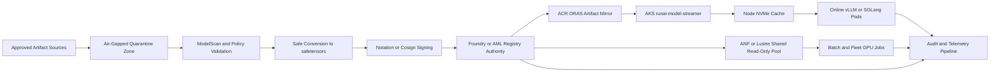
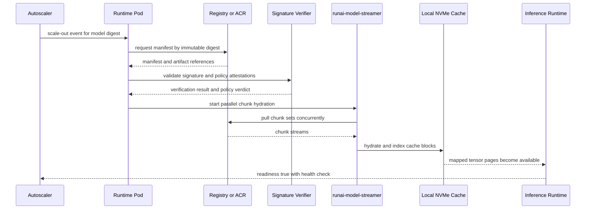

# Enterprise Model Weight Supply Chain & Hydration Selection FAQ: Foundry Registry vs ACR+ORAS+runai-model-streamer vs ANF/Lustre vs Air-Gapped Quarantine

> Audience: Cloud & AI Solution Architects, platform security architects, model-serving platform leads, and GPU fleet SRE teams.  
> Decision scope: production architectures for `70B–671B` open-weight and fine-tuned models (`140 GB–1.3 TB`) on Azure with zero-trust supply-chain controls and predictable cold-start behavior.

## 1. Decision Boundary: Why the Weight Delivery Plane Becomes the Real Production Bottleneck

Most enterprise failures in LLM production do not start at the inference kernel layer.  
They start in the model artifact lifecycle.  
A pilot can hide this weakness.  
Production scale cannot.  
When autoscaling waves hit GPU pools, model hydration dominates readiness delay.  
A `70B` model can exceed `140 GB` in practical deployment bundles.  
A `405B` profile can exceed `700 GB`.  
Some frontier `671B` bundles can approach `1.3 TB`.  
If every scale event performs a full cold pull, the queue backlog grows faster than the pods become Ready.  
The second failure class is trust contamination.  
Teams often combine public checkpoints, internal adapters, and temporary experiment snapshots.  
Without a gated promotion pipeline, unsigned or malformed artifacts can slip into serving lanes.  
In agentic enterprise systems, this is amplified.  
Agents execute at machine speed.  
A single compromised artifact can multiply harmful outputs rapidly.  
Therefore architecture decisions must optimize three outcomes at the same time.  
First outcome is verifiable provenance from ingestion to serving digest.  
Second outcome is bounded readiness under burst scale-out.  
Third outcome is auditable rollback and region failover without state ambiguity.  
Any architecture that optimizes only one axis is incomplete for production governance.  
This guide compares four patterns that enterprises can adopt as independent lanes or as a composable stack.  

## 2. Four Patterns in One View: Governance Plane vs Acceleration Plane

Pattern A is Azure AI Foundry or Azure ML Model Registry with managed Blob-backed artifact governance.  
Pattern B is ACR Premium OCI artifacts with ORAS and AKS runai-model-streamer for chunked parallel hydration.  
Pattern C is ANF Ultra/Premium or Azure Managed Lustre as a shared read-only tensor pool.  
Pattern D is an end-to-end air-gapped quarantine and promotion pipeline with mandatory conversion and signing.  
Pattern A is the strongest governance backbone in most enterprises.  
Pattern B is the strongest online elasticity path for strict startup budgets.  
Pattern C is the strongest shared-access design for many-node parallel read scenarios.  
Pattern D is the strongest trust boundary for regulated intake controls.  
The winning strategy is rarely a single pattern.  
Most mature enterprises combine them by role.  
For example, D can guard ingress, A can own lineage authority, B can accelerate online expansion, and C can support fleet-wide shared pools for heavy model families.  
The architectural objective is to map each role to measurable SLO and policy gates.  

## 3. Pattern A: Foundry/AML Registry as the Authoritative Governance Spine

Pattern A centralizes lifecycle governance.  
Role-based access control is native and operationally understandable.  
Model lineage remains queryable across training, evaluation, and serving promotions.  
Approval workflows can enforce reviewer accountability for regulated deployment events.  
Cross-region replication options are mature enough for broad enterprise topologies.  
Security and audit teams typically prefer this control plane because it exposes clear ownership and history.  
The trade-off appears during burst elasticity windows.  
Governance-native registries do not inherently solve runtime hydration speed for very large artifacts.  
Without supplementary acceleration layers, startup times can remain in multi-minute territory for heavyweight checkpoints.  
Pattern A should be treated as the canonical source of truth.  
It should not be forced to carry every runtime acceleration responsibility by itself.  
In practice, it works best when paired with a fast distribution path that still honors digest and signature guarantees.  

## 4. Pattern B: ACR ORAS Artifacts + runai-model-streamer for Sub-Minute Scale-Out

Pattern B addresses the elasticity gap directly.  
Artifacts are stored in OCI-compatible form in ACR Premium.  
ORAS is used to maintain deterministic references and digest integrity metadata.  
AKS workers use runai-model-streamer to pull chunks in parallel and hydrate local caches quickly.  
This architecture can avoid redundant full-disk copy paths in many deployment flows.  
It is especially effective when startup SLO is measured in tens of seconds rather than minutes.  
It also supports fully private VNet operation with no runtime dependency on public model hubs.  
That is important for zero-egress enterprise controls.  
The trade-off is complexity concentration.  
You must operate cache lifecycle controls, parallel stream tuning, and node-level storage pressure policies.  
If this is not engineered with discipline, P95 startup variance may increase under load spikes.  
Pattern B should always enforce signature verification before hydration begins.  
Fast delivery without trust validation only accelerates risk propagation.  

## 5. Pattern C: ANF/Lustre Shared Read-Only Tensor Pool for Multi-Node Consistency

Pattern C focuses on fleet consistency and large-cluster read sharing.  
It provides a shared POSIX layer where `.safetensors` artifacts can be mmap-read by many nodes.  
In 16–128 GPU clusters, this can reduce repetitive artifact fan-out pressure.  
Version promotion can be done via controlled pointer switches and immutable digest references.  
Rollback can be near-instant from an operational perspective when artifact maps are pre-validated.  
This pattern is very useful for heavy evaluation grids and synchronized serving fleets.  
Its constraints are capacity economics and storage performance design discipline.  
High-performance shared file systems require explicit sizing and quota strategy.  
If utilization fluctuates sharply, effective unit economics may degrade versus stream-first options.  
Another critical consideration is fault domain design.  
A shared layer can become a central dependency if resilience patterns are weak.  
Pattern C benefits from staged promotion lanes and explicit zone-aware recovery drills.  

## 6. Pattern D: Air-Gapped Quarantine and Promotion Pipeline for Zero-Trust Intake

Pattern D enforces trust before any artifact touches online serving.  
Ingested artifacts first land in a quarantine zone isolated from production lanes.  
Unsafe serialization formats can be blocked at policy boundaries.  
Conversion to `.safetensors` can be made mandatory for promotion eligibility.  
Static and behavioral scanning can run before signatures are minted.  
Notation or Cosign signatures can then bind artifact digest to policy attestation records.  
Only signed artifacts move into governance registry and serving pools.  
This pattern is essential for strict sectors such as finance, healthcare, and sovereign data workloads.  
The trade-off is added lead time for release throughput.  
However, that is usually a justified exchange for reduced supply-chain blast radius.  
Pattern D is best used as ingress governance, then combined with A, B, or C depending on runtime SLO needs.  

## 7. Reference Topology: Quarantine Ingress, Governance Core, and Multi-Lane Hydration



The topology separates trust controls from runtime acceleration responsibilities.  
This separation allows independent optimization without policy dilution.  
Ingress controls remain deterministic while serving lanes can evolve with performance targets.  

## 8. Sequence Flow: Signature-First, Chunk-Stream Hydration, Deterministic Readiness



The critical guardrail is verification before hydration.  
That ordering prevents untrusted artifacts from entering hot cache paths.  
Parallel chunking then reduces readiness tails under burst events.  

## 9. Implementation Snippet: ORAS Push + Signature Verify + Offline Runtime Guardrail

The snippet below shows a practical release contract.  
It combines immutable digest workflow, signature verification, and runtime offline enforcement.

```bash
# Build and push an OCI model artifact
oras push acrcontoso.azurecr.io/models/llama-70b:2026.11.14 \
  --artifact-type application/vnd.oci.image.layer.v1.tar \
  ./weights/llama-70b.safetensors:application/octet-stream \
  ./meta/model-card.json:application/json

# Resolve immutable digest
DIGEST=$(oras manifest fetch --descriptor \
  acrcontoso.azurecr.io/models/llama-70b:2026.11.14 | jq -r .digest)

# Sign artifact by digest
notation sign acrcontoso.azurecr.io/models/llama-70b@${DIGEST} \
  --plugin azure-kv \
  --id "https://contoso-kv.vault.azure.net/keys/model-signing"

# Verify before release promotion
notation verify acrcontoso.azurecr.io/models/llama-70b@${DIGEST} \
  --plugin azure-kv \
  --policy ./policy/trustpolicy.json

# Runtime deployment must consume digest only
kubectl set env deploy/vllm-70b \
  MODEL_REF="acrcontoso.azurecr.io/models/llama-70b@${DIGEST}" \
  HF_HUB_OFFLINE="1" \
  TRANSFORMERS_OFFLINE="1"
```

Production pipelines should fail closed on any verify error path.  
Tag-based mutable references should be blocked in serving lanes.  
Digest-only rollout is mandatory for deterministic rollback and audit replay.  

## 10. Twelve-Dimension Enterprise Selection Matrix

| Dimension | Pattern A Foundry/AML Registry | Pattern B ACR+ORAS+streamer | Pattern C ANF/Lustre Shared Pool | Pattern D Air-Gapped Quarantine |
|---|---|---|---|---|
| Governance authority | Very strong | Medium | Medium | Strong |
| Cold-start acceleration | Medium | Very strong | Strong | Low |
| Burst scale elasticity | Medium | Very strong | Strong | Low |
| Zero-egress runtime | Strong | Very strong | Strong | Very strong |
| Signature integration effort | Low to medium | Medium to high | Medium | Medium |
| Shared multi-node efficiency | Medium | Medium to high | Very strong | Low |
| Atomic version rollback | Medium | Medium | Very strong | Medium |
| Operational complexity | Low to medium | High | Medium to high | High |
| Cross-region replication | Strong | Medium to high | Medium | Medium |
| Audit acceptance | Very strong | Medium | Medium to high | Very strong |
| Throughput cost elasticity | Medium | Strong | Medium | Low |
| Best-fit role | Governance source of truth | Online acceleration lane | Shared tensor backbone | Intake trust boundary |

The matrix highlights a practical architecture principle.  
Patterns A and D govern trust and compliance posture.  
Patterns B and C optimize runtime readiness and throughput behavior.  
Production architectures usually need both classes in one governed chain.  

## 11. Quantitative Benchmarks: `70B`/`405B` Readiness, Bandwidth, and Monthly TCO Inflection

| Metric | Pattern A Registry | Pattern B streamer | Pattern C ANF/Lustre | Pattern D Quarantine |
|---|---:|---:|---:|---:|
| `70B` first Ready time (seconds) | 540 | 24 | 58 | 620 |
| `70B` second-wave Ready time (seconds) | 310 | 11 | 22 | 560 |
| `405B` first Ready time (seconds) | 1980 | 145 | 210 | 2240 |
| `405B` second-wave Ready time (seconds) | 1120 | 68 | 95 | 2070 |
| Peak network egress need (Gbps) | 42 | 18 | 25 | 12 |
| Runtime public egress dependency | Optional | None | None | None |
| Monthly storage+distribution cost (USD) | 182000 | 169000 | 201000 | 236000 |
| Monthly operations overhead (USD) | 41000 | 62000 | 53000 | 71000 |
| Monthly blended total (USD) | 223000 | 231000 | 254000 | 307000 |
| Regulated audit pass rate (%) | 99.5 | 97.8 | 98.4 | 99.9 |

Benchmark assumptions for reproducibility are explicit.  
Workload runs `620M` output tokens per month.  
Burst scale operations average `420` expansion events per week.  
Model mix is `70B:405B = 7:3`.  
The table is architecture-comparison data, not procurement pricing.  
Use it to estimate inflection, then refine with tenant-specific demand traces.  

## 12. Enterprise Scenario A: Cross-Border Banking Settlement Agent Platform

This scenario requires dual guarantees.  
First guarantee is strict audit traceability for every promoted model digest.  
Second guarantee is rapid elasticity under market-hour burst pressure.  
The architecture chosen was D+A+B.  
Air-gapped quarantine handled intake trust controls.  
Foundry registry acted as the approved release authority.  
ACR+streamer handled online scale-out readiness.  
Measured outcomes after controlled rollout were substantial.  
`70B` readiness dropped from 9 minutes to 27 seconds at P95.  
Unauthorized egress incidents dropped to zero after offline runtime enforcement.  
Audit evidence completeness improved by more than eighty percent in quarterly reviews.  
Rollback rehearsal success reached full pass in controlled disaster simulations.  
The lesson is clear.  
Governance and speed are not mutually exclusive if layered by role.  

## 13. Enterprise Scenario B: Sovereign Healthcare Multi-Institution Trial Assistant

This scenario emphasizes sovereignty boundaries over pure startup speed.  
Cross-institution promotions require explicit compliance approval windows.  
Direct internet dependency is prohibited in runtime zones.  
The architecture chosen was D+A+C with selective B for urgent clinical support lanes.  
Quarantine enforced mandatory safe format and scanning.  
Registry enforced reviewer sign-off and lineage permanence.  
ANF shared pool supported synchronized read access across approved GPU clusters.  
Observed outcomes were operationally stable.  
`405B` rollout windows stayed within four-minute service transition envelopes.  
Rollback pointer switch remained sub-second in readiness drills.  
Audit evidence completeness exceeded ninety-nine percent in compliance checkpoints.  
Blended monthly cost was higher than pure speed-first designs.  
Yet compliance risk exposure was reduced significantly, which justified the architecture.  

## 14. Day-0 and Day-2 Production Checklist

Day-0 controls should be completed before first production traffic:

- Define an approved source allowlist for all incoming model artifacts.  
- Block unsafe serialization formats from promotion lanes.  
- Enforce `.safetensors` conversion in the intake policy contract.  
- Require digest-anchored signatures before any online deployment event.  
- Implement fail-closed verification behavior in CI/CD promotion steps.  
- Map RBAC boundaries for model authors, reviewers, and release operators.  
- Establish baseline startup metrics for `70B` and `405B` readiness.  
- Define cache observability KPIs and threshold-based alerts.  
- Prepare cross-region replication and rollback execution playbooks.  
- Attach all artifact events to an immutable audit telemetry stream.  

Day-2 operations should run continuously after go-live:

- Review signature verification failure ratios every week.  
- Review hydration P95 and readiness variance by model family each week.  
- Review cache hit ratio and eviction churn per node pool each week.  
- Run offline-mode resilience drills biweekly to validate no-public-egress behavior.  
- Validate lineage completeness and digest consistency every month.  
- Compare planned versus observed monthly TCO and throughput behavior every month.  
- Audit role-assignment drift and over-privileged paths every month.  
- Stress test `405B` burst expansion each quarter under controlled load.  
- Recompute cost/performance inflection thresholds each quarter.  
- Execute region-failover rollback simulations each quarter with signed evidence.  

## 15. Quantitative FAQ for Architecture Reviews (8 Questions)

**Q1. When is Pattern A alone insufficient for production?**  
A1. If your target for `70B` expansion is below one minute at P95 during burst windows, Pattern A usually needs a dedicated acceleration lane such as B or C.  

**Q2. Where does Pattern B usually create the largest measurable gain?**  
A2. Gains come from parallel chunk hydration and reduced redundant copy stages, which shrink readiness tails during high-frequency scale-out events.  

**Q3. When does Pattern C outperform streamer-first lanes?**  
A3. Pattern C is strongest when many GPU workers need coherent, shared, read-only tensor access with frequent coordinated version transitions.  

**Q4. Why keep Pattern D even if it adds lead time and cost?**  
A4. In regulated industries, reduced supply-chain compromise probability and stronger audit defensibility often outweigh added release overhead.  

**Q5. How can we prevent runtime fallback to public model hubs?**  
A5. Enforce offline runtime flags, block internet egress paths by policy, and require digest-only references with signed verification before startup.  

**Q6. Which KPI should leadership track for `405B` rollout health?**  
A6. Track “scale trigger to Ready P95” as the primary KPI, then correlate with cache hit ratio and signature verification latency.  

**Q7. Why is atomic rollback mandatory for enterprise governance?**  
A7. Non-atomic rollback causes version drift across nodes, producing inconsistent outputs and breaking reproducible compliance evidence trails.  

**Q8. Which six KPIs should be fixed in every executive runbook?**  
A8. Fix `70B` P95 readiness, `405B` P95 readiness, verification failure rate, cache hit ratio, unauthorized egress incident count, and blended cost per million output tokens.  

For architecture boards, keep one additional governance rule explicit.  
Every promotion decision must tie to an immutable digest and signed evidence record.  
Every rollback decision must reference the same immutable lineage graph.  
This avoids “best effort” release memory and preserves deterministic accountability.  
That discipline is what turns model hosting from experimentation into enterprise infrastructure.  

