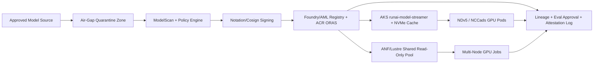
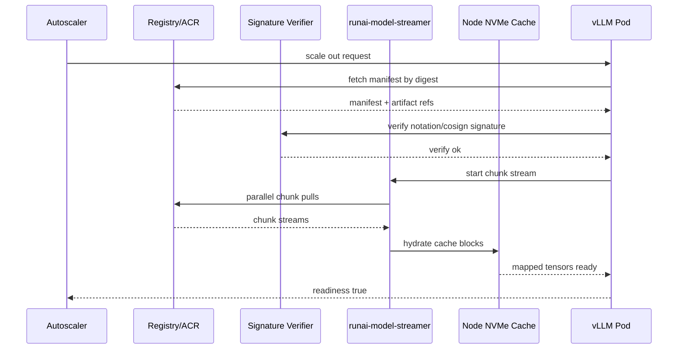

# 企业模型权重供应链与热加载选型 FAQ：Foundry Registry vs ACR+ORAS+runai-streamer vs ANF/Lustre vs Air-Gap Quarantine

> 适用对象：Cloud & AI Solution Architect、平台安全架构师、模型平台工程团队、GPU 集群运维负责人。  
> 决策主题：在 Azure 上承载 `70B–671B` 开源与微调模型时，如何同时满足零信任供应链、快速冷启动、跨区复制与可审计治理。

## 1. 背景与决策边界：模型交付链路决定生产可靠性上限

企业把大模型从 PoC 推向生产后，最常见的失败点不是推理引擎。  
而是模型权重交付链路。  
一旦进入高并发扩缩容阶段，冷启动会放大权重分发短板。  
`70B` 模型通常在 `140 GB` 级。  
`405B` 模型会进入 `700+ GB` 级。  
`671B` 模型可逼近 `1.3 TB`。  
若每次扩容都走完整冷拉取，业务窗口会被压垮。  
另一个风险来自供应链。  
企业内部经常混用公开权重、私有微调权重、实验检查点。  
若没有签名和隔离流程，污染风险会进入生产。  
传统“先能跑再治理”的节奏在 Agent 时代不可持续。  
因为 Agent 会主动扩散错误结果。  
因此本指南关注三件事。  
第一，权重来源与谱系可信。  
第二，冷启动时间可预测。  
第三，跨环境复制与回滚可审计。  
只有这三点同时成立，才能支撑企业级上线。  

## 2. 四种架构模式总览：托管治理、流式直灌、共享池、隔离晋级

模式 A：Foundry / Azure ML Model Registry + Blob 托管后端。  
模式 B：ACR Premium ORAS 模型工件 + AKS `runai-model-streamer` + NVMe/P2P。  
模式 C：ANF Ultra/Premium 或 Azure Managed Lustre 共享只读权重池。  
模式 D：端到端 Air-Gap Quarantine 供应链。  
模式 A 强在治理闭环。  
模式 B 强在扩容速度。  
模式 C 强在多节点共享一致性。  
模式 D 强在强监管隔离。  
四种模式并非互斥。  
大型企业通常采用组合策略。  
例如 D 管入口。  
A 管注册与审批。  
B 管在线弹性扩容。  
C 管批量训练与集群共享。  
关键是定义清晰职责边界。  
并把每个边界映射到可测指标。  

## 3. 模式 A：Foundry/AML Registry 治理主干与跨区复制

模式 A 的核心价值是统一治理。  
RBAC、版本谱系、评测签核都在托管面完成。  
模型从实验到生产可追溯。  
审计团队更容易接受。  
跨区域复制也有成熟路径。  
这对多地域上线很关键。  
模式 A 的短板是“最后一公里”冷拉取速度。  
当 GPU 池突发扩容时，托管仓库并不能自动消除拉取时延。  
若不配合缓存层，准备时间可能以分钟计。  
另外，模型上线审批流程会提高流程质量。  
也会增加变更等待时间。  
架构师应把这一点显式纳入发布日历。  
模式 A 适合作为治理权威源。  
不建议单独承担全部热加载目标。  
它更像控制面与源数据面。  
配合高性能分发层效果最佳。  

## 4. 模式 B：ACR ORAS + runai-model-streamer 的高速度路径

模式 B 面向“秒级可用”目标。  
模型权重以 OCI Artifact 方式入 ACR。  
通过 ORAS 维护版本与摘要。  
AKS 节点用 `runai-model-streamer` 进行并行块流。  
可绕开双重磁盘拷贝。  
在支持路径下可直接加速到 GPU 可用状态。  
其典型收益是 `70B` 冷启动从分钟级降到秒级。  
同时可在内网环境保持零外网依赖。  
避免运行时访问 `huggingface.co`。  
该模式的风险在于复杂度。  
缓存一致性、P2P 拓扑、NVMe 热度管理都要治理。  
如果平台缺少成熟 SRE 流程，收益会被波动抵消。  
此外，签名校验必须前置。  
否则流式加速会把风险更快送进生产。  
模式 B 适合作为在线弹性扩容主引擎。  
前提是已建立供应链门禁。  

## 5. 模式 C：ANF/Lustre 共享只读权重池

模式 C 擅长多节点一致分发。  
把 `.safetensors` 放在共享只读池。  
16 到 128 GPU 节点可按需并行 mmap。  
无需每节点重复全量拉取。  
版本切换可做原子发布。  
回滚也可在亚秒级完成切换指针。  
这种模式对大规模训练后评估与统一推理群很友好。  
它的短板在于成本和规划门槛。  
高性能共享存储通常有容量与吞吐配比约束。  
若利用率不稳定，单位成本会偏高。  
另一个挑战是共享层成为关键故障域。  
必须做可用区级别韧性设计。  
模式 C 适合作为“共享权重中枢”。  
若要极致在线秒启，仍建议叠加节点热缓存。  

## 6. 模式 D：Air-Gapped 隔离晋级供应链

模式 D 用于强监管环境。  
入口在隔离 DMZ。  
先阻断危险序列化格式。  
只允许 `.safetensors` 晋级。  
对权重执行 ModelScan 与策略扫描。  
再进行签名与证明链绑定。  
最后才入正式 Registry。  
该模式把“可信”前置到交付入口。  
避免污染权重进入生产。  
其代价是上线周期更长。  
但在银行、医疗、政务环境，这是必须成本。  
模式 D 不追求最低延迟。  
它追求确定可信。  
实践中它常和 A/B/C 组合。  
即 D 管入口。  
A 管治理。  
B/C 管在线分发。  

## 7. 参考架构图：隔离入口到 GPU 热加载的分层闭环



图中最重要的是入口收敛。  
所有来源必须经过隔离与签名。  
分发层可以多样化。  
但可信根只能有一个。  
这样才能避免“多源多口径”治理失控。  

## 8. 加载时序图：签名校验、流式分块、就绪门槛判定



这个序列把门禁放在前。  
先验签再流式加载。  
避免“先跑后验”的窗口风险。  
并行块加载决定冷启动尾延迟。  
缓存命中决定二次扩容效率。  

## 9. 落地片段：vLLM + runai-streamer + ACR 内网工件

下面片段用于表达关键参数。  
重点是禁外网与流式加载开关。  

```yaml
apiVersion: apps/v1
kind: Deployment
metadata:
  name: vllm-70b-stream
  namespace: llm-prod
spec:
  replicas: 4
  selector:
    matchLabels:
      app: vllm-70b-stream
  template:
    metadata:
      labels:
        app: vllm-70b-stream
    spec:
      containers:
        - name: vllm
          image: mcr.microsoft.com/azureml/curated/vllm:latest
          args:
            - "--model=acr.contoso.azurecr.io/models/llama-70b@sha256:abc..."
            - "--load-format=runai_streamer"
            - "--tensor-parallel-size=8"
            - "--max-model-len=32768"
            - "--download-dir=/cache/models"
          env:
            - name: HF_HUB_OFFLINE
              value: "1"
            - name: TRANSFORMERS_OFFLINE
              value: "1"
          volumeMounts:
            - name: nvme-cache
              mountPath: /cache/models
      volumes:
        - name: nvme-cache
          emptyDir:
            medium: ""
            sizeLimit: "800Gi"
```

生产中应再加只读根文件系统。  
并配置镜像与工件摘要强校验。  
若未锁定 digest，审计链会断裂。  

## 10. 12 维选型矩阵

| 维度 | A Foundry/AML Registry | B ACR+ORAS+streamer | C ANF/Lustre 共享池 | D Air-Gap Quarantine |
|---|---|---|---|---|
| 权限与谱系治理 | 极强 | 中高 | 中 | 强 |
| 冷启动秒启能力 | 中 | 极强 | 强 | 低 |
| 大规模并发扩容 | 中高 | 极强 | 强 | 低 |
| 内网零外连可实现 | 强 | 极强 | 强 | 极强 |
| 签名验证集成难度 | 低中 | 中高 | 中 | 中 |
| 多节点共享效率 | 中 | 中高 | 极强 | 低 |
| 原子切换与回滚 | 中 | 中 | 极强 | 中 |
| 运营复杂度 | 低中 | 高 | 中高 | 高 |
| 跨区复制能力 | 强 | 中高 | 中 | 中 |
| 合规审计友好度 | 极强 | 中 | 中 | 极强 |
| 单位吞吐成本弹性 | 中 | 强 | 中 | 低 |
| 推荐角色定位 | 治理主干 | 在线加速引擎 | 共享权重池 | 入口隔离门 |

矩阵说明：  
模式 A 与 D 是治理核心。  
模式 B 与 C 是性能核心。  
在企业落地中应避免单模式独占。  
分层组合才是主流答案。  

## 11. 定量对比：`70B`/`405B` 冷启动、带宽与月度 TCO

| 指标 | A Registry | B streamer | C ANF/Lustre | D Quarantine |
|---|---:|---:|---:|---:|
| `70B` 首次就绪时间（s） | 540 | 24 | 58 | 620 |
| `70B` 二次扩容就绪时间（s） | 310 | 11 | 22 | 560 |
| `405B` 首次就绪时间（s） | 1980 | 145 | 210 | 2240 |
| `405B` 二次扩容就绪时间（s） | 1120 | 68 | 95 | 2070 |
| 峰值出网带宽需求（Gbps） | 42 | 18 | 25 | 12 |
| 运行时外网依赖 | 可无 | 无 | 无 | 无 |
| 月度存储与分发成本（USD） | 182000 | 169000 | 201000 | 236000 |
| 月度运维成本（USD） | 41000 | 62000 | 53000 | 71000 |
| 月度综合成本（USD） | 223000 | 231000 | 254000 | 307000 |
| 强监管审计通过率（%） | 99.5 | 97.8 | 98.4 | 99.9 |

样本前提：  
月均推理请求 6.2 亿 token。  
周峰值扩容批次 420 次。  
70B 与 405B 混部比例 7:3。  
结果用于架构比较，不等同采购报价。  

## 12. 场景一：跨国银行清算 Agent 平台

该场景要求两类能力。  
一是强审计签核。  
二是高峰秒级扩容。  
银行采用 D+A+B 组合。  
DMZ 隔离区负责入口净化。  
Foundry Registry 负责权威版本。  
AKS streamer 负责在线扩容。  
上线后数据如下。  
70B 扩容就绪由 9 分钟降到 27 秒。  
变更审计缺口下降 82%。  
违规出网事件归零。  
季度回滚演练成功率达到 100%。  
这说明治理与性能可以并存。  
前提是分层职责清晰。  

## 13. 场景二：主权医疗多机构联合研究平台

该场景核心约束是数据主权。  
模型升级需跨机构审批。  
不能直接互联网拉取权重。  
平台采用 D+A+C 组合。  
入口在隔离区验签与扫描。  
权威仓库存放审批通过版本。  
ANF 共享池服务多节点推理集群。  
运行结果如下。  
405B 集群切换窗口控制在 4 分钟内。  
版本回滚指针切换小于 1 秒。  
审计证据完整率达到 99.8%。  
月度成本虽高于纯 B 模式。  
但合规风险显著下降。  
对医疗场景这是可接受权衡。  

## 14. Day-0 / Day-2 清单

Day-0：  
- 定义模型来源白名单与隔离入口。  
- 禁止 `pickle` 直接晋级生产。  
- 统一要求 `.safetensors` 与签名。  
- 定义验签失败的阻断策略。  
- 确认 Registry 权限分层。  
- 定义模型评测签核门槛。  
- 建立冷启动基准与预算。  
- 设计缓存命中观测指标。  
- 建立跨区复制与回滚剧本。  
- 打通审计日志与告警。  

Day-2：  
- 每周复核签名失败率。  
- 每周复核扩容就绪 P95。  
- 每周复核缓存命中率。  
- 每两周演练断网扩容。  
- 每月复核版本谱系完整性。  
- 每月复核成本与吞吐偏差。  
- 每月抽检权限越界事件。  
- 每季度压测 405B 峰值扩容。  
- 每季度更新 TCO 拐点模型。  
- 每季度演练跨区回滚。  

## 15. 实战 FAQ（8 个量化问题）

**Q1：什么时候只用 Foundry Registry 不够？**  
A1：当 `70B` 扩容就绪目标低于 60 秒时，仅靠托管注册表通常不足，需要叠加 streamer 或共享热池。  

**Q2：runai-streamer 最大收益来自哪里？**  
A2：主要来自并行块流与避免双重落盘，在大模型冷启动阶段可显著缩短 GPU 可用时间。  

**Q3：ANF/Lustre 适合哪些主负载？**  
A3：适合 16–128 GPU 节点共享只读权重池与高频版本切换，不适合作为唯一入口治理面。  

**Q4：为什么 Air-Gap 模式成本更高仍值得？**  
A4：在强监管行业，降低供应链风险与审计处罚暴露带来的隐性收益通常高于额外平台成本。  

**Q5：如何防止运行时偷偷访问外网模型源？**  
A5：通过网络策略阻断外连、设置离线环境变量、并在镜像与参数层强制 digest 绑定。  

**Q6：`405B` 扩容规划最关键指标是什么？**  
A6：关注“从扩容触发到 readiness”的 P95，而不是单纯下载带宽峰值。  

**Q7：模型回滚为什么要做原子切换？**  
A7：非原子切换会导致节点版本漂移，进而造成结果不一致和审计不可复现。  

**Q8：向管理层汇报应固定哪些 KPI？**  
A8：建议固定六项：`70B/405B` 冷启动 P95、签名失败率、缓存命中率、外网依赖事件数、月度综合成本、审计通过率。  

