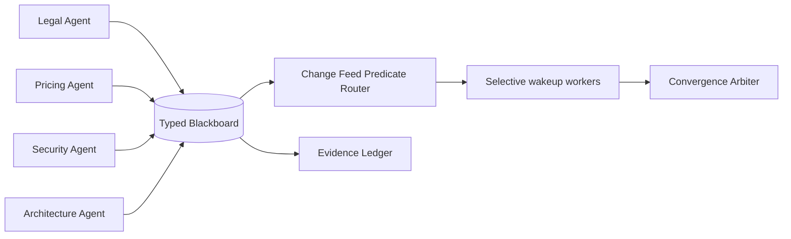
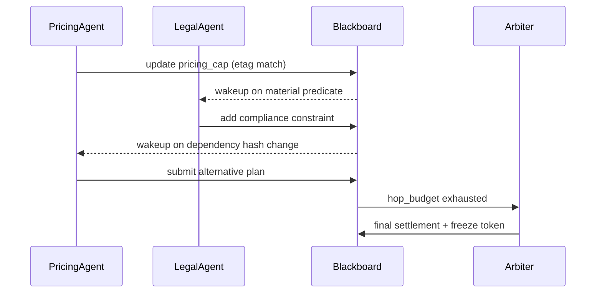

# Multi-agent typed-blackboard coordination selection FAQ: Route A (Cosmos change feed + ETag CAS) vs Route B (Redis tuple-space) vs Route C (Durable Entities / Dapr Actors) vs Route D (central full-history relay anti-pattern)

> Audience: Cloud & AI Solution Architects designing enterprise multi-agent collaboration for RFP assembly, M&A due diligence, compliance review, and live incident war-room synthesis.
> Objective: enable `8-30` specialist agents to co-author complex artifacts using shared typed state without quadratic transcript bloat, silent overwrite loss, or cyclic trigger storms.

## 1. Executive Summary

As soon as collaboration becomes nonlinear and hypothesis-driven, plain supervisor-centric relays break down.

Failure signatures include:

- token and latency growth approaching `O(N^2)` behavior,
- serialized hub bottlenecks,
- weak concurrency semantics with last-write-wins data loss,
- unbounded ping-pong between coupled specialists.

Recommended route composition:

1. **Route A as default enterprise baseline**: durable typed blackboard on Cosmos DB with change predicates and optimistic ETag concurrency.
2. **Route B for sub-10ms reactive collaboration**: in-memory tuple-space with asynchronous audit persistence.
3. **Route C for high-contention cells**: single-writer actor/entity serialization to avoid 412 thrash.
4. **Route D explicitly disallowed** for production governance-grade workloads.

## 2. Problem Definition and Collaboration Boundary

Representative late-breaking events:

- `ComplianceConstraintFailed`
- `PricingCapChanged`
- `RootCauseRefuted`

Architecture must support:

- selective invalidation of only dependent artifacts,
- scoped projection reads (`2K-4K` tokens) instead of full chat replay (`90K+`),
- explicit provenance links for claim/refutation chains,
- bounded convergence under contradictory specialist hypotheses.

## 3. Four Route Definitions

### Route A — Cosmos typed blackboard + change feed predicates + If-Match ETag

Core mechanics:

- each board slot is a typed artifact (`claim`, `constraint`, `assumption`, `cost_model`),
- writes use optimistic `If-Match` ETag checks,
- subscriptions wake downstream agents only on semantic predicate change,
- dependency hashes (`upstream_digest`) drive selective invalidation.

Route A is typically the best default when durability, global replication, and forensic auditability matter.

### Route B — RedisJSON + Streams consumer groups + Lua CAS tuple-space

Core mechanics:

- ultra-low propagation latency (often `<5 ms` in-region),
- efficient reactive update fan-out for live collaboration,
- optional asynchronous bridge to Event Hubs/Cosmos for durable evidence.

Route B favors speed and interaction fluidity in war-room style operating modes.

### Route C — Durable Entities / Dapr Actors single-writer partitioned cells

Core mechanics:

- serial mutation per fine-grained entity key,
- strong fit for high-contention shared counters and coupled budget matrices,
- explicit convergence arbitration logic under conflicting updates.

Route C is ideal for hotspots where optimistic retries become wasteful.

### Route D — Central supervisor full-history relay or unversioned shared blob

Anti-pattern indicators:

- every agent receives and re-summarizes full history each turn,
- updates overwrite without version and dependency semantics,
- loops emerge with no bounded hop or arbitration logic.

Route D does not scale for enterprise-grade correctness and governance.

## 4. 12-Dimension Comparison Matrix

| Dimension | Route A | Route B | Route C | Route D |
|---|---|---|---|---|
| Token efficiency at scale | High | High | High | Low |
| Concurrency conflict handling | Medium-High | Medium | Very High | Low |
| Real-time propagation latency | Medium | Very High | Medium | Superficial |
| Durable auditability | Very High | Medium (needs async sink) | High | Low |
| Selective invalidation precision | High | Medium-High | High | Low |
| Loop suppression capability | High | Medium | High | Low |
| Multi-region durability posture | High | Medium | Medium-High | Low |
| Operational complexity | Medium | Medium | Medium-High | Low (hidden risk) |
| Scalability under mixed workloads | High | High | Medium-High | Low |
| Cost predictability | High | Medium-High | Medium | Low |
| Explainability and provenance | High | Medium | High | Low |
| Production recommendation | default | latency-priority tier | contention hotspot tier | disallowed |

## 5. Quantitative Q&A (Q1..Q6)

### Q1. Why does hub-and-spoke relay produce quadratic token pressure?

A rough scaling approximation:

`Tokens_hub ≈ O(K × N × L_avg × N_receivers)`

For `N=12` agents and `K=6` revision waves, hub relay rapidly consumes context windows and inference budget.

Scoped blackboard projection behaves closer to:

`Tokens_bb ≈ O(K × L_slice)`

where each specialist reads only relevant typed slots.

### Q2. When does optimistic ETag conflict probability become unacceptable?

A simplified occupancy approximation:

`P_conflict = 1 - (1 - 1/S)^(M-1)`

where:

- `S` is effective writable slot cardinality,
- `M` is concurrent writers targeting the same collision domain.

As `M` rises and hotspots concentrate, retries spike; this is the practical crossover point for moving hotspot cells to Route C single-writer entities.

### Q3. How do we prevent cyclic trigger storms (Legal <-> Pricing)?

Three controls:

- monotonic `epoch` semantics,
- finite `hop_budget`,
- hysteresis threshold for semantic significance.

When budget exhausts, route to explicit arbiter escalation rather than continued bilateral chatter.

### Q4. How does selective dependency-hash invalidation reduce unnecessary recompute cost?

Slot metadata includes:

- `content_hash`,
- `upstream_slot_hashes`,
- `materiality_flags`.

Minor textual edits can avoid re-triggering expensive downstream recompute, while material field changes (for example `SLA < 99.95%`) force immediate invalidation of Legal and FinOps branches.

### Q5. How should contradictory hypotheses be represented safely?

Do not destructively overwrite competing claims.

Use an evidence ledger with:

- confidence score,
- structured evidence references,
- explicit `RefutedBy` links,
- resolution state.

This preserves explainability and allows deterministic convergence logic.

### Q6. How should Cosmos partitioning be designed to avoid hot partitions?

Recommended baseline:

- primary partition key `/workspace_id`,
- secondary workload separation using typed dimensions (`/artifact_type`, bounded temporal buckets),
- proactive RU and logical-partition monitoring to avoid concentrated heat near practical throughput boundaries.

## 6. Architecture Overview (Mermaid #1)



## 7. Conflict Convergence Flow (Mermaid #2)



## 8. Production Code Example #1 — Cosmos typed slot CAS update with selective invalidation fields

```python
from azure.cosmos import CosmosClient, exceptions
import hashlib

def compute_hash(payload: dict) -> str:
    raw = repr(sorted(payload.items())).encode("utf-8")
    return hashlib.sha256(raw).hexdigest()

def replace_slot_with_cas(container, slot_id: str, workspace_id: str, payload: dict, etag: str):
    doc = {
        "id": slot_id,
        "workspace_id": workspace_id,
        "artifact_type": payload["artifact_type"],
        "content": payload,
        "content_hash": compute_hash(payload),
        "upstream_slot_hashes": payload.get("upstream_slot_hashes", {}),
        "epoch": payload.get("epoch", 0),
        "hop_budget": payload.get("hop_budget", 6),
    }
    try:
        return container.replace_item(slot_id, doc, etag=etag, match_condition="IfNotModified")
    except exceptions.CosmosHttpResponseError as ex:
        if ex.status_code == 412:
            raise RuntimeError("etag_conflict_retry")
        raise
```

## 9. Production Code Example #2 — Durable Entity serialized hotspot cell

```csharp
public class BudgetCellEntity
{
    public decimal Current { get; set; }
    public string LastUpstreamHash { get; set; } = "";

    public void ApplyDelta(decimal delta, string upstreamHash)
    {
        if (upstreamHash == LastUpstreamHash) return; // idempotent replay guard
        Current += delta;
        LastUpstreamHash = upstreamHash;
    }
}
```

## 10. Enterprise Scenario A — Global IT Services & Defense Contractor RFP Assembly

Context:

- 300-page bid package,
- 14 specialist agents across legal, infosec, architecture, staffing, and pricing,
- frequent late constraint updates from customer legal and compliance channels.

Route composition:

- Route A for durable typed collaboration state,
- Route C for high-contention budget and SLA commitment cells,
- selective invalidation to avoid full-document recompute.

Outcome:

- significantly lower rework blast radius,
- defensible provenance from input evidence to submitted claim sets.

## 11. Enterprise Scenario B — Tier-1 Cloud/Telco NOC Multi-Agent War-Room

Context:

- network, database, auth, and deployment agents emitting parallel hypotheses,
- objective to converge to actionable remediation in `<90s`.

Route composition:

- Route B for low-latency reactive tuple-space,
- asynchronous persistence to Cosmos for after-action forensics,
- arbiter-enforced convergence when cyclic trigger budget is exhausted.

Outcome:

- faster multi-domain alignment,
- lower duplicate action and alert chatter rate.

## 12. Three-Year TCO Comparison (Illustrative)

| Route | Annual Platform | Annual Governance/Ops | 3-Year Total | Interpretation |
|---|---:|---:|---:|---|
| Route A | `$590k` | `$230k` | `$2.46M` | balanced enterprise baseline |
| Route B | `$520k` | `$260k` | `$2.34M` | strongest low-latency behavior |
| Route C | `$640k` | `$300k` | `$2.82M` | premium for contention-critical cells |
| Route D | `$410k` | `$620k` | `$3.09M` | hidden outage and rework costs dominate |

## 13. Day-0 / Day-1 / Day-2 Checklist

### Day-0 (Contract and Schema Baseline)

- define typed slot schemas and dependency metadata contracts,
- define material-change semantics and invalidation policies,
- define hop-budget and escalation thresholds.

### Day-1 (Engineering Integration)

- deploy predicate-based change-feed routing,
- implement ETag CAS write and retry controls,
- instrument evidence ledger and trace-linked visibility.

### Day-2 (Operational Maturity)

- migrate hotspots from optimistic CAS to actor/entity serialization as needed,
- optimize Redis/Cosmos tiering and cost controls,
- codify adjudication runbooks for cross-domain teams.

## 14. Good Fit vs Not For

### Good Fit

- many specialists working concurrently with coupled dependencies,
- strong need for replayable audit and provenance,
- mixed latency and durability requirements requiring route composition.

### Not For

- single-agent linear tasks with no dependency graph,
- organizations without versioning and evidence governance disciplines,
- teams unwilling to enforce bounded convergence semantics.

## 15. Final Recommendation

Successful multi-agent collaboration at enterprise scale is built on **typed shared state**, not indiscriminate transcript fan-out.

Recommended pattern:

- Route A as durable auditable backbone,
- Route B for low-latency interactive collaboration domains,
- Route C for high-contention serialized hotspot cells,
- explicit rejection of Route D anti-patterns.

### 15.1 Core Governance KPIs

| KPI | Suggested Target |
|---|---:|
| conflict retry success rate | `>= 99%` |
| cyclic trigger interception rate | `= 100%` |
| selective recompute precision | `>= 95%` |
| full-history broadcast ratio | `< 5%` |
| provenance completeness | `>= 99%` |

### 15.2 Supervisory Evidence Package

- slot-level mutation ledger with ETag/hash/dependency metadata,
- arbiter escalation and settlement records,
- end-to-end evidence lineage from source inputs to final recommendations.

### 15.3 Condensed Decision Tree

1. Need multi-region durability and auditability by default?
   - start with Route A.
2. Need sub-10ms collaboration propagation?
   - add Route B.
3. Seeing rising 412 retries on hotspot cells?
   - transition those cells to Route C.
4. Still using full-history relay or unversioned shared blob writes?
   - classify as Route D anti-pattern and block production release.

### 15.4 Practical Boundary Notes

No blackboard design eliminates governance responsibility:

- conflict semantics still need business-owner decisions,
- arbitration logic needs explicit ownership and policy lifecycle,
- route transitions (A/B/C) should be data-driven and reviewed periodically.

Treat the architecture as an operational system, not a one-time data model choice.

### 15.5 Conflict Operations Runbook for High-Concurrency Windows

When `10+` specialists concurrently mutate the same artifact family, operate with a tiered conflict policy:

1. **Tier-1 auto-retry**: bounded exponential backoff with jitter for transient ETag conflicts.
2. **Tier-2 hotspot migration**: move repeatedly conflicted cells to Route C single-writer entity lanes.
3. **Tier-3 arbitration escalation**: if cyclic dependencies continue after hop-budget controls, route to arbiter and human checkpoint.

This keeps throughput stable while avoiding retry storms that burn latency and token budget without improving convergence.

### 15.6 Joint Cost-and-Latency Planning Model (Simplified)

A practical planning decomposition:

`Cost_total = Cost_tokens + Cost_state_io + Cost_recompute + Cost_escalation`

Where:

- `Cost_tokens` is dominated by projection width per specialist,
- `Cost_state_io` is driven by board mutation and event fan-out patterns,
- `Cost_recompute` depends on invalidation granularity,
- `Cost_escalation` reflects arbitration and human decision frequency.

In production programs, selective invalidation frequently produces larger savings than prompt-level token trimming because it suppresses expensive downstream recompute waves.

### 15.7 Evidence-Ledger Field Contract (Governance-Ready)

For each material board mutation, persist:

- `actor_id`, `agent_role`,
- `workspace_id`, `slot_id`,
- `previous_hash`, `new_hash`,
- `upstream_dependency_hashes`,
- `confidence`, `refuted_by`,
- `decision_reason_code`,
- `trace_id`, `revision_id`.

This schema transforms retrospective review from narrative explanation to deterministic evidence replay.

### 15.8 Common Failure Patterns and Corrective Actions

| Failure Pattern | Observable Symptom | Corrective Action |
|---|---|---|
| Overly coarse slots | persistent high conflict retries | split slot granularity and role scope |
| Over-broad wakeup predicates | irrelevant agent wakeups | tighten predicate semantics and materiality flags |
| Missing dependency metadata | stale downstream outputs | enforce upstream hash presence on writes |
| No termination semantics | endless bilateral refutation loops | enforce hop budgets and arbiter takeover |
| Incomplete audit fields | weak forensic replay quality | enforce mutation schema validation gates |

### 15.9 Platformization Guidance for Enterprise Rollout

At portfolio scale, package blackboard capability into three productized layers:

- **Schema layer**: typed slot templates, dependency contracts, evidence contracts.
- **Runtime layer**: predicate router, conflict controller, arbiter adapters.
- **Governance layer**: audit reporting, anomaly detection, cost observability, policy replay.

This lets domain teams focus on business reasoning while platform teams centralize reliability and compliance mechanics.
