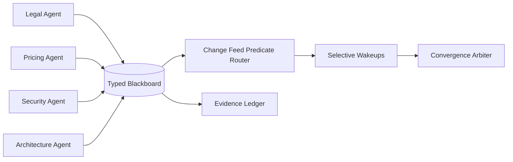
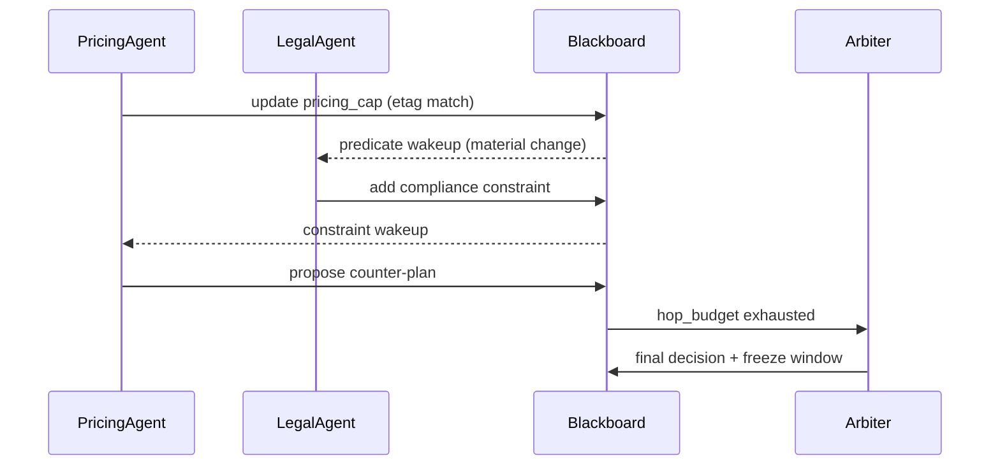

# 多智能体 Typed Blackboard 协同选型 FAQ：Route A（Cosmos Change Feed + ETag CAS）vs Route B（Redis Tuple-Space）vs Route C（Durable Entities / Dapr Actors）vs Route D（中心监督者全量转发反模式）

> 适用对象：企业 RFP 自动化、并购尽调、合规审阅、NOC 战情室、多团队联合交付场景下的 Cloud & AI Solution Architect。
> 目标：让 `8–30` 个专长智能体并行协作时，只重算受影响依赖，避免中心转发瓶颈、覆盖写丢失与互相循环触发。

## 1. 执行摘要

当多智能体协作进入“非线性、多轮次、可反驳”阶段，传统“中心监督者广播全历史”会出现三类问题：

- token 成本按 `O(N^2)` 膨胀；
- 中心节点成为串行瓶颈；
- 写冲突与覆盖难以审计。

推荐架构：

1. **Route A** 作为默认：Cosmos Typed Blackboard + Change Feed + ETag 并发控制；
2. **Route B** 用于毫秒级互动场景：Redis 内存反应式元组空间；
3. **Route C** 用于高冲突热点单元：单写者实体序列化；
4. **Route D** 明确禁止进入生产。

## 2. 问题定义与协作边界

典型输入事件：

- `ComplianceConstraintFailed`
- `PricingCapChanged`
- `RootCauseRefuted`

关键目标：

- 仅失效依赖节点，不全量重算；
- 每个智能体仅读取其投影视图（而非全量聊天历史）；
- 保持证据链与反驳链可追踪；
- 防止 Legal 与 Pricing 类代理发生无穷 ping-pong。

## 3. 四条路线定义

### Route A：Cosmos Typed Blackboard + Change Feed + If-Match ETag

能力特征：

- 每个 slot 为 typed artifact（`claim`, `assumption`, `constraint`, `cost_model`）；
- 使用 `If-Match` ETag 做乐观并发；
- Change Feed 按谓词订阅唤醒下游；
- 用 `upstream_digest` 精确判断依赖失效。

适用：需要多区域持久化、合规审计、可追责重放的企业级协作。

### Route B：RedisJSON + Streams + Lua CAS Tuple-Space

能力特征：

- `<5ms` 级传播延迟；
- 适合战情室、联合看板、实时协同画布；
- 可异步落盘到 Event Hubs/Cosmos 保留审计。

适用：交互时延优先于持久审计的一线指挥协同。

### Route C：Durable Entities / Dapr Actors 单写者分区单元

能力特征：

- 对热点共享单元进行串行化更新；
- 显著减少高并发下 `HTTP 412` 重试风暴；
- 适合预算计数、状态机、耦合表格单元等高争用对象。

适用：写冲突概率高、更新顺序语义严格的关键协作状态。

### Route D：中心监督者全量转发 / 无版本共享 JSON

反模式特征：

- 所有代理读写同一 blob；
- 无显式版本/依赖语义；
- 最终出现“最后写入覆盖一切”与循环触发风暴。

## 4. 12 维比较矩阵

| 维度 | Route A | Route B | Route C | Route D |
|---|---|---|---|---|
| token 成本可控性 | 高 | 高 | 高 | 低 |
| 并发冲突治理 | 中高 | 中 | 很高 | 低 |
| 低延迟互动 | 中 | 很高 | 中 | 表面高 |
| 持久审计 | 很高 | 中（需异步） | 高 | 低 |
| 依赖失效精度 | 高 | 中高 | 高 | 低 |
| 循环触发抑制 | 高 | 中 | 高 | 低 |
| 多区域能力 | 高 | 中 | 中高 | 低 |
| 运维复杂度 | 中 | 中 | 中高 | 低（但风险高） |
| 规模扩展性 | 高 | 高 | 中高 | 低 |
| 成本预测性 | 高 | 中高 | 中 | 低 |
| 可解释性 | 高 | 中 | 高 | 低 |
| 推荐程度 | 默认优先 | 低延迟优先 | 高冲突热点 | 禁止 |

## 5. 定量问题 Q1..Q6

### Q1：中心转发为何导致 `O(N^2)` token 爆炸？

近似：

`Tokens_hub ≈ O(K × N × L_avg × N_receivers)`

若 `N=12`、`K=6`，全量中继会快速超过上下文预算。
Blackboard 投影可降为：

`Tokens_bb ≈ O(K × L_slice)`

即代理只读与自身任务相关 slot。

### Q2：ETag 冲突概率何时不可接受？

近似：

`P_conflict = 1 - (1 - 1/S)^(M-1)`

其中 `S` 为可分散 slot 数，`M` 为并发写者数。
当热点集中、`M` 增大时，Route A 会出现重试抖动，应转向 Route C 的单写者实体化。

### Q3：如何防止循环触发风暴（Legal <-> Pricing）？

治理策略：

- 单调 `epoch` + `hop_budget`；
- 仅“实质变更”触发（阈值/枚举字段）；
- 超预算后进入仲裁器（Arbiter）人工或规则收敛。

### Q4：如何做到选择性依赖失效而非全局重算？

每个 slot 持久化：

- `content_hash`
- `upstream_slot_hashes`
- `materiality_flags`

轻微拼写修正不触发全链路重算；关键字段（如 `SLA < 99.95%`）变更则立即失效法务与 FinOps 节点。

### Q5：冲突假设如何共存，而不是相互覆盖？

采用证据账本：

- `claim_id`
- `confidence`
- `evidence_refs`
- `refuted_by`

通过显式“被反驳关系”建模，避免 destructive overwrite。

### Q6：Cosmos 分区如何避开热点墙？

建议：

- 分区键：`/workspace_id`；
- 子层次：`/artifact_type` + 时间桶/主题桶；
- 监控逻辑分区 RU 热点与容量增长，避免接近 `20 GB`/逻辑分区与高 RU 热点上限。

## 6. 架构拓扑（Mermaid 图 1）



## 7. 冲突仲裁与收敛流程（Mermaid 图 2）



## 8. 生产代码示例 1（Cosmos Typed Blackboard + ETag CAS + 依赖失效）

```python
from azure.cosmos import CosmosClient, exceptions
import hashlib

def digest(payload: dict) -> str:
    raw = repr(sorted(payload.items())).encode("utf-8")
    return hashlib.sha256(raw).hexdigest()

def upsert_slot_with_etag(container, slot_id: str, workspace_id: str, payload: dict, etag: str):
    doc = {
        "id": slot_id,
        "workspace_id": workspace_id,
        "artifact_type": payload["artifact_type"],
        "content": payload,
        "content_hash": digest(payload),
        "upstream_slot_hashes": payload.get("upstream_slot_hashes", {}),
        "hop_budget": payload.get("hop_budget", 6),
        "epoch": payload.get("epoch", 0),
    }
    try:
        return container.replace_item(slot_id, doc, etag=etag, match_condition="IfNotModified")
    except exceptions.CosmosHttpResponseError as ex:
        if ex.status_code == 412:
            raise RuntimeError("etag_conflict_retry")
        raise
```

## 9. 生产代码示例 2（Durable Entity 单写者预算单元）

```csharp
public class BudgetCellEntity
{
    public decimal Current { get; set; }
    public string LastHash { get; set; } = "";

    public void ApplyDelta(decimal delta, string upstreamHash)
    {
        if (upstreamHash == LastHash) return; // idempotent guard
        Current += delta;
        LastHash = upstreamHash;
    }
}
```

## 10. 企业场景 A：全球 IT 服务与国防承包商 RFP 协作

背景：

- 300 页标书；
- 14 个专长代理（法务、信息安全、架构、交付、定价等）；
- 每轮评审会持续引入约束修订。

实践：

- Route A 做持久协作黑板；
- 关键预算与 SLA 承诺单元采用 Route C；
- 只对受影响章节触发重算与复核。

结果：

- 避免全稿级反复重算；
- 审计可追踪到每次约束变化来源。

## 11. 企业场景 B：Tier-1 云/电信 NOC 战情室

背景：

- 网络、数据库、身份、发布四类代理并发给出假设；
- 目标在 `<90s` 内收敛到可执行止血动作。

实践：

- Route B 做超低时延 tuple-space；
- 关键结论异步持久化到 Cosmos；
- 仲裁器在 hop_budget 耗尽时强制收敛。

收益：

- 提升跨团队协同速度；
- 降低误触发级联告警与重复动作。

## 12. 三年 TCO 对比（示例）

| 路线 | 年平台成本 | 年治理运维 | 三年总计 | 说明 |
|---|---:|---:|---:|---|
| Route A | `$590k` | `$230k` | `$2.46M` | 默认企业级平衡方案 |
| Route B | `$520k` | `$260k` | `$2.34M` | 低延迟强，审计需补链路 |
| Route C | `$640k` | `$300k` | `$2.82M` | 高冲突热点场景价值高 |
| Route D | `$410k` | `$620k` | `$3.09M` | 隐性事故与返工成本高 |

## 13. Day-0 / Day-1 / Day-2 清单

### Day-0

- 定义 typed slot schema 与依赖字段；
- 定义 material change 判定规则；
- 明确循环触发上限与仲裁升级机制。

### Day-1

- 部署 Change Feed predicate router；
- 接入 ETag CAS 与冲突重试策略；
- 建立 evidence ledger 与追踪仪表盘。

### Day-2

- 复盘冲突高发 slot 并实体化（Route C）；
- 优化 Redis/Cosmos 成本分层；
- 固化跨团队协作 runbook 与审批策略。

## 14. Good fit vs Not for

### Good fit

- 多团队并发协作且依赖关系复杂；
- 要求可审计、可追责、可重放；
- 需要在成本与时延之间做策略分层。

### Not for

- 仅单代理线性任务；
- 无版本控制与证据治理需求；
- 对循环触发与并发冲突无治理能力。

## 15. 结论

多智能体协作平台的关键不是“让所有代理互相聊天”，而是“让代理围绕 typed state 在受控规则下协作”。

推荐路径：

- 以 Route A 构建可持久、可审计黑板主平面；
- 在超低时延协同链路引入 Route B；
- 对高冲突共享单元使用 Route C；
- 彻底避免 Route D 的全量转发与无版本共享写入。

### 15.1 关键指标建议

| 指标 | 建议目标 |
|---|---:|
| 冲突重试成功率 | `>= 99%` |
| 循环触发被拦截率 | `= 100%` |
| 受影响节点精准重算率 | `>= 95%` |
| 全历史广播占比 | `< 5%` |

### 15.2 监管与审计证据包

- slot 级别变更日志（含 ETag、hash、依赖）；
- 仲裁升级记录与最终裁决依据；
- 关键结论从输入证据到输出建议的可追溯链。

### 15.3 选型决策树（简版）

1. 需要跨区域持久审计？优先 Route A。
2. 需要 `<10ms` 互动传播？叠加 Route B。
3. 热点冲突频繁且 412 重试飙升？对该单元切 Route C。
4. 想继续中心全量转发或共享无版本 JSON？判定 Route D 反模式并拒绝。

### 15.4 冲突治理运行手册（高并发场景）

当协作进入高并发窗口（例如同一交付物被 10+ 代理同时修订），建议启用分级冲突策略：

1. **一级（自动重试）**：轻度 ETag 冲突，指数退避并附带随机抖动。
2. **二级（热点迁移）**：冲突持续超过阈值，自动把热点 slot 迁移为 Route C 实体单写。
3. **三级（仲裁升级）**：跨域冲突伴随循环触发，进入 Arbiter 与人工审批。

这样可避免系统在“高冲突 + 高时延”状态下陷入无意义重试风暴。

### 15.5 成本与延迟联合模型（简化）

可用以下近似评估协同策略：

`Cost_total = Cost_tokens + Cost_state_io + Cost_recompute + Cost_escalation`

其中：

- `Cost_tokens`：由代理读取上下文长度驱动；
- `Cost_state_io`：由黑板存储读写与事件分发驱动；
- `Cost_recompute`：由依赖失效后重算波及面驱动；
- `Cost_escalation`：由仲裁与人工确认次数驱动。

通过 selective invalidation 可显著压降 `Cost_recompute`，通常比盲目优化单次推理 token 更有效。

### 15.6 证据账本字段建议（合规视角）

建议每次关键写入记录以下字段：

- `actor_id` / `agent_role`
- `slot_id` / `workspace_id`
- `previous_hash` / `new_hash`
- `upstream_dependency_hashes`
- `confidence`
- `refuted_by`
- `decision_reason_code`
- `trace_id` / `revision_id`

这使监管或内审在追溯“为什么做出该业务结论”时，不依赖口头解释，而依赖结构化证据。

### 15.7 常见失败模式与修复建议

| 失败模式 | 表现 | 修复建议 |
|---|---|---|
| 共享 slot 过粗 | 冲突频率持续高 | 拆分 slot 粒度并按角色分区 |
| 触发条件过宽 | 无关代理被频繁唤醒 | 改为谓词订阅 + material flag |
| 依赖链缺失 | 变更后下游未重算 | 强制写入 upstream hashes |
| 无仲裁退出 | 代理互相反驳无收敛 | 引入 hop_budget + Arbiter |
| 审计字段缺漏 | 无法复盘决策来源 | 强制 evidence schema 校验 |

### 15.8 平台化推广建议

在集团级推广时，建议把 Blackboard 能力抽象为三层产品：

- **Schema 层**：typed slot 模板、依赖字段规范、证据字段规范；
- **Runtime 层**：Change Feed 路由器、冲突控制器、仲裁器插件；
- **Governance 层**：审计报表、异常告警、成本看板、策略回放。

通过统一平台能力，业务线只需关注“业务语义”和“协同策略”，无需重复建设底层并发与审计机制。

### 15.9 规模化运营 KPI 建议

为保证长期可运营，建议每周至少追踪以下指标：

| 指标 | 说明 | 建议阈值 |
|---|---|---:|
| `projection_token_ratio` | 投影视图 token / 全历史 token | `< 0.25` |
| `etag_retry_rate` | ETag 冲突重试占比 | `< 8%` |
| `arbiter_escalation_rate` | 仲裁升级占比 | `< 5%` |
| `material_change_precision` | 实质变更判定准确率 | `>= 95%` |
| `dependency_miss_rate` | 依赖漏标导致遗漏重算比例 | `< 1%` |

这些指标可直接反映协作系统是否在“低成本、高收敛、可审计”区间运行。

### 15.10 组织协作职责划分

建议在组织层明确 RACI：

- **平台架构团队**：定义 typed schema、依赖语义、冲突策略框架；
- **业务域团队**：定义 materiality 规则与仲裁准则；
- **SRE/运维团队**：维护运行阈值、告警与扩缩容策略；
- **合规与审计团队**：定义证据保留与抽检频率。

这样可以避免“技术实现正确，但业务解释缺位”导致的落地阻塞。

### 15.11 与现有流程体系集成建议

如果组织已具备 ITSM 与变更管理平台，建议把 Blackboard 协同事件映射到既有流程：

- 关键仲裁升级自动生成工单并携带证据链链接；
- 高风险 slot 变更自动触发 CAB 轻量审批；
- 周期性输出“冲突热点榜单”供架构评审会复盘。

通过与既有流程体系对齐，能够把多智能体协作从“实验能力”升级为“可持续运营能力”。

同时建议在季度架构评审中固定审阅黑板协作质量曲线，持续优化触发规则与仲裁策略。
