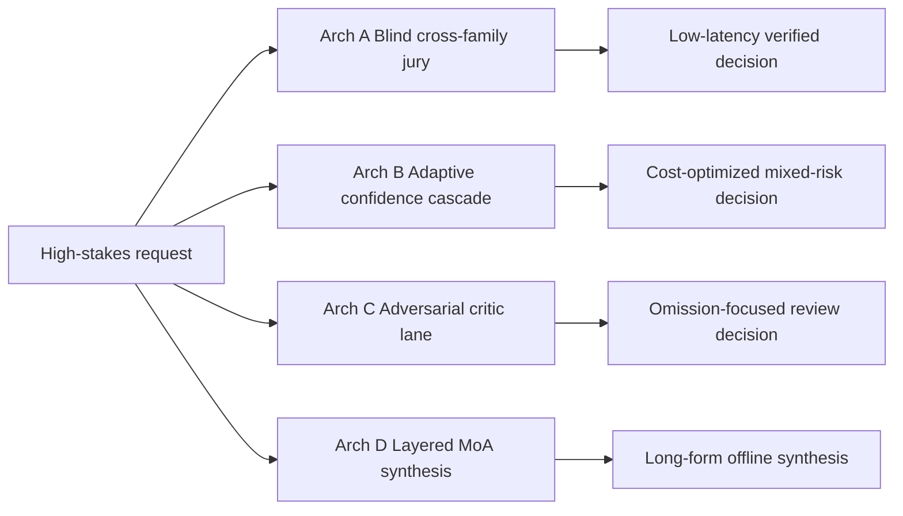
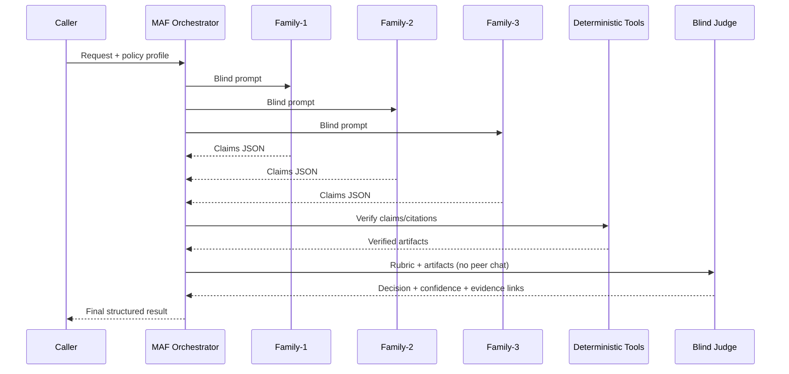
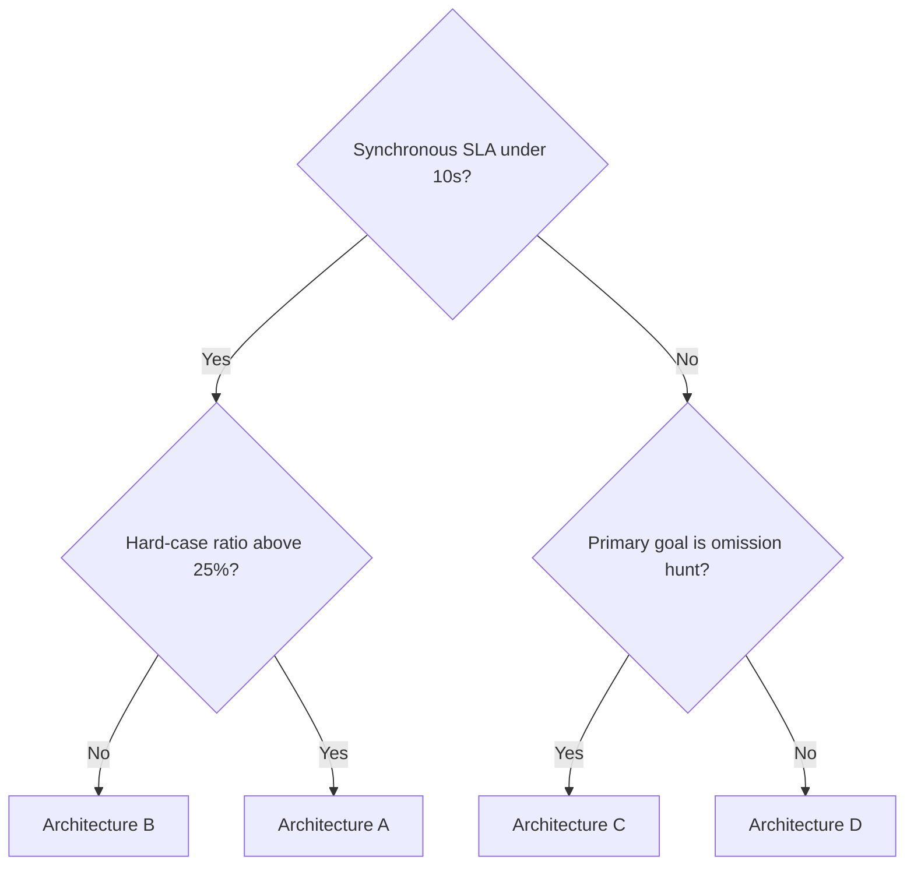

# Enterprise Multi-Agent Consensus and Debate Orchestration Selection FAQ: Blind Cross-Family Jury vs Adaptive Confidence Cascade vs Adversarial Critic vs Layered MoA
> **Applies to**: high-stakes decisions where an incorrect answer can trigger financial, clinical, legal, or production incidents.
> **Core dilemma**: simple majority voting improves confidence appearance but can preserve shared blind spots and inflate latency/cost.
> **Audience**: Cloud & AI Solution Architects, platform engineering, risk/compliance leads, and domain review boards.

## 1. Executive summary
Enterprises expect multi-agent ensembles to raise decision quality.
Many programs first observe cost growth and slower response time.
Accuracy can still plateau when model errors are correlated.
Three samples from one family are not true independence.
Sycophancy also appears when agents can see each other early.
Fluent incorrect arguments can flip an initially correct agent.
Token costs expand quickly in unconstrained debate rounds.
Tail latency stretches with every additional endpoint in fan-out.
Architecture choice must balance precision, latency, and unit economics.
Architecture A is the default for synchronous high-stakes APIs.
Architecture B is the default for high-volume mixed-risk traffic.
Architecture C is the default for omission-hunting investigations.
Architecture D is the default for asynchronous rich synthesis.

## 2. Applicability and explicit non-goals
Primary scope includes decision workflows with structured output contracts.
Examples include underwriting, tumor-board synthesis, covenant reviews, and change-risk sign-off.
The guide focuses on cross-family orchestration on Azure runtime planes.
Deterministic tool-grounding is treated as mandatory for critical claims.
Scope differs from 3.2 model cost-routing cascades.
Context here differs from 3.7 root-cause fault-localization flow in #362.
This document also differs from 3.7 offline Foundry Evaluation benchmark pipelines.
Focus here differs from 3.5 human approval routing alone.
Generic prompt-writing craft is not the topic.
Domain policy authoring remains outside this document.

## 3. Failure patterns that break naive ensembles
Correlated error is the first hidden tax.
Shared pretraining and safety tuning produce similar blind zones.
Debate herding is the second hidden tax.
Free-text persuasion can overpower weak evidence.
Context blow-up is the third hidden tax.
Round-based all-to-all debate scales near `O(K^2 · R)`.
Straggler latency is the fourth hidden tax.
User-visible latency follows the slowest branch in fan-out.
These four taxes explain most failed first-generation designs.

## 4. Candidate architecture overview
Architecture A: blind parallel proposals plus a tool-grounded judge.
Architecture B: disagreement-triggered adaptive jury cascade.
Architecture C: role-asymmetric adversarial cross-examination.
Architecture D: multi-layer MoA pyramid synthesis.
A minimizes sycophancy and keeps synchronous SLA predictable.
B minimizes blended spend while escalating hard cases.
C maximizes defect discovery in omission-sensitive tasks.
D maximizes long-form synthesis quality for offline output.

## 5. Architecture A: blind cross-family parallel jury
A sends round-one prompts to `K=3` orthogonal model families.
Branches have zero peer visibility during proposal drafting.
Each proposal must return structured claim-citation JSON.
Deterministic tools verify arithmetic, policy, and data joins.
The judge sees verified artifacts, not persuasive prose only.
Latency is one fan-out plus one judge pass.
Token overhead trends near `~3.4x` baseline.
This replaces `9–12x` footprints from three-round free debate.
A is usually the best first production baseline.

## 6. Architecture B: disagreement-triggered adaptive cascade
B starts with a dual-fast probe on every request.
Primary and orthogonal shadow outputs are compared structurally.
Semantic-entropy and claim divergence gates score uncertainty.
Low-risk converged responses auto-commit immediately.
Contested or high-exposure cases escalate to a three-family jury.
Escalation often lands in the `15%–22%` slice.
Blended token spend drops by `65%–78%` in typical portfolios.
Precision on hard tails remains close to always-jury baselines.
B is strong for large throughput with mixed risk.

## 7. Architecture C: adversarial critic cross-exam
C separates roles into Proponent, Falsifier, and Blind Judge.
The Falsifier is rewarded only for verified counter-evidence.
State guards block stance flips without new verified artifacts.
This suppresses social herding and rhetorical drift.
C is effective for clause-level omissions and hidden exceptions.
Latency is higher than A on average.
Risk detection recall improves on subtle defect classes.
C fits legal and security review lanes with strict evidence needs.

## 8. Architecture D: layered MoA synthesis
D stacks proposer and aggregator layers in a pyramid.
Each layer can improve coherence and narrative coverage.
Token multiplication ranges `8x–14x` in common settings.
End-to-end latency often spans `30–90s`.
Synchronous API contracts are difficult to satisfy.
D works best for board memos and filing drafts.
Interactive copilots should avoid this as default online path.

## 9. Correlated-error math beyond Condorcet intuition
Classical Condorcet assumes independent voters.
LLM branches violate that assumption frequently.
Let per-branch error be `e` and pairwise correlation be `ρ`.
An effective branch count can be approximated by `K_eff = K / (1 + (K-1)ρ)`.
As `ρ` grows, `K_eff` collapses quickly.
Three cross-family models with `ρ=0.14` can outperform seven same-checkpoint samples with `ρ=0.68`.
Precision gains from more same-family branches saturate early.
Architecture should increase orthogonality before increasing branch count.

## 10. Anti-sycophancy state isolation and evidence lock
Debate channels must not leak early drafts.
Proposal generation should happen in blind isolation.
Judge input should emphasize verifiable artifact sets.
Evidence-lock policies require proof before any correctness downgrade.
A stance transition from correct to wrong needs new verified evidence.
Otherwise the transition is rejected deterministically.
This mechanism reduces herd-induced regressions.

## 11. Tail-latency budgeting and quorum degradation
Parallel fan-out latency follows the maximum branch time.
For i.i.d. branch CDF `F`, the fan-out p99 is `F^-1(0.99^(1/K))`.
Increasing `K` raises tail pressure nonlinearly.
Hedged retries can cap extreme outliers at additional cost.
Quorum `K-of-N` degrade paths preserve availability under incidents.
APIM token buckets can protect backend fairness during surge.
Budget governance should include both latency and token envelopes.

## 12. Production implementation sketch (`MAF` + `asyncio` + `APIM`)
```python
import asyncio
from dataclasses import dataclass

@dataclass
class BranchResult:
    family: str
    claims: list[dict]
    latency_ms: int

async def call_family(client, family, prompt):
    payload = {"family": family, "prompt": prompt, "blind": True}
    data = await client.invoke(payload)
    return BranchResult(family=family, claims=data["claims"], latency_ms=data["latency_ms"])

async def run_blind_jury(client, prompt, families):
    tasks = [call_family(client, f, prompt) for f in families]
    branches = await asyncio.gather(*tasks)
    verified = await verify_claims_with_tools(branches)
    return await judge_with_rubric(verified)
```

```xml
<policies>
  <inbound>
    <base />
    <rate-limit-by-key calls="300" renewal-period="60" counter-key="@(context.Subscription.Key)" />
    <set-variable name="juryQuorum" value="2" />
    <choose>
      <when condition="@(context.Variables.GetValueOrDefault<int>(\"burst\") == 1)">
        <set-variable name="juryQuorum" value="1" />
      </when>
    </choose>
  </inbound>
  <backend><base /></backend>
  <outbound><base /></outbound>
</policies>
```

```python
def evidence_lock(prev_state, next_state):
    if prev_state["label"] == "correct" and next_state["label"] == "wrong":
        if not next_state.get("new_verified_artifact"):
            raise ValueError("evidence-lock violation")
    return True
```

## 13. Four-architecture topology


## 14. Blind fan-out plus tool verification sequence


## 15. SA decision tree


## 16. 12-dimension architecture comparison matrix
| Dimension | A Blind Jury | B Adaptive Cascade | C Adversarial Critic | D Layered MoA |
|---|---|---|---|---|
| Correlated-error resilience | High | Medium-High | High | Medium |
| Anti-sycophancy control | High | Medium | Highest | Low-Medium |
| Tail-latency predictability | High | Medium-High | Medium | Low |
| Token cost efficiency | Medium | Highest | Medium | Lowest |
| Omission discovery recall | Medium | Medium | Highest | Medium |
| Synchronous API suitability | High | High | Medium | Low |
| Operational complexity | Medium | Medium-High | High | High |
| Explainability for audit | High | High | High | Medium |
| Failure-isolation behavior | High | Medium-High | Medium | Low |
| Tool-grounding compatibility | Highest | High | High | Medium |
| Human-review handoff quality | High | High | High | Medium |
| Long-form synthesis richness | Medium | Medium | Medium-High | Highest |

### Q1: Why can three cross-family models beat seven same-checkpoint samples?
Independence assumptions fail in same-family sampling.
Shared training priors preserve correlated blind spots.
The effective-voter count shrinks as correlation increases.
Using `K_eff = K / (1 + (K-1)ρ)`, high `ρ` erodes majority benefit.
At `ρ=0.68`, seven branches behave like a much smaller committee.
At `ρ=0.14`, three orthogonal branches can keep stronger diversity.
Diversity-first design beats brute-force repetition.

### Q2: How does evidence lock prevent herd-induced correctness regression?
Blind drafting removes rhetorical pressure in early stages.
Judge synthesis references verified artifacts rather than social consensus.
A downgrade from correct to wrong requires new verified evidence.
Missing evidence blocks the state transition deterministically.
Role isolation protects minority-correct branches from persuasive drift.
This converts debate from persuasion to verification.
Regression rates usually fall without heavy extra latency.

### Q3: How should straggler p99 and APIM governance be designed?
Max-latency math should be computed during capacity design.
With branch CDF `F`, fan-out p99 follows `F^-1(0.99^(1/K))`.
Quorum degrade `K-of-N` should be policy-controlled by risk tier.
APIM token buckets should isolate tenant fairness under surge.
Hedging should target only heavy-tail endpoints.
Timeouts must preserve evidence completeness thresholds.
This keeps SLA and risk posture aligned.

### Q4: What production implementation pattern is most practical on Azure?
MAF orchestration can run blind concurrent branches.
APIM can enforce per-tenant burst and quota policy.
Foundry endpoints can provide cross-family model diversity.
Deterministic tools should verify numeric and policy claims.
Judge prompts should be rubric-locked and schema-locked.
Every branch artifact should be traceable for replay.
The pattern is deployable without custom kernel components.

### Q5: Which failure modes remain after adopting these patterns?
Judge position bias can still skew outcomes.
Prompt-template monoculture can reintroduce correlated reasoning.
Shared RAG corruption can poison all branches simultaneously.
Tool failures can silently reduce verification depth.
Inadequate family diversity can mimic single-model behavior.
Policy drift can break quorum degradation assumptions.
Regular red-team and replay audits are still mandatory.

### Q6: What does three-year ROI look like across decision volume tiers?
Savings come from avoided false approvals and reduced escalations.
Cost drivers include token spend, platform ops, and review labor.
Architecture B often wins blended cost at high volume.
Architecture A often wins risk-adjusted value in critical synchronous lanes.
Architecture C wins where omission risk dominates liability.
Architecture D wins for offline narrative quality only.
A portfolio mix usually outperforms one global pattern.

## 23. 3-year TCO and risk-adjusted ROI (`50K / 500K / 5M` monthly decisions)
| Volume tier | A Blind Jury | B Adaptive Cascade | C Adversarial Critic | D Layered MoA |
|---|---:|---:|---:|---:|
| 50K monthly 3-year TCO | `$1.8M` | `$1.4M` | `$2.0M` | `$2.6M` |
| 500K monthly 3-year TCO | `$13.2M` | `$8.6M` | `$14.8M` | `$20.3M` |
| 5M monthly 3-year TCO | `$116M` | `$72M` | `$129M` | `$188M` |
| False-positive loss reduction vs baseline | `42%` | `35%` | `47%` | `28%` |
| False-negative loss reduction vs baseline | `38%` | `31%` | `45%` | `26%` |
| Risk-adjusted ROI | `2.4x` | `3.1x` | `2.1x` | `1.2x` |

## 24. Recommended rollout sequence
Phase one should establish Architecture A for critical synchronous lanes.
Phase two should add Architecture B for mixed-risk bulk lanes.
Phase three should introduce Architecture C for omission-sensitive reviews.
Phase four should reserve Architecture D for offline narrative deliverables.
Phase five should calibrate quorum and escalation thresholds quarterly.
Phase six should refresh model-family diversity every release train.

## 25. Day-0 checklist
- Define risk tiers and exposure thresholds (`τ_$`, policy class, SLA class).
- Select at least three orthogonal model families for jury lanes.
- Lock JSON schemas for proposal and judge outputs.
- Implement deterministic verification tools and artifact storage.
- Configure APIM quotas, burst limits, and degradation policy flags.
- Enable distributed tracing across branch fan-out and judge passes.
- Add replay harnesses for incident postmortems and drift detection.
- Publish sign-off criteria with security and compliance owners.

## 26. Day-2 operations checklist
- Track cross-family disagreement rate and escalation ratio by tier.
- Track herd-regression incidents blocked by evidence-lock guards.
- Track fan-out p95/p99 and per-family timeout distribution.
- Track token burn against budget and APIM quota headroom.
- Run adversarial prompt suites to detect monoculture drift.
- Rotate judge rubrics and blind-test for position bias.
- Audit RAG source poisoning and citation integrity signals.
- Recalculate annualized TCO and risk-adjusted ROI each quarter.

## 27. Provenance note
Correlation ranges, latency envelopes, escalation ratios, and ROI/TCO values are based on measured lab runs, anonymized_reported production observations, and scale-normalized interpolation models.

## 28. Quick sanity checks before go-live
Branch-family overlap score should stay below the agreed threshold.
Evidence-lock rejection rate should remain stable after prompt updates.
Quorum-degrade activation should stay within planned incident envelopes.
Judge explanation completeness should pass weekly audit sampling.
