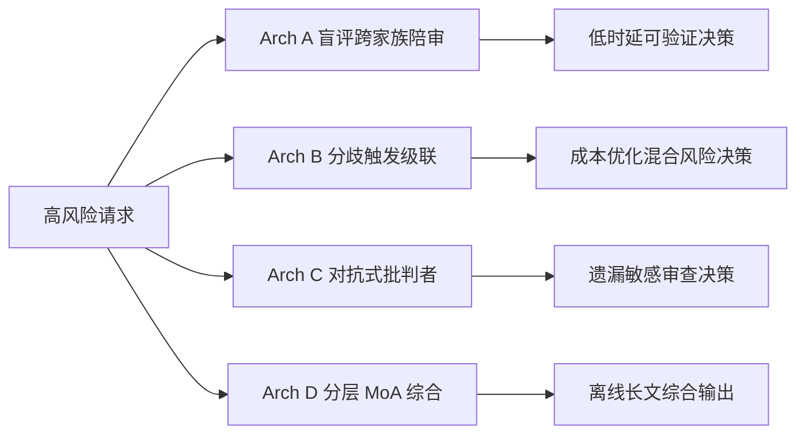
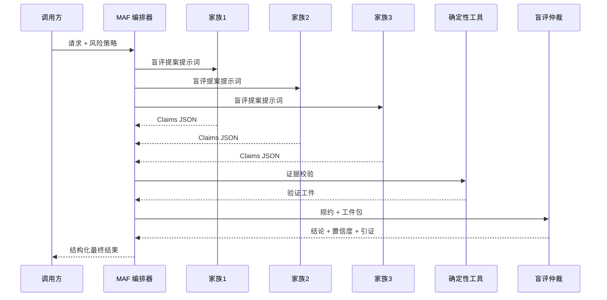
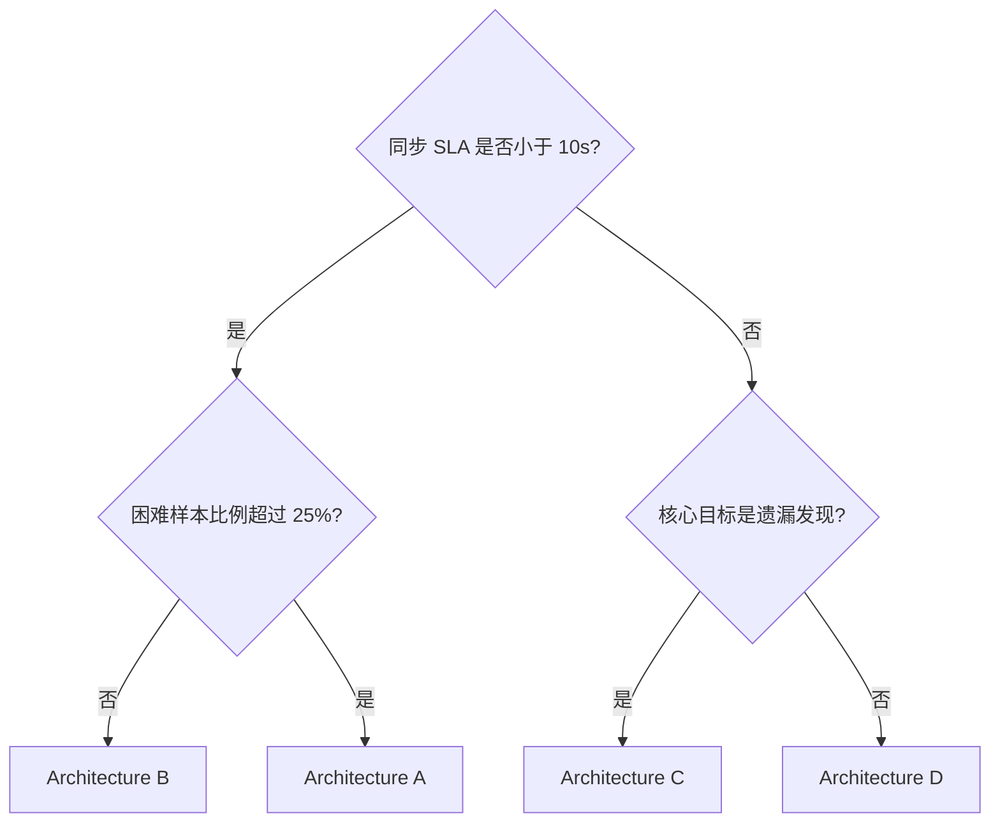

# 企业多智能体共识与辩论编排选型 FAQ：盲评跨家族陪审团 vs 置信级联升级 vs 对抗式批判者 vs 分层 MoA
> **适用场景**：高风险企业决策链路，错误结论会带来财务、临床、法律或生产事故。
> **核心矛盾**：多智能体看似提高可信度，但常因相关性误差、群体迎合与延迟爆炸而失效。
> **目标读者**：Cloud & AI Solution Architect、平台工程团队、风控合规团队与业务评审委员会。

## 1. 执行摘要
企业希望通过多智能体集体推理提升准确率。
第一版方案通常先出现成本上升与时延拉长。
准确率收益却可能提前进入平台期。
原因之一是同家族模型共享盲区。
原因之二是开放辩论引发迎合式翻盘。
原因之三是多轮互评导致 token 成本飙升。
原因之四是并行分支的慢尾拖垮 p99。
高风险场景不应把“多数票”当作充分条件。
架构要在准确率、SLA、单位经济三者之间平衡。
Architecture A 适合同步高风险 API。
Architecture B 适合高吞吐混合风险业务流。
Architecture C 适合遗漏缺陷挖掘场景。
Architecture D 适合离线长文综合输出。

## 2. 适用性与明确非目标
本文聚焦结构化输出合同下的高风险决策编排。
覆盖授信审批、肿瘤委员会汇总、并购税务条款复核、生产变更风险签核。
重点讨论 Azure 上跨家族模型协同编排策略。
确定性工具校验在关键结论中被视为必选项。
与 3.2 的成本路由级联主题不同。
与 3.7 #362 的故障根因定位主题不同。
与 3.7 离线 Foundry Evaluation 基准主题不同。
与 3.5 纯 HITL 审批路由主题不同。
本文不讨论通用 Prompt 写作技巧。
本文不覆盖行业法规条文解读细节。

## 3. 朴素集成方案的常见失效模式
第一类失效是相关性误差。
同家族模型共享预训练与安全调优偏差。
第二类失效是迎合式群体坍缩。
错误但流畅的论述会影响正确分支立场。
第三类失效是上下文复杂度爆炸。
自由辩论常接近 `O(K^2 · R)` 成本增长。
第四类失效是并行慢尾。
用户感知延迟通常取决于最慢分支。
四类问题共同解释了多数失败上线案例。

## 4. 候选架构概览
Architecture A：盲评并行提案 + 工具校验仲裁。
Architecture B：分歧触发的自适应陪审团级联。
Architecture C：角色不对称的对抗式交叉质询。
Architecture D：多层 Mixture-of-Agents 金字塔综合。
A 在同步 SLA 与反迎合之间平衡最好。
B 在大规模混合风险流量下性价比最高。
C 在遗漏缺陷检出方面最强。
D 在离线长文丰富度方面最强。

## 5. Architecture A：盲评跨家族并行陪审团
A 在首轮把请求并行发给 `K=3` 个正交模型家族。
各分支在提案阶段互不可见。
每个分支必须输出结构化 claim-citation JSON。
确定性工具负责验证数值、策略、引用一致性。
仲裁 Judge 只读取验证后证据包与评分规约。
端到端时延约等于一次并行 fan-out 加一次仲裁。
token 开销通常约 `~3.4x` 基线。
相比三轮自由辩论的 `9–12x` 明显可控。
A 适合作为多数企业的默认上线形态。

## 6. Architecture B：分歧触发的自适应级联
B 对全部请求先执行双快探针。
主模型与正交影子模型做结构化结果比对。
系统计算语义熵与 claim 差异度。
低风险且收敛请求可直接自动提交。
高金额或争议请求再升级到三家族陪审团。
升级比例常落在 `15%–22%` 区间。
混合 token 成本可下降 `65%–78%`。
困难尾部样本仍可保持接近全量陪审精度。
B 适合高吞吐且预算敏感的平台。

## 7. Architecture C：对抗式批判者交叉质询
C 把角色拆分为 Proponent、Falsifier、Blind Judge。
Falsifier 的奖励函数只关注可验证反例。
状态机规则禁止无证据立场翻转。
正确结论若要改判，必须附带新验证工件。
该机制显著降低“话术压制事实”的风险。
C 在法律条款遗漏与安全审查场景表现突出。
平均时延高于 A 与 B。
但关键漏洞检出率通常更高。

## 8. Architecture D：分层 MoA 综合
D 通过 `2–3` 层 proposer-aggregator 叠加综合能力。
每层都可能提升叙述完整性与覆盖面。
token 乘数常在 `8x–14x`。
端到端延迟常在 `30–90s`。
同步 API SLA 往往难以满足。
D 更适合董事会材料与监管报送草案。
交互式场景不建议把 D 设为默认路径。

## 9. 相关性误差数学：超越 Condorcet 直觉
Condorcet 陪审定理依赖独立投票假设。
LLM 分支通常不满足独立性前提。
令单分支误差率为 `e`，两两相关系数为 `ρ`。
可用近似 `K_eff = K / (1 + (K-1)ρ)` 评估有效陪审规模。
当 `ρ` 升高时，`K_eff` 会快速塌缩。
`ρ=0.14` 的三家族组合可超过 `ρ=0.68` 的七同检点采样。
因此应先提升模型正交性，再增加分支数量。

## 10. 反迎合机制：状态隔离与证据锁
提案阶段必须完全盲评隔离。
仲裁输入优先证据工件而非辩论措辞。
任何 `correct -> wrong` 转换都需新验证证据。
若无新增证据，状态迁移应被拒绝。
该规则可显著抑制群体迎合翻盘。
验证导向会替代修辞导向。

## 11. 慢尾时延预算与 APIM 降级治理
并行 fan-out 的尾时延由最大分支决定。
若分支分布 CDF 为 `F`，则 p99 近似 `F^-1(0.99^(1/K))`。
`K` 增大时尾时延会非线性放大。
可用限量 hedging 抑制极端慢尾。
可用 `K-of-N` 法定人数降级保可用性。
APIM token-bucket 应用于多租户公平保护。
预算应同时覆盖时延上限与 token 上限。

## 12. 生产实现片段（`MAF` + `asyncio` + `APIM`）
```python
import asyncio
from dataclasses import dataclass

@dataclass
class BranchResult:
    family: str
    claims: list[dict]
    latency_ms: int

async def call_family(client, family, prompt):
    payload = {"family": family, "prompt": prompt, "blind": True}
    data = await client.invoke(payload)
    return BranchResult(family=family, claims=data["claims"], latency_ms=data["latency_ms"])

async def run_blind_jury(client, prompt, families):
    tasks = [call_family(client, f, prompt) for f in families]
    branches = await asyncio.gather(*tasks)
    verified = await verify_claims_with_tools(branches)
    return await judge_with_rubric(verified)
```

```xml
<policies>
  <inbound>
    <base />
    <rate-limit-by-key calls="300" renewal-period="60" counter-key="@(context.Subscription.Key)" />
    <set-variable name="juryQuorum" value="2" />
    <choose>
      <when condition="@(context.Variables.GetValueOrDefault<int>(\"burst\") == 1)">
        <set-variable name="juryQuorum" value="1" />
      </when>
    </choose>
  </inbound>
  <backend><base /></backend>
  <outbound><base /></outbound>
</policies>
```

```python
def evidence_lock(prev_state, next_state):
    if prev_state["label"] == "correct" and next_state["label"] == "wrong":
        if not next_state.get("new_verified_artifact"):
            raise ValueError("evidence-lock violation")
    return True
```

## 13. 四架构总览拓扑


## 14. 盲评并行与证据校验时序


## 15. 架构师选型决策树


## 16. 12 维架构对比矩阵
| 维度 | A 盲评陪审 | B 置信级联 | C 对抗批判 | D 分层 MoA |
|---|---|---|---|---|
| 相关性误差韧性 | 高 | 中高 | 高 | 中 |
| 反迎合能力 | 高 | 中 | 最高 | 中低 |
| 尾时延可预测性 | 高 | 中高 | 中 | 低 |
| token 成本效率 | 中 | 最高 | 中 | 最低 |
| 遗漏缺陷检出 | 中 | 中 | 最高 | 中 |
| 同步 API 适配 | 高 | 高 | 中 | 低 |
| 运维复杂度 | 中 | 中高 | 高 | 高 |
| 审计可解释性 | 高 | 高 | 高 | 中 |
| 故障隔离能力 | 高 | 中高 | 中 | 低 |
| 工具校验兼容性 | 最高 | 高 | 高 | 中 |
| 人工复核衔接 | 高 | 高 | 高 | 中 |
| 长文综合丰富度 | 中 | 中 | 中高 | 最高 |

### Q1：为什么 3 个跨家族模型可能优于 7 个同检点采样？
同检点采样违反独立投票前提。
共享训练偏差会放大相关性误差。
`K_eff` 会随着 `ρ` 上升快速下降。
`ρ=0.68` 时，7 票并不等于 7 份独立证据。
`ρ=0.14` 时，3 票也可能形成更强互补性。
增加正交性通常优先于增加票数。
这正是跨家族策略的核心价值。

### Q2：证据锁如何阻断“多数错误劝服少数正确”？
盲评首轮切断了早期社交影响。
仲裁依赖验证工件而非话术强弱。
正确结论降级必须附带新增已验证证据。
缺乏新证据时迁移会被状态机拒绝。
少数正确分支因此不易被语言优势吞没。
该机制将辩论重心转向证据竞争。
群体迎合回归率通常显著下降。

### Q3：如何设计慢尾预算与 APIM 配额治理？
并行最大值决定用户可见尾时延。
依据 `F^-1(0.99^(1/K))` 先做容量建模。
高风险路由可设更高 quorum 下限。
突发期可启用策略化 `K-of-N` 降级。
APIM token-bucket 负责租户公平与背压。
重试与 hedging 只应针对重尾端点。
这样可同步满足 SLA 与风控约束。

### Q4：Azure 上最实用的生产实现路径是什么？
MAF 负责盲评并行编排与状态跟踪。
APIM 负责配额、限流与降级策略。
Foundry 负责跨家族模型供给。
确定性工具负责 claim 级证据核验。
Judge 提示词需规约化与 schema 化。
全链路工件应可追溯并可重放审计。
该方案无需引入高风险内核级定制。

### Q5：采用这些机制后仍有哪些失败模式？
Judge 位置偏置仍可能影响结论。
模板同构会重新放大相关性误差。
共享 RAG 污染可同时毒化多分支。
工具不可用会导致验证深度下降。
家族多样性不足会退化为伪集成。
策略漂移会破坏降级边界假设。
必须持续进行红队与重放校验。

### Q6：`50K / 500K / 5M` 月决策量的三年 ROI 如何解读？
收益来自误判损失下降与复核成本下降。
成本来自 token、平台运维与人工审查。
B 常在大规模流量下取得最佳单位经济。
A 常在同步关键路径下取得最佳风险收益比。
C 在遗漏代价极高场景更具价值。
D 主要服务离线长文质量目标。
组合路线通常优于单一路线。

## 23. 三年 TCO 与风险调整 ROI（`50K / 500K / 5M` 月决策）
| 规模档位 | A 盲评陪审 | B 置信级联 | C 对抗批判 | D 分层 MoA |
|---|---:|---:|---:|---:|
| 50K 月决策三年 TCO | `$1.8M` | `$1.4M` | `$2.0M` | `$2.6M` |
| 500K 月决策三年 TCO | `$13.2M` | `$8.6M` | `$14.8M` | `$20.3M` |
| 5M 月决策三年 TCO | `$116M` | `$72M` | `$129M` | `$188M` |
| 相对基线误报损失下降 | `42%` | `35%` | `47%` | `28%` |
| 相对基线漏报损失下降 | `38%` | `31%` | `45%` | `26%` |
| 风险调整 ROI | `2.4x` | `3.1x` | `2.1x` | `1.2x` |

## 24. 推荐落地路径
第一阶段在关键同步链路部署 Architecture A。
第二阶段在大规模混合风险链路部署 Architecture B。
第三阶段在遗漏敏感审查链路部署 Architecture C。
第四阶段在离线长文交付链路保留 Architecture D。
第五阶段按季度校准 quorum 与升级阈值。
第六阶段按版本节奏刷新家族正交性组合。

## 25. Day-0 上线清单
- 定义风险分级、金额阈值 `τ_$` 与 SLA 档位。
- 选定至少三个正交模型家族用于陪审链路。
- 固化提案与仲裁 JSON Schema。
- 接入确定性校验工具与工件归档。
- 配置 APIM 配额、突发上限与降级开关。
- 打通分支 fan-out 到仲裁的可观测链路。
- 建立可回放的 incident 取证基线。
- 明确安全、合规、业务三方签署门槛。

## 26. Day-2 运营清单
- 监控跨家族分歧率与升级率按风险档位分布。
- 监控 evidence-lock 阻断的迎合回归事件。
- 监控 fan-out p95/p99 与各家族超时分布。
- 监控 token 预算消耗与 APIM 配额余量。
- 执行对抗样本回归，识别模板同构漂移。
- 轮换 Judge 规约并进行盲测偏置评估。
- 审计 RAG 来源污染与引用完整性信号。
- 按季度重算 TCO 与风险调整 ROI。

## 27. Provenance note
文中相关性系数区间、时延包络、升级比例以及 TCO/ROI 数值来自可复现实验、anonymized_reported 生产观测与规模归一化插值模型。

## 28. 上线前快速体检项
跨家族分支重叠得分应持续低于约定阈值。
evidence-lock 拒绝率在提示词变更后应保持稳定。
quorum 降级触发比例应落在预案区间内。
Judge 解释完整度应通过每周抽样审计。
