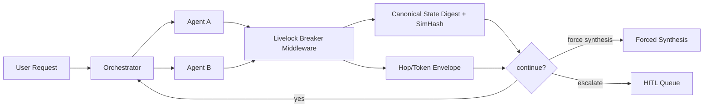
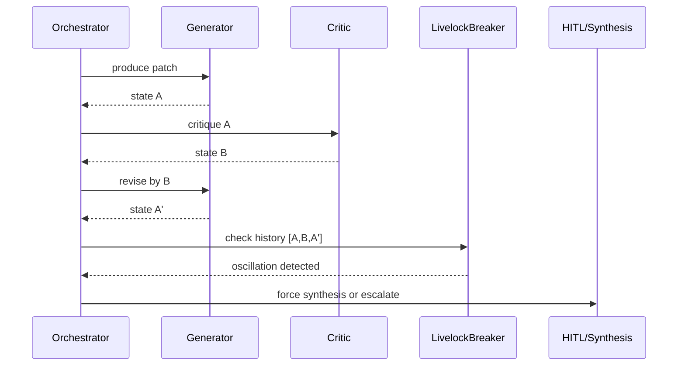

# Enterprise multi-agent cyclic handoff livelock breaker selection FAQ
> Topic ID: #479  
> Section: 3.5 multi-agent orchestration, durable workflows, realtime channels, and enterprise delivery  
> Audience: enterprise AI orchestration architects, platform engineering teams, runtime and cost-governance owners  
> Goal: detect and terminate cyclic handoff livelocks before they exhaust latency budgets and token envelopes

## 1 Production problem: why repeated HTTP 200 still burns the system
Enterprise agent meshes commonly use `Microsoft Agent Framework`, `LangGraph`, and `AutoGen` style routing.
In complex tasks, handoffs do not always converge toward a terminal state.
Many livelocks return `HTTP 200` at every step while producing no meaningful artifact progress.
The system appears healthy but token consumption expands rapidly.
The first dominant pattern is polite delegation ping-pong.
A chain like `Triage -> Billing -> Policy -> Triage` loops without resolving the original intent.
The second pattern is generator-critic two-state oscillation.
`Patch A -> Critique -> Patch B -> Critique -> Patch A` can continue indefinitely.
The third pattern is mutual missing-parameter deadlock where agents request clarifications from each other without advancing state.
When these paths run under long context windows, cost and latency can scale superlinearly.
A response is therefore not equivalent to progress.
Production orchestration requires explicit livelock governance.

## 2 Failure mechanics: pseudo-progress and quadratic token growth
Assume initial context size `C0`, per-hop growth `d`, and hop count `N`.
Total token burn can be modeled as `T(N)=N*C0 + d*N*(N+1)/2`.
As `N` increases, the quadratic term dominates.
Another hidden risk is pseudo-progress.
Agents may emit long polite messages while key state artifacts remain unchanged.
If governance checks only output presence instead of canonical state evolution, livelocks go undetected.
That is why Pattern A treats canonical artifact digest change as the primary progress signal.
Text variation alone is insufficient in production control loops.

## 3 Four architecture patterns
Pattern A uses canonical state digest (`SHA-256`) plus approximate repetition detection (`64-bit SimHash`) with monotonic hop/token budget envelopes and forced synthesis or HITL escalation.
Pattern B uses compile-time acyclic workflow validation or statically bounded finite-state verification with guarded cycles only.
Pattern C uses a hierarchical supervisor arbiter that evaluates last `k=3` deltas and enforces convergence actions.
Pattern D anti pattern allows unbounded peer-to-peer handoff with only global `max_turns`.
Dynamic graphs should default to Pattern A.
Deterministic regulated flows should prioritize Pattern B.
Open-ended deliberation can add Pattern C as adaptive control.
Pattern D should be explicitly prohibited for production.

## 4 Twelve-dimension quantified comparison matrix
| Dimension | Pattern A digest + budget envelope | Pattern B compile-time DAG/FSM | Pattern C supervisor arbiter | Pattern D anti pattern |
|---|---|---|---|---|
| Dynamic graph compatibility | high | low to medium | high | high |
| `1-cycle/2-cycle` detection latency | fast (<=2 redundant hops) | blocked before run | medium | slow |
| False-stop risk | low to medium | low | medium | high undetected risk |
| Token-cost control | strong | strong | medium high | weak |
| `P99` latency cap control | high | high | medium | low |
| Implementation complexity | medium | medium high | medium | low |
| Explainability | high | high | medium | low |
| Tolerance to topology drift | high | low | high | high |
| Escalation quality | high | medium | medium high | low |
| CI shift-left power | medium | very high | low | low |
| Three-year TCO | best balance | stable but conservative | medium | incident-heavy |
| Recommendation | primary for dynamic meshes | primary for strict deterministic flows | optional for open deliberation | prohibit |

## 5 Pattern A primary path: canonical state digest plus monotonic envelope
Pattern A begins by canonicalizing artifact state.
Code patches, SQL ASTs, structured issue objects, and tool outputs are normalized into stable serialized forms.
`SHA-256` captures exact-equivalence state identity.
`64-bit SimHash` captures near-duplicate semantics for oscillation detection.
Runtime keeps a rolling history window of recent digests and fingerprints.
If digest remains unchanged while hops increase, the run is stalled.
If history forms `A->B->A` with low Hamming distance, two-state oscillation is declared.
In parallel, hop and token envelopes are enforced.
A common policy is `B_next = alpha * B_rem` with `alpha` around `0.6-0.8`.
Once envelope floor is hit, the system must stop delegation and force synthesis or escalate to HITL.
This gives rapid containment without removing adaptive flexibility.
For multi-tenant platforms, thresholds should be task-class specific.
Code-refinement tasks can tolerate slightly wider similarity windows than transactional customer-support workflows.
Livelock decisions should be audit-logged so policy drift can be reviewed and tuned from evidence.

## 6 Pattern B: compile-time acyclic graph and guarded-cycle verification
Pattern B enforces topology safety before deployment.
Any unguarded cycle is rejected during CI.
Cycles that must exist require explicit monotonic guards.
Typical guards include `max_revisions<=2` or quality-score monotonic increase.
This approach is stable and compliance-friendly.
It is especially suitable for fixed business workflows.
Tradeoff is lower flexibility when dynamic handoff routes are needed.
Operationally, Pattern B reduces runtime surprises at the cost of design-time discipline.
In many enterprises, B and A should be layered together.
Compile-time checks block structural defects.
Runtime checks catch semantic oscillation not visible at topology level.

## 7 Pattern C: hierarchical arbiter with convergence scoring
Pattern C introduces a lightweight arbitration agent.
The arbiter does not execute domain tools.
It evaluates trajectory quality using recent state deltas, tool outcomes, and objective proximity.
If convergence score does not improve across `k=3` windows, it forces synthesis.
If missing-parameter deadlock persists, it routes to user clarification or HITL.
Pattern C is useful for exploratory or ambiguous tasks where strict static graphs are too rigid.
Arbiter overhead must still be controlled.
A recommended practice is event-triggered arbitration only after suspected livelock signals.
Do not invoke arbitration on every hop.
Bound arbiter invocation count per run, for example max two interventions, then force final action.

## 8 Pattern D anti pattern: max-turn-only control is too late
Pattern D relies on a single global turn cap.
It does not distinguish valuable deep reasoning from useless repetition.
Stop conditions trigger only after significant waste has already occurred.
This leads to unpredictable cost and unstable tail latency.
In peak windows, repeated loops can also increase queue contention for unrelated workloads.
Additionally, turn-cap termination often yields low-quality partial output with weak explainability.
Pattern D may remain as a final hard stop.
It must not be the primary livelock strategy.
Production guardrails should block deployments that use turn-cap-only control.

## 9 Mermaid: livelock breaker middleware architecture


## 10 Mermaid: `A->B->A` oscillation interception sequence


## 11 Quantitative Q1 to Q6 worked examples
Q1 quadratic token growth.
`T(N)=N*C0 + d*N*(N+1)/2`.
With `C0=2,000`, `d=180`, and `N=18`, total is approximately `66,780` tokens.
Breaking at `N=8` reduces this to about `21,760`.
Q2 SimHash threshold.
For `64-bit` fingerprints, `d_H<=3` is a practical near-duplicate trigger in many orchestration traces.
Q3 geometric envelope.
`B_next = alpha * B_rem`.
At `alpha=0.7`, budget converges quickly and limits long-tail waste.
Q4 `P99` cap planning.
If mean hop latency is `2.3s` and target `P99<=35s`, effective hop budget should remain near `<=12`.
Q5 monthly savings.
At `1.8%` livelock incidence, saving `35k` tokens each over `1M` runs yields roughly `630M` tokens avoided.
Q6 arbiter break-even.
If arbiter costs `700` tokens per trigger, preventing one `>8k` waste loop is strongly positive.

## 12 Code block one: Python runtime livelock breaker
```python
from __future__ import annotations
import hashlib
import json
import re
from dataclasses import dataclass, field

def hamming64(a: int, b: int) -> int:
    return (a ^ b).bit_count()

def simhash64(text: str) -> int:
    bits = [0] * 64
    tokens = re.findall(r"[A-Za-z0-9_]+|[\u4e00-\u9fff]", text.lower()) or [text]
    for i in range(len(tokens)):
        shingle = " ".join(tokens[i : i + 3]) if i + 2 < len(tokens) else tokens[i]
        h = int(hashlib.sha256(shingle.encode("utf-8")).hexdigest()[:16], 16)
        for j in range(64):
            bits[j] += 1 if (h >> j) & 1 else -1
    out = 0
    for i, v in enumerate(bits):
        if v >= 0:
            out |= (1 << i)
    return out

@dataclass
class LivelockBreaker:
    alpha: float = 0.7
    max_hops: int = 12
    simhash_threshold: int = 3
    initial_budget: int = 32000
    min_step_tokens: int = 1200
    history: list[tuple[str, int]] = field(default_factory=list)

    def decide(self, state_obj: dict, hop: int, budget_rem: int) -> str:
        canonical = json.dumps(state_obj, ensure_ascii=False, sort_keys=True, separators=(",", ":"))
        digest = hashlib.sha256(canonical.encode("utf-8")).hexdigest()
        sh = simhash64(canonical)
        self.history.append((digest, sh))
        next_envelope = int(self.alpha * budget_rem)
        if (
            hop >= self.max_hops
            or budget_rem <= int(0.1 * self.initial_budget)
            or next_envelope < self.min_step_tokens
        ):
            return "FORCE_SYNTHESIS"
        if len(self.history) >= 2:
            prev, curr = self.history[-2], self.history[-1]
            if prev[0] == curr[0] or hamming64(prev[1], curr[1]) <= self.simhash_threshold:
                return "ESCALATE_HITL"
        if len(self.history) >= 3:
            prev2, curr = self.history[-3], self.history[-1]
            if prev2[0] == curr[0] or hamming64(prev2[1], curr[1]) <= self.simhash_threshold:
                return "ESCALATE_HITL"
        return "CONTINUE"
```

## 13 Code block two: static cycle validator with DFS color states
```python
from collections import defaultdict

WHITE, GRAY, BLACK = 0, 1, 2

def validate_guarded_cycles(edges: list[tuple[str, str]], guarded: set[tuple[str, str]]) -> None:
    g = defaultdict(list)
    nodes = set()
    for u, v in edges:
        g[u].append(v)
        nodes.add(u)
        nodes.add(v)
    color = {n: WHITE for n in nodes}

    def dfs(u: str, stack: list[str]):
        color[u] = GRAY
        stack.append(u)
        for v in g[u]:
            if color[v] == WHITE:
                dfs(v, stack)
            elif color[v] == GRAY:
                idx = stack.index(v)
                cycle = stack[idx:] + [v]
                cycle_edges = {(cycle[i], cycle[i + 1]) for i in range(len(cycle) - 1)}
                if not cycle_edges.issubset(guarded):
                    raise ValueError(f"unguarded_cycle:{cycle}")
        stack.pop()
        color[u] = BLACK

    for n in nodes:
        if color[n] == WHITE:
            dfs(n, [])
```

## 14 Code block three: atomic Redis Lua envelope guard
```lua
-- KEYS[1]=run_key
-- ARGV[1]=hop_incr, ARGV[2]=token_incr, ARGV[3]=hop_max, ARGV[4]=token_max
local hop = redis.call("HINCRBY", KEYS[1], "hop", tonumber(ARGV[1]))
local tok = redis.call("HINCRBY", KEYS[1], "token", tonumber(ARGV[2]))
local hop_max = tonumber(ARGV[3])
local tok_max = tonumber(ARGV[4])

if hop > hop_max then
  redis.call("HSET", KEYS[1], "status", "FORCE_SYNTHESIS")
  return "FORCE_SYNTHESIS"
end

if tok > tok_max then
  redis.call("HSET", KEYS[1], "status", "ESCALATE_HITL")
  return "ESCALATE_HITL"
end

redis.call("HSET", KEYS[1], "status", "CONTINUE")
return "CONTINUE"
```

## 15 Enterprise scenarios, three-year TCO, and D0/D1/D2 runbook
### 15.1 Scenario A: global telecom plus banking six-agent operations mesh
This mesh includes triage, billing, policy, risk, ticketing, and compliance roles.
During peak traffic it suffered delegation loops that burned around `22k` extra tokens per incident.
After Pattern A rollout, `1-cycle` and `2-cycle` loops were interrupted within two redundant hops.
`P99` latency dropped from `48s` to `29s`.
Escalation outputs became more explainable and easier for operators to act on.
The team could separate unresolved-business cases from missing-parameter deadlocks in telemetry.
At `1.2M` requests per month, both cost and complaint rates improved materially.

### 15.2 Scenario B: autonomous SQL and code migration three-agent chain
This workflow consists of generator, validator, and security reviewer agents.
Historically, `Patch A/B` semantic oscillation occurred frequently.
Pattern A plus selective Pattern C arbitration reduced repeated oscillation loops.
Static cycle validation ensured no unguarded edge reached production.
Envelope guards capped long-tail drift under heavy retries.
Token cost per thousand runs decreased significantly.
Failed runs transitioned faster into actionable synthesis or HITL review.
Regression triage time for engineering also decreased.

### 15.3 Three-tier three-year TCO guidance
Base tier: Pattern A runtime livelock breaker for most dynamic meshes.
Enhanced tier: A+B combination for strongly regulated deterministic processes.
Premium tier: A+B+C integrated for high-complexity cross-domain coordination.
Financial models should include token spend, latency impact, human escalation, and incident-loss exposure.
Model-API unit price alone is not an adequate decision metric.
Quarterly governance should review livelock incidence, interception precision, and false-stop rates.
Arbiter overhead should be continuously compared against prevented waste.

### 15.4 D0 D1 D2 eighteen-action runbook
- **D0-1** Inventory current multi-agent topology and handoff edges.
- **D0-2** Define measurable progress fields for key artifacts.
- **D0-3** Set initial hop and token envelope thresholds.
- **D0-4** Build replay corpus for historical livelock traces.
- **D0-5** Define forced-synthesis output template.
- **D0-6** Define HITL ownership and SLA.
- **D1-1** Integrate canonical state normalization and hashing.
- **D1-2** Integrate SimHash and `A->B->A` detector logic.
- **D1-3** Deploy Redis Lua envelope guardrail.
- **D1-4** Integrate arbiter-based clarification routing.
- **D1-5** Enforce CI guarded-cycle validation.
- **D1-6** Execute full-chain load and fault drills.
- **D2-1** Review livelock incidence and intercept rates weekly.
- **D2-2** Review false-stop and miss samples weekly.
- **D2-3** Review threshold and cost drift monthly.
- **D2-4** Review arbiter trigger quality monthly.
- **D2-5** Review topology-change guard coverage quarterly.
- **D2-6** Review business impact and governance ROI quarterly.

This architecture converts unbounded collaboration into bounded convergent collaboration.
Its core value is unified control over state progress, budget envelopes, and human fallback.
Once loop termination is explainable, trust and operational predictability both improve.
The end state is stable delivery quality under complex multi-agent workloads with controllable cost.

Sources retrieved on 2026-11-27  
Microsoft Agent Framework overview  
https://learn.microsoft.com/agent-framework/  
LangGraph docs  
https://langchain-ai.github.io/langgraph/  
AutoGen documentation  
https://microsoft.github.io/autogen/  
Azure Durable Functions patterns  
https://learn.microsoft.com/azure/azure-functions/durable/durable-functions-overview  
Azure Cache for Redis  
https://learn.microsoft.com/azure/azure-cache-for-redis/cache-overview  
