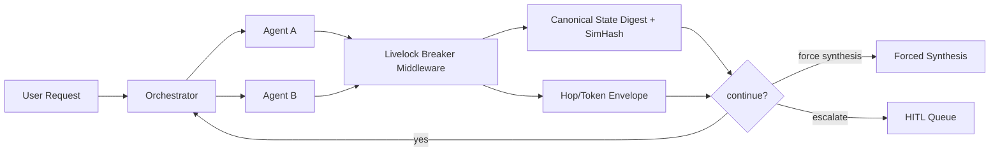
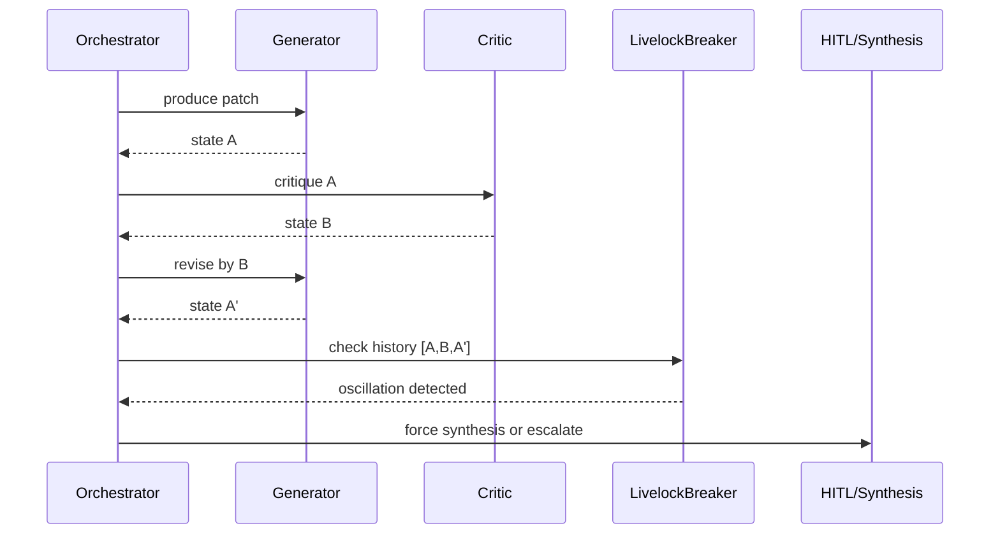

# 企业多智能体循环交接活锁治理选型 FAQ
> Topic ID: #479  
> Section: 3.5 多智能体编排、长周期工作流、实时音视频与业务渠道  
> Audience: 企业 AI 编排架构师、智能体平台工程团队、运行与成本治理团队  
> Goal: 在动态多智能体协作中识别并打断循环交接活锁，控制时延、成本与错误升级风险

## 1 生产问题：看似成功的 200 响应为何仍会烧穿预算
企业多智能体系统常接入 `MAF`、`LangGraph`、`AutoGen` 等编排框架。  
在复杂任务中，节点间交接并非总能收敛到终态。  
很多活锁会持续返回 `HTTP 200`，但产出没有实质进展。  
系统表面可用，实则在循环中持续放大 token 开销。  
最常见的是礼貌转交链路。  
如 `Triage -> Billing -> Policy -> Triage` 在缺少实质状态变化时无限往返。  
第二类是生成器与审查器的 `2-cycle` 语义震荡。  
`Patch A -> Critique -> Patch B -> Critique -> Patch A` 会重复出现。  
第三类是双方互相索取参数的澄清死锁。  
当这类路径叠加长上下文时，账单与时延都会呈二次增长。  
因此“有响应”并不等于“有进展”。  
企业必须把活锁检测作为编排层一等公民能力。

## 2 失败机理：二次增长 token 与伪进展状态
若每轮上下文增长量为 `d`，初始上下文为 `C0`，轮数为 `N`。  
总 token 近似 `T(N)=N*C0 + d*N*(N+1)/2`。  
在 `N` 增大时，二次项会迅速主导总成本。  
更隐蔽的问题是伪进展。  
智能体可能输出大量礼貌性文字，却未改变关键工件状态。  
如果系统只看“有输出”而不看“状态哈希变化”，就无法发现活锁。  
因此需要区分文本变化与工件实质变化。  
只有后者才应被视为有效推进。  
这也是 Pattern A 采用规范化状态摘要与相似度检测的根本原因。

## 3 四种架构路径总览
Pattern A：状态规范化摘要哈希 + `64-bit SimHash` 近似检测 + 单调 hop/token 预算包络 + 强制综合输出/HITL。  
Pattern B：编译期无环流程或静态有界状态机校验，禁止未守护环。  
Pattern C：层级 Supervisor 仲裁器，基于最近 `k=3` 轮状态差分评分做收敛判定。  
Pattern D：仅设全局 `max_turns=50`，其余放任点对点交接。  
动态图与开放式协作首选 A。  
强监管可预测流程首选 B。  
开放探索类任务可考虑 C。  
D 应明确列为禁用反模式。

## 4 十二维量化对比矩阵
| 维度 | Pattern A 状态哈希断环 | Pattern B 静态无环编译 | Pattern C 仲裁器收敛评分 | Pattern D 反模式 |
|---|---|---|---|---|
| 对动态图适应性 | 高 | 低到中 | 高 | 高 |
| `1-cycle/2-cycle` 识别速度 | 快（<=2 冗余 hop） | 编译前阻断 | 中 | 慢 |
| 误杀率 | 低到中 | 低 | 中 | 高风险未检出 |
| token 成本控制 | 强 | 强 | 中高 | 弱 |
| `P99` 时延上限可控性 | 高 | 高 | 中 | 低 |
| 实装复杂度 | 中 | 中高 | 中 | 低 |
| 可解释性 | 高 | 高 | 中 | 低 |
| 对临时拓扑变更容忍 | 高 | 低 | 高 | 高 |
| 人工升级触发质量 | 高 | 中 | 中高 | 低 |
| CI 前置治理能力 | 中 | 很高 | 低 | 低 |
| 三年 TCO | 最优平衡 | 稳定但保守 | 中 | 高事故成本 |
| 推荐结论 | 动态生产首选 | 合规确定流首选 | 开放协作补充 | 禁用 |

## 5 Pattern A 主路径：状态摘要与预算包络双控制
Pattern A 先将工件状态做规范化。  
如代码 patch、SQL AST、JSON 工单、字段字典都转为稳定序列化表示。  
随后计算 `SHA-256` 用于精确同态判断。  
再计算 `64-bit SimHash` 用于近似重复与 `A->B->A` 振荡检测。  
运行时维护最近 `k` 个状态摘要与 hop 计数。  
若哈希不变且 hop 持续增长，判定为停滞。  
若出现 `A->B->A` 且海明距离小于阈值，判定为双态震荡。  
同时执行单调预算约束。  
令下一子任务预算 `B_next = alpha * B_rem`，常取 `alpha=0.6-0.8`。  
当预算跌破最小执行阈值时，不再继续交接。  
系统必须强制输出综合结论或升级 HITL。  
该策略能在动态图场景快速止损。  
并且保留足够弹性，不会过早中断真实推进任务。  
对大规模租户平台，建议把阈值按任务类型分层。  
例如代码修复可放宽 `SimHash` 阈值，客服澄清则收紧阈值。  
这样可平衡误杀与漏检。  
同时应把活锁事件写入统一审计日志，便于后续策略迭代。

## 6 Pattern B：编译期无环/有界状态机校验
Pattern B 在流程发布前做图结构验证。  
若发现未守护循环边，直接拒绝发布。  
对必须存在的循环，要求显式终止条件。  
如 `max_revisions<=2` 或“状态质量分数必须单调提升”。  
这种方式可极大减少运行期不可控行为。  
优点是稳定、可审计、对监管友好。  
缺点是灵活性受限。  
面对临时任务变化时，流程修改成本较高。  
因此 B 更适合规则稳定、变更频率低的核心流程。  
如财务核对、合规审批、定稿签发链路。  
在这些场景，确定性比探索性更重要。  
建议将 B 与 A 组合。  
编译期先挡住结构性风险，运行期再兜底语义活锁。  
两层治理通常比单层更稳健。

## 7 Pattern C：层级仲裁器与收敛评分
Pattern C 引入轻量监督仲裁器。  
仲裁器不直接执行业务工具，只评估轨迹。  
输入是最近 `k=3` 轮状态差分、工具调用摘要和目标完成度。  
若收敛评分持续不提升，则触发强制综合。  
若缺失关键参数且多轮未补齐，则触发用户澄清或 HITL。  
该模式对开放式探索任务较友好。  
它能减少“无限讨论但不收敛”的对话型活锁。  
但仲裁器本身也有开销。  
需要控制其调用频率与提示词长度。  
建议仅在检测到疑似活锁时启用。  
而非每轮都仲裁。  
这样可避免把轻量任务也推高成本。  
在大规模生产中，可为仲裁器设置硬上限。  
如每 run 最多触发两次仲裁，超限直接进入综合输出。

## 8 Pattern D 反模式：仅靠 max_turns 的滞后止损
Pattern D 表面简单，只配置全局轮数上限。  
但它无法区分“高价值深度推理”和“无效循环”。  
通常要到大量 token 已经消耗后才触发停止。  
这种滞后止损会导致成本不可预测。  
在高峰时段还会拖垮队列与尾延迟。  
更糟的是，它给出的是“被截断结果”，并非“可解释中止结果”。  
业务方很难据此做可靠决策。  
因此 D 不应作为生产默认治理策略。  
它可以作为最后防线保底。  
但绝不能替代 A/B/C 的主动收敛机制。  
平台规范应明确禁止“仅 max_turns”上线。

## 9 Mermaid：活锁断路中间件架构


## 10 Mermaid：`A->B->A` 双态震荡拦截时序


## 11 量化推导 Q1 到 Q6
Q1 二次增长 token。  
`T(N)=N*C0 + d*N*(N+1)/2`。  
若 `C0=2,000`、`d=180`、`N=18`，则总 token 约 `66,780`。  
若在 `N=8` 提前断环，总 token 约 `21,760`。  
Q2 `SimHash` 海明阈值。  
对 `64-bit` 指纹，取 `d_H<=3` 可识别高相似重复态。  
Q3 预算包络。  
`B_next = alpha * B_rem`。  
当 `alpha=0.7` 时，预算几何收敛，防止长尾失控。  
Q4 `P99` 时延约束。  
设每 hop 平均 `2.3s`，上限 `P99<=35s`，则有效 hop 应限制在 `<=12`。  
Q5 月度节省。  
若活锁发生率 `1.8%`，每次可节省 `35k` token，月 `1M` 任务可节省 `630M` token。  
Q6 仲裁器盈亏平衡。  
若仲裁平均额外 `700` token，能避免一次 `>8k` token 无效循环即盈利。

## 12 代码块一：Python LivelockBreaker 运行时判定器
```python
from __future__ import annotations
import hashlib
import json
import re
from dataclasses import dataclass, field

def hamming64(a: int, b: int) -> int:
    return (a ^ b).bit_count()

def simhash64(text: str) -> int:
    bits = [0] * 64
    tokens = re.findall(r"[A-Za-z0-9_]+|[\u4e00-\u9fff]", text.lower()) or [text]
    for i in range(len(tokens)):
        shingle = " ".join(tokens[i : i + 3]) if i + 2 < len(tokens) else tokens[i]
        h = int(hashlib.sha256(shingle.encode("utf-8")).hexdigest()[:16], 16)
        for j in range(64):
            bits[j] += 1 if (h >> j) & 1 else -1
    out = 0
    for i, v in enumerate(bits):
        if v >= 0:
            out |= (1 << i)
    return out

@dataclass
class LivelockBreaker:
    alpha: float = 0.7
    max_hops: int = 12
    simhash_threshold: int = 3
    initial_budget: int = 32000
    min_step_tokens: int = 1200
    history: list[tuple[str, int]] = field(default_factory=list)

    def decide(self, state_obj: dict, hop: int, budget_rem: int) -> str:
        canonical = json.dumps(state_obj, ensure_ascii=False, sort_keys=True, separators=(",", ":"))
        digest = hashlib.sha256(canonical.encode("utf-8")).hexdigest()
        sh = simhash64(canonical)
        self.history.append((digest, sh))
        next_envelope = int(self.alpha * budget_rem)
        if (
            hop >= self.max_hops
            or budget_rem <= int(0.1 * self.initial_budget)
            or next_envelope < self.min_step_tokens
        ):
            return "FORCE_SYNTHESIS"
        if len(self.history) >= 2:
            prev, curr = self.history[-2], self.history[-1]
            if prev[0] == curr[0] or hamming64(prev[1], curr[1]) <= self.simhash_threshold:
                return "ESCALATE_HITL"
        if len(self.history) >= 3:
            prev2, curr = self.history[-3], self.history[-1]
            if prev2[0] == curr[0] or hamming64(prev2[1], curr[1]) <= self.simhash_threshold:
                return "ESCALATE_HITL"
        return "CONTINUE"
```

## 13 代码块二：静态图循环校验（DFS 三色）
```python
from collections import defaultdict

WHITE, GRAY, BLACK = 0, 1, 2

def validate_guarded_cycles(edges: list[tuple[str, str]], guarded: set[tuple[str, str]]) -> None:
    g = defaultdict(list)
    nodes = set()
    for u, v in edges:
        g[u].append(v)
        nodes.add(u)
        nodes.add(v)
    color = {n: WHITE for n in nodes}

    def dfs(u: str, stack: list[str]):
        color[u] = GRAY
        stack.append(u)
        for v in g[u]:
            if color[v] == WHITE:
                dfs(v, stack)
            elif color[v] == GRAY:
                idx = stack.index(v)
                cycle = stack[idx:] + [v]
                cycle_edges = {(cycle[i], cycle[i + 1]) for i in range(len(cycle) - 1)}
                if not cycle_edges.issubset(guarded):
                    raise ValueError(f"unguarded_cycle:{cycle}")
        stack.pop()
        color[u] = BLACK

    for n in nodes:
        if color[n] == WHITE:
            dfs(n, [])
```

## 14 代码块三：Redis Lua 单调预算栅栏
```lua
-- KEYS[1]=run_key
-- ARGV[1]=hop_incr, ARGV[2]=token_incr, ARGV[3]=hop_max, ARGV[4]=token_max
local hop = redis.call("HINCRBY", KEYS[1], "hop", tonumber(ARGV[1]))
local tok = redis.call("HINCRBY", KEYS[1], "token", tonumber(ARGV[2]))
local hop_max = tonumber(ARGV[3])
local tok_max = tonumber(ARGV[4])

if hop > hop_max then
  redis.call("HSET", KEYS[1], "status", "FORCE_SYNTHESIS")
  return "FORCE_SYNTHESIS"
end

if tok > tok_max then
  redis.call("HSET", KEYS[1], "status", "ESCALATE_HITL")
  return "ESCALATE_HITL"
end

redis.call("HSET", KEYS[1], "status", "CONTINUE")
return "CONTINUE"
```

## 15 企业场景、三年 TCO 与 D0/D1/D2 清单
### 15.1 场景 A：全球电信与银行全渠道运营六智能体网
该系统包含分诊、账单、套餐、风控、工单、合规六个角色。  
高峰期曾出现礼貌转交循环，平均每次多消耗 `22k` token。  
接入 Pattern A 后，`1-cycle/2-cycle` 在两次冗余 hop 内被拦截。  
`P99` 时延从 `48s` 降到 `29s`。  
HITL 升级率稳定在可控范围，并且具备清晰解释。  
运营团队可快速区分“业务未收敛”与“参数缺失”两类问题。  
在月 `1.2M` 请求规模下，成本与投诉率同步下降。  
系统最终形成“自动收敛优先、必要时人工兜底”的稳定策略。  

### 15.2 场景 B：企业自治 SQL/代码迁移三智能体链
该链路由生成器、验证器、安全审查器组成。  
历史上常出现 `Patch A/B` 反复振荡。  
启用 Pattern A + C 后，仲裁器仅在疑似活锁时触发。  
静态图校验保证发布前不存在未守护循环边。  
运行期预算包络阻止长尾失控。  
上线后每千任务平均 token 降幅显著。  
失败任务能更快转入可执行的综合建议或人工处理。  
研发团队的回归定位时间也明显缩短。  

### 15.3 三档三年 TCO 参考
基础档：Pattern A 运行时断环，适合大多数动态编排。  
增强档：A+B 组合，适合强监管、流程稳定业务。  
旗舰档：A+B+C 协同，适合高复杂跨域协作任务。  
测算应包含 token 费、延迟损失、人工介入成本与事故成本。  
仅比较模型调用单价会低估反模式代价。  
建议每季度复核活锁发生率、拦截准确率与误杀率。  
同时复核仲裁器开销是否持续低于节省收益。  

### 15.4 D0 D1 D2 十八项执行动作
- **D0-1** 盘点现有多智能体拓扑与交接边。  
- **D0-2** 标记关键工件与可度量进展字段。  
- **D0-3** 设定 hop/token 初始预算与阈值。  
- **D0-4** 建立活锁样本库与回放脚本。  
- **D0-5** 定义强制综合输出模板。  
- **D0-6** 定义 HITL 升级责任与 SLA。  
- **D1-1** 接入状态规范化与哈希计算。  
- **D1-2** 接入 SimHash 与 `A->B->A` 检测。  
- **D1-3** 落地 Redis 预算栅栏。  
- **D1-4** 接入仲裁器与澄清分流。  
- **D1-5** 完成 CI 图循环守卫。  
- **D1-6** 执行全链路压测与演练。  
- **D2-1** 每周复核活锁发生率与拦截率。  
- **D2-2** 每周复核误杀与漏检样本。  
- **D2-3** 每月复核预算参数与成本曲线。  
- **D2-4** 每月复核仲裁器触发质量。  
- **D2-5** 每季度复核拓扑变更与守卫覆盖。  
- **D2-6** 每季度复核业务影响与治理收益。  

通过该架构，企业可把“无限协作”转化为“有边界的可收敛协作”。  
核心价值在于把状态进展、预算约束与人工兜底统一到编排中间层。  
当系统具备可解释断环能力后，业务与平台的信任成本都会下降。  
最终可实现高复杂任务下的稳定交付与可预测成本。

来源抓取日期 2026 11 27  
Microsoft Agent Framework overview  
https://learn.microsoft.com/agent-framework/  
LangGraph docs  
https://langchain-ai.github.io/langgraph/  
AutoGen documentation  
https://microsoft.github.io/autogen/  
Azure Durable Functions patterns  
https://learn.microsoft.com/azure/azure-functions/durable/durable-functions-overview  
Azure Cache for Redis  
https://learn.microsoft.com/azure/azure-cache-for-redis/cache-overview  
