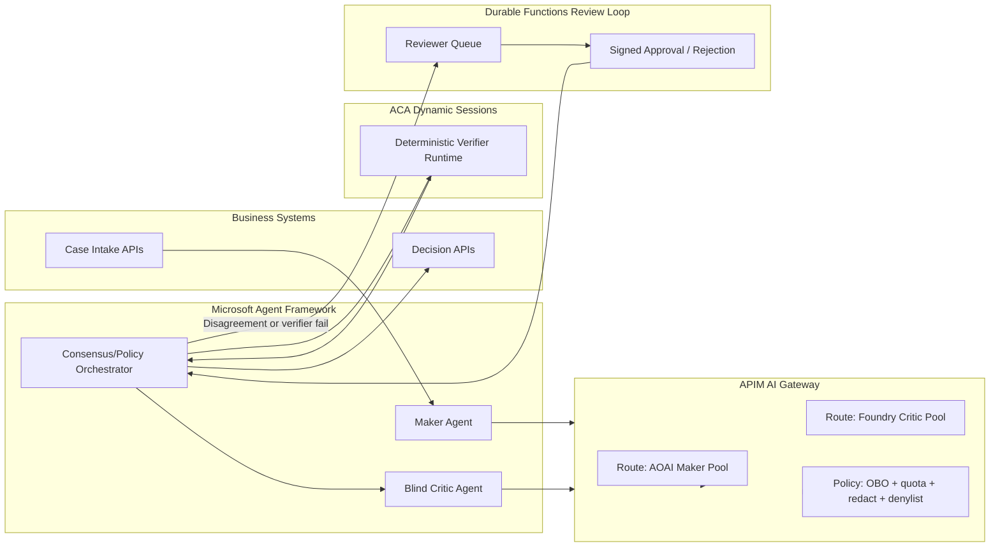
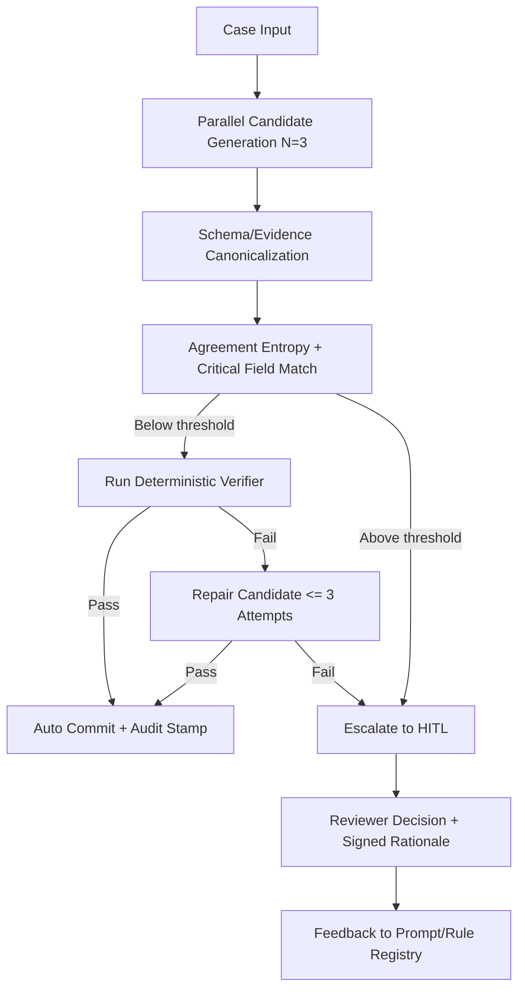

# Enterprise High-Stakes Multi-Agent Verification Selection FAQ: Cross-Family Blind Maker-Checker vs Neuro-Symbolic ACA Verifier vs Best-of-N HITL Consensus

> 🌐 **Language Switch**: [中文](./multi-agent-maker-checker-verification-cross-family-blind-critic-vs-neuro-symbolic-aca-verifier-vs-best-of-n-hitl-selection-faq.md) | **English (current)**
> **Audience**: Cloud & AI Solution Architects, enterprise AI platform teams, model governance leaders, regulated-industry application architects, and SRE/AIOps operators.
> **Scope**: End-to-end architecture and operating guidance for high-stakes multi-agent verification on Microsoft Agent Framework, Foundry, APIM AI Gateway, ACA Dynamic Sessions, and Durable Functions HITL pipelines.

## 1. Problem definition: why enterprise multi-agent systems still fail in expensive, high-accountability decisions
Adding more agents does not automatically produce safer decisions. When those agents share the same model family, similar prompting style, and identical evidence defects, they frequently converge on the same wrong answer with high confidence.
In underwriting, legal extraction, and financial obligation workflows, this failure mode is especially dangerous because downstream systems interpret fluent output as execution-ready truth. The practical consequence is not random hallucination but correlated, self-consistent, auditable-looking error that can pass naive voting gates.
Once this error pattern is connected to automated action paths, it becomes a systemic risk rather than an isolated model mistake. Therefore, architecture selection must focus on reducing correlation and adding deterministic acceptance gates, not simply increasing generation diversity.
The core question is: what verification topology minimizes correlated false-accepts while preserving latency and cost budgets?

## 2. Architecture map and role boundaries (A/B/C/D)
**Architecture A** uses cross-family blind maker-checker orchestration. Maker and critic run on intentionally different model families, and critic context is stripped to evidence-claim-rubric artifacts only.
**Architecture B** uses a neuro-symbolic generator-verifier loop. The LLM proposes candidate output, while deterministic verifiers in ACA Dynamic Sessions enforce invariants through Python, Z3, OPA, SQL/Bicep AST, and domain formulas.
**Architecture C** uses parallel Best-of-N with disagreement-triggered HITL escalation. N candidates are generated concurrently, agreement entropy is computed, and only ambiguous or failed cases are routed to reviewers through Durable Functions.
**Architecture D** uses structured adversarial courtroom debate. Advocate, skeptic, and evidence-bound judge roles execute bounded rounds for difficult unstructured cases where direct schema validation is insufficient.
In enterprise deployments, A/B/C typically form the default production stack, while D is reserved for high-value escalations and policy exception handling.

## 3. Architecture A deep dive: cross-family blind maker-checker with CoT-stripped context firewall
Architecture A reduces correlated error by separating generation and criticism across model families and by constraining what information the critic is allowed to see. A common implementation pairs an AOAI `GPT/o-series` maker with a Foundry-hosted `Claude/Mistral/DeepSeek` critic to avoid same-family bias reinforcement.
The critic receives only `{source_evidence, structured_claim, rubric}`, plus schema metadata and confidence calibration targets. It does not receive persuasive chain-of-thought narrative, hidden system rationale, or tool-level exploratory traces from the maker stage.
This context firewall prevents sycophantic agreement drift and forces independent evidence-grounded evaluation. Operationally, APIM routes the two roles through separate products, separate quotas, and separate policy sets so one role cannot silently consume the other role's budget and controls.
For regulated environments, A also improves post-incident analysis because maker and critic artifacts are clearly separated for audit replay.

## 4. Architecture B deep dive: neuro-symbolic verifier in ACA Dynamic Sessions
Architecture B shifts acceptance authority from probabilistic model self-critique to deterministic, replayable invariants executed inside isolated verifier sessions. Verifier rules can include accounting conservation equations, tariff/tax formula checks, contract date arithmetic, policy eligibility clauses, SQL AST anti-pattern detection, and Bicep resource constraint checks.
By running this verifier in ACA Dynamic Sessions, teams can lock dependencies, isolate runtime state, and preserve reproducible execution records per case. The generator remains valuable for drafting, but acceptance is conditioned on formal constraints and explicit counterexample generation.
This architecture is particularly strong when business errors are expensive and expressible as deterministic constraints. A recommended control pattern is bounded repair loops, for example `max_repairs <= 3`, after which the workflow escalates rather than iterating indefinitely.
B does require stronger rule-asset lifecycle management, but it dramatically reduces the class of “confidently wrong yet plausible” outputs.

## 5. Architecture C deep dive: Best-of-N consensus with disagreement-triggered HITL
Architecture C optimizes throughput while preserving quality by parallelizing candidate generation and escalating only disagreement-heavy or rule-failing cases. With `N=3`, three candidates are produced in parallel, normalized to a shared schema, and compared using agreement entropy and critical-field overlap.
Unanimous high-confidence outcomes can auto-commit after deterministic checks, while split outcomes trigger reviewer escalation through Durable Functions. Because fan-out is parallel, wall-clock P95 can remain close to single-call latency (for example around `1.05x`) rather than scaling linearly with N.
The trade-off is token amplification, commonly around `3.1x`, which must be justified by reduced manual review workload and improved straight-through processing. In insurance and contract triage workloads, C often reaches `80–88%` auto-through rates when schema discipline and evidence normalization are mature.
This makes C attractive for high-volume operations with moderate-to-high risk profiles.

## 6. Architecture D deep dive: adversarial courtroom debate in bounded rounds
Architecture D introduces structured adversarial reasoning for difficult, unstructured, or contentious decisions that resist simple deterministic validation. Advocate constructs a claim, skeptic challenges assumptions and evidence integrity, and judge decides under explicit admissibility and citation rules.
To prevent runaway cost and conversational drift, production designs should enforce strict round caps, evidence citation requirements, and anti-flip constraints. For example, a judge should not reverse stance without newly admitted evidence or a verifiable contradiction raised by the skeptic.
D is valuable for M&A due diligence, complex policy adjudication, and architecture exception boards where interpretability and challenge quality matter as much as speed. However, it carries the highest token and latency multipliers and should not be the default path for routine transactional workloads.
Treat D as a premium escalation mode rather than general-purpose orchestration.

## 7. Twelve-dimension comparison matrix across reliability, economics, and operations
| Dimension | A: Cross-Family Blind Checker | B: Neuro-Symbolic Verifier | C: Best-of-N + HITL | D: Courtroom Debate |
|---|---|---|---|---|
| Correlated-error suppression | High | Very high | Medium-high | High |
| Deterministic correctness guarantees | Medium | Very high | Medium | Medium |
| Explainability quality | High | Very high | Medium | Very high |
| P95 latency multiplier | `1.8x` | `1.3x` | ~`1.05x` wall-clock with parallel N=3 | `6.5x` |
| Token multiplier | `1.9x` | `1.4x` | `3.1x` | `6.5x` |
| Straight-through processing potential | Medium-high | High | Very high | Low |
| Human review share | Medium | Low | Low-to-medium | High |
| Build complexity | Medium | High | Medium | Medium-high |
| Runtime operational complexity | Medium | High | Medium | High |
| Governance/audit friendliness | High | Very high | High | High |
| Cost predictability | Medium-high | High | Medium | Low |
| Recommended role | Primary blind quality gate | Deterministic safety rail | High-throughput decision path | High-value dispute escalation |

## 8. Correlated error mathematics: from same-family collapse to de-correlated acceptance
A simple but effective approximation for joint false-accept probability is: `P(both wrong) = p1*p2 + rho*sqrt(p1*(1-p1)*p2*(1-p2))`.
Here `p1` and `p2` are maker/checker error rates, and `rho` captures correlated failure tendency. If `p1=0.18`, `p2=0.14`, and `rho=0.75` (same-family self-reflection), the joint false-accept probability is roughly `0.118`.
If the same rates are preserved but `rho=0.12` through cross-family blind checking, the joint false-accept probability drops to roughly `0.049`. When deterministic formal checks are added for critical constraints, practical false-accept risk is further bounded by verifier coverage and implementation quality rather than model rhetoric quality.
This is why architecture strategy should prioritize correlation control and deterministic gates before tuning prompts.

## 9. Latency and token economics: how to choose A/B/C/D under real SLO constraints
Let base end-to-end latency be `L` and base tokens be `T`. Architecture A is often around `1.8L` and `1.9T`, paying for independent critique quality.
Architecture B is frequently around `1.3L` and `1.4T` when verifier execution is efficient and candidate schemas are stable. Architecture C can consume around `3.1T` due to fan-out, but wall-clock latency remains near single path when parallelism is healthy.
Architecture D can exceed `6.5L` and `6.5T`, so it should be budgeted as a selective escalation channel. A practical policy tiering model is: C for high-volume moderate-risk traffic, A+B for high-impact structured decisions, and A+B+D+HITL for exceptional ambiguity.
This preserves service SLOs while allocating deep reasoning spend only where business value justifies it.

## 10. End-to-end reference topology: MAF orchestration + APIM role routing + ACA verifier + HITL

This layout isolates generation, criticism, deterministic verification, and human adjudication into separately governed planes. It also enables independent scaling and cleaner incident attribution.

## 11. Disagreement state machine: entropy gate, bounded repair, and reviewer escalation

The main advantage of this state machine is objective escalation criteria instead of ad-hoc reviewer handoffs. It transforms quality debates into measurable process signals.

## 12. Production code snippet #1: Python orchestrator for blind maker-checker and symbolic verifier
```python
from dataclasses import dataclass
from typing import Any, Dict, List
import asyncio
import httpx

@dataclass
class Candidate:
    claims: Dict[str, Any]
    evidence: List[Dict[str, Any]]
    score: float

class MultiAgentVerificationOrchestrator:
    def __init__(self, apim_url: str, bearer: str) -> None:
        self.client = httpx.AsyncClient(base_url=apim_url, timeout=45.0)
        self.headers = {"Authorization": f"Bearer {bearer}"}

    async def call_maker(self, payload: Dict[str, Any]) -> Candidate:
        response = await self.client.post(
            "/maker/chat/completions",
            json={"mode": "structured_claims", "payload": payload},
            headers=self.headers,
        )
        response.raise_for_status()
        data = response.json()
        return Candidate(data["claims"], data["evidence"], data["score"])

    async def call_blind_critic(self, maker: Candidate) -> Candidate:
        critic_payload = {
            "structured_claim": maker.claims,
            "source_evidence": maker.evidence,
            "rubric": "enterprise_verification_v4",
            "exclude_fields": [
                "reasoning_trace",
                "system_prompt",
                "maker_chain_of_thought",
                "tool_exploration_log",
            ],
        }
        response = await self.client.post(
            "/critic/chat/completions",
            json={"mode": "blind_audit", "payload": critic_payload},
            headers=self.headers,
        )
        response.raise_for_status()
        data = response.json()
        return Candidate(data["claims"], data["evidence"], data["score"])

    async def call_symbolic_verifier(self, claims: Dict[str, Any]) -> Dict[str, Any]:
        response = await self.client.post(
            "/verifier/session/execute",
            json={
                "runtime": "aca_dynamic_sessions",
                "entrypoint": "verify_constraints",
                "claims": claims,
                "max_repairs": 3,
                "emit_counterexample": True,
            },
            headers=self.headers,
        )
        response.raise_for_status()
        return response.json()

    async def evaluate(self, payload: Dict[str, Any]) -> Dict[str, Any]:
        maker = await self.call_maker(payload)
        critic = await self.call_blind_critic(maker)
        verifier = await self.call_symbolic_verifier(critic.claims)
        if verifier["status"] == "pass" and critic.score >= 0.86:
            return {
                "decision": "auto_commit",
                "claims": critic.claims,
                "critic_score": critic.score,
            }
        return {
            "decision": "hitl_escalation",
            "reason": verifier.get("reason", "disagreement_or_rule_failure"),
            "maker_score": maker.score,
            "critic_score": critic.score,
            "counterexample": verifier.get("counterexample"),
        }

async def run_batch(cases: List[Dict[str, Any]], orchestrator: MultiAgentVerificationOrchestrator):
    tasks = [orchestrator.evaluate(item) for item in cases]
    return await asyncio.gather(*tasks)
```
This skeleton demonstrates role isolation, deterministic verification, and explicit escalation semantics. In production, add idempotency keys, retry budgets, and signed audit trails.

## 13. Production code snippet #2: APIM cross-family routing policy and Durable escalation contract
```xml
<policies>
  <inbound>
    <base />
    <set-variable name="agentRole" value="@(context.Request.Headers.GetValueOrDefault("x-agent-role","maker"))" />
    <set-variable name="riskTier" value="@(context.Request.Headers.GetValueOrDefault("x-risk-tier","medium"))" />
    <choose>
      <when condition="@(context.Variables.GetValueOrDefault<string>("agentRole") == "maker")">
        <set-backend-service backend-id="aoai-maker-gpt-pool" />
      </when>
      <otherwise>
        <set-backend-service backend-id="foundry-critic-heterogeneous-pool" />
      </otherwise>
    </choose>
    <rate-limit-by-key calls="50" renewal-period="60" counter-key="@(context.Subscription.Id + ":" + context.Variables["agentRole"])" />
    <set-header name="x-cot-mode" exists-action="override">
      <value>stripped</value>
    </set-header>
    <set-header name="x-obo-required" exists-action="override">
      <value>true</value>
    </set-header>
  </inbound>
  <outbound>
    <base />
    <set-header name="x-hitl-required" exists-action="override">
      <value>@(context.Variables.GetValueOrDefault<string>("riskTier") == "high" ? "true" : "false")</value>
    </set-header>
  </outbound>
</policies>
```

```json
{
  "workflow": "durable-disagreement-escalation",
  "trigger": "verification_disagreement",
  "schema_version": "2026-11-23",
  "inputs": {
    "case_id": "@{body.case_id}",
    "maker_score": "@{body.maker_score}",
    "critic_score": "@{body.critic_score}",
    "verifier_status": "@{body.verifier_status}",
    "critical_field_diff": "@{body.critical_field_diff}"
  },
  "activities": [
    { "name": "prepare_semantic_diff", "type": "activity" },
    { "name": "assign_reviewer_pool", "type": "activity" },
    { "name": "wait_human_decision", "type": "externalEvent", "timeout_minutes": 90 },
    { "name": "publish_signed_resolution", "type": "activity" }
  ]
}
```
This combination keeps model routing, policy enforcement, and reviewer governance independently operable and auditable.

## 14. Enterprise scenario A: commercial insurance underwriting at high volume
Underwriting is structurally rich but heavily constrained by regulatory and actuarial rules, making it ideal for layered verification architecture. A practical deployment uses A+B+C: cross-family blind checking for correlation suppression, deterministic invariant checks for financial correctness, and parallel consensus for throughput.
Typical critical constraints include premium boundaries, deductible consistency, jurisdiction restrictions, and exclusion-clause applicability. With mature schema and rubric quality, organizations often achieve around `84%` straight-through processing while reducing manual review concentration to complex outliers.
Dispute/rework rates can decline materially because low-confidence and contradictory outputs are intercepted before downstream commitment. D is usually applied only to exceptional high-value claims where legal interpretation ambiguity exceeds deterministic rule expressiveness.

## 15. Enterprise scenario B + 3-year TCO + Day-0/Day-2 checklists
### 15.1 Scenario B: legal/financial contract extraction and obligation adjudication
Contract extraction combines dense unstructured language with high-liability obligations, making correlated hallucination and subtle omission particularly costly. Recommended stack is A+B with optional D for contentious clauses, plus C-based disagreement routing where throughput pressure is significant.
Critical fields such as payment schedules, termination triggers, jurisdiction boundaries, and indemnity obligations should always pass symbolic checks before acceptance. For high-ambiguity cases, courtroom-style debate can improve rationale quality, but only when bounded by strict evidence and round-control policies.

### 15.2 Three-year TCO (annual volume: `12M` decision cases)
| Cost component (3-year) | A | B | C | Hybrid A+B+C |
|---|---:|---:|---:|---:|
| Model inference spend | `$1.42M` | `$1.06M` | `$1.88M` | `$1.55M` |
| Platform engineering and operations | `$0.84M` | `$1.12M` | `$0.76M` | `$1.08M` |
| Human review and operations | `$1.31M` | `$0.98M` | `$0.92M` | `$0.74M` |
| Error/rework opportunity cost | `$1.26M` | `$0.62M` | `$0.88M` | `$0.51M` |
| Blended total | `$4.83M` | `$3.78M` | `$4.44M` | `$3.88M` |

### 15.3 Quantitative Q&A (6)
**Q1: Why is same-family self-reflection still unsafe at `100K` cases per month?**  
Use the correlated false-accept approximation `P(both wrong)=p1*p2+rho*sqrt(p1*(1-p1)*p2*(1-p2))` with representative production values `p1=0.17`, `p2=0.13`.  
When self-reflection remains in the same model family (`rho=0.72`), the joint false-accept probability is about `0.112`, which maps to roughly `11,200` risky accepts per `100,000` monthly decisions.  
When cross-family blind checking lowers dependence to `rho=0.14`, the same setup drops to roughly `0.046`, or about `4,600` risky accepts, which is a structural reduction rather than a prompt-level tweak.  
This is why architecture programs should prioritize dependency reduction (`rho`) before investing in iterative wording changes.  

**Q2: How should we size `ACA Dynamic Sessions` warm pools for Python/Z3 verifiers?**  
A practical baseline is `C_required = λ_peak * t_verify * (1 + safety_margin)`; with `λ_peak=32 req/s`, `t_verify=0.42s`, and `25%` safety margin, required warm concurrency is `~16.8`, so an operational target of `18–20` ready sessions is appropriate.  
For burst resilience, use `W_min = λ_burst*t_replenish + zα*sqrt(λ_burst*t_replenish)`; with `λ_burst=20 req/s`, replenish time `6s`, and `zα=2.58` (`99%`), minimum warm inventory is `~148`.  
This leads to a two-tier design: warm verifier pool for sub-second paths and queue-governed overflow for burst absorption under strict latency SLOs.  
Capacity should be reviewed whenever rule complexity increases, because symbolic checks often change CPU and memory pressure more than token usage does.  

**Q3: Does Best-of-N increase tail-latency risk, and how should APIM token buckets be set?**  
Tail risk can be quantified by `P_slow_total = 1 - (1 - p_slow)^N`; if per-branch slow-path probability is `p_slow=0.08` and `N=3`, aggregate slow exposure becomes `~22.1%`, even when median latency looks healthy.  
Token burst planning should model concurrency explicitly: with `140 case/s`, `N=3`, and `4,200` tokens per branch, instantaneous demand is `~1.76M token/s`.  
If the gateway smooths over a `10s` window, bucket capacity should be at least `17.6M tokens` to prevent artificial throttling during legitimate fan-out spikes.  
For regulated traffic, isolate high-risk workloads into separate APIM products so burst policy, retry policy, and quota policy can be tuned independently from general traffic.  

**Q4: With a fixed `16%` escalation rate, how do we estimate reviewer FTE using queueing math?**  
At `100,000` monthly cases, daily intake is about `3,333`; with `16%` escalation, reviewer arrival is `~533/day`, or `53.3/hour` over a `10-hour` staffed window.  
If average handling time is `18 minutes`, service rate per reviewer is `μ≈3.33 cases/hour`; keeping utilization at `ρ<=0.78` yields required seats `c >= λ/(μ*0.78) ≈ 20.5`, so at least `21` FTE are needed.  
To hold average queue wait under `12 minutes`, an Erlang-C safety margin of `10–15%` is typically necessary, resulting in a practical staffing target around `23–24` FTE.  
This approach gives finance and operations teams a shared, transparent staffing model tied directly to architecture-level escalation policy.  

**Q5: What should happen when the secondary critic model family hits cross-region `429` throttling?**  
Run APIM with ordered backend pools and circuit-breaking thresholds, for example tripping failover when `429 ratio > 12%` for `30` consecutive seconds, while honoring `retry-after` hints to avoid synchronized retry storms.  
Use `N+1` regional capacity planning so the surviving critic region can absorb at least `60–70%` of the failed region's load without immediate saturation.  
If both primary and secondary critic pools degrade, force policy downgrade to `A+B` with mandatory HITL and block auto-commit paths until critic stability returns.  
This preserves decision safety under regional model instability instead of pretending that degraded validation quality is acceptable for high-stakes flows.  

**Q6: Beyond schema design, which Day-0 quantitative guardrails must be codified first?**  
Define explicit release gates for four dimensions: quality (`false_accept<=0.8%`), efficiency (`auto_STP>=82%`), latency (`P95<=1.8s`), and economics (`token_per_case<=13k`).  
Bind these thresholds to automatic mitigation rules, such as route downgrades, stricter entropy gates, or temporary escalation-rate increases when any metric breaches in `3` consecutive windows.  
Without executable thresholds, Day-2 operations devolve into subjective firefighting and post-hoc justification, which is exactly what regulated governance programs are trying to eliminate.  
Codified quantitative gates also let audit teams reconstruct not only what failed, but which policy branch took effect and why it was considered compliant at the time.  

### 15.4 Day-0 implementation checklist
1. Define maker/critic schema contracts and versioning policy.
2. Configure APIM role-specific routing, quota, redaction, and OBO enforcement.
3. Deploy ACA verifier sessions with pinned dependencies and deterministic entrypoints.
4. Implement Durable Functions escalation with signed reviewer decisions.
5. Publish baseline SLOs: false-accept rate, escalation rate, P95 latency, and token per case.

### 15.5 Day-2 operations checklist
1. Review disagreement clusters weekly and update rubrics with measured drift evidence.
2. Recalibrate risk-tier thresholds monthly using reviewer acceptance outcomes.
3. Version verifier rules and preserve replayability for audit and incident response.
4. Run controlled rollout and rollback drills for high-impact verifier updates.
5. Feed reviewer corrections back into evaluation datasets and governance dashboards.

