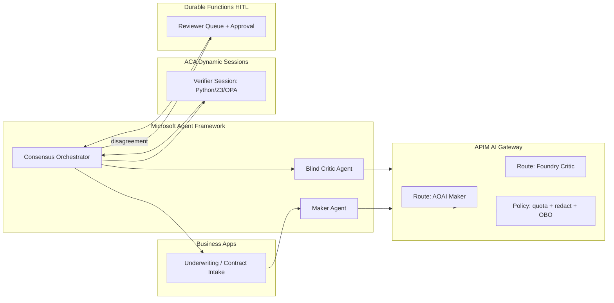
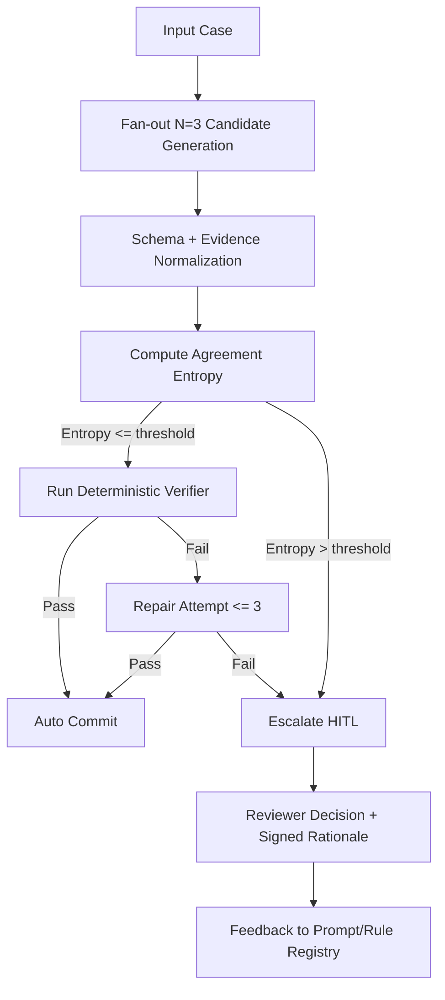

# 企业高风险多智能体验证与共识编排选型 FAQ：Cross-Family Blind Maker-Checker vs Neuro-Symbolic ACA Verifier vs Best-of-N HITL

> 🌐 **Language Switch**：**中文（当前）** | [English](./multi-agent-maker-checker-verification-cross-family-blind-critic-vs-neuro-symbolic-aca-verifier-vs-best-of-n-hitl-selection-faq.en.md)
> **受众**：Cloud & AI Solution Architect、AI 平台工程团队、风控与合规负责人、企业应用架构团队、AIOps/SRE 团队。
> **范围**：围绕高风险业务决策中的多智能体验证体系，比较 `MAF + Foundry/APIM` 跨模型盲审、`ACA Dynamic Sessions` 符号验证、`Best-of-N` 并行共识与 `Durable Functions` 人审升级，以及对抗式法庭辩论模式。

## 1. 问题定义：为什么企业多智能体系统仍会在高价值场景中“集体犯错”
企业引入多智能体并不自动等于可靠性提升。 当多个智能体共享同类模型、同类提示词和同类证据噪声时，它们会出现高度相关的错误路径。
在合同审查、保险核保、财务归因等任务里，错误不是“答非所问”，而是“自洽但错误且可执行”。 这种“相关性幻觉”会通过工作流自动化放大，最终进入审批系统或外部交易链路。
如果平台没有设计 Maker-Checker 相关性隔离和可证明验证层，系统只是把单点错误升级为并行错误。 因此选型核心不是“哪个模型更聪明”，而是“哪种验证架构在成本可控下显著降低错误同向漂移”。

## 2. 四类架构路径总览（A/B/C/D）
**Architecture A**：跨模型家族盲审 Maker-Checker。 主生成智能体与盲评智能体来自不同模型家族，并通过上下文防火墙剥离说服性推理链。
**Architecture B**：神经-符号生成-验证闭环。 LLM 负责候选草案，`ACA Dynamic Sessions` 中的 Python/Z3/OPA/SQL AST 规则引擎负责可证明校验。
**Architecture C**：`Best-of-N` 并行共识 + 分歧升级 HITL。 并发生成 `N=3` 候选，通过结构化一致性门控决定自动通过或升级人工。
**Architecture D**：对抗式法庭辩论编排。 Advocate、Skeptic、Judge 三方多轮辩论，适合高金额、非结构化、可争议决策。
企业落地中，A/B/C 通常形成主干，D 用于关键疑难案件与复核抽检。

## 3. Architecture A：Cross-Family Blind Maker-Checker（MAF + Foundry/APIM）
A 模式的核心是“模型异构 + 推理隔离 + 结构化审查”。 Maker 可使用 `GPT/o-series`，Blind Critic 使用 Foundry 上的 `Claude/Mistral/DeepSeek`。
Critic 不读取 Maker 的长推理链，只读取 `{source_evidence, structured_claim, rubric}`。 这种 CoT-Stripped 防火墙可减少“被说服式赞同”，迫使 Critic 做独立证据校验。
在跨家族配置下，错误相关系数 `rho` 可从同族自检的 `0.75` 降到 `0.12` 左右。 对合规团队而言，A 的最大收益是可审计：每次判定都有明确证据字段和规则评分。
对平台团队而言，A 的难点是模型路由治理，需要 APIM 对每个角色单独配额与策略。

## 4. Architecture B：Neuro-Symbolic Verifier（LLM + ACA Dynamic Sessions）
B 模式把“是否正确”的最终判定权交给确定性引擎，而不是再让 LLM 自我反思。 典型验证器包括：
1. 财务守恒约束（借贷平衡、税额边界、汇率换算）。
2. 合同日期与条款逻辑校验（生效日、冲突条款、责任边界）。
3. Bicep/SQL AST 结构审查（禁止危险语句、资源依赖闭合）。
4. OPA/Rego 策略合规审查（角色、作用域、敏感动作门禁）。
在 `ACA Dynamic Sessions` 中运行验证器，能够把环境依赖、库版本和修复尝试次数封装在会话沙箱。 推荐修复上限 `max_repairs <= 3`，超限直接升级人工，以避免无穷纠错循环。
B 的价值是降低“错而不知”的概率；代价是工程规则资产需要持续维护。

## 5. Architecture C：Best-of-N 共识 + Durable Functions 人审升级
C 模式通过并行候选提升鲁棒性，同时把人工资源聚焦在分歧样本。 例如 `N=3` 时，可同时生成三份结构化输出并计算一致性熵。
若三者在关键字段上完全一致且通过基础规则校验，则自动直通。 若出现 `2:1` 或 `1:1:1` 分歧，则由 `Durable Functions` 触发 HITL 升级。
并行执行使整体 P95 墙钟时延约为单次的 `1.05x`，而不是串行 `3x`。 在企业理赔和合同抽取中，该模式常实现 `80–88%` 直通率。
因此 C 是“成本可控的吞吐型防错”路径，特别适合高并发中风险决策。

## 6. Architecture D：Advocate/Skeptic/Judge 对抗式法庭辩论
D 模式用于复杂、争议、非结构化且决策后果高的任务。 Advocate 提供主张，Skeptic 指出漏洞，Judge 基于证据和规则裁决。
该模式需设置严格轮次上限，例如 `max_rounds=4`，防止推理成本失控。 每轮都应要求引用证据 URI、段落定位与置信区间，禁止“无证据翻转”。
如果 Judge 在两轮内无法形成稳定结论，应自动交给人工专家。 D 模式可显著提高复杂案例解释质量，但 token 与延迟成本最高。
因此不宜作为默认路径，而应作为高价值案件的“强化复核层”。

## 7. 12 维对比矩阵：准确性、延迟、治理、成本与组织复杂度
| 维度 | A：Cross-Family Blind Checker | B：Neuro-Symbolic Verifier | C：Best-of-N + HITL | D：Courtroom Debate |
|---|---|---|---|---|
| 相关性幻觉抑制 | 高 | 很高 | 中高 | 高 |
| 错误可解释性 | 高 | 很高 | 中 | 很高 |
| 规则可证明性 | 中 | 很高 | 中 | 中 |
| P95 延迟放大 | `1.8x` | `1.3x` | `3` 并行约 `1.05x` 墙钟 | `6.5x` |
| Token 放大倍率 | `1.9x` | `1.4x` | `3.1x` | `6.5x` |
| 直通率潜力 | 中高 | 高 | 很高 | 低 |
| 人工介入占比 | 中 | 低 | 低到中 | 高 |
| 上线复杂度 | 中 | 高 | 中 | 中高 |
| 平台运维复杂度 | 中 | 高 | 中 | 高 |
| 合规审计友好度 | 高 | 很高 | 高 | 高 |
| 成本可预测性 | 中高 | 高 | 中 | 低 |
| 推荐定位 | 主干盲审层 | 关键规则保底层 | 高吞吐业务主路径 | 争议复杂案件复核 |

## 8. 相关错误概率数学：从“相关同错”到“去相关验证”
在同类模型自反思场景中，错误相关性往往较高。 设 Maker 错误率 `p1`，Checker 错误率 `p2`，相关系数 `rho`。
联合错放概率可写为： `P(both wrong) = p1*p2 + rho*sqrt(p1*(1-p1)*p2*(1-p2))`。
若 `p1=0.18`、`p2=0.14` 且 `rho=0.75`，则联合错放概率约 `0.118`。 若改为跨家族盲审并把 `rho` 降到 `0.12`，联合错放概率约 `0.049`。
若进一步引入形式化验证器并将关键约束转为确定性检查，错放概率可逼近验证器漏检概率上限。 这也是 B 模式在高合规场景不可替代的原因。

## 9. 延迟与成本经济学：什么时候该用 A/B/C/D
设单次基础请求延迟为 `L`，基础 token 为 `T`。 A 模式通常为 `1.8L` 与 `1.9T`。
B 模式为 `1.3L` 与 `1.4T`，但前提是规则引擎命中率高。 C 模式总 token 约 `3.1T`，墙钟约 `1.05L`，吞吐优势明显。
D 模式可达 `6.5L` 与 `6.5T`，仅适合高价值低频决策。 企业可按案件价值分层：
1. 低风险高并发：优先 C。
2. 中高风险结构化：A + B。
3. 高风险复杂争议：A + B + D + HITL。
该分层可把成本集中在真正需要深度验证的样本上。

## 10. 端到端参考架构图：MAF 编排 + APIM 跨家族路由 + ACA 验证

该架构强调“模型推理、策略路由、确定性验证、人审升级”四个平面分离。 这样既能独立扩缩容，也便于审计定位。

## 11. 分歧升级状态机：Best-of-N + Entropy Gate + HITL

状态机的核心收益是把“为什么升级人工”定义为可度量指标。 这让平台能按周追踪误差来源，而不是靠个案争论。

## 12. 生产代码片段一：Python MAF Maker-Checker + ACA Verifier
```python
from dataclasses import dataclass
from typing import Dict, Any, List
import httpx

@dataclass
class Candidate:
    claims: Dict[str, Any]
    evidence: List[Dict[str, Any]]
    score: float

class VerificationOrchestrator:
    def __init__(self, apim_base: str, token: str) -> None:
        self.client = httpx.AsyncClient(base_url=apim_base, timeout=30.0)
        self.headers = {"Authorization": f"Bearer {token}"}

    async def run_maker(self, payload: Dict[str, Any]) -> Candidate:
        resp = await self.client.post(
            "/maker/chat/completions",
            json={"input": payload, "mode": "structured_claims"},
            headers=self.headers,
        )
        data = resp.json()
        return Candidate(data["claims"], data["evidence"], data["score"])

    async def run_blind_checker(self, candidate: Candidate) -> Candidate:
        blind_payload = {
            "structured_claim": candidate.claims,
            "source_evidence": candidate.evidence,
            "rubric": "regulatory_v3",
            "exclude_fields": ["reasoning_trace", "system_prompt", "maker_chain_of_thought"],
        }
        resp = await self.client.post(
            "/critic/chat/completions",
            json={"input": blind_payload, "mode": "blind_audit"},
            headers=self.headers,
        )
        data = resp.json()
        return Candidate(data["claims"], data["evidence"], data["score"])

    async def run_symbolic_verifier(self, claims: Dict[str, Any]) -> Dict[str, Any]:
        resp = await self.client.post(
            "/verifier/session/execute",
            json={
                "runtime": "aca_dynamic_session",
                "language": "python",
                "entrypoint": "verify_contract_and_finance",
                "claims": claims,
                "max_repairs": 3,
            },
            headers=self.headers,
        )
        return resp.json()

    async def decide(self, payload: Dict[str, Any]) -> Dict[str, Any]:
        maker = await self.run_maker(payload)
        critic = await self.run_blind_checker(maker)
        verify = await self.run_symbolic_verifier(critic.claims)
        if verify["status"] == "pass" and critic.score >= 0.86:
            return {"decision": "auto_commit", "claims": critic.claims}
        return {
            "decision": "escalate_hitl",
            "reason": verify.get("reason", "low_confidence_or_disagreement"),
            "maker_score": maker.score,
            "critic_score": critic.score,
        }
```
代码体现了三点：盲审隔离、确定性验证、明确升级条件。 在生产中还需补充重试预算、幂等键与审计日志。

## 13. 生产代码片段二：APIM 跨家族路由策略 + Durable 升级入口
```xml
<policies>
  <inbound>
    <base />
    <set-variable name="agentRole" value="@(context.Request.Headers.GetValueOrDefault("x-agent-role","maker"))" />
    <set-variable name="caseRisk" value="@(context.Request.Headers.GetValueOrDefault("x-case-risk","medium"))" />
    <choose>
      <when condition="@(context.Variables.GetValueOrDefault<string>("agentRole") == "maker")">
        <set-backend-service backend-id="aoai-gpt-maker" />
      </when>
      <otherwise>
        <set-backend-service backend-id="foundry-critic-pool" />
      </otherwise>
    </choose>
    <rate-limit-by-key calls="40" renewal-period="60" counter-key="@(context.Subscription.Id + ":" + context.Variables["agentRole"])" />
    <set-header name="x-cot-mode" exists-action="override">
      <value>stripped</value>
    </set-header>
  </inbound>
  <outbound>
    <base />
    <set-header name="x-verification-required" exists-action="override">
      <value>@(context.Variables.GetValueOrDefault<string>("caseRisk") == "high" ? "true" : "false")</value>
    </set-header>
  </outbound>
</policies>
```

```json
{
  "workflow": "durable-hitl-escalation",
  "trigger": "verification_disagreement",
  "inputs": {
    "case_id": "@{body.case_id}",
    "maker_score": "@{body.maker_score}",
    "critic_score": "@{body.critic_score}",
    "symbolic_status": "@{body.symbolic_status}"
  },
  "steps": [
    { "name": "prepare_diff", "type": "activity" },
    { "name": "route_to_reviewer_pool", "type": "activity" },
    { "name": "wait_for_approval", "type": "externalEvent", "timeoutMinutes": 90 },
    { "name": "publish_signed_decision", "type": "activity" }
  ]
}
```
该组合让模型路由与人工升级在控制面层面清晰解耦。 审计团队可直接复盘每次升级触发条件与结论。

## 14. 业务场景一：商业保险核保（高并发 + 中高风险）
保险核保数据结构化程度较高，但规则密集且监管约束强。 推荐采用 `A + B + C`：
1. A 负责跨家族盲审，降低同向错误。
2. B 负责财务守恒、费率边界、责任限额规则校验。
3. C 负责高峰吞吐与分歧升级。
在试点中，自动直通率可达 `84%`，人工复核占比降至 `16%`。 同时由于错误前移，争议复议率可下降 `30%` 左右。
这类场景通常不需要默认启用 D，只在高额异常单启用。

## 15. 业务场景二 + 三年 TCO + Day-0/Day-2 清单
### 15.1 场景二：法律/财务合同抽取与义务判定
该类任务文本非结构化程度高、条款相互引用复杂，且错误后果直接关联合规处罚。 推荐采用 `A + B + D`，并在 C 的分歧门后接人工审批。
对关键条款（付款、违约、终止、地域限制）要求强制符号验证。 对高争议条款启用法庭辩论模式并保留全链路审计快照。

### 15.2 三年 TCO（年均 `1200 万` 业务单据）
| 成本项（3 年） | A | B | C | A+B+C 混合 |
|---|---:|---:|---:|---:|
| 模型与推理成本 | `$1.42M` | `$1.06M` | `$1.88M` | `$1.55M` |
| 平台与工程维护成本 | `$0.84M` | `$1.12M` | `$0.76M` | `$1.08M` |
| 人工复核与运营成本 | `$1.31M` | `$0.98M` | `$0.92M` | `$0.74M` |
| 误判与返工机会成本 | `$1.26M` | `$0.62M` | `$0.88M` | `$0.51M` |
| 三年综合成本 | `$4.83M` | `$3.78M` | `$4.44M` | `$3.88M` |

### 15.3 定量 Q&A（6 项）
**Q1：同模型自检为何不够，`100K` 件/月规模会放大到什么程度？**  
可用联合错放概率公式 `P(both wrong)=p1*p2+rho*sqrt(p1*(1-p1)*p2*(1-p2))` 量化相关性风险，假设 Maker `p1=0.17`、Checker `p2=0.13`，同族自检 `rho=0.72` 时 `P≈0.112`，每月 `100,000` 件业务约有 `11,200` 件潜在错放候选。若改为跨家族盲审并将相关系数降至 `rho=0.14`，同样参数下 `P≈0.046`，则潜在错放降至约 `4,600` 件。  
这个差值不是“模型精度小幅提升”，而是“错误联动机制被切断”带来的结构性收益，因此架构设计应优先降低 `rho`，再优化提示词细节。  

**Q2：`ACA Dynamic Sessions` 验证器暖池该如何做并发与容量 sizing？**  
可先用 `C_required = λ_peak * t_verify * (1 + safety_margin)` 估算并发会话数，例如峰值到达率 `λ_peak=32 req/s`、平均验证耗时 `t_verify=0.42s`、安全系数 `25%`，则 `C_required ≈ 16.8`，建议配置 `18–20` 个 warm sessions。  
若目标是 `P95<1.2s`，且冷启动补充时间 `t_replenish=6s`，可再用 `W_min = λ_burst*t_replenish + zα*sqrt(λ_burst*t_replenish)` 估算缓冲水位，在 `λ_burst=20 req/s`、`zα=2.58`（`99%`）时 `W_min≈120+28≈148`。  
因此生产配置通常是“双层池”：短时高并发用 warm pool 吸收，长尾堆积由队列退避与限流协同处理。  

**Q3：`Best-of-N` 会不会放大尾延迟，APIM 该怎么配 token bucket？**  
若单路调用进入慢路径概率为 `p_slow`，并行 `N` 路至少一条慢路径的概率为 `P_slow_total=1-(1-p_slow)^N`；例如 `p_slow=0.08`、`N=3` 时 `P_slow_total≈22.1%`，说明并行虽然降低均值时延，但会提高“命中慢路”的机会。  
APIM 限流建议按“峰值并发 × N × 每次请求 token”配桶，假设每案平均 `4,200` token、峰值 `140 case/s`、`N=3`，则瞬时预算约 `1.76M token/s`；若按 `10s` 窗口平滑，桶容量至少需要 `17.6M token` 才能避免虚假节流。  
实践中可把高风险流量与普通流量拆分 product，并为高风险 product 设置更小突发桶与更严格重试退避。  

**Q4：升级人工比例固定 `16%` 时，Reviewer FTE 如何按排队论估算？**  
先算升级到达率：总流量 `100,000/月` 约 `3,333/日`，按 `16%` 升级得到 `533/日`，若按 `10h` 班次则 `λ≈53.3 case/h`。  
若单 reviewer 平均处理时长 `AHT=18 min`（含阅读、复核、签署），则服务率 `μ≈3.33 case/h`；为了把利用率控制在 `ρ<=0.78`，所需席位约 `c >= λ/(μ*0.78) ≈ 20.5`，即至少 `21` FTE。  
若希望将平均等待压到 `12 min` 内，可按 Erlang-C 再加 `10–15%` 机动席位，实务上建议 `23–24` FTE 并配置跨班次应急池。  

**Q5：当次级 Critic 模型家族跨区触发 `429` 时，如何保持多区域连续性？**  
建议在 APIM 配置优先级后端池：Primary Region Critic、Secondary Region Critic、Tertiary 降级 Critic，并按 `retry-after` 与实时错误率做熔断切换；触发阈值可设置为连续 `30s` 内 `429 ratio > 12%`。  
容量规划上应预留 `N+1`，即次级区域可至少承接主区域 `60–70%` 的 critic 负载，避免故障转移后立即二次拥塞。  
若双区域均触发 `429`，系统应自动降级到 `A+B` 路径并强制 HITL，禁止在 critic 不稳定时继续执行“自动放行”策略。  

**Q6：Day-0 除了 schema 以外，最先需要落地哪些量化治理阈值？**  
建议一次性固化四类阈值：质量阈值（如 `false_accept<=0.8%`）、效率阈值（如 `auto_STP>=82%`）、时延阈值（如 `P95<=1.8s`）、成本阈值（如 `token_per_case<=13k`）。  
这些阈值应写入发布门禁并与回滚策略绑定，例如任一阈值在连续 `3` 个观察窗口越界即自动降级模型路由或提高 HITL 升级率。  
只有把阈值转成可执行策略，Day-2 才不会退化为“凭经验救火”，并且审计方可以直接复盘每次阈值触发与处置动作。  

### 15.4 Day-0 上线清单
1. 定义 Maker/Checker 输入输出 schema 与版本。
2. 配置 APIM 跨家族路由、配额、脱敏与 OBO 策略。
3. 部署 ACA Dynamic Sessions 验证器镜像与依赖锁定。
4. 建立 Durable Functions 升级工作流和 reviewer 池。
5. 建立观测指标：错放率、升级率、P95、token/案。

### 15.5 Day-2 运行清单
1. 周度回看分歧样本并优化 rubric。
2. 月度校准风险分层阈值与升级策略。
3. 版本化管理规则引擎，保留回放能力。
4. 对高风险规则执行灰度发布与回滚演练。
5. 把人工复核结论回注为评估集，持续闭环优化。

### 15.6 指标看板建议：把“多智能体验证质量”转成可运营的 SLO
建议至少建立四层指标：
1. **结果质量层**：错放率（False Accept）、漏拦率（False Reject）、争议复议率、复核推翻率。
2. **流程效率层**：自动直通率、升级人工比例、平均审批等待时长、升级超时率。
3. **资源效率层**：每案 token、每案推理成本、每案验证执行时长、每案重试次数。
4. **稳定性层**：P95/P99 端到端时延、验证器失败率、策略拒绝率、编排重放成功率。
为了避免“指标被平均值掩盖”，应在业务线、风险层、模型族、版本号四个维度同时切片。 此外建议把高风险案件单独设立金丝雀统计窗口，禁止与低风险批量案件做总均值混合。
如果团队只看总量 KPI，很容易出现“总体看起来变好、关键业务实际变差”的治理错觉。 实践中可把每周治理会议固定为“分歧样本复盘 + 规则改进验收 + 阈值调整回归验证”三段式流程。

### 15.7 常见反模式与修复策略
**反模式一：把 Checker 当成第二个 Maker。** 症状是 Critic 也基于完整推理链写“更优答案”，而不是对结构化主张做证据审计。
修复是强制 CoT-Stripped 输入契约，并在 APIM 层校验请求字段白名单。

**反模式二：规则引擎覆盖率不足却默认自动通过。** 当符号规则只覆盖 `40–60%` 关键字段时，剩余字段仍可能携带高风险错误。
修复是先定义关键字段覆盖基线（如 `>= 90%`），未覆盖字段必须触发升级。

**反模式三：升级人工只是“转工单”，缺少结构化差异上下文。** 人工收到的是原始长文本而非语义差异，会显著拉长处理时长并降低一致性。
修复是输出标准化对比包：字段差异、证据定位、规则失败原因、建议关注点。

**反模式四：持续迭代只改提示词，不改策略与验证规则。** 这种做法短期可能提升某些样本，但会导致版本漂移后质量不可控。
修复是把提示词、路由策略、规则资产放到同一版本发布单元，并强制回归测试。

**反模式五：高风险任务与低风险任务共享同一阈值。** 这会导致高风险任务的漏拦率被低风险流量“稀释”，最终形成审计隐患。
修复是建立风险分层阈值矩阵，并在审计报告中按风险层独立披露。

### 15.8 验证基线建议：上线前必须过的最小“硬门槛”
为了防止“功能可跑但质量不可控”，建议在上线门禁中增加以下硬指标：
1. 高风险样本集错放率不高于既定监管阈值（例如 `<= 0.8%`）。
2. 符号验证器关键字段覆盖率达到目标（例如 `>= 90%`）。
3. 分歧升级样本中，人工最终推翻率持续下降并稳定在可接受区间。
4. `P95` 时延与每案 token 不超过预算上限，且峰值时段无明显退化。
5. 回放审计链完整率达到 `100%`（输入、路由、验证、审批、结果均可追溯）。
这些门槛应在预发环境连续运行不少于一周，覆盖工作日高峰与周末低峰。 如果只做短时压测而不做连续观测，往往无法暴露队列堆积、阈值漂移与规则覆盖衰减。
建议把“上线评审”改为“证据评审”，要求提交质量报表、异常样本集、回滚预案与负责人签名。 当组织形成这种证据化流程后，多智能体系统才能从“试验性创新”升级为“可审计生产系统”。
同时建议每季度做一次跨团队“盲演练”，由平台、安全、法务、业务共同参与。 演练目标不是证明系统完美，而是提前暴露角色边界不清、升级链路断点与审计字段缺失。
这类机制建设会显著提升系统在真实压力下的可恢复性与可追责性。 建议将演练结果纳入季度治理 KPI，并与预算、发布节奏和风险问责机制联动，确保改进动作真正落地而非停留在复盘会议纪要中。
只有这样，验证体系才能在组织层面形成长期稳定的制度化能力。

