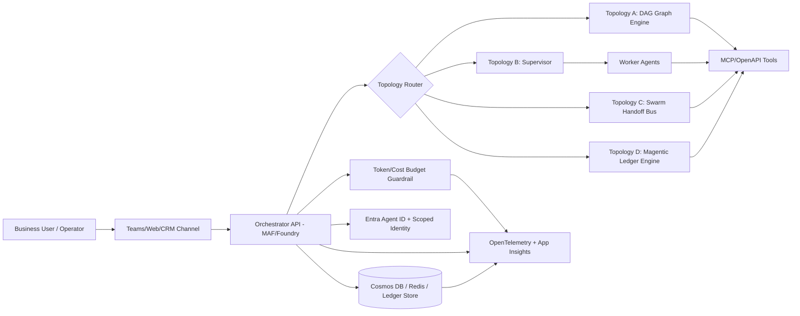
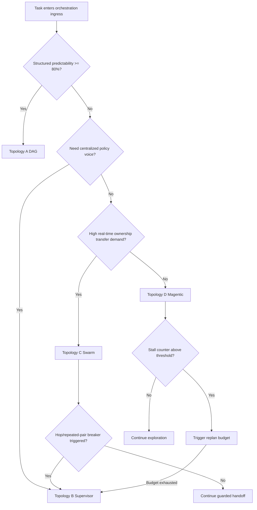

# Enterprise Multi-Agent Orchestration Topology FAQ: Hierarchical Supervisor vs Swarm Handoff vs Magentic Ledger vs Deterministic DAG (MAF / Foundry)

> 🌐 **Language Switch**: [中文](./multi-agent-orchestration-topology-hierarchical-supervisor-vs-swarm-handoff-vs-magentic-ledger-vs-dag-maf-foundry-selection-faq.md) | **English (current)**
> **Audience**: Enterprise Cloud & AI Solution Architects, agent platform leads, workflow automation owners, LLMOps/FinOps owners, and SRE command-center leaders.
> **Scope**: Multi-agent coordination on Microsoft Agent Framework (MAF) and Azure AI Foundry, with explicit control of `O(N^2)` context-broadcast inflation, handoff ping-pong loops, compounded error rates, and orchestration latency tax.

## 1. Problem framing and system boundary: why multi-agent systems often become less reliable as they scale
When organizations move from single-agent prototypes to multi-agent production systems, the primary risk is no longer “can the model answer,” but “can the coordination topology remain stable under load, policy, and failure.”  
At small scale, uncontrolled handoffs and broad context sharing can look acceptable, but once agent count increases from `3` to `8` or more, the same patterns create cost explosion, routing ambiguity, and audit blind spots.  

In production, four failure modes repeatedly appear together: full-thread context broadcast to every worker, reciprocal handoff loops (`A -> B -> A`), compounding step-level drift across long chains, and unclear accountability for who owned the decision when outcomes fail.  
Without explicit topology policy, system behavior becomes path-dependent and difficult to reproduce, which is unacceptable for regulated or mission-critical workloads.  

Topology selection therefore should be treated as control-plane architecture, not framework preference.  
The core questions are deterministic: who decomposes work, who owns transfer decisions, who holds tool permissions, who verifies intermediate outputs, and where budget/identity boundaries are enforced.  

## 2. Four topology families: convert coordination style into explicit operating policy
Topology A (deterministic DAG with typed edges) is ideal when workflow branching is largely known in advance and can be validated as a graph contract.  
Its primary strengths are predictable token growth, bounded routing behavior, and low loop risk.  

Topology B (hierarchical supervisor-worker) is optimized for enterprise governance where one authoritative persona owns task decomposition, policy consistency, and final response arbitration.  
Scoped context slicing in this model commonly reduces per-worker prompt volume by `60–75%`.  

Topology C (decentralized swarm handoff) is optimized for low relay latency in multi-specialist service scenarios where conversation ownership should transfer directly.  
It delivers speed only when protected by hop-count breakers, repeated-pair detection, and explicit RBAC reset semantics.  

Topology D (Magentic task/progress ledger) is optimized for open-ended, uncertain problem spaces such as Sev-1 root-cause analysis and cross-domain synthesis where decomposition must emerge dynamically at runtime.  
Its success depends on dual-ledger state discipline plus stall and re-plan budget ceilings.  

## 3. End-to-end reference architecture: decouple orchestration, execution, budget, and audit planes


This architecture makes topology a first-class routing decision at ingress, so every downstream control domain can attach deterministically: identity policy, budget policy, tracing, replay, and failure automation.  
If topology remains implicit inside prompts, downstream controls become inconsistent and incident reconstruction becomes unreliable.  

A practical enterprise approach is to version topology policies and bind each run with a policy hash in metadata.  
That single design choice dramatically improves auditability, rollback behavior, and post-incident learning quality.  

## 4. Topology A deep dive: deterministic state-graph / parallel fan-out DAG with typed gates
Topology A turns workflow complexity into graph complexity, which is much easier to test and reason about when business stages are structurally stable.  
In lending adjudication, policy compliance checks, and staged document review, deterministic graph execution avoids runtime drift and keeps responsibility boundaries explicit.  

Token behavior remains near-linear because each node consumes scoped inputs rather than full conversation replay.  
Latency remains predictable because independent branches can execute in parallel and converge via typed merge contracts rather than conversational negotiation.  

The trade-off is graph maintenance cost under frequent rule changes.  
A recommended pattern is to keep stable process spine in DAG form and encapsulate uncertain reasoning segments as bounded dynamic subnodes, preserving both predictability and adaptability.  

## 5. Topology B deep dive: hierarchical supervisor-worker with scoped context slicing
Topology B is often the enterprise default because it aligns naturally with governance and accountability needs: one supervisor owns decomposition logic, worker assignment, conflict arbitration, and final response contract.  
This structure simplifies human review and policy enforcement because the decision chain is centralized.  

Its most important optimization is context slicing, not merely centralized dispatch.  
Instead of forwarding full-thread history, the supervisor sends distilled briefs with explicit objective, constraints, and expected output schema, reducing token waste and data exposure.  

The known trade-off is relay overhead, since each worker response returns through the supervisor before final synthesis.  
For real-time workloads, teams should combine supervisor governance with selective direct-transfer exceptions and cache-assisted summaries to reduce double-hop latency penalty.  

## 6. Topology C deep dive: decentralized swarm handoff with explicit ownership envelopes
Topology C enables direct ownership transfer among specialists and can materially improve response time in service desk, technical support, and cross-domain escalation workflows.  
For example, triage agents can transfer active ownership directly to networking or IAM specialists without waiting for central relay arbitration.  

However, decentralized speed requires strict transfer contracts.  
Each handoff should carry a structured envelope containing owner, source policy, hop count, TTL, and constrained tool scopes to prevent conversational drift and authority ambiguity.  

Production swarm systems should enforce at least three guardrails: maximum hop count, repeated-pair circuit breaker, and scope reset on ownership change.  
Without these safeguards, low relay latency is quickly offset by looped transfers and duplicated work.  

## 7. Topology D deep dive: Magentic task ledger + progress ledger for emergent decomposition
Topology D is designed for uncertain and exploratory tasks where a fixed graph is either impossible or too brittle.  
Its core mechanism is dual-ledger discipline: TaskLedger tracks pending hypotheses and priorities, while ProgressLedger tracks verified evidence, dead ends, and confidence evolution.  

This model is effective in war-room incidents and investigation-heavy workflows because it preserves incremental learning and supports dynamic replanning without losing traceability.  
It also reduces hidden state loss across agent turns by externalizing working memory into structured records.  

The dominant failure mode is unbounded exploration.  
To prevent runaway loops, enforce stall counters, re-plan ceilings, and hard budget thresholds, then require partial-result closure with explicit unresolved items when limits are reached.  

## 8. 12-dimension comparison matrix: capability envelope, risk envelope, and operations envelope
| Dimension | Topology A DAG | Topology B Supervisor | Topology C Swarm Handoff | Topology D Magentic Ledger |
|---|---|---|---|---|
| 1. Routing determinism | Highest | High | Medium | Medium |
| 2. Context inflation risk | Low | Low-medium | Medium-high | Medium |
| 3. Loop risk | Lowest | Low | High (without breakers) | Medium |
| 4. Predictable end-to-end latency | High | Medium-high | Medium | Low-medium |
| 5. Dynamic exploration fitness | Low | Medium | Medium-high | Highest |
| 6. Audit explainability | High | High | Medium | Medium-high |
| 7. Permission boundary clarity | High | Highest | Medium | Medium-high |
| 8. Token cost controllability | High | High | Medium | Medium |
| 9. Failure isolation behavior | High | Medium-high | Medium | Medium |
| 10. Implementation complexity | Medium | Medium | Medium-high | High |
| 11. Operations complexity | Medium | Medium | High | High |
| 12. Best-fit workload archetype | Structured pipelines | Governed enterprise workflows | Real-time specialist transfer | Open-ended investigations |

This matrix should not be used as a single-score leaderboard.  
Different domains should weight dimensions differently: compliance-heavy workloads emphasize audit and boundary dimensions, while live support workloads emphasize transfer speed and routing flexibility.  

A practical enterprise baseline is to assign one primary topology and one fallback topology per business domain.  
Fallback topology is not optional; it is the mechanism that preserves system control during abnormal conditions.  

## 9. Quantitative model: token multiplier, P95 latency, compounded success `p^k`, and cost per 1,000 resolved tasks
We standardize evaluation with four metrics:  
`Token Multiplier = total_multi_agent_tokens / single_agent_tokens`  
`Latency_P95 = orchestration_overhead + serial_hops + max(parallel_branch_latency)`  
`CompoundedSuccess = p^k` without verification, and `p^k * g` with verifier correction  
`Cost_per_1000 = total_run_cost / resolved_tasks * 1000`  

| Graph size | Topology | Token Multiplier | End-to-End P95 | Success without verifier (p=0.92) | Success with verifier gate | Cost per 1,000 resolved tasks (USD) |
|---|---|---:|---:|---:|---:|---:|
| 3-agent | DAG | 1.35x | 2.8s | 77.9% | 89.4% | 138 |
| 3-agent | Supervisor | 1.52x | 3.4s | 77.9% | 90.7% | 146 |
| 3-agent | Swarm | 1.68x | 2.6s | 77.9% | 86.9% | 152 |
| 3-agent | Magentic | 1.84x | 3.9s | 77.9% | 91.2% | 169 |
| 8-agent | DAG | 1.92x | 5.6s | 51.3% | 74.8% | 226 |
| 8-agent | Supervisor | 2.21x | 6.9s | 51.3% | 78.5% | 241 |
| 8-agent | Swarm | 2.74x | 5.1s | 51.3% | 69.1% | 264 |
| 8-agent | Magentic | 2.96x | 8.4s | 51.3% | 80.2% | 289 |



Two production implications are immediate.  
First, raw agent-count scaling without verification gates causes steep reliability decay because compounded error accumulates multiplicatively across hops.  
Second, verifier gates and scoped context contracts increase per-run overhead but often lower total cost by reducing high-latency retries and low-quality escalations.  

## 10. Enterprise scenario A: commercial banking underwriting desk with strong governance constraints
This domain includes KYC checks, financial statement extraction, sector-risk analysis, covenant interpretation, and policy/legal review under strict explainability requirements.  
Process structure is largely known, but decision quality and traceability are business-critical.  

Recommended pattern is DAG + Supervisor hybrid.  
DAG handles stable parallel stages, while supervisor handles conflict arbitration and final narrative synthesis with mandatory verifier gates at high-risk checkpoints.  

In an eight-agent underwriting configuration, this pattern can reduce context broadcast by roughly `64%` and keep end-to-end P95 around `7.2s`, while materially reducing loop-induced defects versus unconstrained swarm handoffs.  
It also supports precise identity scoping through Entra Agent IDs so each worker agent only receives role-appropriate data permissions.  

## 11. Enterprise scenario B: cloud SRE multi-domain Sev-1 war-room root-cause coordination
Sev-1 investigations are intrinsically uncertain and often require concurrent hypotheses across networking, identity, compute, deployment, and data planes.  
Fixed workflow graphs are usually too rigid during the first response window.  

Recommended pattern is Magentic ledger + constrained swarm handoff with supervisor fallback.  
TaskLedger tracks active hypotheses, ProgressLedger tracks evidence maturity, and stall/re-plan policies prevent endless branch expansion.  

In practice, adding hard re-plan budgets and handoff breakers can reduce median token consumption by around `31%` compared to unconstrained emergent orchestration, while significantly reducing unresolved long-tail sessions.  
The fallback supervisor path is essential for deterministic closure and incident timeline clarity.  

## 12. Config block A: MAF Python topology orchestration (DAG + supervisor + verifier gate)
```python
from __future__ import annotations
from dataclasses import dataclass
from typing import Dict, List, Literal, Optional
import time

Role = Literal["supervisor", "worker", "verifier"]

@dataclass
class AgentTask:
    task_id: str
    objective: str
    input_brief: Dict
    owner: str
    allowed_tools: List[str]
    max_tokens: int
    deadline_s: int

@dataclass
class AgentResult:
    task_id: str
    owner: str
    status: Literal["ok", "needs_retry", "failed"]
    evidence: Dict
    summary: str
    token_used: int
    latency_ms: int

class BudgetGuard:
    def __init__(self, per_task_token_cap: int, workflow_token_cap: int):
        self.per_task_token_cap = per_task_token_cap
        self.workflow_token_cap = workflow_token_cap
        self.workflow_tokens = 0

    def allow(self, proposed_tokens: int) -> bool:
        if proposed_tokens > self.per_task_token_cap:
            return False
        if self.workflow_tokens + proposed_tokens > self.workflow_token_cap:
            return False
        self.workflow_tokens += proposed_tokens
        return True

class SupervisorGraph:
    def __init__(self, guard: BudgetGuard):
        self.guard = guard

    def fan_out(self, root_objective: str) -> List[AgentTask]:
        return [
            AgentTask(
                task_id="risk-model",
                objective=f"{root_objective} / risk assessment",
                input_brief={"scope": "credit-risk", "depth": "high"},
                owner="risk_worker",
                allowed_tools=["mcp_risk_api", "sql_credit_store"],
                max_tokens=6000,
                deadline_s=12,
            ),
            AgentTask(
                task_id="doc-qa",
                objective=f"{root_objective} / covenant extraction",
                input_brief={"scope": "legal-doc", "depth": "medium"},
                owner="doc_worker",
                allowed_tools=["mcp_doc_parser", "search_index"],
                max_tokens=5500,
                deadline_s=10,
            ),
            AgentTask(
                task_id="policy-check",
                objective=f"{root_objective} / policy compliance",
                input_brief={"scope": "policy", "depth": "high"},
                owner="policy_worker",
                allowed_tools=["policy_engine", "audit_kv"],
                max_tokens=4500,
                deadline_s=8,
            ),
        ]

    def execute_worker(self, task: AgentTask) -> AgentResult:
        predicted_tokens = int(task.max_tokens * 0.72)
        if not self.guard.allow(predicted_tokens):
            return AgentResult(
                task_id=task.task_id,
                owner=task.owner,
                status="failed",
                evidence={"reason": "token_budget_exceeded"},
                summary="Budget guard blocked execution.",
                token_used=0,
                latency_ms=1,
            )
        start = time.time()
        # Replace with real MAF Agent-as-Tool execution in production
        latency_ms = int((time.time() - start) * 1000) + 1200
        return AgentResult(
            task_id=task.task_id,
            owner=task.owner,
            status="ok",
            evidence={"confidence": 0.91, "tool_calls": len(task.allowed_tools)},
            summary=f"{task.owner} completed scoped objective",
            token_used=predicted_tokens,
            latency_ms=latency_ms,
        )

    def verifier_gate(self, results: List[AgentResult]) -> bool:
        ok_count = sum(1 for r in results if r.status == "ok")
        mean_conf = sum(r.evidence.get("confidence", 0) for r in results) / max(len(results), 1)
        return ok_count == len(results) and mean_conf >= 0.88

    def run(self, objective: str) -> Dict:
        tasks = self.fan_out(objective)
        worker_results = [self.execute_worker(t) for t in tasks]
        verified = self.verifier_gate(worker_results)
        return {
            "objective": objective,
            "verified": verified,
            "workflow_tokens": self.guard.workflow_tokens,
            "results": [r.__dict__ for r in worker_results],
        }
```

This implementation demonstrates production-grade principles: scoped briefs instead of full-thread replay, centralized token budget enforcement, and verifier-gated quality before terminal synthesis.  
These controls are essential for enterprise reliability when agent counts increase.  

## 13. Config block B: anti-ping-pong handoff guard + ledger stall guard + budget policy
```yaml
orchestrationPolicy:
  topologyRouter:
    rules:
      - name: structured_workflow_prefers_dag
        when:
          branchPredictability: ">=0.8"
          maxAgents: "<=8"
        select: "dag"
      - name: open_ended_incident_prefers_magentic
        when:
          uncertaintyLevel: "high"
          evidenceFreshnessMinutes: "<=15"
        select: "magentic"
      - name: realtime_handoff_service
        when:
          interactionType: "live_service"
          transferFrequency: "high"
        select: "swarm"

  handoffGuard:
    enabled: true
    maxHopCount: 4
    repeatedPairLimit: 1
    seenAgentWindow: 8
    onViolation:
      action: "escalate_to_supervisor"
      annotate: "handoff_loop_detected"
      resetRbacScope: true

  taskLedger:
    enabled: true
    maxOpenTasks: 24
    maxReplanCount: 2
    stallCounterThreshold: 3
    stallWindowMinutes: 6
    onStall:
      action: "force_replan"
      requireEvidenceDelta: true

  tokenBudget:
    tenantDailyCap: 180000000
    workflowCap: 18000
    perAgentTurnCap: 4200
    hardStopOnExceed: true
    overrunFallback: "return_partial_with_action_items"

  identityBoundary:
    enforceEntraAgentId: true
    workerToolScopes:
      risk_worker: ["mcp_risk_api.read", "sql_credit_store.read"]
      doc_worker: ["mcp_doc_parser.execute", "search_index.read"]
      policy_worker: ["policy_engine.evaluate", "audit_kv.read"]
    requireScopeResetOnHandoff: true
```

```python
def detect_ping_pong(handoff_trace: list[tuple[str, str]], repeat_limit: int = 1) -> bool:
    pair_counts = {}
    for src, dst in handoff_trace:
        key = (src, dst)
        pair_counts[key] = pair_counts.get(key, 0) + 1
        reverse_key = (dst, src)
        if pair_counts.get(reverse_key, 0) >= repeat_limit and pair_counts[key] >= repeat_limit:
            return True
    return False

def should_replan(progress_delta: float, stall_counter: int, stall_threshold: int = 3) -> bool:
    if progress_delta <= 0.03:
        stall_counter += 1
    else:
        stall_counter = 0
    return stall_counter >= stall_threshold
```

These controls convert architecture intent into executable runtime behavior: loop detection, stall-triggered replanning, hard budget stops, and deterministic scope boundaries across ownership transfers.  
Without this layer, decentralized topologies frequently degrade into expensive and opaque execution patterns.  

## 14. TCO comparison and Day-0/Day-2 operating checklists
| Monthly cost component | DAG | Supervisor | Swarm | Magentic |
|---|---:|---:|---:|---:|
| Orchestration compute + state (USD) | 6,900 | 8,200 | 7,600 | 9,700 |
| LLM token spend (USD) | 18,300 | 20,900 | 24,700 | 27,100 |
| Retry + human intervention (USD) | 4,800 | 4,100 | 6,200 | 5,400 |
| Observability + audit (USD) | 2,900 | 3,400 | 3,200 | 4,300 |
| Operations on-call allocation (USD) | 5,200 | 5,800 | 6,900 | 7,200 |
| Total monthly TCO (USD) | 38,100 | 42,400 | 48,600 | 53,700 |

TCO should not be interpreted as a universal ranking.  
In uncertain domains, forcing deterministic topology can increase exception handling and hidden process debt, while controlled dynamic topologies may produce better long-term economics despite higher per-run overhead.  

### Day-0 go-live checklist
| Item | Target | Notes |
|---|---|---|
| Topology router policy deployed | 100% | A/B/C/D decision logic versioned and auditable |
| Hard token budget thresholds enabled | 100% | workflow/turn/tenant caps active |
| Handoff circuit-breakers enabled | 100% | max hop + repeated pair guard in effect |
| Verifier gate coverage | >= 90% of critical paths | high-risk stages must be verifier-protected |
| Identity scope mapping | 100% | worker tool scopes least-privilege enforced |

### Day-2 operations checklist
| Metric | Threshold | Response when breached |
|---|---:|---|
| Mean token multiplier | < 2.4x | redesign context slicing strategy |
| Ping-pong trigger rate | < 0.8% | force fallback to supervisor path |
| Re-plan ratio | < 12% | optimize task decomposition and evidence quality |
| Terminal failure ratio | < 6% | tighten verifier and fallback heuristics |
| Cost variance per 1,000 tasks | < 10% | rebalance topology routing weights |

## 15. Quantitative FAQ and adoption guidance (Good fit vs Not for)
1. **Why does reliability drop sharply when agent count grows from 3 to 8?**  
With per-hop success `p=0.92`, naive chain success becomes `0.92^8=51.3%`, which explains why locally good steps still produce globally weak outcomes.  

2. **Why can supervisor topology reduce tokens even with extra relay hops?**  
Because scoped briefing avoids full-history fan-out; per-worker context payload commonly drops by `60–75%`, outweighing relay overhead in most governed enterprise workflows.  

3. **When is swarm the right default?**  
When service ownership transfer is frequent, specialist lanes are clear, and low relay latency matters more than central arbitration latency, provided handoff guardrails are enforced.  

4. **How does Magentic avoid infinite exploration loops?**  
By combining stall counters, re-plan ceilings, and hard budget policies that force convergent closure with explicit unresolved action items when exploration no longer yields evidence delta.  

5. **Does deterministic DAG kill adaptability?**  
Not if deployed as a stable spine with bounded dynamic subnodes for uncertain segments; this hybrid pattern preserves predictability without eliminating exploration.  

6. **What should be the enterprise default rollout strategy?**  
Use “DAG/Supervisor baseline + Swarm for low-latency transfer lanes + Magentic for high-uncertainty investigations,” then tune routing weights monthly using reliability and cost telemetry.  

**Good fit**: organizations running regulated, multi-team, multi-tenant agent workflows that require explicit governance, replayability, and bounded economics.  
**Not for**: tiny single-agent or minimal two-agent scripts where coordination overhead would exceed business value.  
