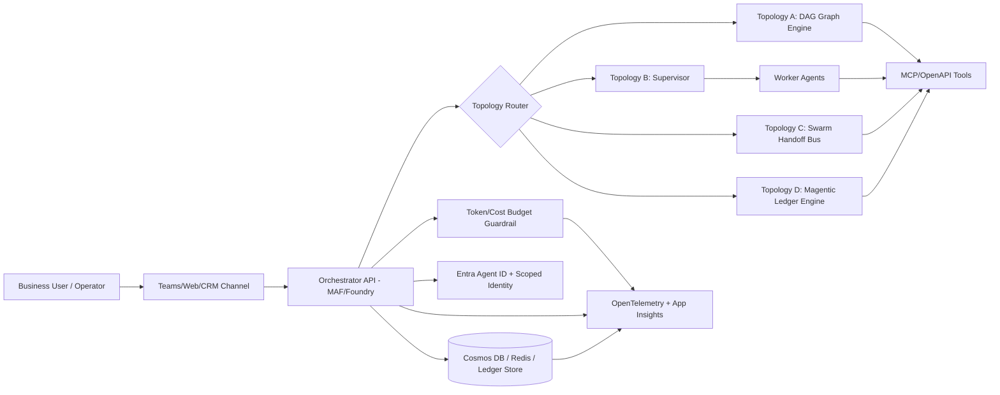
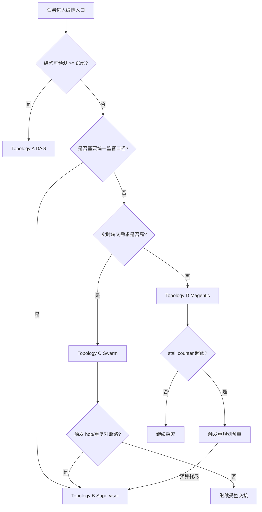

# 企业多智能体编排拓扑选型 FAQ：分层监督者 vs 去中心化交接群体 vs Magentic Ledger 黑板机制 vs 确定性 DAG（MAF / Foundry）

> 🌐 **Language Switch**: **中文（当前）** | [English](./multi-agent-orchestration-topology-hierarchical-supervisor-vs-swarm-handoff-vs-magentic-ledger-vs-dag-maf-foundry-selection-faq.en.md)
> **受众**：企业 Cloud & AI Solution Architect、智能体平台负责人、业务流程自动化负责人、LLMOps/FinOps 负责人、SRE 值班负责人。
> **范围**：基于 Microsoft Agent Framework（MAF）与 Azure AI Foundry 的多智能体协同，重点治理 `O(N^2)` 上下文广播膨胀、交接回旋环、复合错误率 `p^k` 退化、以及端到端时延税。

## 1. 问题定义与系统边界：为什么多智能体规模化后会比单智能体更脆弱
企业进入多智能体阶段后，系统不再只面对“模型是否够聪明”的问题，而是面对协同拓扑是否稳定的问题。  
当代理数量从 `3` 增长到 `8` 甚至 `12` 时，若没有结构化路由、状态封装与权限边界，系统会出现明显的上下文复制膨胀、重复推理、互相打断、以及责任归属模糊。  

在生产场景中，最常见的四类故障模式是：第一，所有代理共享完整会话历史导致 token 成本呈非线性增长；第二，代理之间反复交接形成 `A -> B -> A` ping-pong 环；第三，每跳都可能引入轻微偏差而在 `k` 跳后积累成错误结论；第四，业务层无法回答“当前任务到底由谁负责、何时失败、为何失败”。  

因此多智能体拓扑选型的本质不是“选一个框架”，而是定义控制平面：谁能分配任务、谁能转交上下文、谁能调用工具、谁负责终态回写。  
如果控制平面缺失，再强的模型也会在复杂企业流程里退化成高成本、低可解释、难审计的黑箱。  

## 2. 四种拓扑总览：把“协同方式”变成可治理的架构构件
Topology A（确定性 DAG）适用于分支结构 `>=80%` 可预先定义的流程，通过 MAF Workflow Graph 与 Typed Edge Gate 实现固定阶段的并行 fan-out/fan-in。  
这种模式的优势是 token 预算接近 `O(N)` 且时延上限可用 `max(T_i)` 估算，几乎不存在路由环风险。  

Topology B（分层 Supervisor-Worker）适用于需要统一人设、统一合规口径、统一审批策略的企业流程。  
其关键是 Supervisor 只发送精炼任务摘要给 Worker，避免把完整历史广播给每个子代理，常见可获得 `60–75%` 的上下文削减。  

Topology C（去中心化 Swarm/Handoff）适用于客户服务或 IT 服务台场景中“主责快速转移”需求。  
这种模式可以减少中间中继时延，但必须设置 hop-count 断路器、环路检测与 RBAC 重置，否则响应速度提升会被循环交接故障抵消。  

Topology D（Magentic Task/Progress Ledger）适用于开放式问题求解，如 Sev-1 根因追踪、并购尽调、跨域科学综合。  
其核心是任务台账与进度台账双账本驱动动态重规划，并通过 stall counter 和 re-plan 预算上限约束无限探索。  

## 3. 端到端参考架构：编排平面、执行平面、预算平面、审计平面四层解耦


该架构强调一条关键原则：拓扑选择必须在编排入口完成，不能由每个代理在运行时自由决定。  
只有先做拓扑路由，预算策略、身份策略、审计策略才有稳定挂载点，否则系统会出现“同一任务在不同会话里走不同治理规则”的不可控行为。  

实践上建议把拓扑路由规则写成可版本化策略，例如根据任务结构可预测性、可容忍时延、合规等级、及代理数量自动选择 A/B/C/D，并把决策结果写入任务元数据供后续审计。  

## 4. Topology A 深入：确定性 State-Graph / Parallel DAG（MAF Typed Edge）
Topology A 的价值在于把协同路径前置建模，避免运行时自由漂移。  
在企业信贷审批、保险理赔分段校验、供应链对账等流程里，步骤顺序和依赖关系通常较稳定，DAG 可以将逻辑复杂度转换成可测试的图结构复杂度。  

在 token 维度上，DAG 的优势来自上下文最小化传播：每个节点只接收前置节点的结构化输出，不需要完整聊天历史。  
在时延维度上，并行节点可让端到端时延近似 `max(T_i) + merge_overhead`，明显优于串行中继路径。  

其代价是对前期建模要求高，尤其当业务规则经常变化时，图结构维护成本上升。  
因此建议将稳定主链路放在 DAG，把不确定探索段封装为可插拔子节点，避免整个编排图频繁重构。  

## 5. Topology B 深入：Hierarchical Supervisor-Worker（作用域切片与最小权限工具集）
Topology B 通过单一监督者维持口径一致性和合规一致性，是企业最常见的“可治理多代理”范式。  
Supervisor 负责目标分解、任务派发、结果汇聚和冲突裁决，Worker 仅处理特定子任务并在最小权限范围内调用工具。  

这一模式的关键优化并非“多一个中枢”，而是“上下文切片”：Supervisor 不应广播完整对话，而应发送结构化任务简报、输入边界和期望输出模式。  
在真实部署中，切片策略常能将每个 Worker 的提示词体积减少 `60–75%`，并显著降低隐私扩散风险。  

其代价是双跳时延，即用户请求需要经过 Supervisor 再到 Worker，再回到 Supervisor 汇总。  
若任务本身高度实时，需配合缓存与并行派发，否则治理收益会被交互时延抵消。  

## 6. Topology C 深入：去中心化 Swarm / Direct Handoff（速度优先但必须防环）
Topology C 的核心是“主责代理直接转交所有权”，在客户服务和运维值班中可显著减少中继层延迟。  
例如一级客服代理判断问题属于网络域后直接交给网络专家代理，避免监督者重复转述。  

然而去中心化并不等于无控制。  
必须引入 `handoff_envelope`（含责任代理、跳数、来源策略、TTL、可访问工具范围）并在每次交接时验证，否则容易出现多代理互踢皮球。  

建议在 Swarm 模式中强制三项护栏：`max_hop`、`seen_agent_set`、`same_pair_repeat_limit`。  
一旦触发阈值，系统自动回退到监督者裁决或人工接管，从而保证“快”不以稳定性为代价。  

## 7. Topology D 深入：Magentic TaskLedger / ProgressLedger（动态分解与停滞感知）
Topology D 面向结构不确定、探索性强的问题求解，核心机制是双账本。  
TaskLedger 记录“要做什么与优先级”，ProgressLedger 记录“已经证明了什么、当前卡在何处、下一步假设是什么”。  

这种机制允许代理群体在运行时动态调整分工，而不是预先写死流程，特别适用于跨团队 Sev-1 事件、复杂研究综合、和跨系统根因推断。  
当任务上下文持续变化时，Magentic 模式比固定 DAG 更稳健。  

为了避免无限探索，必须配置 stall counter 与 re-plan budget ceiling。  
例如连续 `3` 次未产生可验证进展即触发重规划，重规划次数超过 `2` 次或 token 超预算即强制收敛到“当前最优解释 + 待人工验证项”。  

## 8. 12 维对比矩阵：拓扑能力、风险与成本边界
| 维度 | Topology A DAG | Topology B Supervisor | Topology C Swarm Handoff | Topology D Magentic Ledger |
|---|---|---|---|---|
| 1. 路由确定性 | 最高 | 高 | 中 | 中 |
| 2. 上下文膨胀风险 | 低 | 低到中 | 中高 | 中 |
| 3. 环路风险 | 最低 | 低 | 高（需护栏） | 中 |
| 4. 端到端可预测时延 | 高 | 中高 | 中 | 低到中 |
| 5. 动态探索能力 | 低 | 中 | 中高 | 最高 |
| 6. 审计可解释性 | 高 | 高 | 中 | 中高 |
| 7. 权限边界清晰度 | 高 | 最高 | 中 | 中高 |
| 8. token 成本可控性 | 高 | 高 | 中 | 中 |
| 9. 失败隔离能力 | 高 | 中高 | 中 | 中 |
| 10. 实施复杂度 | 中 | 中 | 中高 | 高 |
| 11. 运行维护复杂度 | 中 | 中 | 高 | 高 |
| 12. 适合任务类型 | 结构化流程 | 监督式企业流程 | 实时交接服务 | 开放式复杂推理 |

该矩阵不建议作为“单项打分榜”，而应结合业务目标设置权重。  
例如在金融合规场景，维度 `6/7/8` 权重更高；在实时客服场景，维度 `4/5` 权重更高；在 Sev-1 根因场景，维度 `5/9` 权重更高。  

最佳实践是每个业务域固定一个主拓扑与一个降级拓扑。  
主拓扑用于常态效率，降级拓扑用于异常收敛，确保系统在极端情况下仍可回到可控路径。  

## 9. 定量模型：Token Multiplier、P95 时延、复合成功率 `p^k` 与每千任务成本
我们定义统一指标用于跨拓扑对比：  
`Token Multiplier = total_tokens_multi_agent / total_tokens_single_agent`，  
`Latency_P95 = orchestration_overhead + Σ(serial hops) + max(parallel branches)`，  
`CompoundedSuccess = p^k`（无 verifier）或 `p^k * g`（有 verifier gate 修正）。  

| 图规模 | 拓扑 | Token Multiplier | End-to-End P95 | 无 Verifier 成功率（p=0.92） | 有 Verifier 成功率 | 每 1,000 已解决任务成本（USD） |
|---|---|---:|---:|---:|---:|---:|
| 3-agent | DAG | 1.35x | 2.8s | 77.9% | 89.4% | 138 |
| 3-agent | Supervisor | 1.52x | 3.4s | 77.9% | 90.7% | 146 |
| 3-agent | Swarm | 1.68x | 2.6s | 77.9% | 86.9% | 152 |
| 3-agent | Magentic | 1.84x | 3.9s | 77.9% | 91.2% | 169 |
| 8-agent | DAG | 1.92x | 5.6s | 51.3% | 74.8% | 226 |
| 8-agent | Supervisor | 2.21x | 6.9s | 51.3% | 78.5% | 241 |
| 8-agent | Swarm | 2.74x | 5.1s | 51.3% | 69.1% | 264 |
| 8-agent | Magentic | 2.96x | 8.4s | 51.3% | 80.2% | 289 |



该表揭示两个关键事实：第一，代理数量增加时，不加治理的成功率会因 `p^k` 快速下滑；第二，Verifier Gate 的收益在大规模图上更显著，虽然引入时延与成本，但可避免大量无效重试。  

企业常见优化路径是“DAG/Supervisor 主路径 + 局部 Magentic 子任务 + Swarm 受控交接”，即把四种拓扑组合成分层策略，而不是押注单一范式。  
组合策略能在控制成本的同时保留探索能力。  

## 10. 企业场景 A：商业银行对公贷款承销协同台（结构化主流程 + 可审计裁决）
该场景包含 KYC、财务报表解析、行业风险评估、授信条款建议、法务审阅等环节，流程结构明确且审计压力高。  
推荐主拓扑为 DAG + Supervisor 混合：DAG 负责结构化并行步骤，Supervisor 负责冲突裁决与最终解释，关键节点启用 verifier。  

在一个典型 8 代理流程中，混合拓扑可将上下文广播量压降约 `64%`，并把审批链路端到端 P95 控制在 `7.2s` 内。  
相比纯 Swarm 模式，虽然平均响应慢约 `0.8s`，但重复交接故障率降低显著，更符合银行内控要求。  

该场景下应强制执行 Agent-as-Tool 最小权限与 Entra Agent ID 作用域隔离。  
每个 Worker 只获得与其职责匹配的数据访问范围，避免“全代理全权限”导致审计不可接受。  

## 11. 企业场景 B：云平台 SRE 多域 Sev-1 战情室（动态探索 + 强收敛护栏）
Sev-1 场景通常表现为跨域不确定问题：网络抖动、配置漂移、数据库背压、发布回滚等信号同时出现，前期无法提前写死流程图。  
推荐主拓扑为 Magentic Ledger + 受控 Swarm，辅以 Supervisor 兜底裁决。  

在实战中，TaskLedger 用于动态拆解假设分支，ProgressLedger 用于追踪证据与失效假设；当 stall counter 连续触发时自动重规划。  
若重规划超过预算或 hop-count 超阈，系统自动切换到 Supervisor 汇总并触发人工值班确认。  

相较纯 Magentic 无预算配置，加入预算上限后可将单事件 token 消耗中位数压降约 `31%`，且把长尾“无限探索”问题从小时级收敛到分钟级。  
该策略在高压值班环境中更稳定，也更符合成本治理要求。  

## 12. 配置块 A：MAF Python 拓扑编排（DAG + Supervisor + Verifier Gate）
```python
from __future__ import annotations
from dataclasses import dataclass
from typing import Dict, List, Literal, Optional
import time

Role = Literal["supervisor", "worker", "verifier"]

@dataclass
class AgentTask:
    task_id: str
    objective: str
    input_brief: Dict
    owner: str
    allowed_tools: List[str]
    max_tokens: int
    deadline_s: int

@dataclass
class AgentResult:
    task_id: str
    owner: str
    status: Literal["ok", "needs_retry", "failed"]
    evidence: Dict
    summary: str
    token_used: int
    latency_ms: int

class BudgetGuard:
    def __init__(self, per_task_token_cap: int, workflow_token_cap: int):
        self.per_task_token_cap = per_task_token_cap
        self.workflow_token_cap = workflow_token_cap
        self.workflow_tokens = 0

    def allow(self, proposed_tokens: int) -> bool:
        if proposed_tokens > self.per_task_token_cap:
            return False
        if self.workflow_tokens + proposed_tokens > self.workflow_token_cap:
            return False
        self.workflow_tokens += proposed_tokens
        return True

class SupervisorGraph:
    def __init__(self, guard: BudgetGuard):
        self.guard = guard

    def fan_out(self, root_objective: str) -> List[AgentTask]:
        return [
            AgentTask(
                task_id="risk-model",
                objective=f"{root_objective} / risk assessment",
                input_brief={"scope": "credit-risk", "depth": "high"},
                owner="risk_worker",
                allowed_tools=["mcp_risk_api", "sql_credit_store"],
                max_tokens=6000,
                deadline_s=12,
            ),
            AgentTask(
                task_id="doc-qa",
                objective=f"{root_objective} / covenant extraction",
                input_brief={"scope": "legal-doc", "depth": "medium"},
                owner="doc_worker",
                allowed_tools=["mcp_doc_parser", "search_index"],
                max_tokens=5500,
                deadline_s=10,
            ),
            AgentTask(
                task_id="policy-check",
                objective=f"{root_objective} / policy compliance",
                input_brief={"scope": "policy", "depth": "high"},
                owner="policy_worker",
                allowed_tools=["policy_engine", "audit_kv"],
                max_tokens=4500,
                deadline_s=8,
            ),
        ]

    def execute_worker(self, task: AgentTask) -> AgentResult:
        predicted_tokens = int(task.max_tokens * 0.72)
        if not self.guard.allow(predicted_tokens):
            return AgentResult(
                task_id=task.task_id,
                owner=task.owner,
                status="failed",
                evidence={"reason": "token_budget_exceeded"},
                summary="Budget guard blocked execution.",
                token_used=0,
                latency_ms=1,
            )
        start = time.time()
        # 生产中应替换为 MAF Agent-as-Tool 调用链
        latency_ms = int((time.time() - start) * 1000) + 1200
        return AgentResult(
            task_id=task.task_id,
            owner=task.owner,
            status="ok",
            evidence={"confidence": 0.91, "tool_calls": len(task.allowed_tools)},
            summary=f"{task.owner} completed scoped objective",
            token_used=predicted_tokens,
            latency_ms=latency_ms,
        )

    def verifier_gate(self, results: List[AgentResult]) -> bool:
        ok_count = sum(1 for r in results if r.status == "ok")
        mean_conf = sum(r.evidence.get("confidence", 0) for r in results) / max(len(results), 1)
        return ok_count == len(results) and mean_conf >= 0.88

    def run(self, objective: str) -> Dict:
        tasks = self.fan_out(objective)
        worker_results = [self.execute_worker(t) for t in tasks]
        verified = self.verifier_gate(worker_results)
        return {
            "objective": objective,
            "verified": verified,
            "workflow_tokens": self.guard.workflow_tokens,
            "results": [r.__dict__ for r in worker_results],
        }
```

这段代码体现了企业可落地的三个要点：一是任务输入使用结构化 brief 而非全量历史；二是 token 预算在控制面先决；三是 verifier gate 作为质量闸门阻断低置信结果进入终态。  
对于审批与合规流程，这是比“把所有代理串起来跑一遍”更稳健的基本模式。  

## 13. 配置块 B：反 ping-pong 与 Ledger Stall Guard（Swarm/Magentic 护栏）
```yaml
orchestrationPolicy:
  topologyRouter:
    rules:
      - name: structured_workflow_prefers_dag
        when:
          branchPredictability: ">=0.8"
          maxAgents: "<=8"
        select: "dag"
      - name: open_ended_incident_prefers_magentic
        when:
          uncertaintyLevel: "high"
          evidenceFreshnessMinutes: "<=15"
        select: "magentic"
      - name: realtime_handoff_service
        when:
          interactionType: "live_service"
          transferFrequency: "high"
        select: "swarm"

  handoffGuard:
    enabled: true
    maxHopCount: 4
    repeatedPairLimit: 1
    seenAgentWindow: 8
    onViolation:
      action: "escalate_to_supervisor"
      annotate: "handoff_loop_detected"
      resetRbacScope: true

  taskLedger:
    enabled: true
    maxOpenTasks: 24
    maxReplanCount: 2
    stallCounterThreshold: 3
    stallWindowMinutes: 6
    onStall:
      action: "force_replan"
      requireEvidenceDelta: true

  tokenBudget:
    tenantDailyCap: 180000000
    workflowCap: 18000
    perAgentTurnCap: 4200
    hardStopOnExceed: true
    overrunFallback: "return_partial_with_action_items"

  identityBoundary:
    enforceEntraAgentId: true
    workerToolScopes:
      risk_worker: ["mcp_risk_api.read", "sql_credit_store.read"]
      doc_worker: ["mcp_doc_parser.execute", "search_index.read"]
      policy_worker: ["policy_engine.evaluate", "audit_kv.read"]
    requireScopeResetOnHandoff: true
```

```python
def detect_ping_pong(handoff_trace: list[tuple[str, str]], repeat_limit: int = 1) -> bool:
    pair_counts = {}
    for src, dst in handoff_trace:
        key = (src, dst)
        pair_counts[key] = pair_counts.get(key, 0) + 1
        reverse_key = (dst, src)
        if pair_counts.get(reverse_key, 0) >= repeat_limit and pair_counts[key] >= repeat_limit:
            return True
    return False

def should_replan(progress_delta: float, stall_counter: int, stall_threshold: int = 3) -> bool:
    if progress_delta <= 0.03:
        stall_counter += 1
    else:
        stall_counter = 0
    return stall_counter >= stall_threshold
```

这组配置与代码将“治理要求”转化为可执行控制：交接环路可检测、停滞可重规划、预算可硬停、权限可重置。  
对企业生产系统而言，这比抽象“最佳实践”更关键，因为它决定了故障时系统是否可自动收敛。  

## 14. TCO 对照与 Day-0/Day-2 检查清单：把策略落到运营执行
| 成本项（月） | DAG | Supervisor | Swarm | Magentic |
|---|---:|---:|---:|---:|
| 编排层计算与状态存储（USD） | 6,900 | 8,200 | 7,600 | 9,700 |
| LLM token 成本（USD） | 18,300 | 20,900 | 24,700 | 27,100 |
| 失败重试与人工介入（USD） | 4,800 | 4,100 | 6,200 | 5,400 |
| 观测与审计成本（USD） | 2,900 | 3,400 | 3,200 | 4,300 |
| 运维值守折算（USD） | 5,200 | 5,800 | 6,900 | 7,200 |
| 月度总 TCO（USD） | 38,100 | 42,400 | 48,600 | 53,700 |

TCO 并不意味着 DAG 永远最优。  
如果问题本身高度不确定，强行套 DAG 会产生大量“图外分支”与手工补丁，长期看可能比受控 Magentic 更昂贵。  
因此推荐以“任务不确定性 + 合规要求 + 时延预算”三轴联合选型，而非仅按单月成本排序。  

### Day-0 上线清单
| 检查项 | 目标 | 说明 |
|---|---|---|
| 拓扑路由策略上线 | 100% | A/B/C/D 选择规则可审计 |
| token 预算硬阈值 | 100% | workflow/turn/tenant 三层预算 |
| handoff 断路器启用 | 100% | max hop、重复对检测已生效 |
| Verifier Gate 定义 | >= 90% 关键流 | 高风险步骤必须有验证闸门 |
| 身份作用域映射 | 100% | Worker 工具权限最小化 |

### Day-2 运维清单
| 指标 | 阈值 | 超阈动作 |
|---|---:|---|
| 平均 token multiplier | < 2.4x | 启动上下文切片重构 |
| ping-pong 触发率 | < 0.8% | 强制切回 Supervisor |
| 重规划占比 | < 12% | 优化任务分解与证据源 |
| 终态失败率 | < 6% | 提升 verifier 与回退策略 |
| 每千任务成本偏差 | < 10% | 重算预算并调整拓扑权重 |

## 15. 量化 FAQ（含 Good fit vs Not for）
1. **当代理数从 3 增长到 8，为什么失败率会突增？**  
若单跳成功率 `p=0.92`，8 跳无验证链成功率仅 `0.92^8=51.3%`，这解释了“看起来每步都不差但整体经常失败”的现象。  

2. **为什么 Supervisor 模式常能降低 token，而不是增加 token？**  
关键在于上下文切片与摘要传递，虽然多了一跳调度，但可避免把全线程复制到所有 Worker，实测常见 `60–75%` 子任务上下文压降。  

3. **Swarm 模式何时是最佳选择？**  
当业务强调实时交接、任务所有权频繁切换、且每次交接信息边界清晰时，Swarm 能显著减少中继时延。  
但必须同步启用 hop-count 与重复对断路器，否则时延优势会在环路中被吞噬。  

4. **Magentic 模式如何防止无限探索？**  
通过 `stall_counter_threshold` 与 `maxReplanCount` 双阈值控制。  
例如 3 次无进展触发重规划，重规划超过 2 次则强制输出“当前最佳解释 + 待人工验证项”。  

5. **DAG 是否会限制创新与动态探索？**  
不会，如果你把 DAG 视为“稳定骨架 + 动态插件节点”，既能保持主流程可预测，也能在局部容纳探索任务。  

6. **如何选择初始默认拓扑？**  
企业实践中可先用 “DAG/ Supervisor 默认 + Swarm 特殊实时链路 + Magentic 高不确定问题” 的分层策略，然后通过成本与成功率数据逐月调权。  

**Good fit**：需要在多团队、多租户、强审计环境下运行多智能体流程，并且愿意把拓扑治理做成一等公民。  
**Not for**：仅有单代理或极简双代理脚本场景，此时复杂拓扑治理会带来超过收益的工程负担。  
